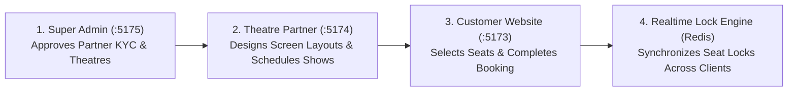

# Developer Onboarding & Local Setup Guide

Welcome to the **BookMyShow Distributed Movie Ticket Booking Platform** monorepo! This comprehensive guide walks any new developer through prerequisites, environment configuration, database setup, dependency installation, seeding, running the applications, and troubleshooting common issues.

---

## 1. System Architecture & Applications

The platform is organized as a monorepo containing **1 Backend API Gateway** and **3 React Frontend Applications**:

| Application | Technology | Directory | Default URL | Purpose |
| :--- | :--- | :--- | :--- | :--- |
| **Backend API Gateway** | Node.js 20+, Express, Mongoose, Redis, Socket.IO | `apps/backend/` | `http://localhost:5000` | Core REST APIs, WebSocket seat locks, payments, auth |
| **Customer Web Application** | React 18, Vite, Tailwind CSS, TanStack Query | `apps/customer-frontend/` | `http://localhost:5173` | Public movie discovery, seat selection, booking, tickets |
| **Theatre Partner Dashboard** | React 18, Vite, Tailwind CSS, Zustand | `apps/theatre-dashboard/` | `http://localhost:5174` | Exhibitor portal: screen layouts, show scheduling, revenue |
| **Super Admin Control Tower** | React 18, Vite, Tailwind CSS, TanStack Query | `apps/admin-dashboard/` | `http://localhost:5175` | Platform governance, KYC approvals, catalog, settlements |

### Additional Developer Endpoints
- **Interactive Swagger API Docs**: [http://localhost:5000/api/v1/docs](http://localhost:5000/api/v1/docs)
- **API Health Check**: [http://localhost:5000/api/v1/health](http://localhost:5000/api/v1/health)
- **Live System Metrics**: [http://localhost:5000/api/v1/health/metrics](http://localhost:5000/api/v1/health/metrics)

---

## 2. Prerequisites & System Requirements

Before running the project, ensure you have the following installed on your machine:

1. **Node.js**: `v20.x` or `v22.x` LTS recommended (`v18.x` minimum).
   - Verify: `node -v`
2. **npm**: `v10.x` or higher.
   - Verify: `npm -v`
3. **MongoDB**: `v7.0+` (Community Server or Docker container).
   - Default port: `27017`
   - Verify: `mongosh --eval "db.adminCommand('ping')"`
4. **Redis**: `v7.0+` (Redis Stack, Memurai on Windows, or Docker container).
   - Default port: `6379`
   - Verify: `redis-cli ping` (should output `PONG`)
5. **Git**: Installed for version control.
6. *(Optional)* **Docker & Docker Compose**: If you prefer running MongoDB and Redis in lightweight containers without installing them natively.

---

## 3. Quick Start (Automated One-Command Setup)

If you have Node.js, MongoDB, and Redis running, you can set up the entire project in 3 simple commands:

```bash
# 1. Install all dependencies across all 4 applications
npm run install:all

# 2. Seed development database with demo cities, theatres, screens, movies, and shows
npm run seed:dev

# 3. Start all 4 applications concurrently
npm run dev
```

All 4 applications will boot together. Open your browser to:
- Customer App: `http://localhost:5173`
- Partner Portal: `http://localhost:5174`
- Admin Tower: `http://localhost:5175`

---

## 4. Detailed Step-by-Step Setup

If you prefer to configure each component manually or are troubleshooting:

### Step 4.1: Clone the Repository
```bash
git clone <repository-url>
cd Bookmyshow
```

### Step 4.2: Configure Environment Variables (`.env`)

Every app contains a `.env.example` template. You need to create `.env` files for each app.

#### Windows (PowerShell):
```powershell
Copy-Item apps/backend/.env.example apps/backend/.env
Copy-Item apps/customer-frontend/.env.example apps/customer-frontend/.env
Copy-Item apps/theatre-dashboard/.env.example apps/theatre-dashboard/.env
Copy-Item apps/admin-dashboard/.env.example apps/admin-dashboard/.env
```

#### macOS / Linux (Bash):
```bash
cp apps/backend/.env.example apps/backend/.env
cp apps/customer-frontend/.env.example apps/customer-frontend/.env
cp apps/theatre-dashboard/.env.example apps/theatre-dashboard/.env
cp apps/admin-dashboard/.env.example apps/admin-dashboard/.env
```

#### Key Backend Variables (`apps/backend/.env`):
```dotenv
PORT=5000
API_PREFIX=/api/v1
MONGODB_URI=mongodb://localhost:27017/bookmyshow_dev
REDIS_URL=redis://localhost:6379
JWT_ACCESS_SECRET=development_jwt_access_secret_super_secure_and_long_enough_for_dev_32char
JWT_REFRESH_SECRET=development_jwt_refresh_secret_super_secure_and_long_enough_for_dev_32char
RAZORPAY_KEY_ID=rzp_test_mockKeyId12345678
RAZORPAY_KEY_SECRET=rzp_test_mockSecret12345678
EMAIL_PROVIDER=mock
SMS_PROVIDER=mock
```

---

### Step 4.3: Start MongoDB & Redis

You need both MongoDB and Redis running for the backend to start. Choose **Option A** (Docker) or **Option B** (Local Services):

#### Option A: Using Docker (Recommended for quick setup)
A ready-to-use `docker-compose.yml` is included in the project root:
```bash
# Start MongoDB and Redis containers in the background
docker compose up -d mongodb redis
```
To verify containers are healthy:
```bash
docker compose ps
```

#### Option B: Using Native Local Services
- **MongoDB**: Start MongoDB Community Service:
  - *Windows*: Open `services.msc` and verify `MongoDB Server` is Running.
  - *macOS*: `brew services start mongodb-community@7.0`
  - *Linux*: `sudo systemctl start mongod`
- **Redis**:
  - *Windows*: Run `redis-server` (or Memurai Service).
  - *macOS*: `brew services start redis`
  - *Linux*: `sudo systemctl start redis-server`

---

### Step 4.4: Install Dependencies

Run the monorepo root installer:
```bash
npm run install:all
```

Alternatively, install individually:
```bash
cd apps/backend && npm install
cd ../customer-frontend && npm install
cd ../theatre-dashboard && npm install
cd ../admin-dashboard && npm install
cd ../..
```

---

### Step 4.5: Seed Demo Data & Admin Accounts

The database seed script initializes all required roles, platform catalogs, demo cinema complexes, seating layouts, movies, and shows:

```bash
npm run seed:dev
```

This provisions:
- **Mumbai City** with active status.
- **Master Catalogs**: Action, Sci-Fi, Drama genres + English, Hindi languages.
- **Movies**: *Dune: Part Two* (IMAX 2D/3D) and *Oppenheimer*.
- **Exhibitor**: PVR INOX Ltd partner entity with approved KYC.
- **Complex & Screen**: *PVR INOX Phoenix Palladium* with *Audi 1* (50-seat layout across Recliner, Prime, and Classic tiers).
- **Scheduled Shows**: Active shows scheduled with dynamic pricing tiers.

---

## 5. Pre-Configured Test Accounts

Use these pre-seeded credentials to test each portal:

| Role | Email | Password | Allowed Portals | Permissions / Scope |
| :--- | :--- | :--- | :--- | :--- |
| **Super Admin** | `admin@bookmyshow.clone` | `SuperAdmin@Secure2026!` | Admin Control Tower (`:5175`) | Full platform governance, partner KYC approval, commissions |
| **Theatre Owner** | `owner@pvr.com` | `Owner@Secure2026!` | Theatre Partner Portal (`:5174`) | Theatres, screens, seating designer, show schedules, revenue |
| **Customer** | `customer@gmail.com` | `Customer@Secure2026!` | Customer Web App (`:5173`) | Browse movies, select seats, book tickets, view orders |

> [!NOTE]
> **RBAC Boundary Enforcement**:
> Logging into the **Theatre Partner Dashboard** (`:5174`) with customer credentials will be rejected with:
> `"Access restricted. This portal is exclusively for Theatre Partners and Operations Staff."`
> Always use `owner@pvr.com` on `:5174`.

---

## 6. Running the Applications

### Method 1: Concurrent Runner (Single Terminal)
Runs all 4 services concurrently with synchronized logging:
```bash
npm run dev
```

### Method 2: Separate Terminals (Recommended for active debugging)
Open 4 terminal tabs:

```bash
# Terminal 1: Backend API Gateway
npm run dev:backend
# Starts Express server at http://localhost:5000 with nodemon auto-restart

# Terminal 2: Customer Web App
npm run dev:customer
# Starts Vite dev server at http://localhost:5173

# Terminal 3: Theatre Partner Dashboard
npm run dev:theatre
# Starts Vite dev server at http://localhost:5174

# Terminal 4: Super Admin Control Tower
npm run dev:admin
# Starts Vite dev server at http://localhost:5175
```

---

## 7. Verifying End-to-End User Journeys

Once all applications are running, verify the primary user flows:



### 1. Customer Booking Journey (`http://localhost:5173`)
1. Visit `http://localhost:5173` and log in with `customer@gmail.com` / `Customer@Secure2026!`.
2. Select **Mumbai** as your city.
3. Click on **Dune: Part Two** or **Oppenheimer**.
4. Choose an available showtime.
5. In the interactive SVG seat layout, select your seats (notice Redis holding a 5-minute atomic lock).
6. Proceed to checkout and confirm with Mock Razorpay payment.
7. View your generated digital ticket with a valid QR code in **My Bookings**.

### 2. Theatre Partner Operations (`http://localhost:5174`)
1. Visit `http://localhost:5174` and log in with `owner@pvr.com` / `Owner@Secure2026!`.
2. Inspect the **Executive Dashboard** with live occupancy charts and ticket sales trends.
3. Navigate to **Auditorium Screens** -> **Seat Layout** to view or customize the interactive grid builder.
4. Navigate to **Show Schedule** to view scheduled shows or schedule new ones.
5. Inspect **Revenue & Settlements** to review settlement statements.

### 3. Super Admin Management (`http://localhost:5175`)
1. Visit `http://localhost:5175` and log in with `admin@bookmyshow.clone` / `SuperAdmin@Secure2026!`.
2. Review pending theatre owner onboarding applications in **Partners KYC**.
3. Manage global movies, genres, and languages in **Catalog Management**.
4. Inspect real-time platform bookings, revenue commissions, and audit logs.

---

## 8. Running Automated Tests & Code Quality

The repository features comprehensive automated test suites covering controllers, business logic, transactions, and UI components:

```bash
# Run all test suites across the monorepo
npm test

# Run backend test suite (81 Jest test suites, 625 tests)
npm run test:backend

# Run frontend test suites (Vitest)
npm run test:customer
npm run test:theatre
npm run test:admin

# Run linter
npm run lint

# Build all applications for production verification
npm run build
```

---

## 9. Troubleshooting & FAQ

### Q1: `Operation users.findOne() buffering timed out after 10000ms`
- **Cause**: The backend cannot connect to MongoDB.
- **Solution**:
  1. Check if MongoDB is running: `mongosh --eval "db.adminCommand('ping')"`
  2. If using Docker: `docker compose up -d mongodb`
  3. Ensure `MONGODB_URI=mongodb://localhost:27017/bookmyshow_dev` in `apps/backend/.env`.

### Q2: `ECONNREFUSED 127.0.0.1:6379` (Redis Error)
- **Cause**: Redis server is not started or port 6379 is blocked.
- **Solution**:
  1. Test Redis: `redis-cli ping`
  2. If using Docker: `docker compose up -d redis`
  3. Ensure `REDIS_URL=redis://localhost:6379` in `apps/backend/.env`.

### Q3: `EADDRINUSE: address already in use :::5000` (or 5173, 5174, 5175)
- **Cause**: A previous process is still occupying the port.
- **Solution (Windows PowerShell)**:
  ```powershell
  # Find PID using the port
  Get-NetTCPConnection -LocalPort 5000 | Select-Object OwningProcess
  # Terminate process
  Stop-Process -Id <PID> -Force
  ```
- **Solution (macOS / Linux)**:
  ```bash
  lsof -ti :5000 | xargs kill -9
  ```

### Q4: "Access restricted. This portal is exclusively for Theatre Partners..."
- **Cause**: You are attempting to log into the Theatre Partner Dashboard (`:5174`) using a customer account (`customer@gmail.com`).
- **Solution**: Use `owner@pvr.com` / `Owner@Secure2026!` on port 5174.

### Q5: Payments failing in Customer App
- **Cause**: Razorpay keys in `apps/backend/.env` are mock/test keys.
- **Solution**: The backend runs in mock mode when `RAZORPAY_KEY_ID=rzp_test_...` is supplied, simulating immediate checkout confirmation without charging real cards.

---

## 10. Monorepo Directory Structure

```text
Bookmyshow/
├── apps/
│   ├── backend/                     # Node.js Express REST & WebSocket API
│   │   ├── src/
│   │   │   ├── config/              # Database, Redis, Logger, Environment setup
│   │   │   ├── middlewares/         # Auth, RBAC, Rate Limiting, Error handlers
│   │   │   ├── modules/             # Modular monolith business domains:
│   │   │   │   ├── auth/            # Authentication, JWT tokens, Partner KYC
│   │   │   │   ├── users/           # User profiles & account operations
│   │   │   │   ├── theatres/        # Theatres, branches, cities
│   │   │   │   ├── screens/         # Screens, seat categories, layout builder
│   │   │   │   ├── movies/          # Movies, genres, languages, censors
│   │   │   │   ├── shows/           # Shows, scheduling, dynamic pricing
│   │   │   │   ├── bookings/        # Atomic seat locks, booking engine
│   │   │   │   ├── payments/        # Razorpay integration & webhook handlers
│   │   │   │   ├── settlements/     # Theatre owner financial settlements
│   │   │   │   └── analytics/       # Platform & exhibitor telemetry
│   │   │   └── scripts/             # seed-dev.js & admin initialization
│   │   └── tests/                   # 81 Jest unit & integration test suites
│   │
│   ├── customer-frontend/           # Customer Web Application (Port 5173)
│   │   └── src/
│   │       ├── components/          # Reusable UI, Navbar, Modals
│   │       ├── features/            # Movies, Shows, Seat Selection, Checkout
│   │       ├── hooks/               # TanStack Query & WebSocket hooks
│   │       └── store/               # Redux / Context client state
│   │
│   ├── theatre-dashboard/           # Theatre Partner Portal (Port 5174)
│   │   └── src/
│   │       ├── components/          # Recharts visualizations, Data tables
│   │       ├── features/            # Layout designer, Show schedule, Revenue
│   │       └── store/               # Zustand auth & theatre context store
│   │
│   └── admin-dashboard/             # Super Admin Control Tower (Port 5175)
│       └── src/
│           ├── components/          # Data grids, approval dialogs, metric cards
│           └── features/            # KYC Approvals, Catalog, Audit logs
│
├── docs/                            # Architectural specs & technical documentation
├── docker-compose.yml               # Multi-container orchestration (MongoDB + Redis)
├── package.json                     # Monorepo root scripts & workspace config
└── GETTING_STARTED.md               # This onboarding guide
```

---

## 11. Useful Commands Cheat Sheet

| Task | Command |
| :--- | :--- |
| **Install Everything** | `npm run install:all` |
| **Seed Database** | `npm run seed:dev` |
| **Start All Apps (Concurrent)** | `npm run dev` |
| **Start Backend Only** | `npm run dev:backend` |
| **Start Customer App Only** | `npm run dev:customer` |
| **Start Theatre Portal Only** | `npm run dev:theatre` |
| **Start Admin Portal Only** | `npm run dev:admin` |
| **Run All Tests** | `npm test` |
| **Run Production Build** | `npm run build` |
| **Start Docker Services** | `docker compose up -d mongodb redis` |
| **Stop Docker Services** | `docker compose down` |

