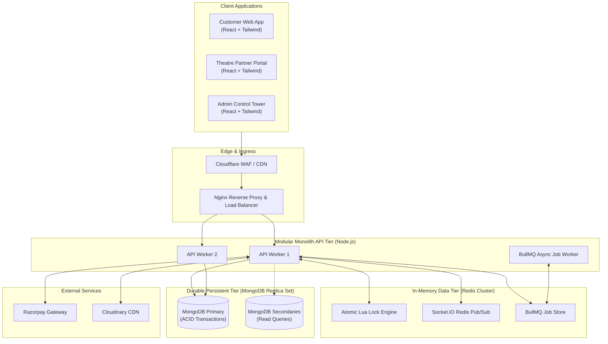

# Corporate Movie Ticket Booking Platform (BookMyShow Clone)

> **Enterprise Distributed Systems Architecture & Technical Blueprint (Part 1 Deliverable)**

An enterprise-grade, high-concurrency movie ticket booking platform inspired by BookMyShow. The platform is engineered to support multi-city operations, multi-tenant cinema partners, dynamic screen layouts, real-time seat lock synchronization, and secure online payments while maintaining strict inventory invariance (zero double-booking guarantees).

---

## 1. Executive Summary & Core Value Proposition

The platform bridges three foundational user experiences through a unified high-throughput backend:
1. **Customer Web Application**: Geolocation-aware movie discovery, dynamic multi-facet filtering, real-time SVG seat selection with sub-second lock state reflection, Razorpay online payments, instant digital QR ticket issuance, and self-service cancellations.
2. **Theatre Partner Portal**: Multi-cinema onboarding, dynamic visual seating layout designer (supporting regular and irregular seat grids, walkways, wheelchair access, and custom pricing tiers), show scheduling, live box office monitoring, and gatekeeper QR scanning for staff.
3. **Super Admin Control Tower**: Ecosystem-wide governance, master catalog management (cities, movies, genres, languages), partner KYC approval/rejection, commission configuration, financial dispute reconciliation, and immutable audit logs.

---

## 2. Technology Stack

| Layer | Technologies Selected | Architectural Rationale |
| :--- | :--- | :--- |
| **Frontend Applications** | React.js 18, Tailwind CSS, React Router v6 | Concurrent rendering, virtual DOM for complex seat visualizers, utility-first styling. |
| **Frontend State & Data** | TanStack Query (React Query v5), Redux Toolkit, Axios | Decoupled server-state caching (Stale-While-Revalidate) from transient client-state (session, lock timers). |
| **Backend Runtime & Framework** | Node.js 20+ LTS, Express.js | Non-blocking event-driven I/O, mature ecosystem, modular monolith service encapsulation. |
| **Primary Operational Datastore** | MongoDB 7.0+ Replica Set (via Mongoose) | Flexible document modeling for irregular screen layouts, ACID multi-document transactions for booking commits. |
| **In-Memory Cache & Lock Store**| Redis 7.2+ Cluster | Sub-millisecond distributed atomic seat locking via custom Lua scripts, sliding-window rate limiting. |
| **Realtime Synchronization** | Socket.IO with Redis Adapter | Bi-directional room-based event broadcasting (`show:<showId>`) scaled horizontally across API instances. |
| **Payment Rails** | Razorpay Payment Gateway | Indian/Global payment rails (UPI, Cards, NetBanking), cryptographic HMAC webhook verification, automated refunds. |
| **Media & Asset CDN** | Cloudinary | Direct-from-client signed asset uploads (posters, banners, KYC documents) and on-the-fly transformations. |
| **Validation & Security** | Zod, Argon2id, Helmet, Express-Mongo-Sanitize | Runtime schema validation, memory-hard password hashing, NoSQL injection and XSS defenses. |
| **Asynchronous Jobs & Queues**| BullMQ (Redis-backed) | Background queue for ticket PDF generation, cryptographic QR payload generation, email/SMS dispatch. |
| **Observability & Logging** | Pino / Winston, Prometheus, Grafana, Sentry | Structured JSON logging with request tracing, application telemetry, and centralized error monitoring. |
| **DevOps & Infrastructure** | Docker, Multi-Stage Builds, Nginx, GitHub Actions | Zero-downtime Blue-Green deployments, reverse proxy SSL termination, automated CI/CD quality gates. |

---

## 3. High-Level System Architecture



---

## 4. Master Architectural Documentation Index

Every component of the system has been documented in extreme detail inside the `docs/` directory:

1. [01. Project Overview & System Vision](file:///d:/YASH%20KACHA/Bookmyshow/docs/01-project-overview.md)
   - Scope, user personas, technology selection rationale, and modular monolith architectural philosophy.
2. [02. Functional Requirements Specification](file:///d:/YASH%20KACHA/Bookmyshow/docs/02-functional-requirements.md)
   - Granular breakdown of Customer, Theatre Partner, and Super Admin capabilities and workflows.
3. [03. End-to-End System Architecture](file:///d:/YASH%20KACHA/Bookmyshow/docs/03-system-architecture.md)
   - Complete architectural blueprints for Frontend, Backend, MongoDB, Redis, Sockets, Payments, File Storage, and Notifications.
4. [04. Database Planning & Data Architecture](file:///d:/YASH%20KACHA/Bookmyshow/docs/04-database-planning.md)
   - 23 MongoDB collections documented with field types, unique constraints, compound indexes, ownership rules, and performance analysis.
5. [05. User Roles, Permissions & Multi-Tenant Access Control](file:///d:/YASH%20KACHA/Bookmyshow/docs/05-user-roles-permissions.md)
   - RBAC matrix across 5 roles, tenant data isolation strategy, and BOLA/IDOR mitigation pipelines.
6. [06. Core Business Workflows & Sequence Specifications](file:///d:/YASH%20KACHA/Bookmyshow/docs/06-business-workflows.md)
   - Step-by-step sequence diagrams for 12 critical workflows (A through L) covering registration, layout building, seat locking, checkout, and refunds.
7. [07. Critical Booking Engine & Concurrency Control Design](file:///d:/YASH%20KACHA/Bookmyshow/docs/07-booking-engine-design.md)
   - Redis Lua atomic scripts, two-phase reservation, idempotency, and exhaustive analysis of all 7 critical failure edge cases.
8. [08. API Architecture & Interface Specifications](file:///d:/YASH%20KACHA/Bookmyshow/docs/08-api-architecture.md)
   - REST URI taxonomy, standardized success/error envelopes, Zod validation pipelines, and tiered sliding-window rate limiting.
9. [09. Enterprise Security Architecture & Hardening](file:///d:/YASH%20KACHA/Bookmyshow/docs/09-security-architecture.md)
   - Argon2id hashing, dual-token rotation in HttpOnly cookies, NoSQL injection defenses, and zero-PCI payment tokenization.
10. [10. Enterprise Monorepo & Backend Modular Architecture](file:///d:/YASH%20KACHA/Bookmyshow/docs/10-folder-structure.md)
    - Monorepo folder tree and the standardized 7-layer domain module structure (`model`, `controller`, `service`, `repository`, `routes`, `validation`, `tests`).
11. [11. Deployment, Infrastructure & Non-Functional Engineering](file:///d:/YASH%20KACHA/Bookmyshow/docs/11-deployment-architecture.md)
    - Multi-stage Dockerfiles, production topology, CI/CD with GitHub Actions, observability, and proposed measurable non-functional targets.
12. [12. Development Roadmap, Architecture Decisions & Dependency Map](file:///d:/YASH%20KACHA/Bookmyshow/docs/12-development-roadmap.md)
    - 11-phase implementation roadmap, dependency graph, 8 Architectural Decision Records (ADRs), risk management matrix, and Part 1 completion checklist.

---

## 5. Master Database Architecture Documentation Index (Part 2 Deliverables)

The complete enterprise database architecture and Mongoose schema specifications are organized in `docs/database/`:

1. [01. Collection Inventory & Architectural Rationale](file:///d:/YASH%20KACHA/Bookmyshow/docs/database/01-collection-inventory.md)
   - 24 normalized and hybrid collections, rationale for pruning redundant candidate models, and lifecycle policies.
2. [02. Users, Authentication & Access Control Schema](file:///d:/YASH%20KACHA/Bookmyshow/docs/database/02-users-and-auth-schema.md)
   - Schemas for `users`, `roles`, `permissions`, `role_permissions`, `refresh_tokens`, and `otp_verifications`.
3. [03. Geographical & Location Master Schema](file:///d:/YASH%20KACHA/Bookmyshow/docs/database/03-location-schema.md)
   - Schemas for `countries`, `states`, and `cities` with GeoJSON `2dsphere` coordinates.
4. [04. Movie Catalog & Review Subsystem Schema](file:///d:/YASH%20KACHA/Bookmyshow/docs/database/04-movie-schema.md)
   - Schemas for `movies`, `genres`, `languages`, and verified viewer `movie_reviews` with embedded cast and media.
5. [05. Theatre & Screen Subsystem Schema](file:///d:/YASH%20KACHA/Bookmyshow/docs/database/05-theatre-and-screen-schema.md)
   - Multi-tenant schemas for `theatre_partners`, `theatres` (cinema multiplexes), and `screens`.
6. [06. Seating Layout, Seat Categories & Auditorium Grid Schema](file:///d:/YASH%20KACHA/Bookmyshow/docs/database/06-seating-layout-schema.md)
   - Schemas for `seat_categories` and `seats`, featuring immutable layout versioning (`layoutVersion`).
7. [07. Show Scheduling, Dynamic Pricing & Overlap Prevention](file:///d:/YASH%20KACHA/Bookmyshow/docs/database/07-show-schema.md)
   - Schemas for `shows` and operational `show_seats`, plus the interval collision detection formula.
8. [08. Booking Management Subsystem Schema](file:///d:/YASH%20KACHA/Bookmyshow/docs/database/08-booking-schema.md)
   - Architectural evaluation of embedded vs. separated seat items, `bookings` schema, and denormalized snapshots.
9. [09. Payment Gateway, Refunds & Webhook Audit Schema](file:///d:/YASH%20KACHA/Bookmyshow/docs/database/09-payment-schema.md)
   - Zero PCI-DSS compliance, schemas for `payments`, `refunds`, and idempotent `payment_webhooks`.
10. [10. Coupons, Promotions & Redemption Ledger Schema](file:///d:/YASH%20KACHA/Bookmyshow/docs/database/10-coupon-and-promotion-schema.md)
    - Anti-abuse double-spending guards, schemas for `coupons` and ledger `coupon_redemptions`.
11. [11. Customer Engagement, Platform Governance & Audit Schema](file:///d:/YASH%20KACHA/Bookmyshow/docs/database/11-notification-and-audit-schema.md)
    - Schemas for `wishlists`, `notifications`, append-only `audit_logs`, and singleton `platform_settings`.
12. [12. Entity Relationship Diagrams & Data Association Models](file:///d:/YASH%20KACHA/Bookmyshow/docs/database/12-relationship-diagrams.md)
    - Granular association mappings, cardinality, and application-level referential integrity cascade policies.
13. [13. Comprehensive Database Indexing Strategy & Performance Tuning](file:///d:/YASH%20KACHA/Bookmyshow/docs/database/13-indexing-strategy.md)
    - Equality-Sort-Range (ESR) rules, unique, compound, partial, TTL, text, and 2dsphere index specifications.
14. [14. MongoDB Multi-Document ACID Transaction Strategy](file:///d:/YASH%20KACHA/Bookmyshow/docs/database/14-transaction-strategy.md)
    - Strict transaction boundaries, exponential jittered retry wrappers, and rollback guarantees.
15. [15. Multi-Tenant Database Architecture & Isolation Controls](file:///d:/YASH%20KACHA/Bookmyshow/docs/database/15-multi-tenant-database-design.md)
    - Shared database with discriminator `partnerId`, repository-level isolation guards, and BOLA/IDOR prevention.
16. [16. Seat Double-Booking Prevention & Durable Consistency Design](file:///d:/YASH%20KACHA/Bookmyshow/docs/database/16-booking-consistency-design.md)
    - MongoDB as durable ground truth, atomic conditional transitions, and solutions for all 7 critical edge cases.
17. [17. Database Performance, Scalability & Lifecycle Management](file:///d:/YASH%20KACHA/Bookmyshow/docs/database/17-performance-and-scalability.md)
    - Keyset cursor pagination vs. offset pagination, aggregation pipelines, connection pooling, and sharding roadmap.
18. [18. Database Security, Hardening & Compliance Architecture](file:///d:/YASH%20KACHA/Bookmyshow/docs/database/18-database-security.md)
    - Least privilege database users, TLS 1.3, AES-256 field encryption for bank details, Argon2id, and DPDP/GDPR.
19. [Complete Mermaid Entity Relationship Diagram](file:///d:/YASH%20KACHA/Bookmyshow/docs/database/ERD.mmd)
    - Master visual ER diagram covering all collections, foreign keys, and cardinalities.
20. [19. Database Architecture Review Report & Readiness Audit](file:///d:/YASH%20KACHA/Bookmyshow/docs/database/19-database-review-report.md)
    - Formal review report, risk mitigations, ADR summary, and Part 2 sign-off checklist.

---

## 6. Backend Foundation & Infrastructure Architecture (Part 3 Deliverables)

The core backend foundation, configuration pipelines, and test suites are documented in `docs/backend/`:

1. [01. Backend Foundation & Initial Project Setup](file:///d:/YASH%20KACHA/Bookmyshow/docs/backend/01-backend-setup.md)
   - ES Modules configuration, dependency matrix, npm scripts, and tooling standards.
2. [02. Backend Modular Folder Structure](file:///d:/YASH%20KACHA/Bookmyshow/docs/backend/02-folder-structure.md)
   - Detailed layout of `apps/backend/` and 7-layer architectural separation of concerns.
3. [03. Centralized Environment Configuration](file:///d:/YASH%20KACHA/Bookmyshow/docs/backend/03-environment-configuration.md)
   - Fail-fast Zod schema parsing, variable dictionary, and secret protection.
4. [04. Express Application Architecture & Pipeline](file:///d:/YASH%20KACHA/Bookmyshow/docs/backend/04-express-architecture.md)
   - Deterministic 11-step middleware execution pipeline and separation of `app.js` from `server.js`.
5. [05. Centralized Error Handling & Exception Taxonomy](file:///d:/YASH%20KACHA/Bookmyshow/docs/backend/05-error-handling.md)
   - Standard error response envelopes, custom error class hierarchy, and Mongoose error mappers.
6. [06. Standard API Response Formats & Pagination](file:///d:/YASH%20KACHA/Bookmyshow/docs/backend/06-api-response-standards.md)
   - Static `ApiResponse` builders, success envelopes, and `PaginationMeta` calculations.
7. [07. MongoDB Connection Architecture](file:///d:/YASH%20KACHA/Bookmyshow/docs/backend/07-database-connection.md)
   - Connection pool management (`maxPoolSize: 50`), lifecycle listeners, and ping probes.
8. [08. Redis Connection Architecture](file:///d:/YASH%20KACHA/Bookmyshow/docs/backend/08-redis-connection.md)
   - `ioredis` client configuration, exponential backoff reconnection, and cache roles.
9. [09. Structured Logging System & Telemetry](file:///d:/YASH%20KACHA/Bookmyshow/docs/backend/09-logging-system.md)
   - Low-overhead Pino logging, mandatory PII/credential redactions, and request ID correlation.
10. [10. Security Middleware Foundation](file:///d:/YASH%20KACHA/Bookmyshow/docs/backend/10-security-foundation.md)
    - Helmet security headers, CORS origin whitelisting, payload size bounding, and sliding rate limiters.
11. [11. Request Validation Infrastructure with Zod](file:///d:/YASH%20KACHA/Bookmyshow/docs/backend/11-validation-system.md)
    - Reusable `validate` middleware parsing request bodies, params, and queries with field-level diagnostics.
12. [12. System Health, Readiness & Liveness Architecture](file:///d:/YASH%20KACHA/Bookmyshow/docs/backend/12-health-checks.md)
    - Health endpoints: `/api/v1/health`, `/api/v1/health/live`, `/api/v1/health/ready`.
13. [13. Interactive Swagger & OpenAPI 3.0 Documentation](file:///d:/YASH%20KACHA/Bookmyshow/docs/backend/13-swagger-setup.md)
    - OpenAPI 3.0 documentation mounted at `/api/v1/docs` with `BearerAuth` security scheme.
14. [14. Real-time Socket.IO Foundation](file:///d:/YASH%20KACHA/Bookmyshow/docs/backend/14-socket-foundation.md)
    - Decoupled WebSocket server, handshake authentication integration hook, and event constants.
15. [15. Graceful Server Shutdown & Process Lifecycle](file:///d:/YASH%20KACHA/Bookmyshow/docs/backend/15-graceful-shutdown.md)
    - Coordinated draining of HTTP connections, Socket.IO, Redis, and MongoDB with a 10s failsafe timer.
16. [16. Docker Containerization & Local Compose](file:///d:/YASH%20KACHA/Bookmyshow/docs/backend/16-docker-setup.md)
    - Multi-stage Alpine Dockerfile, non-root user execution, and multi-service `docker-compose.yml`.
17. [17. Automated Testing Strategy & Jest Test Harness](file:///d:/YASH%20KACHA/Bookmyshow/docs/backend/17-testing-foundation.md)
    - Test execution commands, Supertest integration harness, and 100% passing test metrics (44 tests).
18. [18. Backend Foundation Review Report & Readiness Audit](file:///d:/YASH%20KACHA/Bookmyshow/docs/backend/18-backend-foundation-review.md)
    - Final review report, verified endpoints, security checklist, and Part 3 sign-off audit.

---

## 7. Master Authentication & Security Documentation Index (Part 4 Deliverables)

All identity, authorization, session, and security mechanics are documented in `docs/auth/`:

1. [01. Authentication Architecture](file:///d:/YASH%20KACHA/Bookmyshow/docs/auth/01-authentication-architecture.md)
   - Stateless JWT with stateful session invalidation, module boundaries, and high-level workflow.
2. [02. Registration Workflow](file:///d:/YASH%20KACHA/Bookmyshow/docs/auth/02-registration-workflow.md)
   - Retail customer onboarding and theatre partner KYC registration with `PENDING_APPROVAL` status.
3. [03. Login Workflow](file:///d:/YASH%20KACHA/Bookmyshow/docs/auth/03-login-workflow.md)
   - Email/mobile resolution, bcrypt password verification, account status evaluation, and anti-enumeration.
4. [04. JWT Token Strategy](file:///d:/YASH%20KACHA/Bookmyshow/docs/auth/04-jwt-token-strategy.md)
   - Access token (15m in memory) vs Refresh token (7d in HttpOnly cookie), payload claims, signing algorithms.
5. [05. Refresh Token Rotation & Family Reuse Detection](file:///d:/YASH%20KACHA/Bookmyshow/docs/auth/05-refresh-token-rotation.md)
   - Single-use policy, token family tracking (`familyId`), reuse compromise detection, and cascade revocation.
6. [06. Session Management](file:///d:/YASH%20KACHA/Bookmyshow/docs/auth/06-session-management.md)
   - `user_sessions` schema, active session enumeration, targeted/bulk revocation, and MongoDB TTL indexing.
7. [07. OTP Verification Architecture](file:///d:/YASH%20KACHA/Bookmyshow/docs/auth/07-otp-verification.md)
   - Email & SMS notification providers, SHA-256 OTP hashing, 60s cooldown, and 5-attempt throttling.
8. [08. Password Management Lifecycle](file:///d:/YASH%20KACHA/Bookmyshow/docs/auth/08-password-management.md)
   - Bcrypt 12 rounds, strong complexity rules, anti-enumeration forgot password, reset and change flows.
9. [09. Role-Based Access Control (RBAC) Design](file:///d:/YASH%20KACHA/Bookmyshow/docs/auth/09-rbac-design.md)
   - 5 canonical platform roles (`CUSTOMER`, `THEATRE_STAFF`, `THEATRE_MANAGER`, `THEATRE_OWNER`, `SUPER_ADMIN`).
10. [10. Role-Permission Matrix](file:///d:/YASH%20KACHA/Bookmyshow/docs/auth/10-permission-matrix.md)
    - 23 discrete permissions mapped to roles with `authorizePermission()` middleware enforcement.
11. [11. Multi-Tenant Authorization & Boundary Isolation](file:///d:/YASH%20KACHA/Bookmyshow/docs/auth/11-multi-tenant-authorization.md)
    - `requireTenantScope()` middleware preventing cross-tenant BOLA/IDOR data access.
12. [12. Security Architecture & Threat Mitigations](file:///d:/YASH%20KACHA/Bookmyshow/docs/auth/12-security-architecture.md)
    - OWASP Top 10 mitigations, tamper-proof append-only `audit_logs`, and rate limiting.
13. [13. API Documentation: Auth & Users](file:///d:/YASH%20KACHA/Bookmyshow/docs/auth/13-api-documentation.md)
    - Full reference for all 18 authentication and user management REST endpoints with payloads.
14. [14. Authentication Testing Report](file:///d:/YASH%20KACHA/Bookmyshow/docs/auth/14-testing-report.md)
    - Complete report on 17 test suites, 116 tests passing, edge cases, and test breakdown.
15. [15. Authentication Review & Architectural Compliance Report](file:///d:/YASH%20KACHA/Bookmyshow/docs/auth/15-authentication-review-report.md)
    - Final Part 4 sign-off audit and readiness verification for Part 5.

---

## 8. Master Movie Management Documentation Index (Part 5 Deliverables)

The movie catalog, taxonomy, media handling, and administrative approval pipelines are documented in `docs/movies/`:

1. [01. Movie Management Module Overview](file:///d:/YASH%20KACHA/Bookmyshow/docs/movies/01-movie-module-overview.md)
   - Module scope, architecture, core entities, and layered service-repository design.
2. [02. Movie Database Design & Schemas](file:///d:/YASH%20KACHA/Bookmyshow/docs/movies/02-movie-database-design.md)
   - Mongoose schemas for `movies`, `genres`, and `languages`, indexing strategy, and denormalized `genreSlugs`.
3. [03. Business Rules, Lifecycle & Invariants](file:///d:/YASH%20KACHA/Bookmyshow/docs/movies/03-movie-business-rules.md)
   - Status state machine transitions, dynamic theatrical status derivation, and referential deletion protection.
4. [04. Movie REST API Documentation](file:///d:/YASH%20KACHA/Bookmyshow/docs/movies/04-movie-api-documentation.md)
   - Complete specifications for all 19 public and administrative movie, genre, and language endpoints.
5. [05. Role-Based Access Control (RBAC) & Permissions](file:///d:/YASH%20KACHA/Bookmyshow/docs/movies/05-movie-permissions.md)
   - Permissions matrix, role boundaries for Theatre Owners vs Super Admins, and middleware guards.
6. [06. Media Management Architecture](file:///d:/YASH%20KACHA/Bookmyshow/docs/movies/06-movie-media-management.md)
   - Cloud storage abstraction, 5MB image limits, aspect ratios, and external video streaming validation.
7. [07. Search, Multi-Facet Filtering & Pagination](file:///d:/YASH%20KACHA/Bookmyshow/docs/movies/07-movie-search-filter-pagination.md)
   - Text search indexes, regex sanitization, multi-facet query construction, and pagination boundaries.
8. [08. Movie Module Testing & QA Report](file:///d:/YASH%20KACHA/Bookmyshow/docs/movies/08-movie-testing-report.md)
   - Detailed breakdown of 5 dedicated test suites (44 tests) and 160 total passing tests across 22 suites.
9. [09. Security Review & Threat Assessment](file:///d:/YASH%20KACHA/Bookmyshow/docs/movies/09-movie-security-review.md)
   - OWASP API 2023 threat assessment, NoSQL injection defenses, and mass assignment mitigation.
10. [10. Movie Module Final Review & Sign-Off Report](file:///d:/YASH%20KACHA/Bookmyshow/docs/movies/10-movie-module-review-report.md)
    - Architecture sign-off, transition readiness for Part 6, and completion summary.

---

## 9. Master Theatre & Branch Management Documentation Index (Part 6 Deliverables)

The multi-tenant cinema complex, branch management, geospatial search, and compliance approval pipelines are documented in `docs/theatres/`:

1. [01. Theatre & Branch Module Overview](file:///d:/YASH%20KACHA/Bookmyshow/docs/theatres/01-theatre-module-overview.md)
   - Module scope, architecture, core entities, and layered service-repository design.
2. [02. Theatre Database Design & Schemas](file:///d:/YASH%20KACHA/Bookmyshow/docs/theatres/02-theatre-database-design.md)
   - Mongoose schemas for `theatres` and `cities`, GeoJSON structures, compound indexes, and `2dsphere` spatial indexing.
3. [03. Theatre Registration & Compliance Lifecycle](file:///d:/YASH%20KACHA/Bookmyshow/docs/theatres/03-theatre-registration-workflow.md)
   - Onboarding sequence, validation invariants, status state machine, and audit trail protocols.
4. [04. Theatre Owner Permissions & Delegation Architecture](file:///d:/YASH%20KACHA/Bookmyshow/docs/theatres/04-theatre-owner-permissions.md)
   - RBAC matrix, operational boundaries, and staff/manager assignment workflows.
5. [05. Multi-Tenant Data Isolation & BOLA/IDOR Security](file:///d:/YASH%20KACHA/Bookmyshow/docs/theatres/05-multi-tenant-isolation.md)
   - Boundary isolation, server-side context derivation, query scoping, and anti-enumeration defenses.
6. [06. Cinema Branch Management Architecture](file:///d:/YASH%20KACHA/Bookmyshow/docs/theatres/06-branch-management.md)
   - Physical branch modeling, parent multiplex relationships, and dedicated branch endpoints.
7. [07. Super Admin Theatre Review & Governance Workflow](file:///d:/YASH%20KACHA/Bookmyshow/docs/theatres/07-theatre-admin-workflow.md)
   - Administrative review, approvals, rejections, suspensions, and anti-self approval guards.
8. [08. Location-Based Search & Geospatial Discovery](file:///d:/YASH%20KACHA/Bookmyshow/docs/theatres/08-theatre-location-search.md)
   - GeoJSON coordinate bounds, `2dsphere` spherical indexing, proximity queries (`$near`), and municipal filtering.
9. [09. Theatre & Branch Module API Documentation](file:///d:/YASH%20KACHA/Bookmyshow/docs/theatres/09-theatre-api-documentation.md)
   - Complete REST API specifications for all 28 Owner, Branch, Admin, Public, and City endpoints.
10. [10. Theatre & Branch Module Testing & Quality Report](file:///d:/YASH%20KACHA/Bookmyshow/docs/theatres/10-theatre-testing-report.md)
    - Full test report covering unit tests, integration tests, multi-tenant BOLA tests, and edge case coverage.
11. [11. Theatre Module Security Review & Threat Assessment](file:///d:/YASH%20KACHA/Bookmyshow/docs/theatres/11-theatre-security-review.md)
    - OWASP API 2023 evaluation, privilege escalation defense, and immutable audit logging.
12. [12. Theatre Module Final Review & Sign-Off Report](file:///d:/YASH%20KACHA/Bookmyshow/docs/theatres/12-theatre-module-review-report.md)
    - Final audit sign-off, transition readiness for Part 7, and completion summary.

---

## 10. Master Screen & Seat Layout Documentation Index (Part 7 Deliverables)

The complete specifications, schemas, 2D visual layout builder, validation engine, versioning architecture, and security reports are organized in `docs/screens/`:

1. [01. Screen & Seat Layout Management Overview](file:///d:/YASH%20KACHA/Bookmyshow/docs/screens/01-screen-management-overview.md)
   - Module scope, spatial architecture, auditorium specifications, and layered service design.
2. [02. Screen & Seat Layout Database Design](file:///d:/YASH%20KACHA/Bookmyshow/docs/screens/02-screen-database-design.md)
   - Schemas for `screens`, `seat_categories`, `seating_layouts`, and `seats` with compound unique constraints.
3. [03. Seat Category Management Architecture](file:///d:/YASH%20KACHA/Bookmyshow/docs/screens/03-seat-category-management.md)
   - Default platform categories (`REGULAR`, `EXECUTIVE`, `PREMIUM`, `RECLINER`, `WHEELCHAIR`) + tenant custom tiers with hex display colors.
4. [04. Seating Layout Architecture & Spatial Grid](file:///d:/YASH%20KACHA/Bookmyshow/docs/screens/04-seating-layout-architecture.md)
   - 2D coordinate matrix `(gridRow, gridCol)`, irregular layouts, variable row lengths, and walking aisle corridors.
5. [05. Seating Layout Validation Rules](file:///d:/YASH%20KACHA/Bookmyshow/docs/screens/05-layout-validation-rules.md)
   - Invariant validation engine: duplicate labels, coordinate overlaps, out-of-bound coordinates, and unmapped categories.
6. [06. Immutable Layout Versioning Architecture](file:///d:/YASH%20KACHA/Bookmyshow/docs/screens/06-layout-versioning.md)
   - Non-destructive auditorium renovations: lifecycle states (`DRAFT`, `PUBLISHED`, `DEPRECATED`), and zero corruptions to historical shows.
7. [07. Bulk Seat Generation Engine](file:///d:/YASH%20KACHA/Bookmyshow/docs/screens/07-bulk-seat-generation.md)
   - Declarative row specifications, algorithmic coordinate assignment, walking aisle gaps, and accessibility bay detection.
8. [08. Capacity Calculation Engine](file:///d:/YASH%20KACHA/Bookmyshow/docs/screens/08-capacity-calculation.md)
   - Capacity metrics: physical chairs, bookable inventory, blocked inventory, maintenance inventory, and category/row breakdowns.
9. [09. Screen & Seat Layout API Documentation](file:///d:/YASH%20KACHA/Bookmyshow/docs/screens/09-screen-api-documentation.md)
   - Complete REST API specifications across 21 endpoints covering screens, categories, layout drafts, preview, publication, and physical chairs.
10. [10. Multi-Tenant Security & BOLA Protection](file:///d:/YASH%20KACHA/Bookmyshow/docs/screens/10-multi-tenant-security.md)
    - Cryptographic token context derivation, anti-enumeration 404 responses, and strict multi-tenant boundary enforcement.
11. [11. Screen Module Testing & Quality Report](file:///d:/YASH%20KACHA/Bookmyshow/docs/screens/11-screen-testing-report.md)
    - Full test suite report covering unit tests, integration tests, multi-tenant BOLA tests, and edge case coverage.
12. [12. Screen Module Final Review & Sign-Off Report](file:///d:/YASH%20KACHA/Bookmyshow/docs/screens/12-screen-module-review-report.md)
    - Architectural review, requirement fulfillment matrix, and transition readiness for Part 8.

---

## 11. Master Show Management & Scheduling Documentation Index (Part 8 Deliverables)

The complete specifications, temporal interval collision formula, concurrency-safe screen locking, category pricing engine, and review reports are organized in `docs/shows/`:

1. [01. Show Management & Scheduling Module Overview](file:///d:/YASH%20KACHA/Bookmyshow/docs/shows/01-show-module-overview.md)
   - Module scope, architectural pillars, cross-domain bindings, and operational workflows.
2. [02. Show Database Design & Schemas](file:///d:/YASH%20KACHA/Bookmyshow/docs/shows/02-show-database-design.md)
   - Mongoose schemas for `shows` and `show_pricing`, denormalized snapshots, and compound indexes.
3. [03. Show Scheduling & Operational Workflow](file:///d:/YASH%20KACHA/Bookmyshow/docs/shows/03-show-scheduling-workflow.md)
   - Step-by-step sequence diagram for show scheduling, facility health checks, and duration calculations.
4. [04. Screen Interval Conflict Detection Engine](file:///d:/YASH%20KACHA/Bookmyshow/docs/shows/04-screen-conflict-detection.md)
   - Temporal collision formula `(Start_E < End_N) AND (End_E > Start_N)`, buffer handling, and reschedule self-exclusions.
5. [05. Concurrency & Race Condition Protection](file:///d:/YASH%20KACHA/Bookmyshow/docs/shows/05-concurrency-and-race-condition-protection.md)
   - Two-tier concurrency defense: distributed Redis screen mutex with 10s auto-expiry & atomic Lua release + MongoDB ACID transactions.
6. [06. Show Pricing Management](file:///d:/YASH%20KACHA/Bookmyshow/docs/shows/06-show-pricing-management.md)
   - Category-to-layout invariance rule, base price, convenience fees, GST computation, and effective price formula.
7. [07. Show Publishing and Cancellation Workflows](file:///d:/YASH%20KACHA/Bookmyshow/docs/shows/07-show-publishing-and-cancellation.md)
   - Show lifecycle state machine, pre-publication checklist, mandatory cancellation reasons, and future refund trigger points.
8. [08. Timezone & Date Handling Architecture](file:///d:/YASH%20KACHA/Bookmyshow/docs/shows/08-timezone-and-date-handling.md)
   - UTC ISO 8601 storage, midnight calendar normalization, cinema IANA timezone association, and drift prevention.
9. [09. Show Management & Scheduling API Documentation](file:///d:/YASH%20KACHA/Bookmyshow/docs/shows/09-show-api-documentation.md)
   - Complete REST API specifications across 12 Owner and Public endpoints with query, param, and body validations.
10. [10. Show Indexing Strategy & Performance Architecture](file:///d:/YASH%20KACHA/Bookmyshow/docs/shows/10-show-indexing-and-performance.md)
    - ESR compound indexing rules, collision query acceleration, and zero-join customer city movie discovery.
11. [11. Show Management & Scheduling Testing Report](file:///d:/YASH%20KACHA/Bookmyshow/docs/shows/11-show-testing-report.md)
    - Full test suite report covering unit tests, integration tests, concurrency tests, and multi-tenant BOLA tests.
12. [12. Show Management Security & Multi-Tenant Threat Assessment](file:///d:/YASH%20KACHA/Bookmyshow/docs/shows/12-show-security-review.md)
    - OWASP API Security 2023 evaluation, anti-enumeration 404 responses, and server-side context derivation.
13. [13. Show Module Final Review & Sign-Off Report](file:///d:/YASH%20KACHA/Bookmyshow/docs/shows/13-show-module-review-report.md)
    - Architectural review, requirement fulfillment matrix, and transition readiness for Part 9.

---

## 12. Master Seat Availability & Locking Documentation Index (Part 9 Deliverables)

The complete specifications, atomic multi-seat Lua locking engine, safe release compare-and-delete logic, Socket.IO real-time event synchronization, and test reports are organized in `docs/seat-locks/`:

1. [01. Seat Availability & Temporary Seat Locking Overview](file:///d:/YASH%20KACHA/Bookmyshow/docs/seat-locks/01-seat-availability-overview.md)
   - Domain overview, business requirements, seat state lifecycles, and user journeys.
2. [02. Seat Locking Architecture & Data Flows](file:///d:/YASH%20KACHA/Bookmyshow/docs/seat-locks/02-seat-locking-architecture.md)
   - Ephemeral Redis tier vs durable MongoDB tier, component workflows, and sequence diagrams.
3. [03. Redis Key Design & Memory Optimization](file:///d:/YASH%20KACHA/Bookmyshow/docs/seat-locks/03-redis-key-design.md)
   - Key conventions (`seatlock:{showId}:{seatId}`), non-blocking SCAN iteration, and memory calculations.
4. [04. Atomic Multi-Seat Locking Mechanics](file:///d:/YASH%20KACHA/Bookmyshow/docs/seat-locks/04-atomic-multi-seat-locking.md)
   - Deep dive into `ACQUIRE_MULTI_SEAT_LOCKS_LUA`, all-or-nothing guarantees, and zero partial locks.
5. [05. Lock Expiration & Renewal Mechanics](file:///d:/YASH%20KACHA/Bookmyshow/docs/seat-locks/05-lock-expiration-and-renewal.md)
   - Redis TTL authority, safe renewal script `RENEW_MULTI_SEAT_LOCKS_LUA`, and anti-squatting ceilings.
6. [06. Lock Ownership & Security (BOLA/IDOR Defense)](file:///d:/YASH%20KACHA/Bookmyshow/docs/seat-locks/06-lock-ownership-and-security.md)
   - Dual-identifier verification (`lockId` + `userId`), safe compare-and-delete, and zero PII WebSocket broadcasts.
7. [07. Seat Availability Reconciliation Engine](file:///d:/YASH%20KACHA/Bookmyshow/docs/seat-locks/07-seat-availability-reconciliation.md)
   - Tri-tier synthesis (Physical -> MongoDB Confirmed -> Redis Holds), user perspective (`LOCKED_BY_ME`), and pricing attachment.
8. [08. Socket.IO Real-Time Seat Events & Multi-Instance Scaling](file:///d:/YASH%20KACHA/Bookmyshow/docs/seat-locks/08-socket-io-seat-events.md)
   - Room architecture `show:{showId}`, event specifications (`seat:locked`, `seat:released`, etc.), and Redis Pub/Sub adapter.
9. [09. Concurrency & Race Condition Protection](file:///d:/YASH%20KACHA/Bookmyshow/docs/seat-locks/09-concurrency-and-race-condition-protection.md)
   - Multi-layer defense analysis, simultaneous overlapping request simulations, and throughput benchmarks.
10. [10. Failure Handling, Fault Tolerance & Recovery](file:///d:/YASH%20KACHA/Bookmyshow/docs/seat-locks/10-failure-handling-and-recovery.md)
    - Stale lock self-healing, Redis failover handling, cart abandonment handling, and health probes.
11. [11. Seat Availability & Locking REST API Reference](file:///d:/YASH%20KACHA/Bookmyshow/docs/seat-locks/11-seat-lock-api-documentation.md)
    - Full API reference for seats layout, multi-seat lock acquisition, safe release, and lock renewal.
12. [12. Seat Availability & Locking Testing Report](file:///d:/YASH%20KACHA/Bookmyshow/docs/seat-locks/12-seat-lock-testing-report.md)
    - 63 automated tests breakdown (unit, integration, concurrency, BOLA, socket events) with 100% pass rate.
13. [13. Seat Availability & Locking Security Review](file:///d:/YASH%20KACHA/Bookmyshow/docs/seat-locks/13-seat-lock-security-review.md)
    - Threat modeling, BOLA/IDOR mitigations, token authentication, and privacy postures.
14. [14. Seat Availability & Locking Module Review Report](file:///d:/YASH%20KACHA/Bookmyshow/docs/seat-locks/14-seat-lock-module-review-report.md)
    - Engineering sign-off, requirement fulfillment matrix, and transition readiness for Part 10.

---

## 13. Master Booking Engine Documentation Index (Part 10 Deliverables)

The complete specifications, status state machine, server-side pricing engine, idempotency architecture, automated expiration, and security reports are organized in `docs/bookings/`:

1. [01. Booking Engine Overview & Architecture](file:///d:/YASH%20KACHA/Bookmyshow/docs/bookings/01-booking-engine-overview.md)
   - Module scope, architecture, core objectives, and domain boundary design.
2. [02. Booking Lifecycle & State Machine Architecture](file:///d:/YASH%20KACHA/Bookmyshow/docs/bookings/02-booking-lifecycle.md)
   - Formal 7-status state machine, transition rules matrix, and chronological audit trail schema.
3. [03. Booking Creation Workflow & Checkout Processing](file:///d:/YASH%20KACHA/Bookmyshow/docs/bookings/03-booking-creation-workflow.md)
   - Step-by-step sequence diagram, lock ownership validation, show viability, and transaction persistence.
4. [04. Seat Lock Integration & Coordination](file:///d:/YASH%20KACHA/Bookmyshow/docs/bookings/04-seat-lock-integration.md)
   - Two-phase reservation model (ephemeral Redis hold to durable MongoDB booking) and unified boundary model.
5. [05. Booking Consistency Strategy & Double-Booking Prevention](file:///d:/YASH%20KACHA/Bookmyshow/docs/bookings/05-booking-consistency-strategy.md)
   - Multi-tier defense-in-depth: Redis lock verification, application conflict check, and compound unique partial index.
6. [06. Idempotency Architecture & Duplicate Request Protection](file:///d:/YASH%20KACHA/Bookmyshow/docs/bookings/06-idempotency.md)
   - Client idempotency keys, SHA-256 payload fingerprinting, and Redis response caching (600s TTL).
7. [07. Server-Side Pricing Engine & Tax Calculation](file:///d:/YASH%20KACHA/Bookmyshow/docs/bookings/07-pricing-engine.md)
   - Authoritative pricing evaluation, convenience fees, 18% GST calculation, and epsilon rounding precision.
8. [08. Automated Booking Expiration & Inventory Reclamation](file:///d:/YASH%20KACHA/Bookmyshow/docs/bookings/08-booking-expiration.md)
   - Redis Sorted Set index (`bookings:expirations`), distributed Redlock sweeper, and Socket.IO release sync.
9. [09. Booking Cancellation & Refund Policy Engine](file:///d:/YASH%20KACHA/Bookmyshow/docs/bookings/09-booking-cancellation.md)
   - Cancellation cutoff window (2 hours before show), role permissions, and partial index auto-release.
10. [10. Booking Engine REST API Reference](file:///d:/YASH%20KACHA/Bookmyshow/docs/bookings/10-booking-api-documentation.md)
    - Complete REST API specifications for checkout, details, user history, partner bookings, and cancellation.
11. [11. Booking Security, BOLA Protection & Cryptographic QR Verification](file:///d:/YASH%20KACHA/Bookmyshow/docs/bookings/11-booking-security.md)
    - Anti-counterfeit HMAC-SHA256 gate QR tokens, tenant isolation, and BOLA/IDOR defense.
12. [12. Concurrency, Consistency & Race Condition Analysis](file:///d:/YASH%20KACHA/Bookmyshow/docs/bookings/12-concurrency-and-race-conditions.md)
    - Simulated edge cases: competing requests, partial booking prevention, and payment vs expiration race.
13. [13. Booking Engine Testing Report & Quality Verification](file:///d:/YASH%20KACHA/Bookmyshow/docs/bookings/13-testing-report.md)
    - 53 new automated tests breakdown across 9 suites (unit, integration, concurrency, BOLA) with 100% pass rate.
14. [14. Booking Engine Review & Approval Report](file:///d:/YASH%20KACHA/Bookmyshow/docs/bookings/14-booking-engine-review.md)
    - Architectural sign-off, checklist verification, and readiness audit for Part 11.

---

## 14. Master Payment Gateway Documentation Index (Part 11 Deliverables)

The complete architectural specifications, Razorpay integration, cryptographic HMAC verification, webhook ingestion, atomic booking confirmation, failure handling, refund management, and concurrency reports are organized in `docs/payments/`:

1. [01. Payment Gateway Architecture & Overview](file:///d:/YASH%20KACHA/Bookmyshow/docs/payments/01-payment-architecture.md)
   - Enterprise payment architecture, zero-trust server model, and modular topology.
2. [02. Razorpay Gateway Configuration & Environment Setup](file:///d:/YASH%20KACHA/Bookmyshow/docs/payments/02-razorpay-configuration.md)
   - Credentials, Zod environment validation, raw body buffering preservation in Express, and SDK singleton.
3. [03. Payment & Refund Lifecycle State Machines](file:///d:/YASH%20KACHA/Bookmyshow/docs/payments/03-payment-lifecycle.md)
   - Deterministic FSM state transitions (`CREATED` -> `PENDING` -> `CAPTURED` -> `REFUNDED` / `FAILED`) and audit logs.
4. [04. Create Payment Order Workflow](file:///d:/YASH%20KACHA/Bookmyshow/docs/payments/04-create-order-workflow.md)
   - Step-by-step sequence diagram, integer paise conversion, BOLA checks, and idempotent order reuse.
5. [05. Cryptographic Signature Verification & Security](file:///d:/YASH%20KACHA/Bookmyshow/docs/payments/05-signature-verification.md)
   - Constant-time HMAC-SHA256 signature verification via `crypto.timingSafeEqual` preventing forgery and timing attacks.
6. [06. Asynchronous Webhook Integration & Resiliency](file:///d:/YASH%20KACHA/Bookmyshow/docs/payments/06-webhook-integration.md)
   - Ingesting `payment.captured`, `payment.failed`, `order.paid`, `refund.processed`, and 90-day TTL deduplication ledger.
7. [07. Booking Confirmation & Inventory Synchronization](file:///d:/YASH%20KACHA/Bookmyshow/docs/payments/07-booking-confirmation-integration.md)
   - Multi-document MongoDB ACID transactions, Redis ephemeral lock release, and Socket.IO real-time emission.
8. [08. Payment Failure Handling & Error Diagnostics](file:///d:/YASH%20KACHA/Bookmyshow/docs/payments/08-payment-failure-handling.md)
   - Classification of failures, customer-recoverable retry vs terminal errors, and late-capture auto-refund guards.
9. [09. Refund Management & Settlement Engine](file:///d:/YASH%20KACHA/Bookmyshow/docs/payments/09-refund-management.md)
   - Role-based refund authorization, anti-drain unrefunded balance verification, and instant settlement.
10. [10. Payment Reconciliation & Anomaly Detection](file:///d:/YASH%20KACHA/Bookmyshow/docs/payments/10-payment-reconciliation.md)
    - Detecting orphan pending orders, repairing status drifts, and flagging payments for automated refund.
11. [11. Payment Security, PCI-DSS & BOLA Defense](file:///d:/YASH%20KACHA/Bookmyshow/docs/payments/11-payment-security.md)
    - Zero PCI-DSS footprint, no cardholder data storage, and strict tenant isolation on payment records.
12. [12. Payment Concurrency, Race Conditions & Idempotency](file:///d:/YASH%20KACHA/Bookmyshow/docs/payments/12-concurrency-and-idempotency.md)
    - Detailed defense against duplicate webhooks, simultaneous verify/webhook races, and expiration races.
13. [13. Payment Gateway REST API Specification](file:///d:/YASH%20KACHA/Bookmyshow/docs/payments/13-payment-api-documentation.md)
    - Complete REST API documentation for orders, signature verification, webhooks, payment history, and refunds.
14. [14. Payment Gateway Testing & Quality Assurance Report](file:///d:/YASH%20KACHA/Bookmyshow/docs/payments/14-payment-testing-report.md)
    - 54 automated tests across 6 suites (unit, integration, concurrency, BOLA) with 100% pass rate.
15. [15. Payment Gateway Module Architectural Review](file:///d:/YASH%20KACHA/Bookmyshow/docs/payments/15-payment-module-review.md)
    - Architectural sign-off, checklist verification, and readiness audit for Part 12.

---

## 15. Master Notification System Documentation Index (Part 12 Deliverables)

The complete architectural specifications, provider adapters (Email, SMS, WhatsApp), in-app notification ledger, Socket.IO real-time push, template engine, background queues, and security reports are organized in `docs/notifications/`:

1. [01. Notification System Architecture & System Topology](file:///d:/YASH%20KACHA/Bookmyshow/docs/notifications/01-notification-architecture.md)
   - Omnichannel architecture, provider-independent adapters, non-blocking delivery, and system topology.
2. [02. Notification Events & Business Lifecycle Integration](file:///d:/YASH%20KACHA/Bookmyshow/docs/notifications/02-notification-events.md)
   - Master event catalog (Auth, Booking, Payment, Theatre, Platform), post-commit trigger guarantees, and transactional safety.
3. [03. Email Provider Integration & Delivery Engine](file:///d:/YASH%20KACHA/Bookmyshow/docs/notifications/03-email-integration.md)
   - Configurable Resend / SMTP / Mock adapters, HTML responsive ticket formatting, plain-text fallback, and delivery tracking.
4. [04. SMS Gateway Integration & Indian Telecom DLT Compliance](file:///d:/YASH%20KACHA/Bookmyshow/docs/notifications/04-sms-integration.md)
   - TRAI DLT regulations (PE ID, BMSIND header, template IDs), E.164 phone validation, 160-char GSM parts calculation, and masked logging.
5. [05. Official WhatsApp Business Cloud API Integration](file:///d:/YASH%20KACHA/Bookmyshow/docs/notifications/05-whatsapp-integration.md)
   - Meta WhatsApp Business Platform Cloud API (v20.0), pre-approved utility templates, explicit opt-in consent, and no scraping.
6. [06. In-App Notifications & Durable Storage](file:///d:/YASH%20KACHA/Bookmyshow/docs/notifications/06-in-app-notifications.md)
   - MongoDB `notifications` collection, 60-day TTL indexing, user feed querying, soft deletion, and unread counts.
7. [07. Socket.IO Real-Time Notifications & Private User Rooms](file:///d:/YASH%20KACHA/Bookmyshow/docs/notifications/07-socket-notifications.md)
   - Private `user:<userId>` room architecture, real-time events (`notification:new`, `notification:read`), and horizontal Redis Pub/Sub scaling.
8. [08. Customer Notification Preferences & Consent Governance](file:///d:/YASH%20KACHA/Bookmyshow/docs/notifications/08-notification-preferences.md)
   - Granular channel/category preference controls, mandatory security alert locking, and transactional vs promotional separation.
9. [09. Template Engine & Multi-Lingual Localization](file:///d:/YASH%20KACHA/Bookmyshow/docs/notifications/09-template-management.md)
   - HTML sanitization against XSS, variable validation, and built-in localized templates across English, Hindi, and Gujarati.
10. [10. Background Queue Architecture & Worker Execution](file:///d:/YASH%20KACHA/Bookmyshow/docs/notifications/10-background-delivery.md)
    - Redis and in-memory fallback queue processing, worker loops, non-blocking execution, and restart resilience.
11. [11. Delivery Tracking, Status Lifecycles & Monitoring](file:///d:/YASH%20KACHA/Bookmyshow/docs/notifications/11-delivery-tracking.md)
    - Per-channel `notification_deliveries` ledger, status state machine (`QUEUED`, `PROCESSING`, `SENT`, `DELIVERED`, `RETRYING`, `PERMANENTLY_FAILED`), and analytics.
12. [12. Deduplication, Idempotency & Exponential Backoff Retries](file:///d:/YASH%20KACHA/Bookmyshow/docs/notifications/12-deduplication-and-retries.md)
    - Unique compound idempotency keys, exponential backoff delay calculation ($5 \times 2^{n-1}$), and dead-letter queue routing.
13. [13. Administrative Notification Management & Broadcasts](file:///d:/YASH%20KACHA/Bookmyshow/docs/notifications/13-admin-notification-management.md)
    - Super Admin platform broadcasts, audience targeting (`ALL`, `CUSTOMERS`, `THEATRE_OWNERS`), delivery statistics, and RBAC guards.
14. [14. Notification Security, Privacy & Consent Compliance](file:///d:/YASH%20KACHA/Bookmyshow/docs/notifications/14-security-and-consent.md)
    - Masked phone logging, BOLA / IDOR access defense, XSS entity escaping, and anti-spam governance.
15. [15. Notification System Testing & Quality Assurance Report](file:///d:/YASH%20KACHA/Bookmyshow/docs/notifications/15-testing-report.md)
    - 65 automated tests across 8 suites (unit, integration, providers, queue, scenarios) with 100% pass rate.
16. [16. Notification Module Architectural Review & Sign-Off](file:///d:/YASH%20KACHA/Bookmyshow/docs/notifications/16-notification-module-review.md)
    - Architectural sign-off, checklist verification, and readiness audit for Part 13.

---

## 16. Master Discovery, Search & Recommendations Documentation Index (Part 13 Deliverables)

The complete architectural specifications, query sanitization, ReDoS defense, ranking algorithms, explainable recommendation scoring, geospatial theatre radius searches, and Redis caching mechanics are organized in `docs/discovery/`:

1. [01. Search Architecture & Discovery Topology](file:///d:/YASH%20KACHA/Bookmyshow/docs/discovery/01-search-architecture.md)
   - High-level topology, replaceable search provider design, and multi-dimensional discovery routing.
2. [02. Movie Search API Specification](file:///d:/YASH%20KACHA/Bookmyshow/docs/discovery/02-movie-search.md)
   - Multi-field partial text search, safe regex escaping, allowlisted sorting, and query sanitization.
3. [03. Movie Catalog Multi-Criteria Filtering](file:///d:/YASH%20KACHA/Bookmyshow/docs/discovery/03-movie-filters.md)
   - Multi-criteria filtering by genre, language, release year, duration bounds, certification, format, cast, and director.
4. [04. Upcoming & Now Showing Movie Discovery](file:///d:/YASH%20KACHA/Bookmyshow/docs/discovery/04-upcoming-and-now-showing.md)
   - Real published shows as the source of truth, date & city scoping, and upcoming release chronologies.
5. [05. Trending & Popular Movies Engine](file:///d:/YASH%20KACHA/Bookmyshow/docs/discovery/05-trending-and-popular.md)
   - 48-hour booking velocity formula, 30-day sustained popularity formula, and verified high-quality fallback rules.
6. [06. Theatre Discovery & Geospatial Search](file:///d:/YASH%20KACHA/Bookmyshow/docs/discovery/06-theatre-discovery.md)
   - Administrative city/area/pincode filtering, MongoDB `2dsphere` spherical radius searches (`$geoWithin`), and tenant secret redaction.
7. [07. Show Discovery & Schedule Exploration](file:///d:/YASH%20KACHA/Bookmyshow/docs/discovery/07-show-discovery.md)
   - Published bookable show query filters, theatre timezone awareness, format filtering, and seat availability indicators.
8. [08. Location-Based Discovery Landing Engine](file:///d:/YASH%20KACHA/Bookmyshow/docs/discovery/08-location-based-discovery.md)
   - Single round-trip regional discovery bundling now-showing movies, local cinemas, and regional trending titles.
9. [09. Rule-Based Explainable Recommendation Engine](file:///d:/YASH%20KACHA/Bookmyshow/docs/discovery/09-recommendation-engine.md)
   - Explainable scoring formula (+30 genre, +20 language, +15 director, +25 city shows, +10 rating), customer signals, and guest fallback.
10. [10. Content-Based Similar Movies Engine](file:///d:/YASH%20KACHA/Bookmyshow/docs/discovery/10-similar-movies.md)
    - Weighted Jaccard similarity across genres ($40\%$), languages ($25\%$), cast ($20\%$), and director ($15\%$) with self-exclusion.
11. [11. Customer Recently Viewed History](file:///d:/YASH%20KACHA/Bookmyshow/docs/discovery/11-recently-viewed.md)
    - In-place deduplication, timestamp updating, 50-item FIFO cap enforcement, and privacy-compliant clearing.
12. [12. Real-Time Search Suggestions & Autocomplete](file:///d:/YASH%20KACHA/Bookmyshow/docs/discovery/12-search-suggestions.md)
    - Low-latency typed suggestions (`MOVIE`, `ACTOR`, `DIRECTOR`, `GENRE`, `THEATRE`, `CITY`) with 15-minute Redis caching.
13. [13. Centralized Search Relevance & Ranking Engine](file:///d:/YASH%20KACHA/Bookmyshow/docs/discovery/13-search-ranking.md)
    - Weighted composite relevance formula, title prefix/substring boosting, show availability bonus, and deterministic tie-breaking.
14. [14. Redis Distributed Caching & Invalidation Architecture](file:///d:/YASH%20KACHA/Bookmyshow/docs/discovery/14-redis-caching.md)
    - Cache key taxonomy, TTL policies, and automated targeted invalidation on movie and show lifecycle mutations.
15. [15. Database Indexing & Query Optimization](file:///d:/YASH%20KACHA/Bookmyshow/docs/discovery/15-search-performance.md)
    - Compound indexes on movies, shows, theatres, bookings, and recently viewed collections to eliminate collection scans.
16. [16. Security, Privacy & Search Abuse Defense](file:///d:/YASH%20KACHA/Bookmyshow/docs/discovery/16-security-and-privacy.md)
    - ReDoS defense, catalogue visibility firewall, customer recommendation isolation, and tenant boundary protection.
17. [17. Discovery & Search Testing Report](file:///d:/YASH%20KACHA/Bookmyshow/docs/discovery/17-testing-report.md)
    - 55 automated tests across 8 suites (unit, integration, scenarios) with 100% pass rate.
18. [18. Part 13 Discovery Module Review & Final Sign-Off](file:///d:/YASH%20KACHA/Bookmyshow/docs/discovery/18-discovery-module-review.md)
    - Architecture sign-off, checklist verification, and readiness audit for Part 14.

---

## 17. Part 14 Production Hardening, Analytics, Audit Logs & CI/CD Documentation Index

The complete production hardening, analytics, security review, performance optimization, and deployment strategy is documented in `docs/production/`:

1. [01. Existing System Audit & Pre-Production Assessment](file:///d:/YASH%20KACHA/Bookmyshow/docs/production/01-existing-system-audit.md)
   - Baseline audit across Parts 1–13, technical debt analysis, security weaknesses, and improvement roadmap.
2. [02. Production Configuration Management & Environment Architecture](file:///d:/YASH%20KACHA/Bookmyshow/docs/production/02-production-configuration.md)
   - Twelve-factor environment validation with Zod, proxy trust (`TRUST_PROXY`), secure cookies, and CORS whitelisting.
3. [03. Centralized Production Logging, Tracing & Observability](file:///d:/YASH%20KACHA/Bookmyshow/docs/production/03-logging-and-monitoring.md)
   - Pino structured JSON logging, UUID correlation IDs (`req.id`), user context, and PII/credential redaction.
4. [04. Application Monitoring, Health Probes & Operational Metrics](file:///d:/YASH%20KACHA/Bookmyshow/docs/production/04-health-checks.md)
   - Infrastructure endpoints `/health`, `/health/live`, `/health/ready`, and protected `/health/metrics`.
5. [05. Global Error Handling, Exception Sanitization & API Reliability](file:///d:/YASH%20KACHA/Bookmyshow/docs/production/05-error-handling.md)
   - Uniform error envelopes, zero production stack traces, and automatic MongoDB error interception.
6. [06. Backend Security Audit & Vulnerability Review](file:///d:/YASH%20KACHA/Bookmyshow/docs/production/06-security-audit.md)
   - Comprehensive threat vector review: BOLA/IDOR defense, token rotation, signature validation, and least privilege.
7. [07. Distributed Rate Limiting & Abuse Prevention](file:///d:/YASH%20KACHA/Bookmyshow/docs/production/07-rate-limiting.md)
   - Redis-backed rate limiting with atomic Lua scripts for auth, OTP, seat locks, bookings, payments, and search.
8. [08. Administrative Audit Logging Subsystem](file:///d:/YASH%20KACHA/Bookmyshow/docs/production/08-audit-logging.md)
   - Append-only immutable audit trail with `IMMUTABLE_AUDIT_LOG` pre-hooks and `/api/v1/admin/audit-logs` query APIs.
9. [09. Real Platform Analytics, Financial Accounting & Tenant Reporting](file:///d:/YASH%20KACHA/Bookmyshow/docs/production/09-analytics.md)
   - Real MongoDB aggregations distinguishing Gross Booking Value, Captured Payments, Refunds, Platform Commissions, and Settlements.
10. [10. Database Performance Optimization & Compound Indexing](file:///d:/YASH%20KACHA/Bookmyshow/docs/production/10-database-performance.md)
    - 13 compound indexes, explain plan analysis, lean projections, and connection pool sizing.
11. [11. Redis Performance, Concurrency Reliability & Cache Hygiene](file:///d:/YASH%20KACHA/Bookmyshow/docs/production/11-redis-reliability.md)
    - AOF persistence, volatile-lru eviction, non-blocking SCAN, reconnection retry, and atomic seat lock scripts.
12. [12. Background Worker Architecture & Queue Reliability](file:///d:/YASH%20KACHA/Bookmyshow/docs/production/12-queue-operations.md)
    - Idempotent workers, exponential backoff retries, dead-letter quarantine, and graceful SIGTERM shutdown.
13. [13. OpenAPI / Swagger 3.0 Documentation Synchronization](file:///d:/YASH%20KACHA/Bookmyshow/docs/production/13-api-documentation.md)
    - Dynamic OpenAPI 3.0 spec with schema coverage for audit logs, analytics, and health probes.
14. [14. Production Docker Architecture & Deployment Runbook](file:///d:/YASH%20KACHA/Bookmyshow/docs/production/14-docker-deployment.md)
    - Multi-stage Dockerfile (`node:20-alpine`), non-root `nodejs` execution, compose orchestration, and topology guides.
15. [15. GitHub Actions CI/CD Pipeline & Continuous Security](file:///d:/YASH%20KACHA/Bookmyshow/docs/production/15-github-actions-cicd.md)
    - Workflows for test/coverage verification (`ci.yml`), vulnerability/secret scanning (`security.yml`), and container build (`docker-build.yml`).
16. [16. Automated Testing Strategy & Reliability Matrix](file:///d:/YASH%20KACHA/Bookmyshow/docs/production/16-testing-strategy.md)
    - Testing pyramid, security test coverage, concurrency race condition tests, and reliability metrics.
17. [17. Repeatable Load Testing & Concurrency Benchmarking](file:///d:/YASH%20KACHA/Bookmyshow/docs/production/17-load-testing.md)
    - Repeatable Artillery test profiles for search catalog, seat locking rush, and end-to-end booking checkout.
18. [18. Backup, Disaster Recovery & Financial Data Reconciliation](file:///d:/YASH%20KACHA/Bookmyshow/docs/production/18-backup-disaster-recovery.md)
    - MongoDB Atlas PITR, RPO < 5m, RTO < 30m, and post-recovery payment gateway reconciliation procedures.
19. [19. Final Production Readiness Checklist](file:///d:/YASH%20KACHA/Bookmyshow/docs/production/19-production-readiness-checklist.md)
    - Itemized verification table with concrete evidence and official production sign-off.
20. [20. Final Backend Review & Engineering Sign-Off Report](file:///d:/YASH%20KACHA/Bookmyshow/docs/production/20-final-backend-review.md)
    - Summary of all files created/modified, security enhancements, and readiness for React frontend integration.

---

## 18. Development Phases Overview

```
Phase 01: Architecture & Technical Foundations (COMPLETED)
Phase 02: Database Schemas, Validation & Seeding (COMPLETED)
Phase 03: Backend Foundation & Project Setup (COMPLETED)
Phase 04: Authentication, Security & RBAC Implementation (COMPLETED)
Phase 05: Movie Management Module & Taxonomies (COMPLETED)
Phase 06: Theatre & Branch Management Module (COMPLETED)
Phase 07: Screen & Seat Layout Management Module (COMPLETED)
Phase 08: Show Scheduling Engine & Dynamic Pricing (COMPLETED)
Phase 09: Seat Availability & Temporary Seat Locking System (COMPLETED)
Phase 10: Booking Engine Module (Production-Grade) (COMPLETED)
Phase 11: Payment Processing & Gateway Integration (Razorpay) (COMPLETED)
Phase 12: Notification System & Omnichannel Alerts (COMPLETED)
Phase 13: Search, Filtering, Discovery & Recommendation Engine (COMPLETED)
Phase 14: Production Hardening, Analytics, Audit Logs, Security Review, Performance Optimization, Deployment and CI/CD (COMPLETED)
Phase 15: Customer Frontend Application (React) (COMPLETED)
Phase 16: Theatre Partner Dashboard (React) (COMPLETED)
Phase 17: Super Admin Dashboard (React) (NEXT PHASE)
```

---

## 19. Customer Frontend Application (Part 15)

The production-grade Customer Frontend application is located in `apps/customer-frontend/`. Built with React 18, Vite, Tailwind CSS, TanStack Query, React Hook Form, Zod, and Socket.IO Client, it integrates seamlessly with the backend APIs developed in Parts 1–14.

### 19.1 Frontend Features & Modules
- **Movie Discovery**: Dynamic hero premiere banner, personalized recommendations (`/api/v1/recommendations`), now-showing and upcoming carousels, and genre exploration pills.
- **Search & Multi-Facet Filtering**: Debounced autocomplete suggestions (`/api/v1/search/suggestions`), multi-parameter catalog filters (genre, language, format, status), and sorting.
- **City Selector**: Persistent city switcher with automatic theatre and show scheduling discovery.
- **Cinema & Showtimes**: 7-day date selector strip, format badges (2D, 3D, IMAX, 4DX), and sold-out detection.
- **Real-Time Interactive Seating Layout**: Physical rows and columns, category pricing headers (Platinum, Gold, Silver), and live seat status legend.
- **Distributed Atomic Seat Locking**: Direct integration with Part 9 Redis Lua lock API (`POST /api/v1/shows/:showId/seat-locks`), lock countdown timer, conflict detection, and automatic renewal.
- **Real-Time WebSocket Sync**: Subscriptions to show room events (`seat:locked`, `seat:released`, `seat:expired`, `seat:booked`, `show:availability-updated`).
- **Booking Engine**: Server-calculated pricing snapshot, convenience fee, GST breakdown, and idempotency key protection.
- **Razorpay Checkout Integration**: Standard gateway checkout modal, test card payments, and cryptographic HMAC signature verification (`POST /api/v1/payments/verify`).
- **Digital Ticket Pass**: Confirmed booking PNR, show details, cryptographically signed QR code, and print support.
- **Booking History**: All, Upcoming, Completed, and Cancelled tabs with cancellation policy enforcement and refund status.
- **Profile & Settings**: Profile updates, password rotation, communication channel toggles, and active login session management.
- **Notification Center**: Real-time alerts, unread badge counter, mark all as read.

### 19.2 Frontend Setup & Run Commands
```bash
# Navigate to customer frontend
cd apps/customer-frontend

# Install dependencies
npm install

# Setup environment configuration
cp .env.example .env

# Start development server (http://localhost:5173)
npm run dev

# Run automated tests (Vitest)
npm run test

# Build production bundle
npm run build
```

---

## 20. Theatre Partner Dashboard (Part 16)

The enterprise-grade Theatre Partner Dashboard application is located in `apps/theatre-dashboard/`. Designed for cinema operators, multiplex owners, and box-office operations staff, it provides end-to-end management of theatres, screens, layouts, shows, ticket admissions, live telemetry, and financial settlements with strict multi-tenant isolation.

### 20.1 Supported Personas & RBAC Enforcement
- **THEATRE_OWNER**: Full administrative control over partner organization, cinema registration, branch networks, auditoriums, layouts, dynamic show pricing, staff assignments, financial settlement reports, and CSV exports.
- **THEATRE_MANAGER**: Operational oversight for daily show scheduling, procedural seat layout drafting, screen hardware maintenance, admissions, and staff coordination (financial settlements restricted).
- **THEATRE_STAFF**: Box-office and front-desk personnel with read-only schedule visibility, ticket QR admittance, and booking lookup permissions.

### 20.2 Key Modules & Features
- **Executive Dashboard Overview**: Live KPI stat cards (Total Bookings, Tickets Sold, Active Screenings, Net Settlements), daily booking velocity trends, and status ratio donut visualizations (`Recharts`).
- **Theatre & Branch Hierarchy**: Master theatre registration (`POST /api/v1/owner/theatres`), branch management (`/api/v1/owner/theatres/:theatreId/branches`), operational policies, and facility checkboxes (Parking, Dolby Atmos, Wheelchair Access, IMAX, Food Court).
- **Auditorium Screen Management**: Screen hardware specifications (`STANDARD_2D`, `REAL_3D`, `IMAX_3D`, `4DX`), audio engine mapping (`DOLBY_ATMOS`, `DOLBY_7_1`, `DTS_X`), and operational state toggles (`ACTIVE`, `MAINTENANCE`, `INACTIVE`).
- **Dynamic 2D Seating Layout Builder**:
  - Interactive 2D matrix canvas with curved front-screen visual cue.
  - Multi-tool palette: Category Brush Painter (VIP, Platinum, Gold, Silver), Aisle/Walkway Gap tool, and Maintenance Seat Block.
  - Continuous automatic row renumbering across aisle gaps.
  - Procedural Bulk Generation Wizard for quick auditorium layout templating.
  - Strict layout validation engine (`POST /api/v1/owner/screens/:screenId/layout/validate`).
  - Draft save (`POST /api/v1/owner/screens/:screenId/layout`) and immutable version publishing (`POST /api/v1/owner/screens/:screenId/layout/publish`).
  - Layout version history inspector.
- **Approved Movies Catalog**: Licensed titles catalog with runtime, censor certifications, format capabilities, and direct "Schedule Screening" integration.
- **Show Scheduling Engine & Timeline Calendar**:
  - Conflict-free show scheduling with automatic end-time calculation (runtime + 30-minute intermission and cleaning buffer).
  - Interactive 24-hour day timeline calendar with conflict overlap detection across screens.
  - Show publishing, rescheduling, and cancellation with automated customer refund alerts.
- **Dynamic Show Pricing Engine**: Category-wise seat pricing configuration (`PUT /api/v1/owner/shows/:showId/pricing`) with validation preventing unpriced shows from going live.
- **Bookings & Admissions**: Tenant-isolated customer booking explorer with multi-parameter search, status badges, and digital QR ticket admission validator.
- **Revenue & Financial Settlements**: Gross ticket sales tracking, platform commission deductions (10%), refund deductions, net payable calculations, date-range filtering, and one-click Settlement CSV exports.
- **Staff Oversight**: Delegated staff invitations, role assignments (`THEATRE_MANAGER`, `THEATRE_STAFF`), and access revocation.
- **Live Operations Telemetry**: Real-time WebSocket connection to Socket.IO (`partner:<id>` and `show:<id>`), live seat lock ticker, and auditorium occupancy fill progress.
- **Notifications & Partner Settings**: Operational approval notices, unread counter badge, mark all read, and password rotation.

### 20.3 Setup & Run Commands
```bash
# Navigate to theatre dashboard
cd apps/theatre-dashboard

# Install dependencies
npm install

# Setup environment configuration
cp .env.example .env

# Start development server (http://localhost:5174)
npm run dev

# Run automated tests (Vitest)
npm run test

# Build production bundle
npm run build
```

---

## 21. Architecture Status & Quality Gates

- **Architecture Style**: Modular Monolith with clean domain boundaries, prepared for microservice extraction.
- **Concurrency Guarantee**: CP (Consistency + Partition Tolerance) on inventory; zero double-locking and zero double-booking under race conditions via Redis Lua scripts, atomic MongoDB transactions, and compound unique partial indexes.
- **Tenancy Boundary**: Absolute isolation by `partnerId` / `theatreId`, enforced at middleware (`requireTenantScope`), service layer, and repository layers.
- **Authentication & Tokens**: Dual-token JWT (15m in-memory access token, 7d rotating refresh token in `HttpOnly, Secure, SameSite=Strict` cookie) with Token Family reuse detection.
- **Role-Based Access Control**: 5 platform roles, 24 fine-grained permissions, and immutable server-side role assignment.
- **Movie Catalog & Taxonomy**: Normalized `genres` and `languages`, denormalized `genreSlugs` indexing, 8-stage movie status lifecycle with dynamic theatrical state derivation, and Cloudinary media abstraction.
- **Theatre & Branch Subsystem**: Multi-tenant cinema complexes, physical branch management, GeoJSON `2dsphere` proximity indexing (`$near`), BOLA/IDOR anti-enumeration defense, and staff delegation governance.
- **Screen & Seating Layout Subsystem**: Multi-format auditorium management (`STANDARD`, `IMAX`, `DOLBY_ATMOS`, `4DX`), 2D spatial coordinate matrix, bulk generation engine, invariant validation engine, immutable layout versioning (`layoutVersion: 1, 2, 3...`), and physical chairs master inventory (`seats` collection).
- **Show Scheduling Subsystem**: Temporal interval collision detection $[S_E < O_N \land O_E > S_N]$ with cleanup buffers, two-tier distributed screen concurrency locking, category-to-layout pricing invariance, UTC date normalization, and lifecycle status state machine.
- **Seat Availability & Locking Subsystem**: Distributed atomic multi-seat locking via single-threaded Redis Lua scripts (`ACQUIRE_MULTI_SEAT_LOCKS_LUA`), safe compare-and-delete release (`RELEASE_MULTI_SEAT_LOCKS_LUA`), renewal ceiling limits, BOLA/IDOR protection with dual-identifier validation (`lockId` + `userId`), non-blocking SCAN iteration, and Socket.IO real-time broadcasts with Redis Pub/Sub adapter.
- **Booking Engine Subsystem**: Dual-phase reservation transition, centralized status state machine (`BookingStatusService`), server-side dynamic pricing with epsilon rounding, client idempotency caching with SHA-256 fingerprinting, distributed expiration worker via Redis Sorted Sets (`bookings:expirations`), and tamper-proof HMAC-SHA256 gate QR admittance tokens.
- **Payment Processing & Gateway Integration**: Official Razorpay Node.js SDK integration with server-side paise order generation, constant-time HMAC-SHA256 signature verification (`crypto.timingSafeEqual`), untampered raw body webhook processing (`express.json` verify hook), multi-document MongoDB ACID confirmation transactions, Zero PCI-DSS SAQ A compliance, multi-tenant BOLA defense, and automated reconciliation for orphan orders and late captures.
- **Notification System & Omnichannel Alerts**: Centralized decoupled notification architecture across Email (SMTP/Resend/Mock), SMS (Fast2SMS/Twilio/Mock with Indian DLT compliance), WhatsApp (Meta Business Platform Cloud API), and In-App delivery. Dual-mode Redis and in-memory background queues, exponential backoff retries ($5 \times 2^{n-1}$), dead-letter queues, HTML sanitization, multi-lingual localization (en, hi, gu), private Socket.IO user rooms (`user:<userId>`), and strict BOLA defense.
- **Search, Discovery & Recommendation Engine**: Centralized discovery system with safe regex escaping, ReDoS defense, multi-criteria filtering, verified show availability for now-showing movies, 48-hour booking velocity trending, 30-day sustained popularity, weighted Jaccard similar movies, geospatial `2dsphere` theatre radius searches, explainable rule-based recommendations with natural-language reasons, low-latency autocomplete suggestions, in-place recently viewed history management, and multi-tier Redis caching with automated invalidation.
- **Production Hardening & Operations (Part 14)**: Distributed Redis rate limiting (`RedisRateLimitStore`), immutable append-only audit logging (`/api/v1/admin/audit-logs`), real MongoDB analytics reporting distinguishing Gross Booking Value, Captured Payments, Refunds, and Settlements (`/api/v1/admin/analytics/*` and `/api/v1/theatre-owner/analytics/*`), Kubernetes liveness/readiness/metrics probes (`/api/v1/health/*`), multi-stage Docker Alpine container, and GitHub Actions CI/CD workflows.
- **Customer Frontend (Part 15)**: Modern cinematic React 18 single-page application with Vite, Tailwind CSS, TanStack Query v5, Zod validation, Socket.IO client, and Razorpay Checkout standard integration.
- **Theatre Partner Dashboard (Part 16)**: Full-featured multi-tenant React 18 SPA with Vite, Tailwind CSS, TanStack Query v5, Recharts, Socket.IO client, and an interactive 2D Seating Layout Builder engine with immutable version publishing.
- **Backend Quality Gate**: **625 automated tests across 81 test suites passing (100% pass rate)**. Zero ESLint errors, 100% Prettier compliance.
- **Customer Frontend Quality Gate**: **18 automated tests across 8 test suites passing (100% pass rate)**.
- **Theatre Dashboard Quality Gate**: **15 automated tests across 8 test suites passing (100% pass rate)**. Production Vite build (2410 modules transformed) compiling with 0 errors/warnings.

---

> [!IMPORTANT]
> **Parts 1 through 16 Complete:** Both the Customer Frontend and Theatre Partner Dashboard React applications, full backend architecture, database designs, authentication, security, movie catalog, theatre management, seat locking, booking engine, Razorpay payments, notifications, search & discovery, production hardening, analytics, audit logs, Docker containerization, and CI/CD pipelines are fully implemented, verified, tested, and documented.
> In strict accordance with the project instructions and stop condition:
> **STOP AND WAIT FOR USER APPROVAL BEFORE PROCEEDING TO PART 17 (SUPER ADMIN DASHBOARD).**

