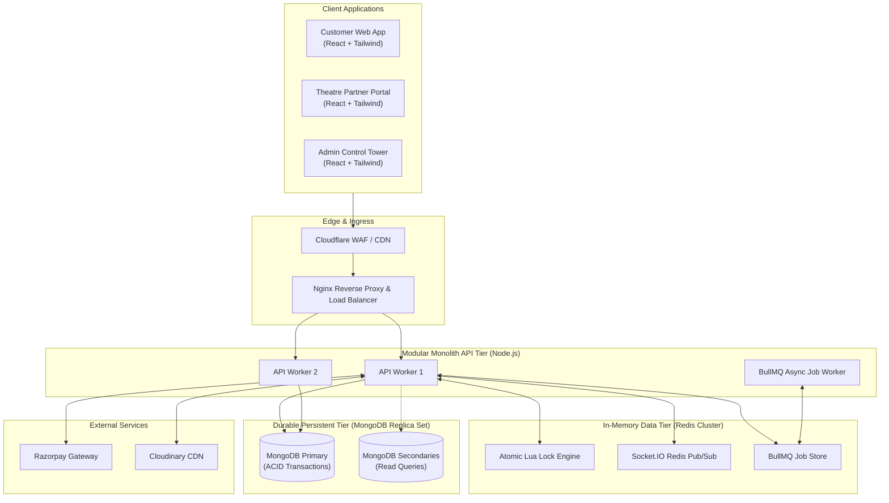

# Corporate Movie Ticket Booking Platform (BookMyShow Clone)

> **Enterprise Distributed Systems Architecture & Technical Blueprint (Part 1 Deliverable)**

An enterprise-grade, high-concurrency movie ticket booking platform inspired by BookMyShow. The platform is engineered to support multi-city operations, multi-tenant cinema partners, dynamic screen layouts, real-time seat lock synchronization, and secure online payments while maintaining strict inventory invariance (zero double-booking guarantees).

---

## 1. Executive Summary & Core Value Proposition

The platform bridges three foundational user experiences through a unified high-throughput backend:
1. **Customer Web Application**: Geolocation-aware movie discovery, dynamic multi-facet filtering, real-time SVG seat selection with sub-second lock state reflection, Razorpay online payments, instant digital QR ticket issuance, and self-service cancellations.
2. **Theatre Partner Portal**: Multi-cinema onboarding, dynamic visual seating layout designer (supporting regular and irregular seat grids, walkways, wheelchair access, and custom pricing tiers), show scheduling, live box office monitoring, and gatekeeper QR scanning for staff.
3. **Super Admin Control Tower**: Ecosystem-wide governance, master catalog management (cities, movies, genres, languages), partner KYC approval/rejection, commission configuration, financial dispute reconciliation, and immutable audit logs.

---

## 2. Technology Stack

| Layer | Technologies Selected | Architectural Rationale |
| :--- | :--- | :--- |
| **Frontend Applications** | React.js 18, Tailwind CSS, React Router v6 | Concurrent rendering, virtual DOM for complex seat visualizers, utility-first styling. |
| **Frontend State & Data** | TanStack Query (React Query v5), Redux Toolkit, Axios | Decoupled server-state caching (Stale-While-Revalidate) from transient client-state (session, lock timers). |
| **Backend Runtime & Framework** | Node.js 20+ LTS, Express.js | Non-blocking event-driven I/O, mature ecosystem, modular monolith service encapsulation. |
| **Primary Operational Datastore** | MongoDB 7.0+ Replica Set (via Mongoose) | Flexible document modeling for irregular screen layouts, ACID multi-document transactions for booking commits. |
| **In-Memory Cache & Lock Store**| Redis 7.2+ Cluster | Sub-millisecond distributed atomic seat locking via custom Lua scripts, sliding-window rate limiting. |
| **Realtime Synchronization** | Socket.IO with Redis Adapter | Bi-directional room-based event broadcasting (`show:<showId>`) scaled horizontally across API instances. |
| **Payment Rails** | Razorpay Payment Gateway | Indian/Global payment rails (UPI, Cards, NetBanking), cryptographic HMAC webhook verification, automated refunds. |
| **Media & Asset CDN** | Cloudinary | Direct-from-client signed asset uploads (posters, banners, KYC documents) and on-the-fly transformations. |
| **Validation & Security** | Zod, Argon2id, Helmet, Express-Mongo-Sanitize | Runtime schema validation, memory-hard password hashing, NoSQL injection and XSS defenses. |
| **Asynchronous Jobs & Queues**| BullMQ (Redis-backed) | Background queue for ticket PDF generation, cryptographic QR payload generation, email/SMS dispatch. |
| **Observability & Logging** | Pino / Winston, Prometheus, Grafana, Sentry | Structured JSON logging with request tracing, application telemetry, and centralized error monitoring. |
| **DevOps & Infrastructure** | Docker, Multi-Stage Builds, Nginx, GitHub Actions | Zero-downtime Blue-Green deployments, reverse proxy SSL termination, automated CI/CD quality gates. |

---

## 3. High-Level System Architecture



---

## 4. Master Architectural Documentation Index

Every component of the system has been documented in extreme detail inside the `docs/` directory:

1. [01. Project Overview & System Vision](file:///d:/YASH%20KACHA/Bookmyshow/docs/01-project-overview.md)
   - Scope, user personas, technology selection rationale, and modular monolith architectural philosophy.
2. [02. Functional Requirements Specification](file:///d:/YASH%20KACHA/Bookmyshow/docs/02-functional-requirements.md)
   - Granular breakdown of Customer, Theatre Partner, and Super Admin capabilities and workflows.
3. [03. End-to-End System Architecture](file:///d:/YASH%20KACHA/Bookmyshow/docs/03-system-architecture.md)
   - Complete architectural blueprints for Frontend, Backend, MongoDB, Redis, Sockets, Payments, File Storage, and Notifications.
4. [04. Database Planning & Data Architecture](file:///d:/YASH%20KACHA/Bookmyshow/docs/04-database-planning.md)
   - 23 MongoDB collections documented with field types, unique constraints, compound indexes, ownership rules, and performance analysis.
5. [05. User Roles, Permissions & Multi-Tenant Access Control](file:///d:/YASH%20KACHA/Bookmyshow/docs/05-user-roles-permissions.md)
   - RBAC matrix across 5 roles, tenant data isolation strategy, and BOLA/IDOR mitigation pipelines.
6. [06. Core Business Workflows & Sequence Specifications](file:///d:/YASH%20KACHA/Bookmyshow/docs/06-business-workflows.md)
   - Step-by-step sequence diagrams for 12 critical workflows (A through L) covering registration, layout building, seat locking, checkout, and refunds.
7. [07. Critical Booking Engine & Concurrency Control Design](file:///d:/YASH%20KACHA/Bookmyshow/docs/07-booking-engine-design.md)
   - Redis Lua atomic scripts, two-phase reservation, idempotency, and exhaustive analysis of all 7 critical failure edge cases.
8. [08. API Architecture & Interface Specifications](file:///d:/YASH%20KACHA/Bookmyshow/docs/08-api-architecture.md)
   - REST URI taxonomy, standardized success/error envelopes, Zod validation pipelines, and tiered sliding-window rate limiting.
9. [09. Enterprise Security Architecture & Hardening](file:///d:/YASH%20KACHA/Bookmyshow/docs/09-security-architecture.md)
   - Argon2id hashing, dual-token rotation in HttpOnly cookies, NoSQL injection defenses, and zero-PCI payment tokenization.
10. [10. Enterprise Monorepo & Backend Modular Architecture](file:///d:/YASH%20KACHA/Bookmyshow/docs/10-folder-structure.md)
    - Monorepo folder tree and the standardized 7-layer domain module structure (`model`, `controller`, `service`, `repository`, `routes`, `validation`, `tests`).
11. [11. Deployment, Infrastructure & Non-Functional Engineering](file:///d:/YASH%20KACHA/Bookmyshow/docs/11-deployment-architecture.md)
    - Multi-stage Dockerfiles, production topology, CI/CD with GitHub Actions, observability, and proposed measurable non-functional targets.
12. [12. Development Roadmap, Architecture Decisions & Dependency Map](file:///d:/YASH%20KACHA/Bookmyshow/docs/12-development-roadmap.md)
    - 11-phase implementation roadmap, dependency graph, 8 Architectural Decision Records (ADRs), risk management matrix, and Part 1 completion checklist.

---

## 5. Master Database Architecture Documentation Index (Part 2 Deliverables)

The complete enterprise database architecture and Mongoose schema specifications are organized in `docs/database/`:

1. [01. Collection Inventory & Architectural Rationale](file:///d:/YASH%20KACHA/Bookmyshow/docs/database/01-collection-inventory.md)
   - 24 normalized and hybrid collections, rationale for pruning redundant candidate models, and lifecycle policies.
2. [02. Users, Authentication & Access Control Schema](file:///d:/YASH%20KACHA/Bookmyshow/docs/database/02-users-and-auth-schema.md)
   - Schemas for `users`, `roles`, `permissions`, `role_permissions`, `refresh_tokens`, and `otp_verifications`.
3. [03. Geographical & Location Master Schema](file:///d:/YASH%20KACHA/Bookmyshow/docs/database/03-location-schema.md)
   - Schemas for `countries`, `states`, and `cities` with GeoJSON `2dsphere` coordinates.
4. [04. Movie Catalog & Review Subsystem Schema](file:///d:/YASH%20KACHA/Bookmyshow/docs/database/04-movie-schema.md)
   - Schemas for `movies`, `genres`, `languages`, and verified viewer `movie_reviews` with embedded cast and media.
5. [05. Theatre & Screen Subsystem Schema](file:///d:/YASH%20KACHA/Bookmyshow/docs/database/05-theatre-and-screen-schema.md)
   - Multi-tenant schemas for `theatre_partners`, `theatres` (cinema multiplexes), and `screens`.
6. [06. Seating Layout, Seat Categories & Auditorium Grid Schema](file:///d:/YASH%20KACHA/Bookmyshow/docs/database/06-seating-layout-schema.md)
   - Schemas for `seat_categories` and `seats`, featuring immutable layout versioning (`layoutVersion`).
7. [07. Show Scheduling, Dynamic Pricing & Overlap Prevention](file:///d:/YASH%20KACHA/Bookmyshow/docs/database/07-show-schema.md)
   - Schemas for `shows` and operational `show_seats`, plus the interval collision detection formula.
8. [08. Booking Management Subsystem Schema](file:///d:/YASH%20KACHA/Bookmyshow/docs/database/08-booking-schema.md)
   - Architectural evaluation of embedded vs. separated seat items, `bookings` schema, and denormalized snapshots.
9. [09. Payment Gateway, Refunds & Webhook Audit Schema](file:///d:/YASH%20KACHA/Bookmyshow/docs/database/09-payment-schema.md)
   - Zero PCI-DSS compliance, schemas for `payments`, `refunds`, and idempotent `payment_webhooks`.
10. [10. Coupons, Promotions & Redemption Ledger Schema](file:///d:/YASH%20KACHA/Bookmyshow/docs/database/10-coupon-and-promotion-schema.md)
    - Anti-abuse double-spending guards, schemas for `coupons` and ledger `coupon_redemptions`.
11. [11. Customer Engagement, Platform Governance & Audit Schema](file:///d:/YASH%20KACHA/Bookmyshow/docs/database/11-notification-and-audit-schema.md)
    - Schemas for `wishlists`, `notifications`, append-only `audit_logs`, and singleton `platform_settings`.
12. [12. Entity Relationship Diagrams & Data Association Models](file:///d:/YASH%20KACHA/Bookmyshow/docs/database/12-relationship-diagrams.md)
    - Granular association mappings, cardinality, and application-level referential integrity cascade policies.
13. [13. Comprehensive Database Indexing Strategy & Performance Tuning](file:///d:/YASH%20KACHA/Bookmyshow/docs/database/13-indexing-strategy.md)
    - Equality-Sort-Range (ESR) rules, unique, compound, partial, TTL, text, and 2dsphere index specifications.
14. [14. MongoDB Multi-Document ACID Transaction Strategy](file:///d:/YASH%20KACHA/Bookmyshow/docs/database/14-transaction-strategy.md)
    - Strict transaction boundaries, exponential jittered retry wrappers, and rollback guarantees.
15. [15. Multi-Tenant Database Architecture & Isolation Controls](file:///d:/YASH%20KACHA/Bookmyshow/docs/database/15-multi-tenant-database-design.md)
    - Shared database with discriminator `partnerId`, repository-level isolation guards, and BOLA/IDOR prevention.
16. [16. Seat Double-Booking Prevention & Durable Consistency Design](file:///d:/YASH%20KACHA/Bookmyshow/docs/database/16-booking-consistency-design.md)
    - MongoDB as durable ground truth, atomic conditional transitions, and solutions for all 7 critical edge cases.
17. [17. Database Performance, Scalability & Lifecycle Management](file:///d:/YASH%20KACHA/Bookmyshow/docs/database/17-performance-and-scalability.md)
    - Keyset cursor pagination vs. offset pagination, aggregation pipelines, connection pooling, and sharding roadmap.
18. [18. Database Security, Hardening & Compliance Architecture](file:///d:/YASH%20KACHA/Bookmyshow/docs/database/18-database-security.md)
    - Least privilege database users, TLS 1.3, AES-256 field encryption for bank details, Argon2id, and DPDP/GDPR.
19. [Complete Mermaid Entity Relationship Diagram](file:///d:/YASH%20KACHA/Bookmyshow/docs/database/ERD.mmd)
    - Master visual ER diagram covering all collections, foreign keys, and cardinalities.
20. [19. Database Architecture Review Report & Readiness Audit](file:///d:/YASH%20KACHA/Bookmyshow/docs/database/19-database-review-report.md)
    - Formal review report, risk mitigations, ADR summary, and Part 2 sign-off checklist.

---

## 6. Development Phases Overview

```
Phase 01: Architecture & Technical Foundations (COMPLETED)
Phase 02: Database Schemas, Validation & Seeding (COMPLETED)
Phase 03: Auth, Token Rotation & RBAC Engine (PENDING APPROVAL)
Phase 04: Master Catalogs, Theatres & Screen Visualizer
Phase 05: High-Concurrency Booking Engine & Redis Locks
Phase 06: Payment Gateway & Asynchronous Webhooks
Phase 07: Digital Ticket QR Engine & Notifications
Phase 08: Theatre Partner & Super Admin Portals
Phase 09: Customer Web Application
Phase 10: Performance, Chaos & Load Testing
Phase 11: Production Deployment & Observability
```

---

## 7. Architecture Status & Quality Gates

- **Architecture Style**: Modular Monolith with clean domain boundaries, prepared for microservice extraction.
- **Concurrency Guarantee**: CP (Consistency + Partition Tolerance) on inventory; zero double-booking under race conditions via Redis Lua scripts + MongoDB ACID transactions.
- **Tenancy Boundary**: Absolute isolation by `partner_id` / `theatre_id`, enforced at the repository layer.
- **Payment Compliance**: Zero PCI-DSS footprint; Razorpay webhook verification via HMAC-SHA256 constant-time comparison.

---

> [!IMPORTANT]
> **Part 1 & Part 2 Objectives Complete:** All architecture, database plans, schemas, business workflows, concurrency models, security controls, and indexing strategies are fully documented.
> In accordance with project instructions, backend setup and coding will commence only after Part 2 approval.

