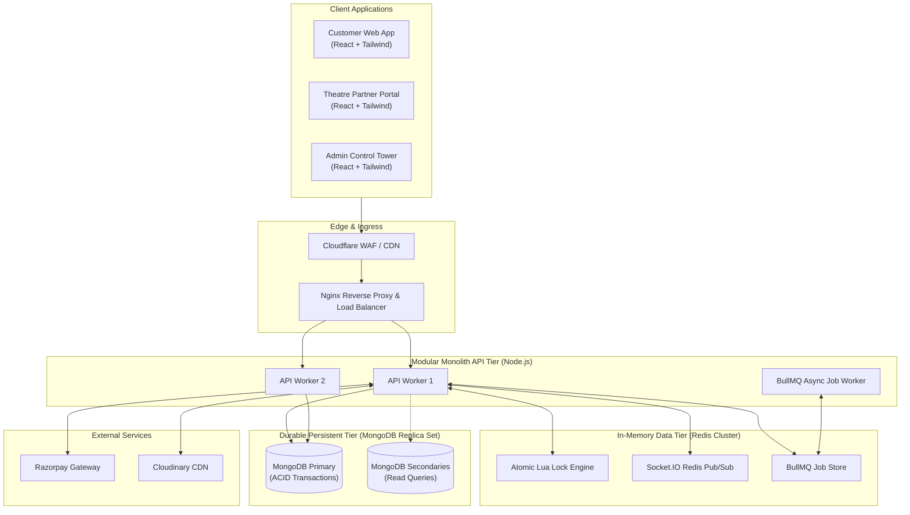

# Corporate Movie Ticket Booking Platform (BookMyShow Clone)

> **Enterprise Distributed Systems Architecture & Technical Blueprint (Part 1 Deliverable)**

An enterprise-grade, high-concurrency movie ticket booking platform inspired by BookMyShow. The platform is engineered to support multi-city operations, multi-tenant cinema partners, dynamic screen layouts, real-time seat lock synchronization, and secure online payments while maintaining strict inventory invariance (zero double-booking guarantees).

---

## 1. Executive Summary & Core Value Proposition

The platform bridges three foundational user experiences through a unified high-throughput backend:
1. **Customer Web Application**: Geolocation-aware movie discovery, dynamic multi-facet filtering, real-time SVG seat selection with sub-second lock state reflection, Razorpay online payments, instant digital QR ticket issuance, and self-service cancellations.
2. **Theatre Partner Portal**: Multi-cinema onboarding, dynamic visual seating layout designer (supporting regular and irregular seat grids, walkways, wheelchair access, and custom pricing tiers), show scheduling, live box office monitoring, and gatekeeper QR scanning for staff.
3. **Super Admin Control Tower**: Ecosystem-wide governance, master catalog management (cities, movies, genres, languages), partner KYC approval/rejection, commission configuration, financial dispute reconciliation, and immutable audit logs.

---

## 2. Technology Stack

| Layer | Technologies Selected | Architectural Rationale |
| :--- | :--- | :--- |
| **Frontend Applications** | React.js 18, Tailwind CSS, React Router v6 | Concurrent rendering, virtual DOM for complex seat visualizers, utility-first styling. |
| **Frontend State & Data** | TanStack Query (React Query v5), Redux Toolkit, Axios | Decoupled server-state caching (Stale-While-Revalidate) from transient client-state (session, lock timers). |
| **Backend Runtime & Framework** | Node.js 20+ LTS, Express.js | Non-blocking event-driven I/O, mature ecosystem, modular monolith service encapsulation. |
| **Primary Operational Datastore** | MongoDB 7.0+ Replica Set (via Mongoose) | Flexible document modeling for irregular screen layouts, ACID multi-document transactions for booking commits. |
| **In-Memory Cache & Lock Store**| Redis 7.2+ Cluster | Sub-millisecond distributed atomic seat locking via custom Lua scripts, sliding-window rate limiting. |
| **Realtime Synchronization** | Socket.IO with Redis Adapter | Bi-directional room-based event broadcasting (`show:<showId>`) scaled horizontally across API instances. |
| **Payment Rails** | Razorpay Payment Gateway | Indian/Global payment rails (UPI, Cards, NetBanking), cryptographic HMAC webhook verification, automated refunds. |
| **Media & Asset CDN** | Cloudinary | Direct-from-client signed asset uploads (posters, banners, KYC documents) and on-the-fly transformations. |
| **Validation & Security** | Zod, Argon2id, Helmet, Express-Mongo-Sanitize | Runtime schema validation, memory-hard password hashing, NoSQL injection and XSS defenses. |
| **Asynchronous Jobs & Queues**| BullMQ (Redis-backed) | Background queue for ticket PDF generation, cryptographic QR payload generation, email/SMS dispatch. |
| **Observability & Logging** | Pino / Winston, Prometheus, Grafana, Sentry | Structured JSON logging with request tracing, application telemetry, and centralized error monitoring. |
| **DevOps & Infrastructure** | Docker, Multi-Stage Builds, Nginx, GitHub Actions | Zero-downtime Blue-Green deployments, reverse proxy SSL termination, automated CI/CD quality gates. |

---

## 3. High-Level System Architecture



---

## 4. Master Architectural Documentation Index

Every component of the system has been documented in extreme detail inside the `docs/` directory:

1. [01. Project Overview & System Vision](file:///d:/YASH%20KACHA/Bookmyshow/docs/01-project-overview.md)
   - Scope, user personas, technology selection rationale, and modular monolith architectural philosophy.
2. [02. Functional Requirements Specification](file:///d:/YASH%20KACHA/Bookmyshow/docs/02-functional-requirements.md)
   - Granular breakdown of Customer, Theatre Partner, and Super Admin capabilities and workflows.
3. [03. End-to-End System Architecture](file:///d:/YASH%20KACHA/Bookmyshow/docs/03-system-architecture.md)
   - Complete architectural blueprints for Frontend, Backend, MongoDB, Redis, Sockets, Payments, File Storage, and Notifications.
4. [04. Database Planning & Data Architecture](file:///d:/YASH%20KACHA/Bookmyshow/docs/04-database-planning.md)
   - 23 MongoDB collections documented with field types, unique constraints, compound indexes, ownership rules, and performance analysis.
5. [05. User Roles, Permissions & Multi-Tenant Access Control](file:///d:/YASH%20KACHA/Bookmyshow/docs/05-user-roles-permissions.md)
   - RBAC matrix across 5 roles, tenant data isolation strategy, and BOLA/IDOR mitigation pipelines.
6. [06. Core Business Workflows & Sequence Specifications](file:///d:/YASH%20KACHA/Bookmyshow/docs/06-business-workflows.md)
   - Step-by-step sequence diagrams for 12 critical workflows (A through L) covering registration, layout building, seat locking, checkout, and refunds.
7. [07. Critical Booking Engine & Concurrency Control Design](file:///d:/YASH%20KACHA/Bookmyshow/docs/07-booking-engine-design.md)
   - Redis Lua atomic scripts, two-phase reservation, idempotency, and exhaustive analysis of all 7 critical failure edge cases.
8. [08. API Architecture & Interface Specifications](file:///d:/YASH%20KACHA/Bookmyshow/docs/08-api-architecture.md)
   - REST URI taxonomy, standardized success/error envelopes, Zod validation pipelines, and tiered sliding-window rate limiting.
9. [09. Enterprise Security Architecture & Hardening](file:///d:/YASH%20KACHA/Bookmyshow/docs/09-security-architecture.md)
   - Argon2id hashing, dual-token rotation in HttpOnly cookies, NoSQL injection defenses, and zero-PCI payment tokenization.
10. [10. Enterprise Monorepo & Backend Modular Architecture](file:///d:/YASH%20KACHA/Bookmyshow/docs/10-folder-structure.md)
    - Monorepo folder tree and the standardized 7-layer domain module structure (`model`, `controller`, `service`, `repository`, `routes`, `validation`, `tests`).
11. [11. Deployment, Infrastructure & Non-Functional Engineering](file:///d:/YASH%20KACHA/Bookmyshow/docs/11-deployment-architecture.md)
    - Multi-stage Dockerfiles, production topology, CI/CD with GitHub Actions, observability, and proposed measurable non-functional targets.
12. [12. Development Roadmap, Architecture Decisions & Dependency Map](file:///d:/YASH%20KACHA/Bookmyshow/docs/12-development-roadmap.md)
    - 11-phase implementation roadmap, dependency graph, 8 Architectural Decision Records (ADRs), risk management matrix, and Part 1 completion checklist.

---

## 5. Master Database Architecture Documentation Index (Part 2 Deliverables)

The complete enterprise database architecture and Mongoose schema specifications are organized in `docs/database/`:

1. [01. Collection Inventory & Architectural Rationale](file:///d:/YASH%20KACHA/Bookmyshow/docs/database/01-collection-inventory.md)
   - 24 normalized and hybrid collections, rationale for pruning redundant candidate models, and lifecycle policies.
2. [02. Users, Authentication & Access Control Schema](file:///d:/YASH%20KACHA/Bookmyshow/docs/database/02-users-and-auth-schema.md)
   - Schemas for `users`, `roles`, `permissions`, `role_permissions`, `refresh_tokens`, and `otp_verifications`.
3. [03. Geographical & Location Master Schema](file:///d:/YASH%20KACHA/Bookmyshow/docs/database/03-location-schema.md)
   - Schemas for `countries`, `states`, and `cities` with GeoJSON `2dsphere` coordinates.
4. [04. Movie Catalog & Review Subsystem Schema](file:///d:/YASH%20KACHA/Bookmyshow/docs/database/04-movie-schema.md)
   - Schemas for `movies`, `genres`, `languages`, and verified viewer `movie_reviews` with embedded cast and media.
5. [05. Theatre & Screen Subsystem Schema](file:///d:/YASH%20KACHA/Bookmyshow/docs/database/05-theatre-and-screen-schema.md)
   - Multi-tenant schemas for `theatre_partners`, `theatres` (cinema multiplexes), and `screens`.
6. [06. Seating Layout, Seat Categories & Auditorium Grid Schema](file:///d:/YASH%20KACHA/Bookmyshow/docs/database/06-seating-layout-schema.md)
   - Schemas for `seat_categories` and `seats`, featuring immutable layout versioning (`layoutVersion`).
7. [07. Show Scheduling, Dynamic Pricing & Overlap Prevention](file:///d:/YASH%20KACHA/Bookmyshow/docs/database/07-show-schema.md)
   - Schemas for `shows` and operational `show_seats`, plus the interval collision detection formula.
8. [08. Booking Management Subsystem Schema](file:///d:/YASH%20KACHA/Bookmyshow/docs/database/08-booking-schema.md)
   - Architectural evaluation of embedded vs. separated seat items, `bookings` schema, and denormalized snapshots.
9. [09. Payment Gateway, Refunds & Webhook Audit Schema](file:///d:/YASH%20KACHA/Bookmyshow/docs/database/09-payment-schema.md)
   - Zero PCI-DSS compliance, schemas for `payments`, `refunds`, and idempotent `payment_webhooks`.
10. [10. Coupons, Promotions & Redemption Ledger Schema](file:///d:/YASH%20KACHA/Bookmyshow/docs/database/10-coupon-and-promotion-schema.md)
    - Anti-abuse double-spending guards, schemas for `coupons` and ledger `coupon_redemptions`.
11. [11. Customer Engagement, Platform Governance & Audit Schema](file:///d:/YASH%20KACHA/Bookmyshow/docs/database/11-notification-and-audit-schema.md)
    - Schemas for `wishlists`, `notifications`, append-only `audit_logs`, and singleton `platform_settings`.
12. [12. Entity Relationship Diagrams & Data Association Models](file:///d:/YASH%20KACHA/Bookmyshow/docs/database/12-relationship-diagrams.md)
    - Granular association mappings, cardinality, and application-level referential integrity cascade policies.
13. [13. Comprehensive Database Indexing Strategy & Performance Tuning](file:///d:/YASH%20KACHA/Bookmyshow/docs/database/13-indexing-strategy.md)
    - Equality-Sort-Range (ESR) rules, unique, compound, partial, TTL, text, and 2dsphere index specifications.
14. [14. MongoDB Multi-Document ACID Transaction Strategy](file:///d:/YASH%20KACHA/Bookmyshow/docs/database/14-transaction-strategy.md)
    - Strict transaction boundaries, exponential jittered retry wrappers, and rollback guarantees.
15. [15. Multi-Tenant Database Architecture & Isolation Controls](file:///d:/YASH%20KACHA/Bookmyshow/docs/database/15-multi-tenant-database-design.md)
    - Shared database with discriminator `partnerId`, repository-level isolation guards, and BOLA/IDOR prevention.
16. [16. Seat Double-Booking Prevention & Durable Consistency Design](file:///d:/YASH%20KACHA/Bookmyshow/docs/database/16-booking-consistency-design.md)
    - MongoDB as durable ground truth, atomic conditional transitions, and solutions for all 7 critical edge cases.
17. [17. Database Performance, Scalability & Lifecycle Management](file:///d:/YASH%20KACHA/Bookmyshow/docs/database/17-performance-and-scalability.md)
    - Keyset cursor pagination vs. offset pagination, aggregation pipelines, connection pooling, and sharding roadmap.
18. [18. Database Security, Hardening & Compliance Architecture](file:///d:/YASH%20KACHA/Bookmyshow/docs/database/18-database-security.md)
    - Least privilege database users, TLS 1.3, AES-256 field encryption for bank details, Argon2id, and DPDP/GDPR.
19. [Complete Mermaid Entity Relationship Diagram](file:///d:/YASH%20KACHA/Bookmyshow/docs/database/ERD.mmd)
    - Master visual ER diagram covering all collections, foreign keys, and cardinalities.
20. [19. Database Architecture Review Report & Readiness Audit](file:///d:/YASH%20KACHA/Bookmyshow/docs/database/19-database-review-report.md)
    - Formal review report, risk mitigations, ADR summary, and Part 2 sign-off checklist.

---

## 6. Backend Foundation & Infrastructure Architecture (Part 3 Deliverables)

The core backend foundation, configuration pipelines, and test suites are documented in `docs/backend/`:

1. [01. Backend Foundation & Initial Project Setup](file:///d:/YASH%20KACHA/Bookmyshow/docs/backend/01-backend-setup.md)
   - ES Modules configuration, dependency matrix, npm scripts, and tooling standards.
2. [02. Backend Modular Folder Structure](file:///d:/YASH%20KACHA/Bookmyshow/docs/backend/02-folder-structure.md)
   - Detailed layout of `apps/backend/` and 7-layer architectural separation of concerns.
3. [03. Centralized Environment Configuration](file:///d:/YASH%20KACHA/Bookmyshow/docs/backend/03-environment-configuration.md)
   - Fail-fast Zod schema parsing, variable dictionary, and secret protection.
4. [04. Express Application Architecture & Pipeline](file:///d:/YASH%20KACHA/Bookmyshow/docs/backend/04-express-architecture.md)
   - Deterministic 11-step middleware execution pipeline and separation of `app.js` from `server.js`.
5. [05. Centralized Error Handling & Exception Taxonomy](file:///d:/YASH%20KACHA/Bookmyshow/docs/backend/05-error-handling.md)
   - Standard error response envelopes, custom error class hierarchy, and Mongoose error mappers.
6. [06. Standard API Response Formats & Pagination](file:///d:/YASH%20KACHA/Bookmyshow/docs/backend/06-api-response-standards.md)
   - Static `ApiResponse` builders, success envelopes, and `PaginationMeta` calculations.
7. [07. MongoDB Connection Architecture](file:///d:/YASH%20KACHA/Bookmyshow/docs/backend/07-database-connection.md)
   - Connection pool management (`maxPoolSize: 50`), lifecycle listeners, and ping probes.
8. [08. Redis Connection Architecture](file:///d:/YASH%20KACHA/Bookmyshow/docs/backend/08-redis-connection.md)
   - `ioredis` client configuration, exponential backoff reconnection, and cache roles.
9. [09. Structured Logging System & Telemetry](file:///d:/YASH%20KACHA/Bookmyshow/docs/backend/09-logging-system.md)
   - Low-overhead Pino logging, mandatory PII/credential redactions, and request ID correlation.
10. [10. Security Middleware Foundation](file:///d:/YASH%20KACHA/Bookmyshow/docs/backend/10-security-foundation.md)
    - Helmet security headers, CORS origin whitelisting, payload size bounding, and sliding rate limiters.
11. [11. Request Validation Infrastructure with Zod](file:///d:/YASH%20KACHA/Bookmyshow/docs/backend/11-validation-system.md)
    - Reusable `validate` middleware parsing request bodies, params, and queries with field-level diagnostics.
12. [12. System Health, Readiness & Liveness Architecture](file:///d:/YASH%20KACHA/Bookmyshow/docs/backend/12-health-checks.md)
    - Health endpoints: `/api/v1/health`, `/api/v1/health/live`, `/api/v1/health/ready`.
13. [13. Interactive Swagger & OpenAPI 3.0 Documentation](file:///d:/YASH%20KACHA/Bookmyshow/docs/backend/13-swagger-setup.md)
    - OpenAPI 3.0 documentation mounted at `/api/v1/docs` with `BearerAuth` security scheme.
14. [14. Real-time Socket.IO Foundation](file:///d:/YASH%20KACHA/Bookmyshow/docs/backend/14-socket-foundation.md)
    - Decoupled WebSocket server, handshake authentication integration hook, and event constants.
15. [15. Graceful Server Shutdown & Process Lifecycle](file:///d:/YASH%20KACHA/Bookmyshow/docs/backend/15-graceful-shutdown.md)
    - Coordinated draining of HTTP connections, Socket.IO, Redis, and MongoDB with a 10s failsafe timer.
16. [16. Docker Containerization & Local Compose](file:///d:/YASH%20KACHA/Bookmyshow/docs/backend/16-docker-setup.md)
    - Multi-stage Alpine Dockerfile, non-root user execution, and multi-service `docker-compose.yml`.
17. [17. Automated Testing Strategy & Jest Test Harness](file:///d:/YASH%20KACHA/Bookmyshow/docs/backend/17-testing-foundation.md)
    - Test execution commands, Supertest integration harness, and 100% passing test metrics (44 tests).
18. [18. Backend Foundation Review Report & Readiness Audit](file:///d:/YASH%20KACHA/Bookmyshow/docs/backend/18-backend-foundation-review.md)
    - Final review report, verified endpoints, security checklist, and Part 3 sign-off audit.

---

## 7. Master Authentication & Security Documentation Index (Part 4 Deliverables)

All identity, authorization, session, and security mechanics are documented in `docs/auth/`:

1. [01. Authentication Architecture](file:///d:/YASH%20KACHA/Bookmyshow/docs/auth/01-authentication-architecture.md)
   - Stateless JWT with stateful session invalidation, module boundaries, and high-level workflow.
2. [02. Registration Workflow](file:///d:/YASH%20KACHA/Bookmyshow/docs/auth/02-registration-workflow.md)
   - Retail customer onboarding and theatre partner KYC registration with `PENDING_APPROVAL` status.
3. [03. Login Workflow](file:///d:/YASH%20KACHA/Bookmyshow/docs/auth/03-login-workflow.md)
   - Email/mobile resolution, bcrypt password verification, account status evaluation, and anti-enumeration.
4. [04. JWT Token Strategy](file:///d:/YASH%20KACHA/Bookmyshow/docs/auth/04-jwt-token-strategy.md)
   - Access token (15m in memory) vs Refresh token (7d in HttpOnly cookie), payload claims, signing algorithms.
5. [05. Refresh Token Rotation & Family Reuse Detection](file:///d:/YASH%20KACHA/Bookmyshow/docs/auth/05-refresh-token-rotation.md)
   - Single-use policy, token family tracking (`familyId`), reuse compromise detection, and cascade revocation.
6. [06. Session Management](file:///d:/YASH%20KACHA/Bookmyshow/docs/auth/06-session-management.md)
   - `user_sessions` schema, active session enumeration, targeted/bulk revocation, and MongoDB TTL indexing.
7. [07. OTP Verification Architecture](file:///d:/YASH%20KACHA/Bookmyshow/docs/auth/07-otp-verification.md)
   - Email & SMS notification providers, SHA-256 OTP hashing, 60s cooldown, and 5-attempt throttling.
8. [08. Password Management Lifecycle](file:///d:/YASH%20KACHA/Bookmyshow/docs/auth/08-password-management.md)
   - Bcrypt 12 rounds, strong complexity rules, anti-enumeration forgot password, reset and change flows.
9. [09. Role-Based Access Control (RBAC) Design](file:///d:/YASH%20KACHA/Bookmyshow/docs/auth/09-rbac-design.md)
   - 5 canonical platform roles (`CUSTOMER`, `THEATRE_STAFF`, `THEATRE_MANAGER`, `THEATRE_OWNER`, `SUPER_ADMIN`).
10. [10. Role-Permission Matrix](file:///d:/YASH%20KACHA/Bookmyshow/docs/auth/10-permission-matrix.md)
    - 23 discrete permissions mapped to roles with `authorizePermission()` middleware enforcement.
11. [11. Multi-Tenant Authorization & Boundary Isolation](file:///d:/YASH%20KACHA/Bookmyshow/docs/auth/11-multi-tenant-authorization.md)
    - `requireTenantScope()` middleware preventing cross-tenant BOLA/IDOR data access.
12. [12. Security Architecture & Threat Mitigations](file:///d:/YASH%20KACHA/Bookmyshow/docs/auth/12-security-architecture.md)
    - OWASP Top 10 mitigations, tamper-proof append-only `audit_logs`, and rate limiting.
13. [13. API Documentation: Auth & Users](file:///d:/YASH%20KACHA/Bookmyshow/docs/auth/13-api-documentation.md)
    - Full reference for all 18 authentication and user management REST endpoints with payloads.
14. [14. Authentication Testing Report](file:///d:/YASH%20KACHA/Bookmyshow/docs/auth/14-testing-report.md)
    - Complete report on 17 test suites, 116 tests passing, edge cases, and test breakdown.
15. [15. Authentication Review & Architectural Compliance Report](file:///d:/YASH%20KACHA/Bookmyshow/docs/auth/15-authentication-review-report.md)
    - Final Part 4 sign-off audit and readiness verification for Part 5.

---

## 8. Development Phases Overview

```
Phase 01: Architecture & Technical Foundations (COMPLETED)
Phase 02: Database Schemas, Validation & Seeding (COMPLETED)
Phase 03: Backend Foundation & Project Setup (COMPLETED)
Phase 04: Authentication, Security & RBAC Implementation (COMPLETED)
Phase 05: Master Catalogs, Movies & Screen Visualizer (PENDING APPROVAL)
Phase 06: High-Concurrency Booking Engine & Redis Locks
Phase 07: Payment Gateway & Asynchronous Webhooks
Phase 08: Digital Ticket QR Engine & Notifications
Phase 09: Theatre Partner & Super Admin Portals
Phase 10: Customer Web Application
Phase 11: Performance, Chaos & Load Testing
Phase 12: Production Deployment & Observability
```

---

## 9. Architecture Status & Quality Gates

- **Architecture Style**: Modular Monolith with clean domain boundaries, prepared for microservice extraction.
- **Concurrency Guarantee**: CP (Consistency + Partition Tolerance) on inventory; zero double-booking under race conditions via Redis Lua scripts + MongoDB ACID transactions.
- **Tenancy Boundary**: Absolute isolation by `partnerId` / `theatreId`, enforced at middleware (`requireTenantScope`) and repository layers.
- **Authentication & Tokens**: Dual-token JWT (15m in-memory access token, 7d rotating refresh token in `HttpOnly, Secure, SameSite=Strict` cookie) with Token Family reuse detection.
- **Role-Based Access Control**: 5 platform roles, 23 fine-grained permissions, and immutable server-side role assignment.
- **Payment Compliance**: Zero PCI-DSS footprint; Razorpay webhook verification via HMAC-SHA256 constant-time comparison.
- **Test Quality Gate**: 116 automated tests across 17 test suites passing (100% pass rate). Zero ESLint errors, 100% Prettier compliance.

---

> [!IMPORTANT]
> **Part 1, Part 2, Part 3 & Part 4 Complete:** System architecture, database designs, backend foundation, authentication, security, user management, and multi-tenant isolation are fully implemented, verified, and documented.
> In accordance with project instructions, **Part 5: Movie Management Module** will commence only after user review and approval.

