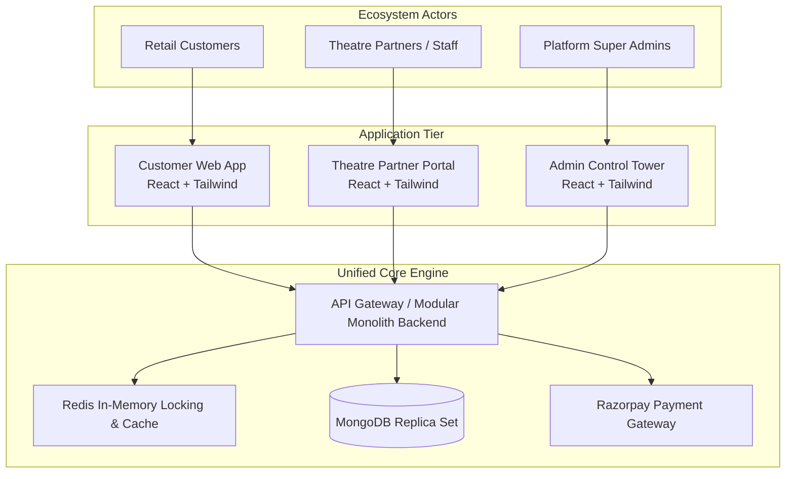
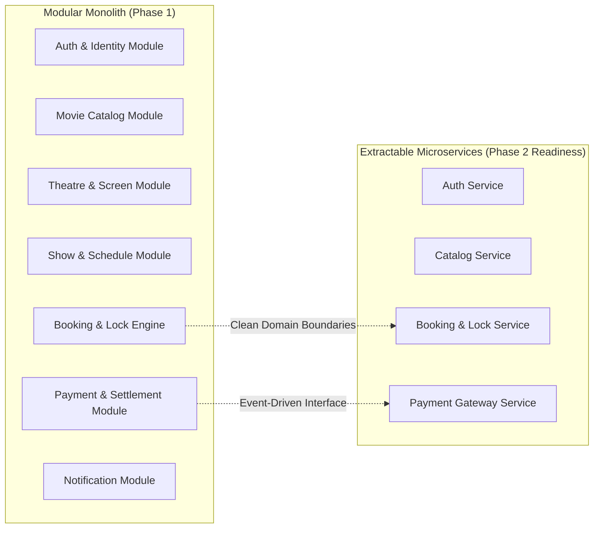

# 01. Project Overview & System Vision

## 1. Executive Summary

The **Movie Ticket Booking Platform** (inspired by BookMyShow) is an enterprise-grade, multi-tenant entertainment ticketing platform engineered to handle millions of consumers, thousands of theatre partners, and high-frequency concurrent seat reservation transactions across hundreds of geographical cities.

Building a high-availability ticket booking engine presents unique distributed systems challenges:
1. **Extreme Concurrency Hotspots**: When blockbuster movies open booking slots, thousands of users compete for identical high-value seats within milliseconds.
2. **Strict Inventory Invariance**: The platform must guarantee zero double-booking under all circumstances (network partitioning, client crashes, payment gateway latency).
3. **Multi-Tenant Isolation**: Independent cinema operators must configure screens, dynamic pricing, and seat tiers while remaining strictly isolated from other cinema owners.
4. **Real-time Synchronized State**: Dynamic seat state (available, locked, booked, out-of-order) must be reflected across connected clients with sub-second latency.

This platform balances high-performance read throughput for movie discovery with strict ACID transaction guarantees during booking and settlement.

---

## 2. Business Objectives & Platform Ecosystem

The platform operates across three interconnected applications powered by a unified backend:

### Core Value Propositions
- **For Customers**: Frictionless search by city, genre, format (IMAX, 4DX, 2D, 3D), and language; real-time interactive seat layouts; seamless checkout with Razorpay; instant digital QR ticket issuance; automated cancellation and refund tracking.
- **For Theatre Partners**: Self-serve onboarding, complex screen layout visual configurator, granular seat category pricing, real-time box office monitoring, automated revenue reconciliation, and secure QR-based ticket scanning for staff.
- **For Platform Administrators**: Complete ecosystem governance, movie catalog master data curation, theatre KYC approval, platform commission configuration, financial dispute resolution, real-time audit logs, and system analytics.

---

## 3. Technology Stack Specification

| Category | Technology | Rationale / Architectural Purpose |
| :--- | :--- | :--- |
| **Frontend Framework** | React.js (v18+) | Component-driven UI, concurrent rendering, virtual DOM for high-performance interactive seat layouts. |
| **Styling Engine** | Tailwind CSS | Utility-first CSS, zero runtime overhead, deterministic design tokens, responsive layout management. |
| **Client Routing** | React Router (v6+) | Declarative nested routing, route-level authorization guards, code-splitting via lazy loading. |
| **Data Fetching / Cache** | TanStack Query (React Query v5) | Server-state synchronization, optimistic updates, automated cache invalidation, background refetching. |
| **Client State Management** | Redux Toolkit (RTK) | Centralized management for purely transient global client state (authenticated session, multi-step booking locks). |
| **HTTP Client** | Axios | Interceptors for JWT rotation, request signing, uniform error wrapping, and timeout handling. |
| **Backend Runtime** | Node.js (v20+ LTS) | Non-blocking, event-driven asynchronous I/O ideal for high concurrent I/O throughput. |
| **Web Application Framework** | Express.js | Mature, robust middleware ecosystem, lightweight footprint for modular monolith service boundaries. |
| **Primary Database** | MongoDB (v7.0+) with Mongoose | Document model naturally accommodates nested screen seating layouts, polymorphic show configs, and audit documents with ACID multi-document transactions. |
| **In-Memory Cache & Lock** | Redis (v7.2+) | Sub-millisecond distributed atomic seat locking (Lua scripts), ephemeral session caching, and rate limiting. |
| **Real-time Event Fabric** | Socket.IO | Bi-directional WebSocket communication for live seat lock broadcasts with Redis Pub/Sub multi-instance scaling. |
| **Payment Gateway** | Razorpay | Standardized Indian/Global payment rails, webhook verification, escrow splitting, and automated refund APIs. |
| **Media Storage** | Cloudinary | CDN-backed image and video asset optimization, signed upload security, dynamic responsive transformations for posters and banners. |
| **Schema Validation** | Zod | Runtime type safety, strict request payload validation, and TypeScript schema inference. |
| **Logging & Telemetry** | Winston / Pino | Structured JSON logging with correlation IDs, log level segregation, and log shipping readiness. |
| **API Documentation** | Swagger / OpenAPI 3.0 | Living interactive documentation and automated client SDK contract validation. |
| **Automated Testing** | Jest & Supertest | Comprehensive unit tests, repository mocking, and end-to-end HTTP integration suites. |
| **Containerization** | Docker & Docker Compose | Immutable multi-stage container images for consistent local, staging, and production environments. |
| **CI/CD Automation** | GitHub Actions | Automated linting, type-checking, test execution, container building, and deployment pipelines. |

---

## 4. Architectural Philosophy: Modular Monolith First

The system is deliberately designed as a **Modular Monolith** rather than premature microservices. 

### Why Modular Monolith?
1. **Simplified Consistency**: High-concurrency seat reservation requires atomic ACID transactions across shows, seats, bookings, and payments. In a distributed microservice setup, this requires 2-Phase Commits (2PC) or Sagas with compensating transactions, increasing latency and failure surface.
2. **Zero Network Serialization Overhead**: In-process method calls between modules operate with zero network latency compared to gRPC/REST hops between microservices.
3. **Operational Simplicity**: Single deployment artifact, unified database cluster, simplified debugging, and centralized logging.
4. **Clean Boundary Discipline**: Modules communicate strictly through well-defined service interfaces and event boundaries. When traffic volume dictates, individual modules (e.g., `BookingModule`, `NotificationModule`, `PaymentModule`) can be extracted cleanly into standalone microservices without refactoring domain logic.

---

## 5. High-Level System Scope & Boundaries

### What the Platform Delivers
- Multi-city geolocation and manual city switching with isolated catalogue indexing.
- Multi-tenant cinema management with fine-grained role-based access control.
- Screen builder supporting irregular seating grids, multiple categories (VIP, Premium, Executive), walkways, and wheelchair slots.
- Real-time temporary seat locking engine backed by Redis atomic operations with strict 10-minute automated expiration.
- Razorpay order creation, browser checkout, and cryptographically verified webhook payment finalization.
- Digital ticket generation with unique tamper-evident cryptographic QR codes and PDF download.
- Full cancellation lifecycle honoring progressive refund windows (e.g., 100% refund > 24 hrs, 50% refund > 2 hrs, 0% refund < 2 hrs).

### System Assumptions & Constraints
- Currency is natively INR (₹) with currency abstraction for internationalization readiness.
- Timezone handling is standardized to UTC in database and persistence layers, converted to local cinema timezone in application layers.
- Payment processing relies on external gateway webhooks as the single source of truth for financial capture.

