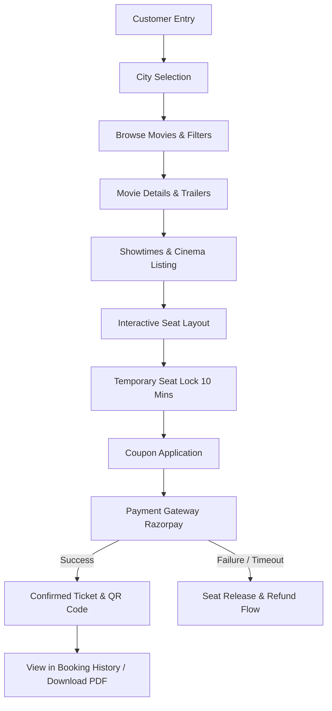
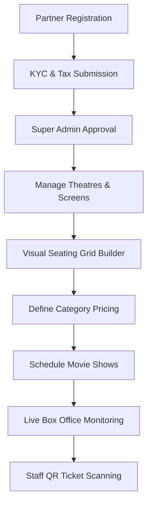
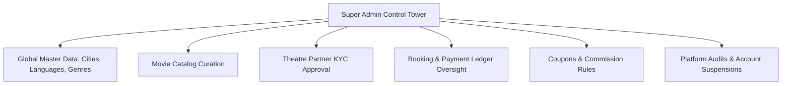

# 02. Functional Requirements Specification

## 1. System Actor Taxonomy

| Actor Code | Role Name | System Access Scope | Primary Persona Description |
| :--- | :--- | :--- | :--- |
| **ACT-01** | `GUEST_USER` | Public Endpoints | Unauthenticated visitor browsing cities, movies, trailers, and theatre listings. |
| **ACT-02** | `CUSTOMER` | Customer Web App | Authenticated consumer selecting seats, executing payments, managing tickets and reviews. |
| **ACT-03** | `THEATRE_OWNER` | Theatre Dashboard | Owner/Partner managing cinema chain metadata, financial settlements, and staff roles. |
| **ACT-04** | `THEATRE_MANAGER`| Theatre Dashboard | Operational manager configuring screens, seat pricing, showtimes, and monitoring daily bookings. |
| **ACT-05** | `THEATRE_STAFF` | Theatre Mobile/Scanner| Gatekeeper verifying QR codes on entry and admitting patrons. |
| **ACT-06** | `SUPER_ADMIN` | Admin Control Tower| Platform operator with unrestricted governance across all tenants, movies, and financial rules. |

---

## 2. Customer Application Capabilities

### Module FR-CUST-01: Authentication & Profile Lifecycle
- **FR-C1.1 (Registration & Social Identity)**: Users must be able to register using Email/Password or Phone OTP. System requires verifiable email address.
- **FR-C1.2 (Session Management)**: Secure authentication delivering short-lived JWT Access Tokens (15 mins) and rotating Refresh Tokens (7 days) stored in `HttpOnly`, `SameSite=Strict` cookies.
- **FR-C1.3 (Profile & Wishlist)**: Customers can update personal profile, notification preferences, and maintain a "Watchlist / Wishlist" of upcoming movies with automated notification triggers on ticket release.

### Module FR-CUST-02: Geolocation & Movie Discovery Engine
- **FR-C2.1 (City Context Binding)**: Platform enforces explicit City Context (defaulting to GPS / IP geocoding with user override). All movie queries, showtimes, and theatre listings are strictly scoped to the active city.
- **FR-C2.2 (Catalog Categorization)**: Distinction between `NOW_SHOWING` (movies with active show schedules in current city) and `UPCOMING` (movies scheduled for future release).
- **FR-C2.3 (Search & Multi-Facet Filtering)**: Search by title, actor, director, genre. Faceted filtering by:
  - Language: Hindi, English, Tamil, Telugu, Malayalam, Kannada, etc.
  - Genre: Action, Sci-Fi, Drama, Comedy, Horror, etc.
  - Format: 2D, 3D, IMAX 2D, IMAX 3D, 4DX, ICE, Dolby Cinema.
- **FR-C2.4 (Rich Media & Engagement)**: Movie detail views showing duration, certification (U, UA 13+, UA 16+, A), synopsis, verified critic/user score, cast & crew cards, embedded YouTube trailer modals.

### Module FR-CUST-03: Theatres & Showtime Selection
- **FR-C3.1 (Cinema Listing by Date)**: Daily schedule view spanning up to 7 rolling calendar days.
- **FR-C3.2 (Show Card Metadata)**: Each showtime displays format, sound technology (Dolby Atmos 7.1), seat pricing tiers preview, and availability indicators (Available, Fast Filling, Almost Full).
- **FR-C3.3 (Cinema Distance Calculation)**: Optional sorting of cinemas by geographical distance based on customer latitude/longitude.

### Module FR-CUST-04: Real-Time Seat Selection & Locking
- **FR-C4.1 (Dynamic Visual Layout)**: Render exact layout configured by theatre: rows (A, B, C...), column coordinates, seat categories (e.g., Recliner ₹450, Prime ₹250, Classic ₹180), walkways, and structural pillars.
- **FR-C4.2 (Max Ticket Limit)**: Maximum of 10 seats per booking transaction to mitigate scalper hoarding.
- **FR-C4.3 (Atomic Temporary Lock)**: Selecting seats places an immediate atomic 10-minute hold on the selected seat keys in Redis. Other users viewing the same show instantly receive real-time UI updates (via Socket.IO) marking those seats as "LOCKED".
- **FR-C4.4 (Live Countdown Timer)**: Front-end displays a countdown timer synchronized with Redis TTL. If timer hits zero before payment confirmation, the hold expires and seats are automatically recycled to "AVAILABLE".

### Module FR-CUST-05: Checkout, Coupons & Payment
- **FR-C5.1 (Price Breakdown Calculation)**: Base ticket price + Convenience Fee + GST (18%) - Coupon Discount = Total Payable.
- **FR-C5.2 (Coupon Validation Engine)**: Validation against minimum order value, valid show dates, applicable cinemas, and per-user usage limits.
- **FR-C5.3 (Razorpay Checkout Gateway)**: Generation of Razorpay Order ID; client checkout modal supporting UPI, Credit/Debit cards, Net Banking, and Wallets.
- **FR-C5.4 (Cryptographic Verification)**: Server-side validation of HMAC-SHA256 signature (`razorpay_order_id`, `razorpay_payment_id`, `razorpay_signature`) before persisting booking as `CONFIRMED`.

### Module FR-CUST-06: Digital Ticket Delivery, Cancellations & Reviews
- **FR-C6.1 (Instant Ticket Issuance)**: Instantaneous generation of Booking ID, encrypted QR code payload (containing booking reference, show ID, seat IDs, and cryptographic signature), and downloadable formatted PDF ticket.
- **FR-C6.2 (Omnichannel Notifications)**: Automated email and SMS/WhatsApp confirmation dispatch with PDF attachment and calendar invite (.ics).
- **FR-C6.3 (Self-Service Cancellation Policy)**:
  - If show start time > 24 hours: 100% refund of ticket price (convenience fee non-refundable).
  - If 2 hours < show start time <= 24 hours: 50% refund.
  - If show start time <= 2 hours: Cancellation strictly prohibited.
- **FR-C6.4 (Automated Refund Execution)**: Automated API trigger to Razorpay Refund API; refund state tracking (`REQUESTED`, `PROCESSING`, `COMPLETED`, `FAILED`).
- **FR-C6.5 (Verified Reviews & Ratings)**: Only customers with a `CONFIRMED` or `COMPLETED` booking for a movie can submit a verified review (1-10 stars + markdown review text).

---

## 3. Theatre Partner Application Capabilities

### Module FR-PTNR-01: Onboarding & Tenant Governance
- **FR-P1.1 (Business Entity Onboarding)**: Legal entity name, GSTIN, PAN, cinema chain registration, bank settlement details.
- **FR-P1.2 (Multi-Location Management)**: Single partner account can manage multiple cinema properties across different cities.
- **FR-P1.3 (Tenant Data Isolation)**: Strict row/document-level tenant isolation. A partner and their delegates can never view or mutate data belonging to other cinema owners.

### Module FR-PTNR-02: Screen & Seating Layout Builder
- **FR-P2.1 (Screen Specification)**: Screen name (e.g., Screen 1, Audi 2, IMAX Hall), sound system, projection format (Laser 4K, 3D).
- **FR-P2.2 (Seating Grid Designer)**: Configurable matrix (e.g., 20 rows x 25 columns).
- **FR-P2.3 (Seat Metadata Assignment)**:
  - Seat Type: Standard, Recliner, Balcony, Wheelchair Accessible, Blocked/Aisle.
  - Identifier: Row label (alphabetic) + Column number (numeric).
  - Tier Allocation: Association of each seat with a pricing tier (Silver, Gold, Platinum).

### Module FR-PTNR-03: Movie Show Scheduling & Pricing
- **FR-P3.1 (Show Scheduling Engine)**: Assigning an approved movie from the platform catalog to a specific screen with a start datetime.
- **FR-P3.2 (Show Duration & Buffer Validation)**: Automatic validation preventing overlapping shows on the same screen (Movie Runtime + 20 minutes cleaning/intermission buffer).
- **FR-P3.3 (Dynamic Pricing Tiers)**: Setting custom prices per seat category for weekday vs. weekend, matinee vs. evening shows.
- **FR-P3.4 (Show Lifecycle States)**: `DRAFT` -> `PUBLISHED` -> `HOUSEFULL` -> `COMPLETED` -> `CANCELLED`.

### Module FR-PTNR-04: Operations, Analytics & Ticket Scanning
- **FR-P4.1 (Box Office Dashboard)**: Real-time visual seating layout displaying current show occupancy (Booked, Locked, Available, Blocked).
- **FR-P4.2 (Financial Reconciliation)**: Daily, weekly, monthly gross ticket collections, deducted convenience fees, net payable settlements.
- **FR-P4.3 (Staff Management & Role Delegation)**: Partner can invite and provision `THEATRE_MANAGER` and `THEATRE_STAFF` with granular permissions restricted to specific cinema locations.
- **FR-P4.4 (Gatekeeper QR Ticket Scanner)**: Mobile-optimized interface utilizing device camera to scan ticket QR codes:
  - Cryptographically verifies QR payload against server public key or HMAC.
  - Checks booking status (`CONFIRMED`).
  - Marks ticket as `CHECKED_IN` preventing re-entry fraud.

---

## 4. Super Admin Application Capabilities

### Module FR-ADM-01: Master Data & Catalog Governance
- **FR-A1.1 (Geographical Management)**: Create, update, and toggle active status for operating Cities, States, and Pin codes.
- **FR-A1.2 (Taxonomy Administration)**: Maintain standardized genres, languages, and screen technology formats.
- **FR-A1.3 (Centralized Movie Catalog)**: Master movie records (Title, Synopsis, Certification, Runtime, Release Date, Cast, Crew, Posters, Backdrop, Trailers). Theatres select from this master catalog to create shows.

### Module FR-ADM-02: Partner KYC & Compliance Oversight
- **FR-A2.1 (Verification Workflow)**: Review pending partner onboarding requests, review uploaded commercial licenses and GST certificates, and trigger `APPROVED` or `REJECTED` state with feedback notes.
- **FR-A2.2 (Theatre Status Toggle)**: Capability to suspend a theatre or specific screen immediately in case of compliance breaches or emergency maintenance.

### Module FR-ADM-03: Global Financials & Commission Configuration
- **FR-A3.1 (Commission Engine)**: Configure platform convenience fees (flat per-ticket fee or percentage) and theatre payout schedules.
- **FR-A3.2 (Universal Payment & Refund Ledger)**: Full visibility into all gateway transactions, failed payments, manual refund overrides, and chargeback disputes.
- **FR-A3.3 (Campaign & Coupon Administration)**: Create global discount campaigns, define sponsor codes (e.g., Bank offers), and set max budget ceilings.

### Module FR-ADM-04: System Security, Telemetry & Audit Logs
- **FR-A4.1 (User Management)**: Search, inspect, suspend, or terminate abusive customer or partner accounts.
- **FR-A4.2 (Immutable Audit Log Viewer)**: Detailed search and filtering over all administrative actions (price adjustments, show cancellations, manual refunds, role assignments) with actor ID, IP address, and timestamp.
- **FR-A4.3 (System Health Monitoring)**: Real-time telemetry on active Redis lock counts, Socket.IO connected client pools, error rates, and booking conversion funnels.

