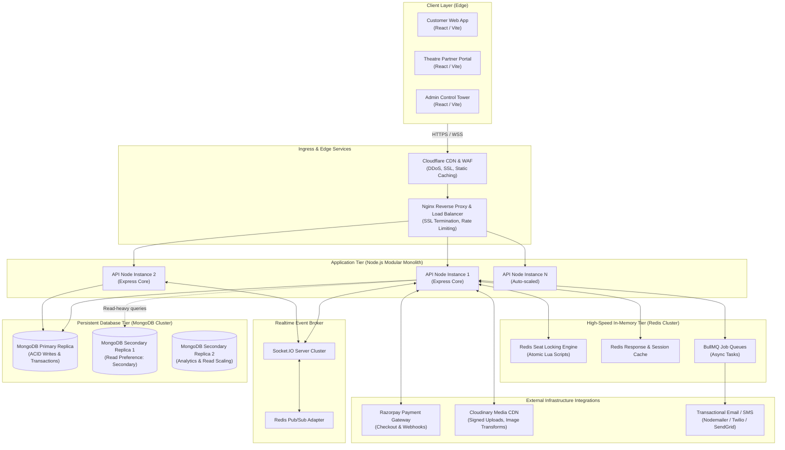
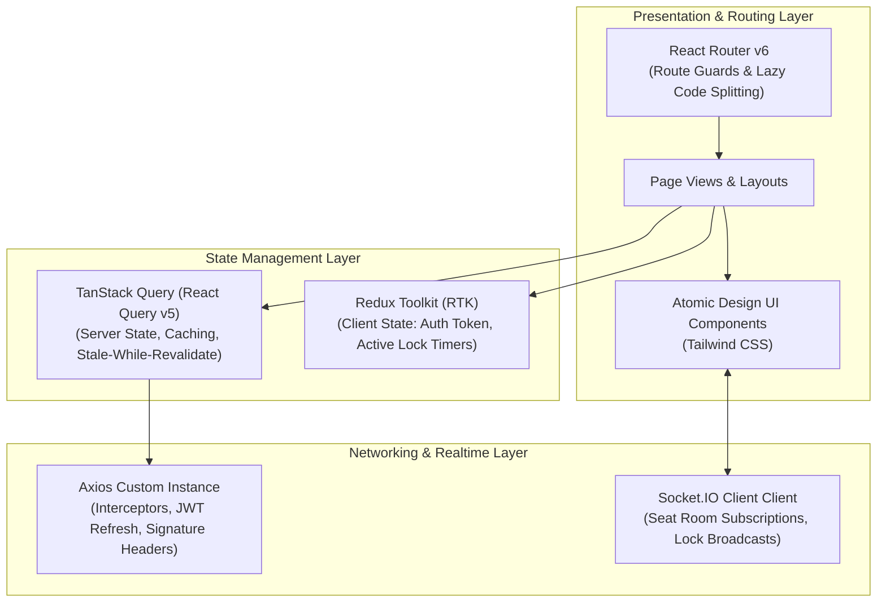
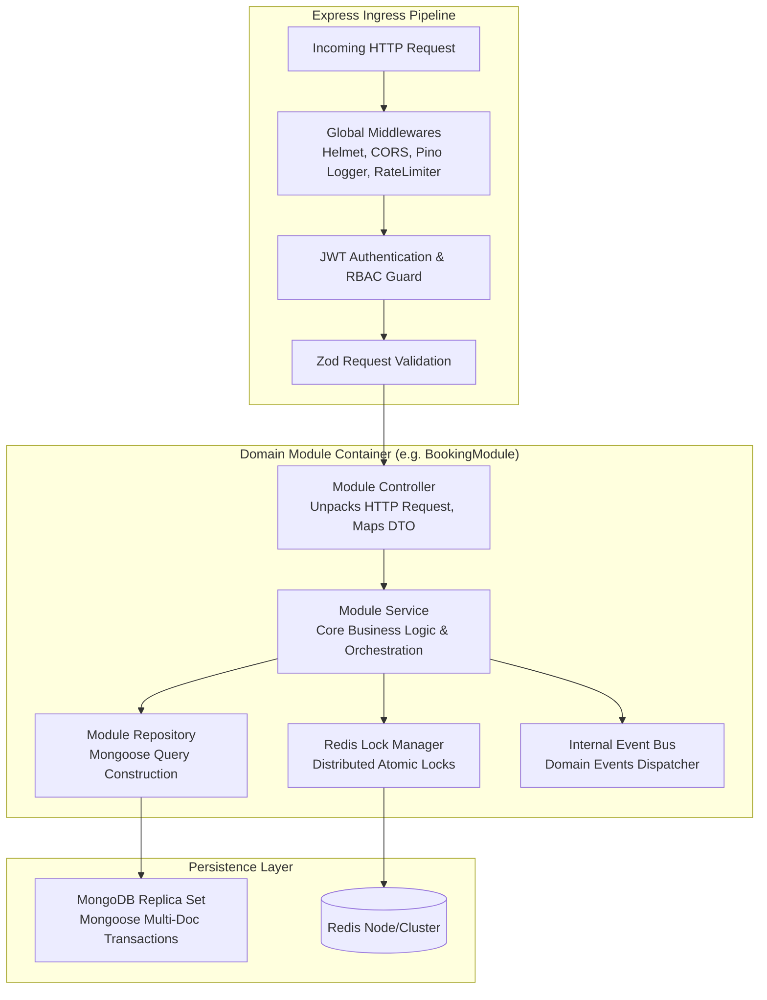
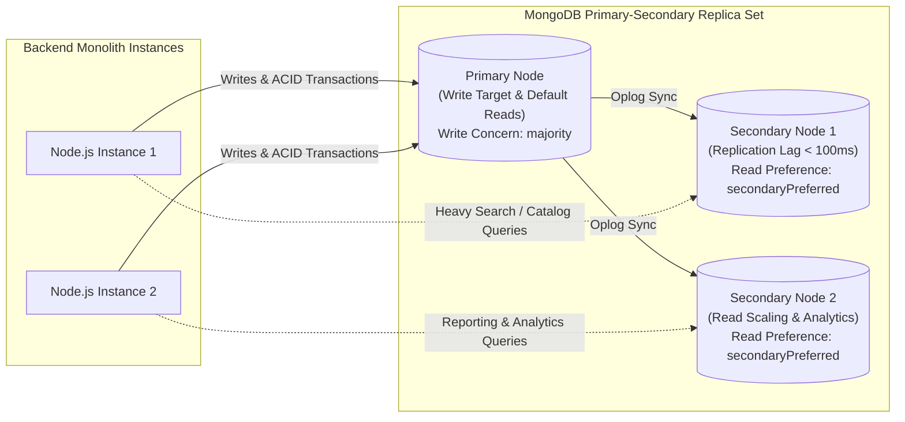
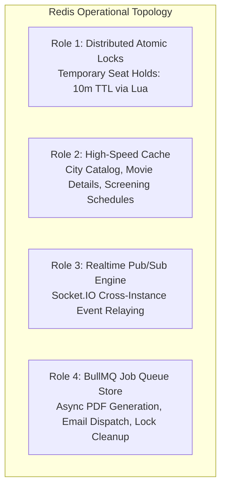
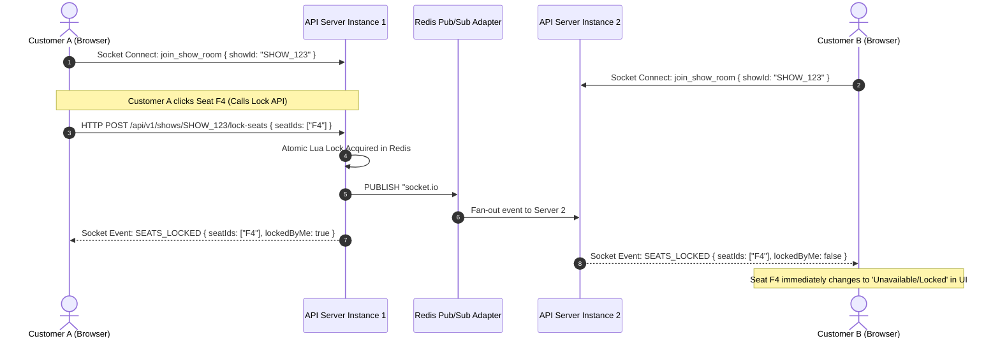
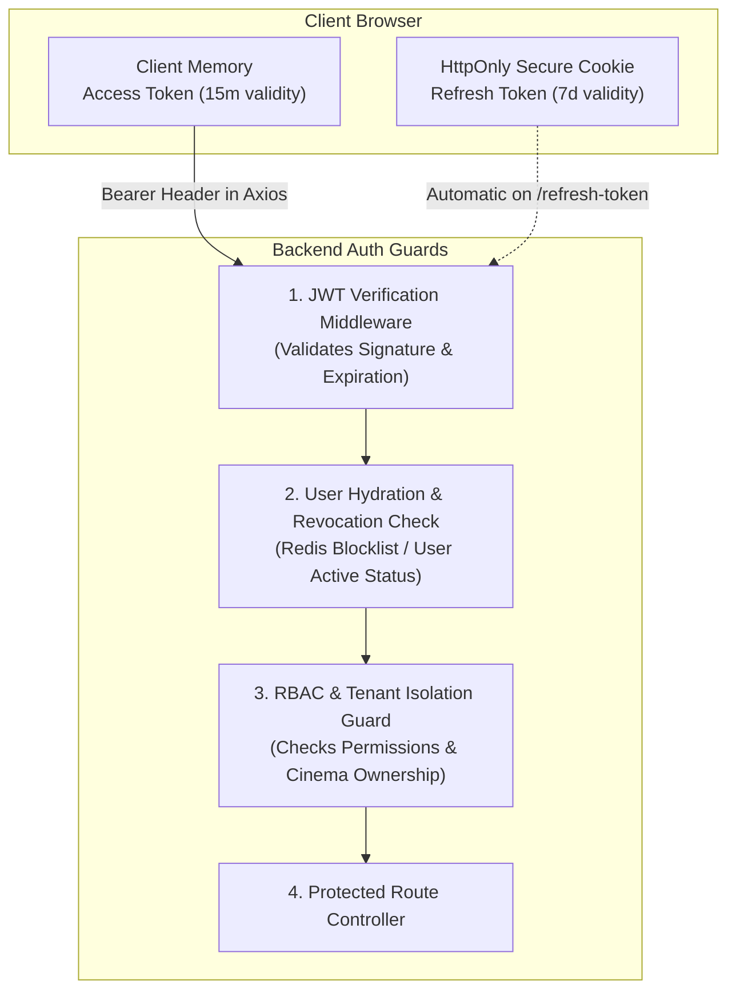
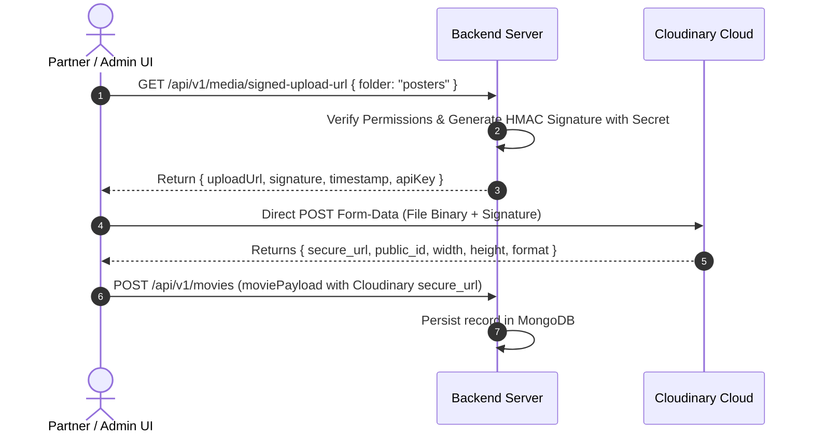
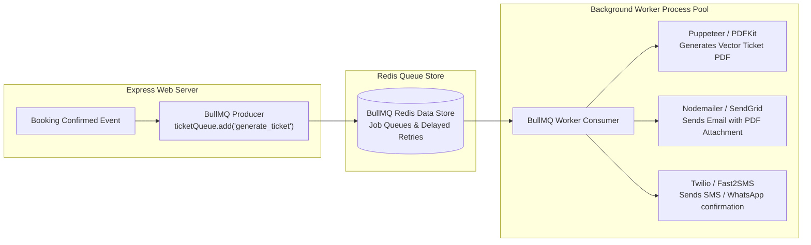
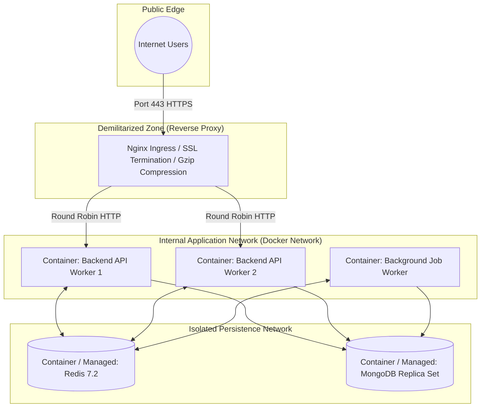

# 03. End-to-End System Architecture

## 1. High-Level Enterprise System Architecture

The Movie Ticket Booking Platform is organized as a high-throughput, cloud-native **Modular Monolith**. It unifies presentation, API routing, business logic, asynchronous event pipelines, distributed state synchronization, and persistent storage into a coherent, highly maintainable ecosystem.



---

## 2. Frontend Architecture (React.js SPA)

Each of the three applications (`customer-web`, `theatre-dashboard`, `admin-dashboard`) follows a clean, feature-driven architecture.



### Key Frontend Architectural Principles
1. **Server State vs. Client State Separation**:
   - **TanStack Query** manages all remote data (movies, showtimes, user profiles, bookings) with deterministic cache keys, automatic background polling, and optimistic UI mutations.
   - **Redux Toolkit** is strictly reserved for transient, synchronous client state: authenticated user session flags, active booking countdown timers, and UI theme toggles.
2. **Dynamic Seating Visualizer Canvas/SVG**:
   - High-performance, virtualized SVG canvas rendering seating grids up to 1,000+ seats per screen with 60 FPS interaction.
3. **Resilient Axios Interceptor Pipeline**:
   - Automatically catches `401 Unauthorized` responses, invokes the token refresh endpoint via a locked promise queue (preventing multiple concurrent refresh calls), and replays pending HTTP requests seamlessly.

---

## 3. Backend Architecture (Layered Modular Monolith)

The backend runs as a single process (or cluster of identical Node.js worker processes) structured into decoupled domain modules. Cross-module calls occur via service interfaces, not by reaching into another module's database collections.



### Module Layer Responsibilities
- **Controller Layer**: Handles HTTP protocol concerns: extracts URL params, headers, query strings, and body; invokes Zod validation schemas; calls the Service layer; formats standardized JSON responses.
- **Service Layer**: Houses pure business logic, transactional workflows, policy enforcement, third-party integrations, and domain events. Completely agnostic of Express `req` or `res` objects.
- **Repository Layer**: Encapsulates all data access logic and Mongoose model queries. Enforces tenant scoping and soft-delete filters.
- **Model Layer**: Defines Mongoose schemas, field data types, database-level constraints, and indexing specs.

---

## 4. Database Architecture (MongoDB Replica Set)

MongoDB serves as the primary operational datastore configured as a minimum 3-node Replica Set (Primary - Secondary - Secondary).



### Transaction & Consistency Strategy
- **ACID Multi-Document Transactions**: Used during critical operations: finalizing a booking, updating seat occupancy states, creating ledger payment entries, and recalculating coupon consumption.
- **Write Concern**: Enforces `{ w: "majority", j: true }` on write operations ensuring that once a booking is acknowledged, it has been durably committed to journaled storage across replica quorums.
- **Read Preference**: Write operations and real-time seat queries hit `primary`. Catalog browsing (movies, cities, genres, static cinema profiles) uses `secondaryPreferred` to reduce load on the primary node.

---

## 5. Redis Architecture (Distributed State, Locks & Caching)

Redis is deployed as an in-memory acceleration and synchronization tier fulfilling four distinct architectural roles:



### Key Redis Strategies
1. **Seat Lock Namespace**: `lock:show:<show_id>:seat:<seat_id>` storing `{ customer_id, locked_at, expires_at }` with strict millisecond TTLs.
2. **Catalog Caching (Stale-While-Revalidate pattern)**:
   - Key: `cache:city:<city_id>:movies:active` (TTL 10 minutes, invalidated on show publish).
   - Key: `cache:movie:<movie_id>:details` (TTL 24 hours, invalidated on admin edit).
3. **Sliding Window Rate Limiting**: Redis Sorted Sets (`zset`) tracking user IP and user ID requests per minute to stop DDoS and scalper bot attacks.

---

## 6. Socket.IO Real-time Architecture

Real-time seat state synchronization is paramount: when Customer A clicks seat `E12`, that seat must immediately transition to "LOCKED" (greyed out) on Customer B's screen in real time.



### Scaling Socket.IO with Redis Adapter
When Node.js instances are scaled horizontally behind Nginx, WebSockets connect to arbitrary instances. The `@socket.io/redis-adapter` distributes room broadcasts across all Node instances using Redis Pub/Sub channels.

---

## 7. Payment Architecture (Razorpay Integration)

Financial transactions must be resilient to browser crashes, dropped Wi-Fi connections, and payment gateway network latency. The architecture relies on an **asynchronous webhook-first state machine**.

```mermaid
sequenceDiagram
    autonumber
    actor Customer as Customer Client
    participant API as Backend Platform
    participant Redis as Redis Lock Engine
    participant DB as MongoDB
    participant Razorpay as Razorpay Gateway

    Customer->>API: POST /api/v1/bookings/initiate (showId, seatIds, couponCode)
    API->>Redis: Verify active lock belongs to customer
    API->>DB: Create Booking record (status: PENDING_PAYMENT)
    API->>Razorpay: Create Order (amount: calculated_amount, receipt: booking_id)
    Razorpay-->>API: Returns razorpay_order_id
    API-->>Customer: Return bookingId, razorpay_order_id, key_id

    Customer->>Razorpay: Opens Razorpay Checkout Modal & Completes Payment
    
    alt Synchronous Client Callback Path
        Customer->>API: POST /api/v1/payments/verify (razorpay_payment_id, signature)
        API->>API: Verify HMAC-SHA256 Signature
        API->>DB: Transition Booking to CONFIRMED inside MongoDB Transaction
        API->>Redis: Upgrade Lock to PERMANENT_BOOKED in Redis/DB
        API-->>Customer: Payment Verified & Confirmed Booking DTO
    else Asynchronous Webhook Fail-Safe Path (Client closes tab)
        Razorpay->>API: POST /api/v1/webhooks/razorpay (event: payment.captured)
        API->>API: Verify Webhook Signature Header
        API->>DB: Idempotent lookup: Is booking already CONFIRMED?
        API->>DB: If PENDING_PAYMENT -> Update to CONFIRMED
        API->>Redis: Release temporary lock; mark booked
    end
```

---

## 8. Authentication & Authorization Architecture

The platform implements a stateless JWT model paired with secure token rotation:



- **Short-Lived Access Token**: Carries `userId`, `role`, and assigned `theatreIds` (for partners). Lifespan: 15 minutes.
- **Rotating Refresh Token**: Opaque cryptographically random UUID stored in `HttpOnly`, `SameSite=Strict`, `Secure` cookie. Each refresh invalidates the prior token and issues a new pair.
- **Tenant Isolation Enforcement**: For `THEATRE_OWNER`, `THEATRE_MANAGER`, and `THEATRE_STAFF`, every request path validates that the target `theatreId` or `cinemaId` is explicitly listed in the caller's tenancy scope.

---

## 9. File Storage & Media Processing Architecture (Cloudinary)

To maintain high API throughput, media binary streams (movie posters, theatre license PDFs, banner images) never pass directly through the Express server memory.



---

## 10. Asynchronous Notification & Job Architecture (BullMQ)

High-latency tasks (generating PDF tickets, rendering QR codes, transmitting transactional emails and SMS) are dispatched asynchronously via **BullMQ** running on Redis.



---

## 11. Deployment & Infrastructure Architecture

The platform is fully containerized using Docker, designed to deploy onto any standard container orchestrator (Kubernetes, AWS ECS, or Docker Swarm) with zero vendor lock-in.



