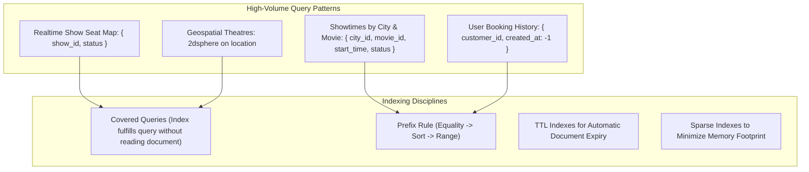

# 04. Database Planning & Data Architecture

## 1. Relational-to-Document Modeling Strategy in MongoDB

In high-concurrency ticketing engines, balancing normalization (referential integrity) against denormalization (low-latency read performance) is critical. 

### Strategic Architectural Decisions
1. **Screen Physical Layout vs. Show Seat Instances**:
   - `screens` and `seats` define the **physical immutable template** of an auditorium (e.g., Screen 1 has 150 physical chairs: Row A to J, Seats 1 to 15).
   - Once a show is scheduled, the system creates/references `show_seats` (or an optimized state bitmap/array) for that specific show instance. Mutating seat states (LOCKED, BOOKED) during a show must **never** mutate the screen's master layout template.
2. **Denormalized Snapshotting on Bookings**:
   - When a booking is finalized, movie title, theatre name, screen name, seat labels (e.g. `["E10", "E11"]`), and pricing tiers are stored as an **immutable snapshot** inside `bookings`. If a theatre renames a screen or a movie updates its synopsis 6 months later, the customer's historical ticket remains historically accurate and legally valid.
3. **Optimistic Locking via Version Keys (`__v`)**:
   - Critical documents subject to concurrent state transitions (`shows`, `bookings`, `payments`) utilize MongoDB optimistic concurrency control (`__v`) to ensure no lost updates during high-frequency writes.

---

## 2. Comprehensive Collection Specifications

### 2.1 Collection: `users`
- **Purpose**: Stores identity, credentials, role associations, and profile metadata for all system actors (customers, theatre staff, super admins).
- **Important Fields**:
  - `_id`: `ObjectId` (Primary Key)
  - `name`: `String` (Required)
  - `email`: `String` (Required, Lowercase, Unique)
  - `phone`: `String` (Required, E.164 format, Sparse Unique)
  - `password_hash`: `String` (Required, Argon2/Bcrypt)
  - `role_id`: `ObjectId` (Required, Ref: `roles`)
  - `tenant_id`: `ObjectId` (Optional, Ref: `theatre_partners`, required if role is partner/staff)
  - `assigned_theatres`: `Array<ObjectId>` (Refs: `theatres`, for manager/staff scope)
  - `city_id`: `ObjectId` (Optional, Ref: `cities`, preferred city)
  - `is_active`: `Boolean` (Default: `true`)
  - `is_email_verified`: `Boolean` (Default: `false`)
  - `deleted_at`: `Date` (Nullable, for soft delete)
  - `created_at`, `updated_at`: `Date`
- **Unique Constraints**: `email` (Unique), `phone` (Unique, Sparse).
- **Index Requirements**:
  - `{ email: 1 }` (Unique)
  - `{ phone: 1 }` (Sparse, Unique)
  - `{ tenant_id: 1, role_id: 1 }` (Compound, Tenant queries)
  - `{ is_active: 1, deleted_at: 1 }` (Filtering active users)
- **Data Ownership**: System / User self.
- **Soft Delete**: Yes (`deleted_at` timestamp).

---

### 2.2 Collection: `roles`
- **Purpose**: Defines granular role categories for the RBAC engine.
- **Important Fields**:
  - `_id`: `ObjectId`
  - `code`: `String` (Required, Enum: `CUSTOMER`, `THEATRE_OWNER`, `THEATRE_MANAGER`, `THEATRE_STAFF`, `SUPER_ADMIN`)
  - `name`: `String` (Required, e.g. "Theatre Operational Manager")
  - `description`: `String`
  - `created_at`, `updated_at`: `Date`
- **Unique Constraints**: `{ code: 1 }` (Unique).
- **Relationships**: Referenced by `users`, 1-to-Many with `permissions` (via junction or array).
- **Soft Delete**: No.

---

### 2.3 Collection: `permissions`
- **Purpose**: Atomic capabilities granted to roles (e.g. `movies:create`, `shows:publish`, `theatres:read`).
- **Important Fields**:
  - `_id`: `ObjectId`
  - `action`: `String` (Required, e.g. "theatres:update_pricing")
  - `module`: `String` (Required, e.g. "THEATRE_MGMT")
  - `description`: `String`
- **Unique Constraints**: `{ action: 1 }` (Unique).
- **Soft Delete**: No.

---

### 2.4 Collection: `role_permissions`
- **Purpose**: Junction mapping associating permissions with roles.
- **Important Fields**:
  - `_id`: `ObjectId`
  - `role_id`: `ObjectId` (Required, Ref: `roles`)
  - `permission_id`: `ObjectId` (Required, Ref: `permissions`)
- **Index Requirements**: Compound unique `{ role_id: 1, permission_id: 1 }`.
- **Soft Delete**: No.

---

### 2.5 Collection: `theatre_partners`
- **Purpose**: Legal/Corporate entity owning one or multiple physical cinema locations.
- **Important Fields**:
  - `_id`: `ObjectId`
  - `owner_user_id`: `ObjectId` (Required, Ref: `users`)
  - `business_name`: `String` (Required, e.g., "PVR INOX Limited")
  - `gstin`: `String` (Required, Unique)
  - `pan`: `String` (Required)
  - `bank_details`: `Object` (Encrypted account number, IFSC code, account name)
  - `kyc_status`: `String` (Enum: `PENDING`, `VERIFIED`, `REJECTED`, Default: `PENDING`)
  - `kyc_documents`: `Array<Object>` (Document type, Cloudinary URL, uploaded_at)
  - `rejection_reason`: `String`
  - `deleted_at`: `Date`
- **Unique Constraints**: `{ gstin: 1 }` (Unique).
- **Index Requirements**: `{ owner_user_id: 1 }`, `{ kyc_status: 1 }`.
- **Soft Delete**: Yes.

---

### 2.6 Collection: `cities`
- **Purpose**: Master registry of operational geographical locations.
- **Important Fields**:
  - `_id`: `ObjectId`
  - `name`: `String` (Required, e.g., "Mumbai", "Bengaluru")
  - `slug`: `String` (Required, Lowercase, e.g., "mumbai")
  - `state`: `String` (Required)
  - `country`: `String` (Default: "India")
  - `coordinates`: `Object` (`{ type: "Point", coordinates: [lng, lat] }`)
  - `is_active`: `Boolean` (Default: `true`)
  - `deleted_at`: `Date`
- **Unique Constraints**: `{ slug: 1 }` (Unique).
- **Index Requirements**: `{ slug: 1 }`, `2dsphere` on `coordinates`.
- **Soft Delete**: Yes.

---

### 2.7 Collection: `genres` & `languages`
- **Purpose**: Standardized taxonomic master data for movie classifications.
- **Important Fields**:
  - `_id`: `ObjectId`
  - `name`: `String` (Required, e.g. "Sci-Fi", "Hindi")
  - `slug`: `String` (Required, Unique)
  - `is_active`: `Boolean` (Default: `true`)
- **Unique Constraints**: `{ slug: 1 }` (Unique).
- **Soft Delete**: Yes.

---

### 2.8 Collection: `movies`
- **Purpose**: Centralized entertainment catalog entity.
- **Important Fields**:
  - `_id`: `ObjectId`
  - `title`: `String` (Required)
  - `slug`: `String` (Required, Unique)
  - `synopsis`: `String` (Required)
  - `duration_mins`: `Number` (Required, e.g. 165)
  - `release_date`: `Date` (Required)
  - `censor_rating`: `String` (Required, Enum: `U`, `UA`, `A`, `S`)
  - `language_ids`: `Array<ObjectId>` (Required, Refs: `languages`)
  - `genre_ids`: `Array<ObjectId>` (Required, Refs: `genres`)
  - `available_formats`: `Array<String>` (Enum: `2D`, `3D`, `IMAX_2D`, `IMAX_3D`, `4DX`)
  - `cast`: `Array<Object>` (`{ name: String, role: String, photo_url: String }`)
  - `crew`: `Array<Object>` (`{ name: String, designation: String, photo_url: String }`)
  - `poster_url`: `String` (Cloudinary URL)
  - `backdrop_url`: `String` (Cloudinary URL)
  - `trailer_youtube_url`: `String`
  - `status`: `String` (Enum: `UPCOMING`, `NOW_SHOWING`, `ARCHIVED`)
  - `avg_rating`: `Number` (Default: 0.0)
  - `total_reviews`: `Number` (Default: 0)
  - `deleted_at`: `Date`
- **Unique Constraints**: `{ slug: 1 }` (Unique).
- **Index Requirements**:
  - `{ status: 1, release_date: -1 }` (Catalog browsing)
  - `{ language_ids: 1, genre_ids: 1, status: 1 }` (Filter queries)
  - Text Index on `{ title: "text", "cast.name": "text", "crew.name": "text" }` (Search)
- **Soft Delete**: Yes.

---

### 2.9 Collection: `theatres`
- **Purpose**: Physical cinema complex (e.g. "PVR Director's Cut, Ambience Mall").
- **Important Fields**:
  - `_id`: `ObjectId`
  - `partner_id`: `ObjectId` (Required, Ref: `theatre_partners`)
  - `city_id`: `ObjectId` (Required, Ref: `cities`)
  - `name`: `String` (Required)
  - `address`: `String` (Required)
  - `landmark`: `String`
  - `pincode`: `String` (Required)
  - `location`: `Object` (`{ type: "Point", coordinates: [lng, lat] }`)
  - `amenities`: `Array<String>` (e.g. `["PARKING", "WHEELCHAIR", "FOOD_COURT", "RECLINERS"]`)
  - `is_active`: `Boolean` (Default: `true`)
  - `deleted_at`: `Date`
- **Index Requirements**:
  - `{ partner_id: 1 }` (Partner tenancy lookup)
  - `{ city_id: 1, is_active: 1 }` (City cinema listing)
  - `2dsphere` on `location` (Geospatial nearest cinema search)
- **Data Ownership**: Owned by `theatre_partners`.
- **Soft Delete**: Yes.

---

### 2.10 Collection: `screens`
- **Purpose**: Specific auditorium inside a theatre.
- **Important Fields**:
  - `_id`: `ObjectId`
  - `theatre_id`: `ObjectId` (Required, Ref: `theatres`)
  - `name`: `String` (Required, e.g. "Audi 3 - IMAX")
  - `total_rows`: `Number` (Required, e.g. 15)
  - `total_columns`: `Number` (Required, e.g. 20)
  - `total_seats`: `Number` (Required, e.g. 250)
  - `supported_formats`: `Array<String>` (e.g. `["2D", "3D", "IMAX_3D"]`)
  - `sound_system`: `String` (e.g. "Dolby Atmos 64 Channel")
  - `is_active`: `Boolean` (Default: `true`)
  - `deleted_at`: `Date`
- **Unique Constraints**: Compound `{ theatre_id: 1, name: 1, deleted_at: 1 }` (Unique screen name per cinema).
- **Index Requirements**: `{ theatre_id: 1, is_active: 1 }`.
- **Soft Delete**: Yes.

---

### 2.11 Collection: `seats`
- **Purpose**: Master physical layout template of chairs for a screen.
- **Important Fields**:
  - `_id`: `ObjectId`
  - `screen_id`: `ObjectId` (Required, Ref: `screens`)
  - `row_label`: `String` (Required, e.g. "A", "B", "K")
  - `column_number`: `Number` (Required, e.g. 1, 2, 14)
  - `seat_label`: `String` (Required, e.g. "A12")
  - `category`: `String` (Required, Enum: `VIP`, `PREMIUM`, `EXECUTIVE`, `STANDARD`)
  - `type`: `String` (Enum: `NORMAL`, `RECLINER`, `WHEELCHAIR`, `AISLE_GAP`)
  - `grid_row`: `Number` (Coordinate for SVG rendering)
  - `grid_col`: `Number` (Coordinate for SVG rendering)
  - `is_available`: `Boolean` (Default: `true`, false if seat is permanently broken/under repair)
- **Unique Constraints**: Compound `{ screen_id: 1, seat_label: 1 }` (Unique seat coordinate per screen).
- **Index Requirements**: `{ screen_id: 1 }`.
- **Soft Delete**: No (Seats are replaced or updated via screen layout versioning).

---

### 2.12 Collection: `shows`
- **Purpose**: Scheduled projection of a specific movie on a screen at a given datetime.
- **Important Fields**:
  - `_id`: `ObjectId`
  - `movie_id`: `ObjectId` (Required, Ref: `movies`)
  - `theatre_id`: `ObjectId` (Required, Ref: `theatres`)
  - `screen_id`: `ObjectId` (Required, Ref: `screens`)
  - `city_id`: `ObjectId` (Required, Ref: `cities`, denormalized for instant filtering)
  - `start_time`: `Date` (Required, UTC)
  - `end_time`: `Date` (Required, UTC, calculated from movie duration + buffer)
  - `format`: `String` (Required, e.g. "IMAX_3D")
  - `language`: `String` (Required, e.g. "English")
  - `pricing_tier`: `Array<Object>` (Required, e.g. `[{ category: "VIP", price: 450 }, { category: "PREMIUM", price: 300 }]`)
  - `status`: `String` (Enum: `SCHEDULED`, `BOOKING_OPEN`, `HOUSEFULL`, `CANCELLED`, `COMPLETED`)
  - `cancellation_reason`: `String`
  - `total_seats_count`: `Number` (Total capacity)
  - `available_seats_count`: `Number` (Fast counter for "Filling Fast" badges)
  - `deleted_at`: `Date`
- **Index Requirements**:
  - `{ city_id: 1, movie_id: 1, start_time: 1, status: 1 }` (Core showtime search query)
  - `{ screen_id: 1, start_time: 1, end_time: 1 }` (Collision prevention query)
  - `{ theatre_id: 1, start_time: 1 }` (Cinema daily schedule query)
- **Soft Delete**: Yes.

---

### 2.13 Collection: `show_seats`
- **Purpose**: Operational runtime seat state for a scheduled show. Separates dynamic show state from master screen layout.
- **Important Fields**:
  - `_id`: `ObjectId`
  - `show_id`: `ObjectId` (Required, Ref: `shows`)
  - `seat_id`: `ObjectId` (Required, Ref: `seats`)
  - `category`: `String` (Denormalized)
  - `price`: `Number` (Calculated show price)
  - `status`: `String` (Enum: `AVAILABLE`, `LOCKED`, `BOOKED`, `BLOCKED`, Default: `AVAILABLE`)
  - `locked_by_user_id`: `ObjectId` (Optional, Ref: `users`)
  - `locked_until`: `Date` (Optional, TTL synchronization timestamp)
  - `booking_id`: `ObjectId` (Optional, Ref: `bookings`)
  - `version`: `Number` (Optimistic concurrency control)
- **Unique Constraints**: Compound `{ show_id: 1, seat_id: 1 }` (Unique seat instance per show).
- **Index Requirements**:
  - `{ show_id: 1, status: 1 }` (Fast show layout availability fetch)
  - `{ show_id: 1, seat_id: 1 }` (Atomic status updates)
- **Soft Delete**: No.

---

### 2.14 Collection: `bookings`
- **Purpose**: Root financial and fulfillment transaction document.
- **Important Fields**:
  - `_id`: `ObjectId`
  - `booking_reference`: `String` (Required, Unique, e.g. "BMS-202610-A89K2")
  - `customer_id`: `ObjectId` (Required, Ref: `users`)
  - `show_id`: `ObjectId` (Required, Ref: `shows`)
  - `theatre_id`: `ObjectId` (Required, Ref: `theatres`)
  - `total_seats`: `Number` (Required, e.g. 2)
  - `base_amount`: `Number` (Required, in paise/cents or ₹, e.g. 600.00)
  - `convenience_fee`: `Number` (Required, e.g. 50.00)
  - `tax_amount`: `Number` (Required, GST 18%, e.g. 9.00)
  - `discount_amount`: `Number` (Default: 0.00)
  - `net_payable_amount`: `Number` (Required, Total charged)
  - `coupon_id`: `ObjectId` (Optional, Ref: `coupons`)
  - `status`: `String` (Enum: `PENDING_PAYMENT`, `CONFIRMED`, `CANCELLED`, `REFUNDED`, `EXPIRED`)
  - `snapshot`: `Object` (Denormalized immutable record of movie title, poster, theatre name, screen name, seat labels, show start time)
  - `qr_code_payload`: `String` (Encrypted/signed verification hash)
  - `pdf_ticket_url`: `String` (Cloudinary signed PDF URL)
  - `is_checked_in`: `Boolean` (Default: `false`)
  - `checked_in_at`: `Date`
  - `checked_in_by`: `ObjectId` (Ref: `users`, staff ID)
  - `created_at`, `updated_at`: `Date`
- **Unique Constraints**: `{ booking_reference: 1 }` (Unique).
- **Index Requirements**:
  - `{ customer_id: 1, created_at: -1 }` (Customer booking history)
  - `{ show_id: 1, status: 1 }` (Show settlement & auditing)
  - `{ theatre_id: 1, created_at: -1 }` (Partner box office reports)
- **Data Ownership**: Customer / Theatre.
- **Soft Delete**: No (Strict financial ledger auditing requires permanent persistence).

---

### 2.15 Collection: `booking_items`
- **Purpose**: Individual seat line-item breakdown associated with a booking.
- **Important Fields**:
  - `_id`: `ObjectId`
  - `booking_id`: `ObjectId` (Required, Ref: `bookings`)
  - `seat_id`: `ObjectId` (Required, Ref: `seats`)
  - `seat_label`: `String` (Required, e.g. "F12")
  - `seat_category`: `String` (Required, e.g. "PREMIUM")
  - `unit_price`: `Number` (Required, e.g. 300.00)
- **Index Requirements**: Compound `{ booking_id: 1, seat_id: 1 }`.
- **Soft Delete**: No.

---

### 2.16 Collection: `payments`
- **Purpose**: Immutable financial ledger capturing gateway interactions.
- **Important Fields**:
  - `_id`: `ObjectId`
  - `booking_id`: `ObjectId` (Required, Ref: `bookings`)
  - `customer_id`: `ObjectId` (Required, Ref: `users`)
  - `gateway`: `String` (Default: "RAZORPAY")
  - `razorpay_order_id`: `String` (Required, Indexed)
  - `razorpay_payment_id`: `String` (Sparse, Indexed)
  - `razorpay_signature`: `String`
  - `amount`: `Number` (Required)
  - `currency`: `String` (Default: "INR")
  - `status`: `String` (Enum: `CREATED`, `AUTHORIZED`, `CAPTURED`, `FAILED`, `REFUNDED`)
  - `payment_method`: `String` (e.g. `UPI`, `CARD`, `NETBANKING`)
  - `failure_reason`: `String`
  - `gateway_raw_response`: `Object` (Stored for financial dispute audit)
  - `created_at`, `updated_at`: `Date`
- **Unique Constraints**: `{ razorpay_order_id: 1 }` (Unique), `{ razorpay_payment_id: 1 }` (Sparse, Unique).
- **Index Requirements**: Compound `{ booking_id: 1, status: 1 }`.
- **Soft Delete**: No.

---

### 2.17 Collection: `refunds`
- **Purpose**: Manages refund requests, policy calculations, and gateway payout reconciliation.
- **Important Fields**:
  - `_id`: `ObjectId`
  - `booking_id`: `ObjectId` (Required, Ref: `bookings`)
  - `payment_id`: `ObjectId` (Required, Ref: `payments`)
  - `razorpay_refund_id`: `String` (Sparse, Unique)
  - `requested_by`: `ObjectId` (Ref: `users`)
  - `cancellation_reason`: `String`
  - `gross_amount`: `Number`
  - `deductions`: `Number` (Convenience fee & cancellation policy deduction)
  - `refund_amount`: `Number` (Net amount credited to customer)
  - `status`: `String` (Enum: `PENDING`, `PROCESSING`, `SUCCESS`, `FAILED`)
  - `initiated_at`: `Date`
  - `settled_at`: `Date`
- **Index Requirements**: `{ booking_id: 1 }`, `{ razorpay_refund_id: 1 }`.
- **Soft Delete**: No.

---

### 2.18 Collection: `coupons`
- **Purpose**: Promotional codes, marketing campaigns, and bank offers.
- **Important Fields**:
  - `_id`: `ObjectId`
  - `code`: `String` (Required, UpperCase, e.g. "AXISMOVIE50")
  - `discount_type`: `String` (Enum: `PERCENTAGE`, `FLAT`)
  - `discount_value`: `Number` (Required, e.g. 50% or ₹150)
  - `max_discount_cap`: `Number` (Optional ceiling for percentage discounts)
  - `min_order_value`: `Number` (Default: 0)
  - `usage_limit_per_user`: `Number` (Default: 1)
  - `total_usage_limit`: `Number`
  - `current_usage_count`: `Number` (Default: 0)
  - `start_date`: `Date` (Required)
  - `end_date`: `Date` (Required)
  - `applicable_cities`: `Array<ObjectId>` (Optional, empty = all)
  - `is_active`: `Boolean` (Default: `true`)
- **Unique Constraints**: `{ code: 1 }` (Unique).
- **Index Requirements**: `{ code: 1, is_active: 1, start_date: 1, end_date: 1 }`.
- **Soft Delete**: Yes.

---

### 2.19 Collection: `reviews`
- **Purpose**: Verified viewer ratings and written critique.
- **Important Fields**:
  - `_id`: `ObjectId`
  - `movie_id`: `ObjectId` (Required, Ref: `movies`)
  - `customer_id`: `ObjectId` (Required, Ref: `users`)
  - `booking_id`: `ObjectId` (Required, Ref: `bookings`, enforces verified viewer check)
  - `rating`: `Number` (Required, 1 to 10 scale)
  - `review_title`: `String`
  - `comment`: `String`
  - `is_verified_booking`: `Boolean` (Default: `true`)
  - `likes_count`: `Number` (Default: 0)
  - `is_flagged`: `Boolean` (Default: `false`)
  - `created_at`: `Date`
- **Unique Constraints**: Compound `{ customer_id: 1, movie_id: 1 }` (One review per customer per movie).
- **Index Requirements**: `{ movie_id: 1, is_flagged: 1, created_at: -1 }`.
- **Soft Delete**: Yes.

---

### 2.20 Collection: `wishlists`
- **Purpose**: Customer watchlist tracking upcoming or now-showing titles.
- **Important Fields**:
  - `_id`: `ObjectId`
  - `customer_id`: `ObjectId` (Required, Ref: `users`)
  - `movie_id`: `ObjectId` (Required, Ref: `movies`)
  - `notify_on_booking_open`: `Boolean` (Default: `true`)
  - `created_at`: `Date`
- **Unique Constraints**: Compound `{ customer_id: 1, movie_id: 1 }` (Unique).
- **Index Requirements**: `{ customer_id: 1 }`, `{ movie_id: 1 }`.
- **Soft Delete**: No.

---

### 2.21 Collection: `notifications`
- **Purpose**: In-app alert inbox and notification history.
- **Important Fields**:
  - `_id`: `ObjectId`
  - `user_id`: `ObjectId` (Required, Ref: `users`)
  - `type`: `String` (Enum: `BOOKING_CONFIRMED`, `CANCELLATION`, `REFUND_PROCESSED`, `TICKET_ALERT`)
  - `title`: `String` (Required)
  - `message`: `String` (Required)
  - `metadata`: `Object` (e.g. `{ booking_id: "...", url: "..." }`)
  - `is_read`: `Boolean` (Default: `false`)
  - `created_at`: `Date`
- **Index Requirements**: `{ user_id: 1, is_read: 1, created_at: -1 }`.
- **Soft Delete**: No.

---

### 2.22 Collection: `audit_logs`
- **Purpose**: Immutable governance and compliance trail for administrative operations.
- **Important Fields**:
  - `_id`: `ObjectId`
  - `actor_id`: `ObjectId` (Required, Ref: `users`)
  - `actor_role`: `String` (Required)
  - `action`: `String` (Required, e.g. "SHOW_PRICING_UPDATED", "THEATRE_APPROVED")
  - `target_resource`: `String` (e.g. "shows")
  - `target_id`: `ObjectId` (ID of the altered entity)
  - `ip_address`: `String`
  - `user_agent`: `String`
  - `previous_state`: `Object` (JSON snapshot before mutation)
  - `new_state`: `Object` (JSON snapshot after mutation)
  - `timestamp`: `Date` (Required, Default: `Date.now`)
- **Index Requirements**:
  - `{ target_id: 1, timestamp: -1 }`
  - `{ actor_id: 1, timestamp: -1 }`
  - `{ action: 1, timestamp: -1 }`
- **Soft Delete**: Strictly Prohibited (Append-only immutable collection).

---

### 2.23 Collection: `refresh_tokens`
- **Purpose**: Stores active cryptographic refresh tokens to enable instant token revocation and rotation detection.
- **Important Fields**:
  - `_id`: `ObjectId`
  - `user_id`: `ObjectId` (Required, Ref: `users`)
  - `token_hash`: `String` (Required, SHA-256 hash of token)
  - `family_id`: `String` (Required, UUID for token family rotation tracking)
  - `expires_at`: `Date` (Required, TTL index candidate)
  - `is_revoked`: `Boolean` (Default: `false`)
  - `created_at`: `Date`
- **Index Requirements**:
  - `{ token_hash: 1 }` (Unique)
  - `{ expires_at: 1 }` (MongoDB TTL index: automatically purges expired records)
  - `{ user_id: 1, is_revoked: 1 }`
- **Soft Delete**: No.

---

## 3. High-Performance Indexing & Query Strategy

### Potential Performance Pitfalls & Mitigations
1. **Unbounded Array Growth (Anti-Pattern: Embedding Seats inside Screen)**:
   - *Risk*: A screen with 1,000 seats updated repeatedly can trigger MongoDB document relocation (BSON 16MB ceiling and I/O write amplification).
   - *Mitigation*: Physical layout seats reside in a dedicated `seats` collection referencing `screen_id`.
2. **Showtime Schedule Collisions**:
   - *Risk*: Two theater operators mistakenly scheduling Screen 1 for two different movies at 4:00 PM.
   - *Mitigation*: Application checks overlapping windows: `start_time < existing.end_time AND end_time > existing.start_time` within an isolated transaction.
3. **High Write Contention on Popular Shows**:
   - *Risk*: 500 customers hitting the exact same `show_seats` documents simultaneously.
   - *Mitigation*: Temporary seat holds are handled entirely in **Redis memory** via Lua scripts. MongoDB write transactions occur only upon definitive payment capture.

