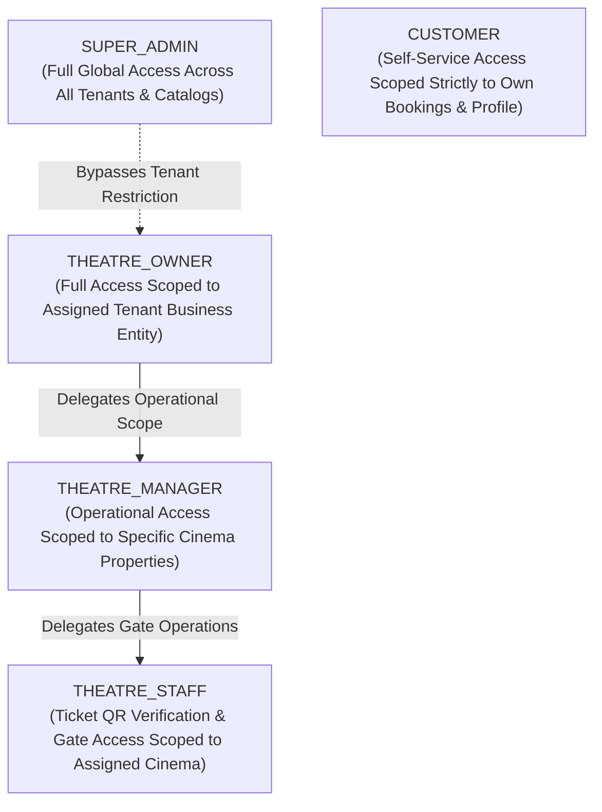
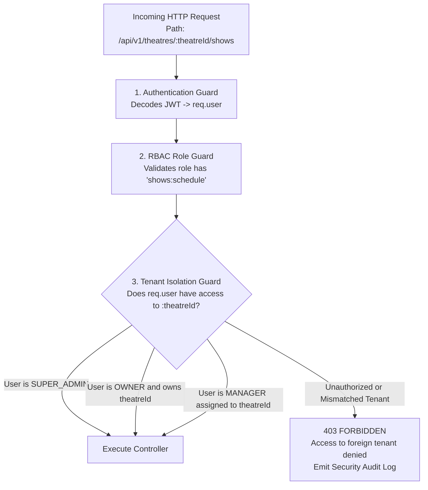
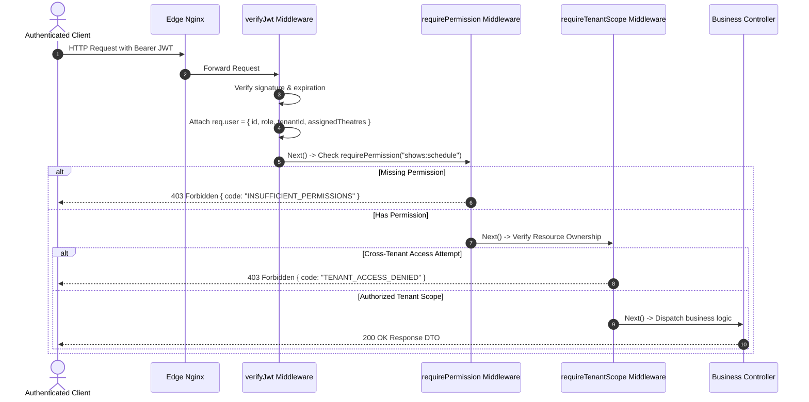

# 05. User Roles, Permissions & Multi-Tenant Access Control

## 1. Role Hierarchy & Persona Definitions

The platform enforces a strict multi-tier **Role-Based Access Control (RBAC)** architecture coupled with **Attribute-Based Tenant Scoping (ABAC)**.



### Hierarchy Breakdown
1. **`SUPER_ADMIN`**: Global platform operator. Can create/archive master catalogs (cities, movies, languages), approve/reject theatre partner KYC, alter commission schedules, view universal audit trails, and impersonate or suspend accounts.
2. **`THEATRE_OWNER`**: Legal entity head. Owns one `theatre_partner` record and all associated cinema properties (`theatres`), screens, and shows. Can view corporate revenue, manage bank details, and invite/manage operational managers.
3. **`THEATRE_MANAGER`**: Operational lead at the cinema location. Has permissions restricted to specific assigned `theatres`. Can configure screen layouts, set pricing tiers, create and publish shows, and view local daily box-office collections. Cannot alter partner bank accounts or invite other owners.
4. **`THEATRE_STAFF`**: Box-office or usher staff. Permissions strictly limited to QR code validation (`tickets:verify`) and real-time door admission (`tickets:check_in`) for their assigned theatre on the current date.
5. **`CUSTOMER`**: End user. Access strictly restricted to personal identity: browsing public catalogues, reserving seats, making payments, managing personal profile, and viewing personal booking history.

---

## 2. Granular RBAC Permission Matrix

| Module / Resource | Permission Key | CUSTOMER | THEATRE_STAFF | THEATRE_MANAGER | THEATRE_OWNER | SUPER_ADMIN |
| :--- | :--- | :---: | :---: | :---: | :---: | :---: |
| **Authentication** | `auth:profile_read_own` |  |  |  |  |  |
| | `auth:profile_update_own` |  |  |  |  |  |
| | `auth:manage_users_global`| ❌ | ❌ | ❌ | ❌ |  |
| **Cities / Master** | `master:read` |  |  |  |  |  |
| | `master:write` | ❌ | ❌ | ❌ | ❌ |  |
| **Movies Catalog** | `movies:read` |  |  |  |  |  |
| | `movies:create` | ❌ | ❌ | ❌ | ❌ |  |
| | `movies:update` | ❌ | ❌ | ❌ | ❌ |  |
| | `movies:delete` | ❌ | ❌ | ❌ | ❌ |  |
| **Partner KYC** | `partner:register` | ❌ | ❌ | ❌ |  |  |
| | `partner:view_own_kyc` | ❌ | ❌ | ❌ |  |  |
| | `partner:approve_kyc` | ❌ | ❌ | ❌ | ❌ |  |
| **Theatres** | `theatres:read_public` |  |  |  |  |  |
| | `theatres:create` | ❌ | ❌ | ❌ |  (Own) |  |
| | `theatres:update` | ❌ | ❌ | ❌ |  (Own) |  |
| | `theatres:view_revenue`| ❌ | ❌ |  (Local) |  (Tenant) |  (Global) |
| **Screens & Layout**| `screens:create` | ❌ | ❌ |  (Assigned) |  (Own) |  |
| | `screens:update_layout`| ❌ | ❌ |  (Assigned) |  (Own) |  |
| **Shows** | `shows:read_public` |  |  |  |  |  |
| | `shows:schedule` | ❌ | ❌ |  (Assigned) |  (Own) |  |
| | `shows:cancel` | ❌ | ❌ |  (Assigned) |  (Own) |  |
| **Seats & Locks** | `seats:lock_temporary`|  | ❌ | ❌ | ❌ | ❌ |
| | `seats:release_lock` |  (Own) | ❌ | ❌ | ❌ |  |
| **Bookings** | `bookings:create` |  | ❌ | ❌ | ❌ | ❌ |
| | `bookings:read_own` |  | ❌ | ❌ | ❌ | ❌ |
| | `bookings:cancel_own` |  | ❌ | ❌ | ❌ | ❌ |
| | `bookings:read_theatre`| ❌ | ❌ |  (Assigned) |  (Own) |  (Global) |
| **Tickets / QR** | `tickets:verify_qr` | ❌ |  (Assigned) |  (Assigned) |  (Own) |  |
| | `tickets:check_in` | ❌ |  (Assigned) |  (Assigned) |  (Own) |  |
| **Coupons** | `coupons:apply` |  | ❌ | ❌ | ❌ | ❌ |
| | `coupons:manage` | ❌ | ❌ | ❌ | ❌ |  |
| **Audit Logs** | `audit:read` | ❌ | ❌ | ❌ | ❌ |  |

---

## 3. Multi-Tenant Isolation Architecture

A core vulnerability in multi-tenant SaaS applications is **BOLA (Broken Object Level Authorization)** / **IDOR (Insecure Direct Object References)**, where a malicious theatre owner alters the URL parameter `theatreId` to query or modify a competitor's revenue or show schedule.



### Architectural Tenancy Enforcement Rules
1. **Never Trust Client-Supplied Tenant Identifiers**:
   - For partner requests, `tenant_id` is always extracted from the cryptographically signed JWT or database session, **not** from unverified request body parameters.
2. **Query-Level Scoping in Repositories**:
   - The repository layer automatically injects tenant filters into every Mongoose query:
   ```typescript
   // Enforced Repository Pattern Rule
   const findTheatres = async (filter, user) => {
     if (user.role === 'SUPER_ADMIN') {
       return TheatreModel.find(filter);
     }
     if (user.role === 'THEATRE_OWNER') {
       return TheatreModel.find({ ...filter, partner_id: user.tenant_id });
     }
     if (user.role === 'THEATRE_MANAGER') {
       return TheatreModel.find({ ...filter, _id: { $in: user.assigned_theatres } });
     }
     throw new ForbiddenException('Unauthorized theatre scope access');
   };
   ```
3. **Database-Level Compound Indexing**:
   - All tenant-sensitive collections (`theatres`, `screens`, `shows`, `bookings`) maintain compound indexes prefixed by `theatre_id` or `partner_id` to ensure isolation and high query performance.

---

## 4. API Authorization Pipeline Implementation Blueprint



### Security Event Auditing
Any attempt to access resources outside a tenant's authorized scope immediately triggers an asynchronous audit event logged to `audit_logs` with severity level `SECURITY_ALERT`, capturing the actor's ID, source IP address, target resource, and the requested URI.

