# 06. Core Business Workflows & Sequence Specifications

This document outlines the 12 mission-critical business workflows across the platform, complete with architectural sequence diagrams, state transitions, validation checkpoints, and failure recovery policies.

---

## Workflow A: Customer Registration & Multi-Factor Login

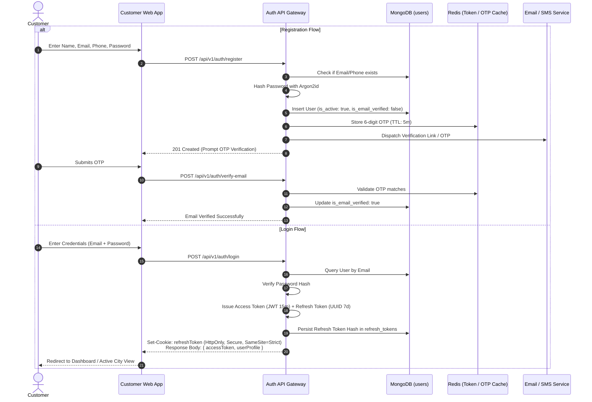

---

## Workflow B: Theatre Owner Onboarding & Super Admin Approval

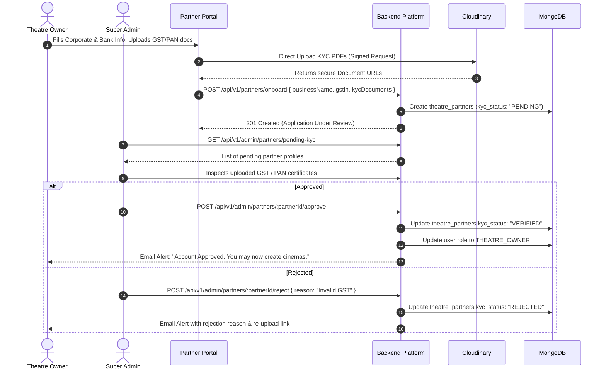

---

## Workflow C: Adding a Theatre & Screens

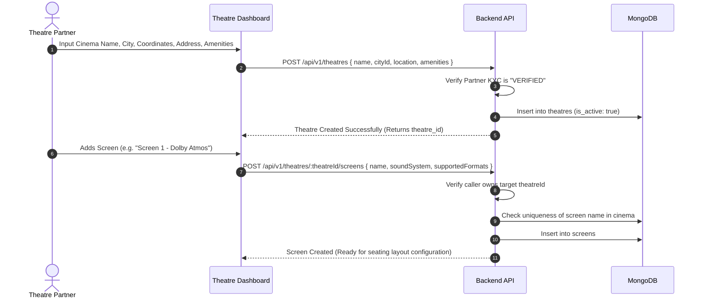

---

## Workflow D: Configuring Visual Seating Layouts

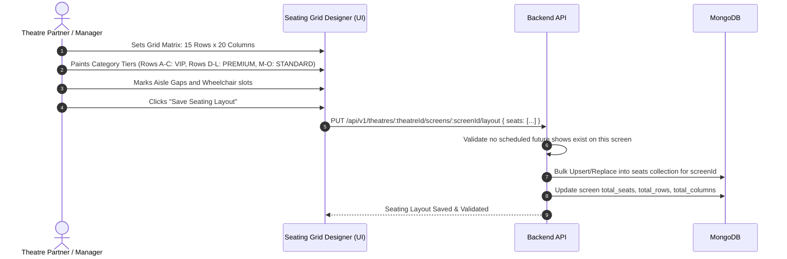

---

## Workflow E: Adding Movies & Creating Shows

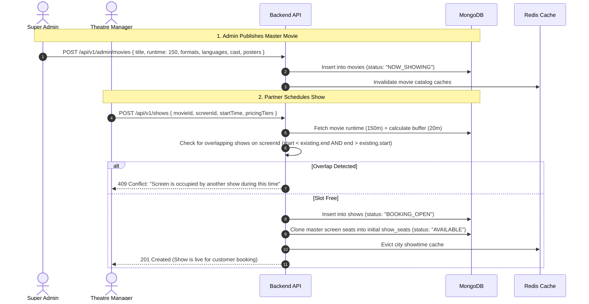

---

## Workflow F: Customer Movie Discovery, Search & Dynamic Filtering

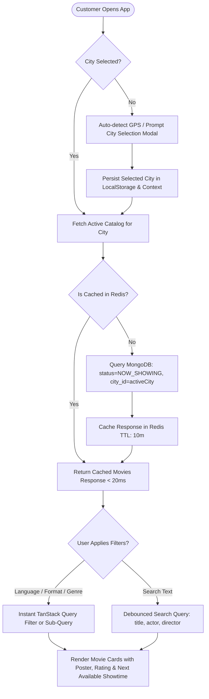

---

## Workflow G: Theatre & Showtime Selection with City Context

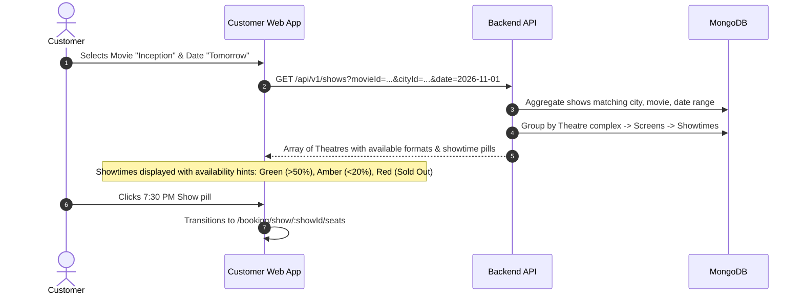

---

## Workflow H: Seat Selection & Distributed Temporary Locking

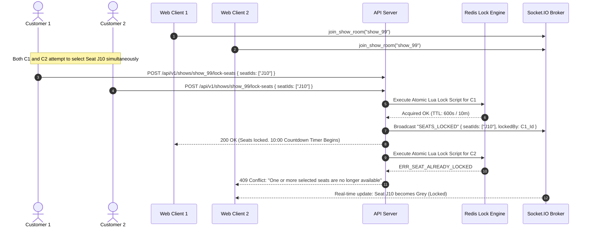

---

## Workflow I: Payment Processing (Razorpay Integration)

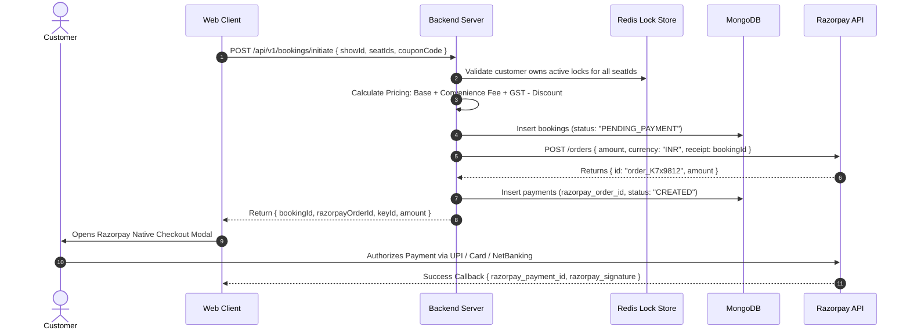

---

## Workflow J: Booking Confirmation & ACID Ledger Commit

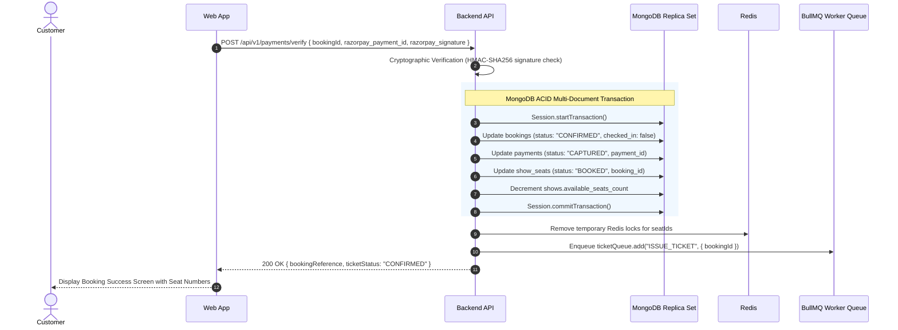

---

## Workflow K: QR Ticket Generation & Box-Office Gate Verification

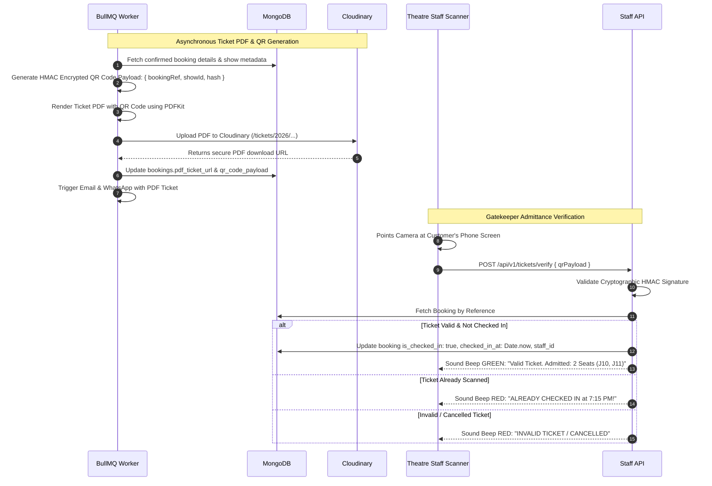

---

## Workflow L: Booking Cancellation, Inventory Restitution & Refunds

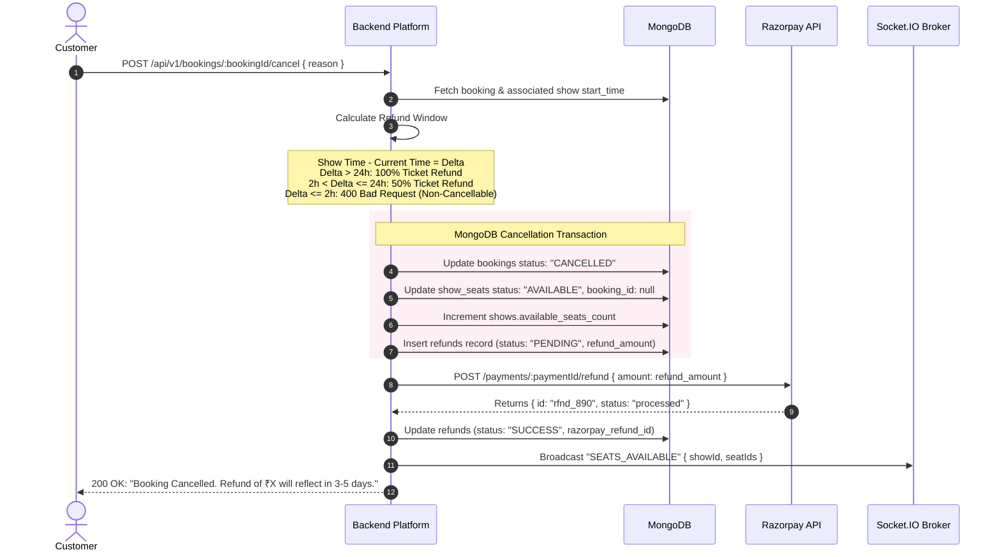

