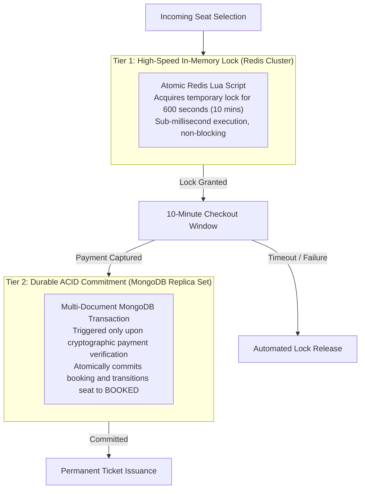
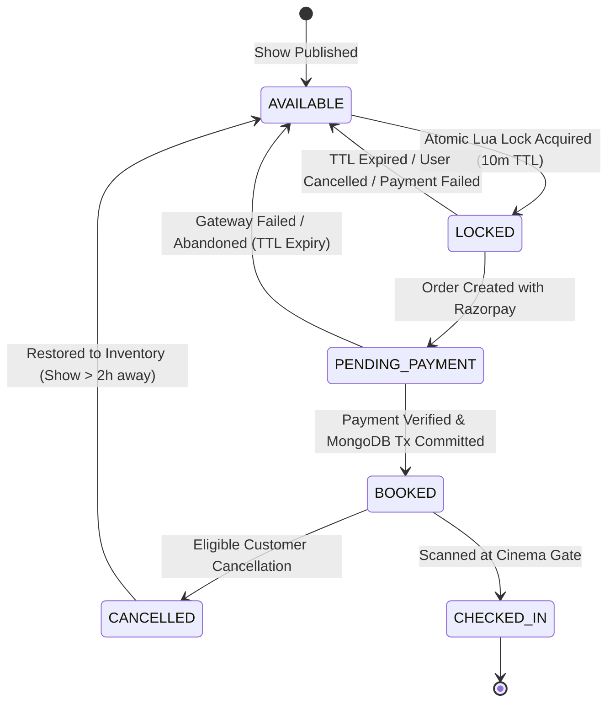

# 07. Critical Booking Engine & Concurrency Control Design

## 1. The Core Distributed Challenge: Inventory Invariance

The central challenge of an enterprise ticketing engine is ensuring **strict inventory invariance**:
$$\sum (\text{Available Seats}) + \sum (\text{Temporarily Locked Seats}) + \sum (\text{Booked Seats}) + \sum (\text{Blocked Seats}) = \text{Total Capacity}$$

Under zero circumstances may two customers successfully purchase or reserve the same physical seat for the same show:
$$\forall s \in \text{Seats}, \quad \text{ConfirmedBookings}(s, \text{showId}) \le 1$$

In high-demand scenarios (such as opening day ticket sales for blockbusters), thousands of concurrent requests attempt to reserve identical prime seats within a narrow millisecond window. A pure relational or document database lock (row-level locking) under such load suffers catastrophic connection pool exhaustion, locking contention, and severe latency spikes.

---

## 2. Multi-Tier Distributed Locking Strategy

To achieve sub-millisecond lock acquisition while guaranteeing ACID permanence, the platform adopts a **Two-Tier Hybrid Concurrency Engine**:



---

## 3. Atomic Redis Lock Architecture (Lua Scripts)

Redis executes single scripts as atomic transactions without interleaving other commands. Using a custom **Lua script**, the platform evaluates seat availability and writes the lock key in a single atomic memory step.

### 3.1 Lock Key Namespace Specification
```
lock:show:<show_id>:seat:<seat_id>
```
- **Key Value**: JSON string containing `{ "customerId": "USR_987", "lockedAt": 1793448000000, "lockToken": "UUID-v4" }`
- **TTL**: Exactly `600` seconds (10 minutes).

### 3.2 Atomic Multi-Seat Lock Lua Script (Design Specification)

```lua
-- KEYS: Array of lock keys [lock:show:101:seat:A1, lock:show:101:seat:A2, ...]
-- ARGV[1]: Lock Payload JSON (customerId, timestamp, lockToken)
-- ARGV[2]: Lock TTL in milliseconds (e.g. 600000 ms)

-- Step 1: Check if ANY of the requested seats are already locked
for i, key in ipairs(KEYS) do
    if redis.call('EXISTS', key) == 1 then
        -- Return conflict indicator with the specific colliding key
        return { 0, key }
    end
end

-- Step 2: All seats are free; atomically acquire all locks
for i, key in ipairs(KEYS) do
    redis.call('SET', key, ARGV[1], 'PX', ARGV[2])
end

-- Return success indicator (1)
return { 1, "OK" }
```

### 3.3 Atomic Lock Release Lua Script (Safe Release)
Locks must only be released by the specific customer who acquired them (or upon payment completion), preventing a customer from inadvertently unlocking another user's seats:

```lua
-- KEYS[1]: lock:show:101:seat:A1
-- ARGV[1]: Expected customerId or lockToken

local currentVal = redis.call('GET', KEYS[1])
if not currentVal then
    return 1 -- Key already expired/released
end

-- If JSON contains matching lockToken, delete the key
local decoded = cjson.decode(currentVal)
if decoded.lockToken == ARGV[1] or decoded.customerId == ARGV[1] then
    return redis.call('DEL', KEYS[1])
else
    return 0 -- Lock owned by someone else; forbidden
end
```

---

## 4. End-to-End Booking State Machine



---

## 5. Comprehensive Analysis of the 7 Critical Edge Cases

### Edge Case 1: Two customers select the exact same seat at the exact same millisecond
- **Scenario**: Customer A and Customer B click seat `H12` simultaneously. Both HTTP requests arrive at the backend cluster at $t = 0$.
- **Architectural Resolution**:
  1. Requests hit the Node.js API servers and invoke the atomic Redis Lua lock script.
  2. Redis runs on a single-threaded event loop for command execution. Regardless of how close the incoming network packets are, Redis processes them sequentially.
  3. Customer A's evaluation runs first: key `lock:show:X:seat:H12` does not exist. Redis writes the key with TTL 600s and returns `{ 1, "OK" }`.
  4. Customer B's evaluation executes immediate microseconds later: `redis.call('EXISTS', key)` evaluates to `1`. The script immediately aborts without acquiring any seats and returns `{ 0, "lock:show:X:seat:H12" }`.
  5. Customer A's UI receives `200 OK` and initiates the payment countdown timer.
  6. Customer B's UI receives `409 Conflict` with message: *"Seat H12 has just been reserved by another customer. Please choose alternative seats."*

---

### Edge Case 2: Customer closes the browser / navigates away after locking seats
- **Scenario**: Customer locks 4 seats, reaches the payment screen, and abruptly shuts their laptop or loses cellular connection.
- **Architectural Resolution**:
  1. No manual release signal is transmitted.
  2. The Redis key is armed with an immutable TTL (600 seconds / 10 minutes).
  3. When TTL elapses, Redis automatically evicts the keys from memory.
  4. The background **Seat Expiration Worker** (listening to Redis Keyspace Notifications `__keyevent@0__:expired` or running a 30-second polling reconciliation sweep) detects that the booking record remained in `PENDING_PAYMENT`.
  5. The booking status transitions to `EXPIRED`.
  6. A Socket.IO broadcast event `SEATS_AVAILABLE` is pushed to room `show:<showId>`, instantly restoring the seats to active clickable green status on all connected client browsers.

---

### Edge Case 3: Payment succeeds on gateway, but client disconnects / callback fails
- **Scenario**: Customer authorizes a UPI transfer of ₹800. Razorpay captures the money from the customer's bank account, but the customer's phone runs out of battery before the browser can post `/api/v1/payments/verify`.
- **Architectural Resolution**:
  1. **Webhook as the Ground Truth**: Razorpay dispatches an asynchronous, cryptographically signed HTTP webhook (`payment.captured` / `order.paid`) directly to the backend endpoint `/api/v1/webhooks/razorpay`.
  2. **Webhook Idempotency Handler**:
     - The webhook handler extracts the `razorpay_order_id`.
     - Queries `bookings` in MongoDB: finds the booking in `PENDING_PAYMENT`.
     - Executes the ACID transaction: transitions booking to `CONFIRMED`, marks `show_seats` as `BOOKED`, and enqueues ticket generation in BullMQ.
     - Releases the temporary Redis lock (since the seat is now permanently marked `BOOKED` in MongoDB).
  3. When the customer powers their phone back on and opens the app, the booking is already resting in their **Booking History** with the generated PDF ticket and confirmed QR code. An email and WhatsApp confirmation were already dispatched.

---

### Edge Case 4: Payment fails or is declined by customer's bank
- **Scenario**: Customer enters incorrect UPI PIN or bank server declines transaction.
- **Architectural Resolution**:
  1. Razorpay checkout emits a payment failure callback to the frontend and an asynchronous `payment.failed` webhook to the backend.
  2. The frontend notifies the customer: *"Payment failed. You have remaining time on your reservation to retry."*
  3. If the customer retries before the 10-minute timer expires, the same booking record and seat locks are reused.
  4. If the customer explicitly clicks *"Cancel / Choose Other Seats"* or the 10-minute timer expires without successful capture:
     - The API server executes the lock release script.
     - The booking transitions to `FAILED`.
     - Real-time seat release is broadcast via Socket.IO.

---

### Edge Case 5: Redis node crash / failure recovery
- **Scenario**: The Redis primary node suffers hardware failure, network outage, or crashes mid-operation.
- **Architectural Resolution**:
  1. **Redis Sentinel / Cluster Automated Failover**: Redis is deployed as a Multi-AZ Master-Replica set with Sentinel or Cluster mode. Upon primary node failure, an automatic failover elects a healthy replica within 2-3 seconds.
  2. **Persistence Guarantee**: Redis uses `AOF` (Append-Only File) configured with `appendfsync everysec`, bounding maximum theoretical state loss to at most 1 second of lock data.
  3. **MongoDB Fallback Ground Truth**:
     - If Redis is temporarily unreachable during a lock attempt, the API falls back to **Optimistic Database Locking** on the `show_seats` collection:
     ```typescript
     // Fallback when Redis is degraded
     const result = await ShowSeatModel.updateMany(
       { show_id: showId, seat_id: { $in: seatIds }, status: "AVAILABLE" },
       { $set: { status: "LOCKED", locked_by_user_id: userId, locked_until: new Date(Date.now() + 600000) } }
     );
     if (result.modifiedCount !== seatIds.length) {
       // Rollback partial locks and throw conflict
     }
     ```
  4. When Redis recovers, active non-expired locks are hydrated from MongoDB `show_seats` where `status = "LOCKED" AND locked_until > NOW()`.

---

### Edge Case 6: Backend server crash during booking transaction
- **Scenario**: Node.js worker crashes (e.g. Out of Memory or container restart) midway through executing the checkout verification.
- **Architectural Resolution**:
  1. **MongoDB Multi-Document ACID Atomicity**:
     - If the process crashes before `session.commitTransaction()` finishes, the MongoDB WiredTiger storage engine automatically rolls back all intermediate operations (seat updates, booking record mutations).
     - Nothing is partially committed.
  2. **Reconciliation Cron Worker**:
     - A scheduled BullMQ background worker runs every 2 minutes scanning for "zombie" bookings (`status = "PENDING_PAYMENT"` older than 12 minutes).
     - It queries the Razorpay API with the `razorpay_order_id`:
       - If Razorpay confirms the order was paid: it recovers the booking and commits it as `CONFIRMED`.
       - If Razorpay confirms the order was unpaid or never attempted: it cancels the booking and ensures Redis/MongoDB seats are marked `AVAILABLE`.

---

### Edge Case 7: Payment webhook arrives twice (or out of order)
- **Scenario**: Network jitter causes Razorpay to dispatch the `payment.captured` webhook twice within 500 milliseconds.
- **Architectural Resolution**:
  1. **Distributed Idempotency Key**:
     - Before processing any webhook payload, the system acquires a Redis lock on the event ID: `webhook:lock:event_id` with TTL 60 seconds.
     - If lock acquisition fails, the second webhook invocation is discarded or delayed.
  2. **Idempotent State Check in MongoDB**:
     ```typescript
     // Idempotent state machine transition
     const booking = await BookingModel.findOneAndUpdate(
       { _id: bookingId, status: "PENDING_PAYMENT" }, // Strict precondition!
       { $set: { status: "CONFIRMED", razorpay_payment_id: paymentId } },
       { new: true, session }
     );

     if (!booking) {
       // If booking is ALREADY "CONFIRMED", findOneAndUpdate returns null.
       // The worker recognizes it was already processed, acknowledges HTTP 200 to Razorpay,
       // and terminates without re-issuing tickets or re-triggering emails.
       return res.status(200).json({ message: "Already processed" });
     }
     ```

---

## 6. Consistency Strategy: CP vs AP Evaluation

Under the **CAP Theorem**, the booking engine is designed strictly as a **CP system (Consistency + Partition Tolerance)** for inventory and financial ledger state:
- During a network partition or system degradation, the platform **will fail or reject a booking attempt rather than risk double-booking a physical seat**.
- Conversely, the movie discovery and browsing catalog is configured as an **AP system (Availability + Partition Tolerance)** using stale-while-revalidate Redis caching to ensure users can always browse movies even during backend database spikes.

