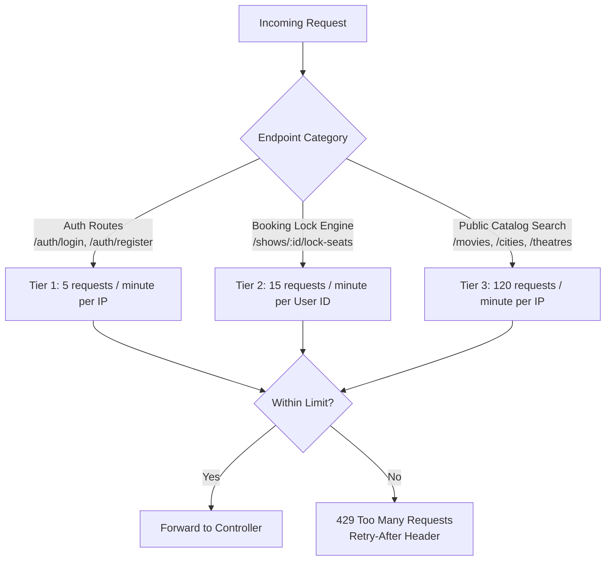

# 08. API Architecture & Interface Specifications

## 1. RESTful Standards & URI Conventions

All API interfaces adhere strictly to RESTful conventions, versioned under `/api/v1`. Resource paths utilize lowercase nouns in plural form, with nested sub-resources representing hierarchical ownership:

```
https://api.bookmyshow-clone.com/api/v1/{resource}[/{id}[/{sub-resource}[/{sub-id}]]]
```

### Core Resource Endpoint Taxonomy
- `/api/v1/auth`: Authentication, registration, OTP validation, token rotation, password recovery.
- `/api/v1/users`: User profile management, communication preferences, wishlists.
- `/api/v1/cities`: Operational cities master data and geospatial discovery.
- `/api/v1/movies`: Movies catalog, cast/crew details, trailers, genres, languages.
- `/api/v1/theatres`: Cinema properties, locations, amenities, partner-owned cinemas.
- `/api/v1/screens`: Auditorium specifications, visual seating layout definitions.
- `/api/v1/shows`: Scheduled screenings, pricing matrices, seat availability maps.
- `/api/v1/bookings`: Seat locking, checkout initialization, booking confirmation, ticket retrieval, cancellations.
- `/api/v1/payments`: Gateway transactions, verification, webhooks, refund tracking.
- `/api/v1/coupons`: Promotional discount rules, coupon code validation.
- `/api/v1/reviews`: Verified ratings, reviews, social endorsements.
- `/api/v1/admin`: Super Admin governance, partner KYC approval, commissions, audit logs.

---

## 2. Standardized HTTP Methods & Status Codes

| Method | Idempotent | Safe | Semantic Usage | Typical Success Code |
| :--- | :---: | :---: | :--- | :--- |
| **GET** | Yes | Yes | Retrieve resource representation(s). | `200 OK` |
| **POST** | No | No | Create a new subordinate resource or trigger state transitions. | `201 Created` / `200 OK` |
| **PUT** | Yes | No | Completely replace an existing resource representation. | `200 OK` |
| **PATCH** | No | No | Apply partial modifications to a resource. | `200 OK` |
| **DELETE** | Yes | No | Soft-delete or remove a resource. | `200 OK` / `204 No Content`|

---

## 3. Uniform Envelope Formats

To ensure consistent integration contracts across the three frontend applications, all responses wrap payloads in a predictable envelope structure.

### 3.1 Standard Success Envelope
```json
{
  "success": true,
  "statusCode": 200,
  "message": "Resource retrieved successfully",
  "data": {
    "id": "67220b3f81e7d23a104f981a",
    "title": "Interstellar",
    "durationMins": 169
  },
  "meta": {
    "timestamp": "2026-10-30T10:30:00.000Z",
    "requestId": "req-9b81-42e1-a08b-4a5f"
  }
}
```

### 3.2 Standard Paginated Envelope
```json
{
  "success": true,
  "statusCode": 200,
  "message": "Movies retrieved successfully",
  "data": [
    { "id": "...", "title": "Interstellar" },
    { "id": "...", "title": "Dune: Part Two" }
  ],
  "pagination": {
    "totalRecords": 142,
    "currentPage": 1,
    "totalPages": 8,
    "limit": 20,
    "hasNextPage": true,
    "hasPrevPage": false
  },
  "meta": {
    "timestamp": "2026-10-30T10:30:00.000Z",
    "requestId": "req-1a2b-3c4d-5e6f"
  }
}
```

### 3.3 Standard Error Envelope (RFC 7807 Aligned)
```json
{
  "success": false,
  "statusCode": 409,
  "errorCode": "SEAT_LOCK_CONFLICT",
  "message": "One or more selected seats are currently reserved by another customer.",
  "errors": [
    {
      "field": "seatIds",
      "rejectedValue": ["E10"],
      "message": "Seat E10 is locked until 2026-10-30T10:40:00.000Z"
    }
  ],
  "meta": {
    "timestamp": "2026-10-30T10:30:00.000Z",
    "requestId": "req-77f2-491a-b06c-8e43",
    "path": "/api/v1/shows/67220b/lock-seats"
  }
}
```

---

## 4. Query Specification: Pagination, Filtering & Sorting

### 4.1 Pagination
- **Offset/Page-based** (Default for admin tables & search listings):
  `GET /api/v1/movies?page=2&limit=20`
- **Cursor-based** (For high-frequency or infinite-scroll feeds):
  `GET /api/v1/shows?cursor=67220b3f81e7d23a104f981a&limit=50`

### 4.2 Filtering Syntax
Filtering uses URL query parameters with comma separation for `OR` conditions and distinct keys for `AND` conditions:
- By City: `?city=mumbai`
- Multi-genre Filter: `?genre=action,sci-fi` (Matches action OR sci-fi)
- Format Filter: `?format=IMAX_3D,4DX`
- Date Range Filter: `?startDate=2026-11-01&endDate=2026-11-03`
- Pricing Filter: `?minPrice=200&maxPrice=600`

### 4.3 Dynamic Sorting Syntax
Sorting follows the standard `+/-` or `asc/desc` notation:
- Sort by release date descending: `?sort=-releaseDate`
- Multi-column sort: `?sort=-releaseDate,+title`

---

## 5. Input Validation with Zod Schema Pipelines

All incoming request payloads (`req.body`, `req.query`, `req.params`) pass through a type-safe Zod validation middleware prior to reaching controllers.

```typescript
// Validation Middleware Architecture Pattern
import { z } from 'zod';

export const LockSeatsSchema = z.object({
  params: z.object({
    showId: z.string().regex(/^[0-9a-fA-F]{24}$/, 'Invalid MongoDB Show ObjectId')
  }),
  body: z.object({
    seatIds: z
      .array(z.string().min(1))
      .min(1, 'At least one seat must be selected')
      .max(10, 'Maximum 10 seats allowed per booking transaction')
  })
});
```
Any schema mismatch halts execution immediately, returning a standard `400 Bad Request` error envelope with field-level diagnostics.

---

## 6. Tiered Rate Limiting Architecture

To protect the infrastructure against distributed Denial of Service (DDoS), credential stuffing, and ticket-scalping bots, rate limits are enforced via Redis sliding-window counters:



### Response Headers on Rate-Limited Endpoints
- `X-RateLimit-Limit`: Maximum allowable requests in current window.
- `X-RateLimit-Remaining`: Remaining request quota.
- `X-RateLimit-Reset`: Unix timestamp when quota resets.
- `Retry-After`: Seconds to wait before retrying (upon 429 response).

---

## 7. Master API Endpoint Catalog Overview

### Authentication & User Identity (`/api/v1/auth`, `/api/v1/users`)
- `POST /api/v1/auth/register` (Public) - Create new customer account.
- `POST /api/v1/auth/login` (Public) - Authenticate and receive tokens.
- `POST /api/v1/auth/refresh-token` (Public / Cookie) - Rotate expired access token.
- `POST /api/v1/auth/logout` (Authenticated) - Invalidate active session.
- `GET /api/v1/users/me` (Authenticated) - Fetch authenticated user profile.
- `PUT /api/v1/users/me` (Authenticated) - Update profile info.
- `GET /api/v1/users/me/wishlist` (Customer) - View bookmarked movies.

### Catalog & Discovery (`/api/v1/cities`, `/api/v1/movies`)
- `GET /api/v1/cities` (Public) - Retrieve list of operational cities.
- `GET /api/v1/movies` (Public) - Browse movies filtered by city, status, genre, format.
- `GET /api/v1/movies/:slugOrId` (Public) - Deep movie metadata, trailer, cast.
- `POST /api/v1/admin/movies` (Super Admin) - Create master movie record.

### Theatres & Screens (`/api/v1/theatres`, `/api/v1/screens`)
- `GET /api/v1/theatres` (Public) - Retrieve cinemas by city with distance sorting.
- `POST /api/v1/theatres` (Theatre Owner) - Create cinema location.
- `POST /api/v1/theatres/:theatreId/screens` (Theatre Manager/Owner) - Add screen.
- `PUT /api/v1/theatres/:theatreId/screens/:screenId/layout` (Theatre Manager) - Save seating layout.

### Shows & Real-Time Locks (`/api/v1/shows`)
- `GET /api/v1/shows` (Public) - Filter shows by city, movie, date, format.
- `POST /api/v1/shows` (Theatre Manager) - Schedule new show.
- `GET /api/v1/shows/:showId/seats` (Public) - Get current interactive seat map.
- `POST /api/v1/shows/:showId/lock-seats` (Customer) - Atomically lock selected seats.
- `POST /api/v1/shows/:showId/release-seats` (Customer) - Manually release locked seats.

### Bookings, Payments & Tickets (`/api/v1/bookings`, `/api/v1/payments`)
- `POST /api/v1/bookings/initiate` (Customer) - Initialize checkout and Razorpay order.
- `POST /api/v1/payments/verify` (Customer) - Submit client payment signature.
- `POST /api/v1/webhooks/razorpay` (Public / HMAC Verified) - Asynchronous payment capture webhook.
- `GET /api/v1/bookings/:bookingReference` (Customer / Staff) - Fetch ticket DTO with QR.
- `POST /api/v1/bookings/:bookingId/cancel` (Customer) - Request booking cancellation and refund.
- `POST /api/v1/tickets/verify` (Theatre Staff) - Gatekeeper QR scan admission.

