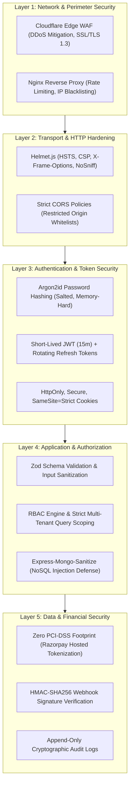
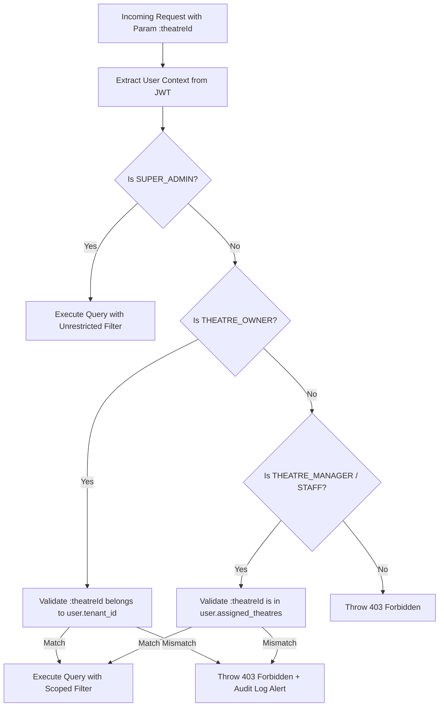

# 09. Enterprise Security Architecture & Hardening

## 1. Defense-in-Depth Security Framework

The security architecture employs a multi-layered **Defense-in-Depth** model ensuring that the compromise of any single protective barrier does not lead to system-wide breach or data leakage.



---

## 2. Authentication & Credential Storage

### 2.1 Password Hashing Specification
- **Algorithm**: `Argon2id` (the winner of the Password Hashing Competition, resistant to both GPU and side-channel attacks).
- **Configuration Parameters**:
  - Memory Cost ($m$): 64 MB (`65536` KiB)
  - Time Cost ($t$): 3 iterations
  - Parallelism ($p$): 4 threads
  - Salt Length: 16 cryptographically random bytes (`crypto.randomBytes(16)`)
  - Hash Length: 32 bytes

### 2.2 Dual-Token Session Management with Token Rotation
1. **Access Token**:
   - Standard: Signed JWT (JSON Web Token) using asymmetric `RS256` (RSA-SHA256) or hardened symmetric `HS512`.
   - Lifespan: **15 minutes**.
   - Payload: `{ sub: userId, role: "CUSTOMER", tenantId: null, jti: uuid }`.
   - Transport: Transmitted via HTTP `Authorization: Bearer <token>` header. Kept exclusively in client memory (React state/TanStack cache), **never** in `localStorage` or `sessionStorage` (preventing XSS exfiltration).
2. **Refresh Token**:
   - Cryptographically random 256-bit string (`crypto.randomBytes(32).toString('hex')`).
   - Lifespan: **7 days**.
   - Transport: Stored in an HTTP Cookie with flags:
     - `HttpOnly: true` (Inaccessible to client-side JavaScript).
     - `Secure: true` (Only transmitted over HTTPS).
     - `SameSite: 'Strict'` (Guards against Cross-Site Request Forgery).
     - `Path: '/api/v1/auth'` (Cookie is only sent to authentication rotation endpoints).
3. **Automatic Token Family Reuse Detection**:
   - Every refresh operation issues a new Refresh Token and invalidates the previous one in `refresh_tokens`.
   - If an invalidated refresh token is ever presented again (indicating token theft or man-in-the-middle replay), the system detects **Token Family Compromise**: all active sessions across that entire family ID are revoked immediately.

---

## 3. Application Security & Injection Defenses

### 3.1 MongoDB NoSQL Injection Prevention
- **Threat**: Attackers submitting query operator payloads like `{"$gt": ""}` in place of strings to bypass authentication or extract data.
- **Defenses**:
  1. **Strict Zod Parsing**: Endpoints validate that IDs and credentials are pure strings. Any JSON containing objects where strings are expected is rejected immediately.
  2. **Express-Mongo-Sanitize Middleware**: Recursively strips any keys starting with `$` or containing `.` from `req.body`, `req.query`, and `req.params`.
  3. **No Dynamic `$where` Clauses**: Prohibit usage of JavaScript evaluation `$where` or `mapReduce` within Mongoose queries.

### 3.2 Cross-Site Scripting (XSS) Defenses
- **Contextual Output Escaping**: React natively escapes all JSX text expressions by default.
- **Sanitized Rich Content**: Any customer-submitted reviews or markdown are scrubbed using `DOMPurify` on both client and server before persistence.
- **Content Security Policy (CSP)**: Enforced via Helmet, disallowing unapproved external scripts or inline `eval()`.

### 3.3 HTTP Header Hardening via Helmet.js
```javascript
app.use(
  helmet({
    contentSecurityPolicy: {
      directives: {
        defaultSrc: ["'self'"],
        scriptSrc: ["'self'", "https://checkout.razorpay.com"],
        connectSrc: ["'self'", "https://api.razorpay.com", "wss://api.bookmyshow-clone.com"],
        imgSrc: ["'self'", "data:", "https://res.cloudinary.com"],
        frameSrc: ["https://api.razorpay.com"]
      }
    },
    hsts: {
      maxAge: 31536000,
      includeSubDomains: true,
      preload: true
    },
    noSniff: true,
    referrerPolicy: { policy: "strict-origin-when-cross-origin" }
  })
);
```

---

## 4. Payment & Financial Data Protection

### 4.1 Zero PCI-DSS Footprint
The platform **never** accepts, processes, logs, or stores raw credit card numbers, CVVs, or bank account login credentials:
- Payment card data is input directly into the Razorpay PCI-DSS Level 1 certified client SDK modal hosted on Razorpay's isolated iframe.
- The platform only receives non-sensitive tokenized references (`razorpay_order_id`, `razorpay_payment_id`).

### 4.2 Webhook Signature Cryptographic Verification
To prevent spoofed webhook requests from simulating payment confirmations, every webhook payload is validated using HMAC-SHA256:

```typescript
// Webhook Verification Architecture Pattern
import crypto from 'node:crypto';

export const verifyWebhookSignature = (
  rawBody: string,
  signature: string,
  secret: string
): boolean => {
  const expectedSignature = crypto
    .createHmac('sha256', secret)
    .update(rawBody)
    .digest('hex');

  // Constant-time comparison to prevent timing attacks
  return crypto.timingSafeEqual(
    Buffer.from(signature, 'utf8'),
    Buffer.from(expectedSignature, 'utf8')
  );
};
```
*Requirement*: The Express server must retain the raw unparsed request body stream for `/api/v1/webhooks/razorpay` to ensure exact byte-for-byte HMAC calculation.

---

## 5. Multi-Tenant Authorization & IDOR/BOLA Protection

Broken Object Level Authorization is prevented through **Mandatory Tenant Scoping Filters**:



---

## 6. Secrets Management & Environment Security

1. **Zero Hardcoded Secrets**: Secrets (`JWT_SECRET`, `RAZORPAY_KEY_SECRET`, `CLOUDINARY_API_SECRET`, `MONGO_URI`, `REDIS_PASSWORD`) are strictly injected via runtime environment variables or Docker Secrets.
2. **Commit Gatekeeper**: Git pre-commit hooks configured with `gitleaks` block accidental commits containing secrets, private keys, or API tokens.
3. **Environment Segregation**: Separate development, staging, and production credential sets with zero cross-environment sharing.

