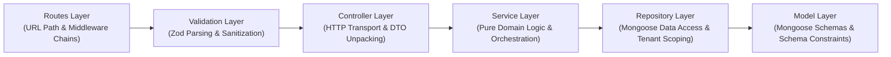

# 10. Enterprise Monorepo & Backend Modular Architecture

## 1. High-Level Monorepo Structure

The platform adopts a modern, workspace-based monorepo (managed via pnpm / npm workspaces or Turborepo) to unify shared TypeScript interfaces, validation utilities, infrastructure code, and documentation across all three client applications and the backend modular monolith.

```
movie-booking-platform/
├── apps/
│   ├── customer-web/             # Customer React 18 SPA (Vite + Tailwind)
│   ├── theatre-dashboard/        # Theatre Partner & Operations Portal (React 18 + Vite)
│   ├── admin-dashboard/          # Super Admin Governance Control Tower (React 18 + Vite)
│   └── backend/                  # Node.js Express Modular Monolith API
├── packages/
│   ├── shared-types/             # Universal TypeScript models, DTOs & Enums
│   ├── shared-utils/             # Formatting, currency, dates & validation helpers
│   └── eslint-config/            # Unified linting and code style standards
├── infrastructure/
│   ├── docker/                   # Dockerfiles & docker-compose configurations
│   │   ├── Dockerfile.backend
│   │   ├── Dockerfile.frontend
│   │   ├── docker-compose.dev.yml
│   │   └── docker-compose.prod.yml
│   ├── nginx/                    # Reverse proxy, SSL, and rate-limiting configs
│   │   └── nginx.conf
│   └── deployment/               # CI/CD workflows and deployment manifests
│       └── .github/workflows/
├── docs/                         # Comprehensive architectural and technical documentation
├── .env.example                  # Template of all environment variables
├── package.json                  # Root monorepo configuration
├── turbo.json                    # Turborepo task pipeline orchestration
└── README.md                     # Platform overview & development guide
```

---

## 2. Backend Modular Monolith Structure (`apps/backend/`)

The backend source code is organized into decoupled, high-cohesion domain modules with clear architectural layers.

```
apps/backend/
├── src/
│   ├── config/                   # Environment config, DB configs, Redis configs
│   │   ├── env.config.ts
│   │   ├── database.config.ts
│   │   ├── redis.config.ts
│   │   └── razorpay.config.ts
│   ├── database/                 # Connection handlers, transaction managers & seeders
│   │   ├── connection.ts
│   │   ├── transaction.helper.ts
│   │   └── seeders/
│   ├── middlewares/              # Global Express middlewares
│   │   ├── authenticate.ts       # JWT verification & token hydration
│   │   ├── authorize.ts          # RBAC permission & tenant isolation guard
│   │   ├── validate.ts           # Zod schema validation interceptor
│   │   ├── rate-limiter.ts       # Redis-based sliding window rate limiter
│   │   ├── error-handler.ts      # Global centralized error handler
│   │   ├── request-logger.ts     # Pino HTTP request logging
│   │   └── sanitize.ts           # NoSQL injection and XSS sanitation
│   ├── modules/                  # Encapsulated Domain Modules (See Section 3)
│   │   ├── auth/
│   │   ├── users/
│   │   ├── cities/
│   │   ├── movies/
│   │   ├── genres/
│   │   ├── languages/
│   │   ├── theatres/
│   │   ├── screens/
│   │   ├── seats/
│   │   ├── shows/
│   │   ├── bookings/
│   │   ├── payments/
│   │   ├── refunds/
│   │   ├── coupons/
│   │   ├── reviews/
│   │   ├── wishlists/
│   │   ├── notifications/
│   │   └── audit-logs/
│   ├── sockets/                  # Realtime Socket.IO handlers & rooms
│   │   ├── socket.server.ts      # Socket server initialization with Redis Adapter
│   │   ├── seat-lock.socket.ts   # Realtime seat locking room events
│   │   └── socket.middleware.ts  # WebSocket auth token handshake guard
│   ├── queues/                   # BullMQ Queue definitions
│   │   ├── queue.config.ts
│   │   ├── ticket.queue.ts
│   │   └── email.queue.ts
│   ├── jobs/                     # Asynchronous workers & scheduled cron handlers
│   │   ├── workers/
│   │   │   ├── ticket-generator.worker.ts
│   │   │   └── email-dispatcher.worker.ts
│   │   └── crons/
│   │       ├── seat-lock-reconciler.cron.ts
│   │       └── daily-settlement.cron.ts
│   ├── services/                 # Cross-cutting infrastructure services
│   │   ├── redis-lock.service.ts # Atomic Lua script seat locking engine
│   │   ├── cloudinary.service.ts # Signed direct uploads and media CDN
│   │   ├── razorpay.service.ts   # Payment gateway client wrapper
│   │   ├── email.service.ts      # Transactional email sender
│   │   └── pdf.service.ts        # PDF ticket vector generator
│   ├── utils/                    # Core mathematical, cryptographic & error helpers
│   │   ├── api-response.ts       # Uniform success/error response envelopes
│   │   ├── app-error.ts          # Typed application error taxonomy
│   │   ├── crypto.utils.ts       # HMAC, token hashes & QR encryption
│   │   └── logger.ts             # Structured Pino logger instance
│   ├── app.ts                    # Express application factory & middleware pipeline
│   └── server.ts                 # HTTP server bootstrap & graceful shutdown listener
├── tests/                        # Global integration & end-to-end test suites
│   ├── e2e/
│   └── setup.ts
├── tsconfig.json
└── package.json
```

---

## 3. Standardized Domain Module Architecture

Every domain module inside `src/modules/<module-name>/` follows an identical, strict **7-layer separation of concerns**:

```
src/modules/bookings/
├── model/
│   ├── booking.model.ts          # Mongoose schema, field types, indexes & virtuals
│   └── booking-item.model.ts     # Mongoose schema for line items
├── controller/
│   └── booking.controller.ts     # Express req/res handling, parameter mapping
├── service/
│   └── booking.service.ts        # Core business logic, transactions, policy rules
├── repository/
│   └── booking.repository.ts     # Abstracted MongoDB queries & tenant filters
├── routes/
│   └── booking.routes.ts         # Route declarations, middleware bindings
├── validation/
│   └── booking.validation.ts     # Zod request schemas (params, query, body)
└── tests/
    ├── booking.service.spec.ts   # Isolated unit tests with repository mocks
    └── booking.controller.spec.ts# Controller contract tests
```

---

## 4. Layer Responsibilities & Architectural Rules



### Detailed Layer Responsibilities

#### 1. Routes (`*.routes.ts`)
- Declares the RESTful endpoint paths.
- Chains security guards in exact sequence: `authenticate` -> `authorize(permission)` -> `tenantScopeGuard` -> `validate(zodSchema)` -> `controllerMethod`.
- Never contains any business logic or query code.

#### 2. Validation (`*.validation.ts`)
- Defines immutable Zod schemas for `params`, `query`, and `body`.
- Ensures type coercion (e.g. converting string numbers in query params to true JavaScript numbers).
- Rejects malformed requests before any controller or service code executes.

#### 3. Controller (`*.controller.ts`)
- Bridges the HTTP protocol and domain services.
- Extracts parameters from `req.params`, `req.query`, `req.body`, and authenticated user from `req.user`.
- Calls appropriate methods on the `Service` layer.
- Returns standardized response envelopes (`ApiResponse.success(...)`) with appropriate HTTP status codes.
- Does not interact with Mongoose models or external databases directly.

#### 4. Service (`*.service.ts`)
- The heart of the application: houses pure business logic, calculations, domain invariants, and workflow orchestration.
- Coordinates calls between multiple repositories, Redis distributed locks, and external services (e.g., Razorpay, Cloudinary).
- Manages MongoDB Multi-Document ACID Transactions (`session.startTransaction()`).
- Emits domain events to BullMQ queues or Socket.IO brokers.
- Completely decoupled from HTTP: receives plain objects/DTOs, returns domain models or primitives, throws typed `AppError` exceptions (e.g. `NotFoundException`, `ConflictException`).

#### 5. Repository (`*.repository.ts`)
- Pure data access layer. Encapsulates all Mongoose query methods (`find`, `findById`, `findOneAndUpdate`, `aggregate`).
- Automatically injects multi-tenant scoping filters (`partner_id`, `theatre_id`) to prevent cross-tenant leaks.
- Enforces consistent soft-delete filtering (`deleted_at: null`).
- Abstracts database specifics away from the Service layer, making testing and future database migration straightforward.

#### 6. Model (`*.model.ts`)
- Declares Mongoose schemas, field types, required constraints, and default values.
- Configures secondary compound indexes, text indexes, and geospatial 2dsphere indexes.
- Defines schema hooks (e.g. `pre('save')` for audit timestamps) and virtual fields.

#### 7. Tests (`*.spec.ts`)
- Unit and integration tests co-located within the module for high discoverability.
- Services tested in isolation by providing mock repositories and in-memory Redis stubs.

