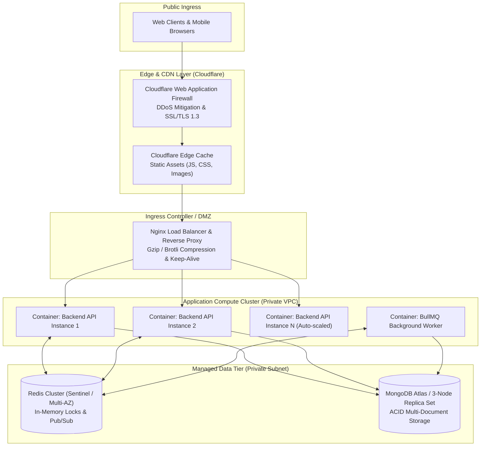
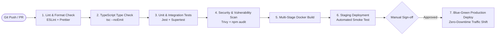
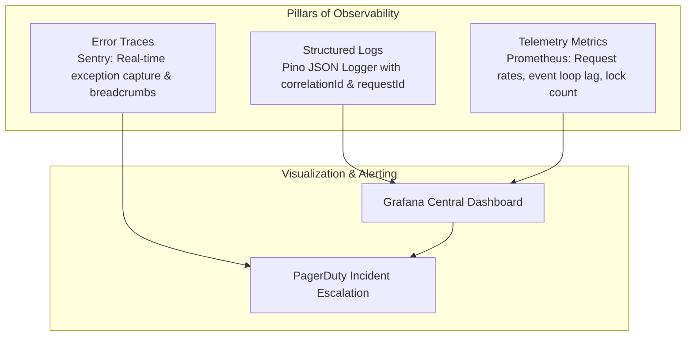

# 11. Deployment, Infrastructure & Non-Functional Engineering

## 1. Non-Functional Requirements & Proposed Engineering Targets

To ensure enterprise-grade stability under peak traffic surges (such as festival releases and major blockbuster openings), the platform is engineered to meet rigorous non-functional targets.

> [!NOTE]
> The metrics listed below represent **proposed initial engineering targets** for system design, load testing, and capacity planning. They reflect expected baseline operational standards under production hardware, not contractual guarantees.

### Measurable Engineering Targets

| Metric Category | Target Indicator | Proposed Design Benchmark | Measurement Conditions |
| :--- | :--- | :---: | :--- |
| **System Availability** | Core Uptime | **99.95%** | Monthly availability excluding scheduled maintenance windows (< 22 minutes downtime/month). |
| **API Response Time** | Redis-Cached Catalog Reads | **< 30 ms** | 95th percentile ($P_{95}$) under standard traffic. |
| **API Response Time** | Complex Filter Queries (Mongo) | **< 150 ms** | 95th percentile ($P_{95}$) with indexed compound lookups. |
| **Lock Latency** | Seat Lock Acquisition (Redis) | **< 10 ms** | 99th percentile ($P_{99}$) for atomic Lua execution. |
| **Transaction Latency**| End-to-End Booking Commit | **< 600 ms** | 95th percentile ($P_{95}$) including multi-doc Mongo transaction. |
| **Concurrent Users** | Active Browsing Concurrency | **25,000+** | Simultaneous active sessions across all 3 client web apps. |
| **Peak Throughput** | Booking Rate Capacity | **500 bookings/sec** | Sustained commit throughput during high-demand release spikes. |
| **Realtime Sync** | Socket.IO Lock Fanout Latency | **< 100 ms** | Broadcast delay from lock acquisition to client UI update. |
| **Database Performance**| Query Execution Time | **< 50 ms** | Mean query time for all index-covered application queries. |

---

## 2. Containerization Strategy (Multi-Stage Dockerfiles)

All applications leverage lightweight Alpine-based multi-stage Docker builds to maximize security, strip development dependencies, and produce minimal container footprint (< 120MB for Node API).

### 2.1 Backend Production Multi-Stage Build Concept
```dockerfile
# Stage 1: Build & Prune
FROM node:20-alpine AS builder
WORKDIR /app
RUN npm install -g pnpm
COPY package.json pnpm-lock.yaml pnpm-workspace.yaml ./
COPY apps/backend/package.json ./apps/backend/
COPY packages/ ./packages/
RUN pnpm install --frozen-lockfile
COPY apps/backend/ ./apps/backend/
RUN pnpm --filter backend build

# Stage 2: Minimal Distroless / Production Runtime
FROM node:20-alpine AS runner
WORKDIR /app
ENV NODE_ENV=production
RUN addgroup --system --gid 1001 nodejs && adduser --system --uid 1001 nodejs
COPY --from=builder /app/node_modules ./node_modules
COPY --from=builder /app/apps/backend/dist ./apps/backend/dist
COPY --from=builder /app/apps/backend/package.json ./apps/backend/package.json
USER nodejs
EXPOSE 4000
CMD ["node", "apps/backend/dist/server.js"]
```

---

## 3. Production Deployment Topology



---

## 4. Continuous Integration & Continuous Delivery (CI/CD)

The automated deployment pipeline is governed by **GitHub Actions** enforcing rigorous quality gates prior to staging or production deployment:



### Zero-Downtime Deployment via Blue-Green Strategy
- Two identical production environments (**Blue** and **Green**) run simultaneously.
- When a new release is staged on **Green**, health-check probes verify that database migrations and HTTP ping endpoints respond with `200 OK`.
- Nginx switches upstream routing to Green in a single configuration reload (`nginx -s reload`) with zero dropped TCP connections.
- Blue is kept warm for 30 minutes to facilitate instantaneous zero-loss rollbacks if telemetry spikes error rates.

---

## 5. Observability, Telemetry & Logging

Enterprise visibility is guaranteed via the three pillars of observability:



### Structured Log Standard
Every log entry emitted by the backend outputs a machine-readable JSON structure containing:
- `timestamp`: ISO-8601 UTC timestamp.
- `level`: `info`, `warn`, `error`, `debug`, or `fatal`.
- `requestId`: Unique distributed tracing UUID propagated across headers.
- `tenantId`: Present for all partner/theatre requests.
- `userId`: Masked user reference.
- `responseTimeMs`: HTTP latency in milliseconds.

---

## 6. Disaster Recovery & Backup Plan (DRP)

| Tier | Backup Frequency | Retention Policy | Recovery Point Objective (RPO) | Recovery Time Objective (RTO) |
| :--- | :--- | :--- | :---: | :---: |
| **MongoDB Replica Set** | Continuous Continuous Oplog + Daily Snapshots | 30 Days rolling Point-In-Time (PITR) | **< 1 minute** | **< 15 minutes** |
| **Redis In-Memory State** | AOF every second + RDB Snapshots every 6 hours | 7 Days | **< 1 second** | **< 5 minutes** |
| **Cloudinary Media Assets** | Cross-region cloud replication | Indefinite | **0 minutes (Active-Active)**| **0 minutes** |

### Automated Failover Drills
Simulated node failure and database failover drills are scheduled quarterly to validate that replica election occurs within 10 seconds without dropping active user bookings.

