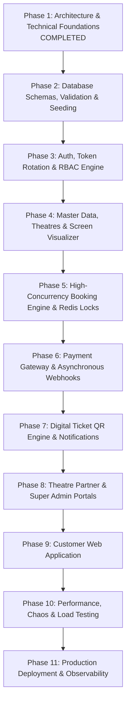

# 12. Development Roadmap, Architecture Decisions & Dependency Map

## 1. Phased Implementation Roadmap

The platform engineering lifecycle is structured into distinct, milestone-driven phases. Execution follows strict dependency ordering to ensure a rock-solid foundation before building dependent layers.

### Phase Details

#### Phase 1: Architecture, System Design & Technical Specification (CURRENT)
- Deliverables: Comprehensive architectural blueprints, database planning, RBAC specifications, booking engine design, API architecture, and deployment strategy.
- Status: **100% Complete**.

#### Phase 2: Database Schemas, Migrations & Seeders
- Deliverables: Mongoose schemas with strict TypeScript typing, validation schemas, compound/geospatial indexes, relational integrity validators, and mock seeders for major Indian cities, genres, and sample theatres.
- Prerequisites: Phase 1 approval.

#### Phase 3: Core Authentication, Token Rotation & Multi-Tenant Security
- Deliverables: Argon2id password hashing, dual-token JWT rotation in HttpOnly cookies, family invalidation, RBAC authorization middlewares, and tenant isolation guards.
- Prerequisites: Phase 2.

#### Phase 4: Master Catalogs, Theatres & Screen Visual Designer
- Deliverables: Super Admin movie catalog management, theatre owner onboarding, cinema properties, screens, and the interactive SVG/Canvas seat layout visualizer.
- Prerequisites: Phase 3.

#### Phase 5: High-Concurrency Booking Engine & Distributed Redis Locks
- Deliverables: Redis Lua atomic locking scripts, TTL management, Socket.IO real-time seat lock fanout with Redis adapter, and optimistic concurrency controls.
- Prerequisites: Phase 4.

#### Phase 6: Razorpay Payment Integration & Resilient Webhook Engine
- Deliverables: Razorpay order generation, HMAC-SHA256 webhook signature verification, MongoDB multi-document ACID commit transactions, and idempotency guards.
- Prerequisites: Phase 5.

#### Phase 7: Ticket Generation, Cryptographic QR Codes & Notifications
- Deliverables: BullMQ background worker queue, PDFKit ticket rendering, encrypted QR generation, Cloudinary storage, and transactional Email/SMS delivery.
- Prerequisites: Phase 6.

#### Phase 8: Theatre Partner Portal & Super Admin Control Tower
- Deliverables: React SPA for theatre owners (screen builder, pricing tiers, box office live dashboard, staff scanner) and Super Admin (KYC approval, commissions, audit logs).
- Prerequisites: Phase 7.

#### Phase 9: Customer Web Application
- Deliverables: Customer React SPA (city selector, movie discovery, interactive seat selection, coupon redemption, Razorpay modal checkout, booking history, and verified reviews).
- Prerequisites: Phase 6 & 8.

#### Phase 10: Performance Hardening, Chaos Testing & Load Testing
- Deliverables: K6 load testing scripts simulating 25,000 concurrent users and 500 bookings/sec, simulated Redis node crashes, database failovers, and security vulnerability scans.
- Prerequisites: Phase 9.

#### Phase 11: Production Container Orchestration & Telemetry
- Deliverables: Docker multi-stage images, Nginx SSL/reverse proxy, GitHub Actions CI/CD automation, Prometheus/Grafana dashboards, and Sentry error monitoring.
- Prerequisites: Phase 10.

---

## 2. Dependency Map Between Development Parts

| Phase | Phase Name | Upstream Dependencies | Primary Downstream Consumers |
| :---: | :--- | :--- | :--- |
| **01** | Architecture & Specifications | None | All subsequent phases |
| **02** | Database Schemas & Models | Phase 01 | Phase 03, 04, 05 |
| **03** | Auth, Security & RBAC | Phase 02 | Phase 04, 08, 09 |
| **04** | Master Catalogs & Theatres | Phase 02, 03 | Phase 05, 08 |
| **05** | Booking Engine & Redis Locks| Phase 02, 04 | Phase 06, 08, 09 |
| **06** | Razorpay Payments & Webhooks| Phase 05 | Phase 07, 09 |
| **07** | Ticket QR & Notifications | Phase 06 | Phase 08, 09 |
| **08** | Partner & Admin Portals | Phase 03, 04, 07 | Phase 10 |
| **09** | Customer Web Application | Phase 05, 06, 07 | Phase 10 |
| **10** | Load Testing & Auditing | Phase 08, 09 | Phase 11 |
| **11** | Production Deployment | Phase 10 | Live Go-to-Market |

---

## 3. Architecture Decision Records (ADR Log)

### ADR-001: Architecture Style Selection
- **Status**: Accepted
- **Context**: Need to decide between Microservices vs. Modular Monolith for initial build.
- **Decision**: Adopt a **Modular Monolith** initially.
- **Consequences**: Avoids distributed transaction overhead (2PC/Sagas) during high-concurrency seat locking, maximizes developer velocity, and maintains clean domain boundaries allowing seamless microservice extraction in the future.

### ADR-002: Temporary Seat Lock Mechanism
- **Status**: Accepted
- **Context**: Thousands of concurrent users selecting the same seat simultaneously. Database row locks cause database connection exhaustion.
- **Decision**: Use **Redis In-Memory Atomic Lua Scripts** (`EVAL`) with 10-minute TTL.
- **Consequences**: Sub-millisecond locking latency ($< 10\text{ ms}$), zero database write contention during seat selection, and automatic expiration when users abandon checkouts.

### ADR-003: Ground Truth for Financial Commitment
- **Status**: Accepted
- **Context**: Browser crashes or mobile network disconnects during Razorpay payment authorization.
- **Decision**: Treat the **Razorpay Asynchronous Webhook (`payment.captured`)** as the definitive ground truth for booking fulfillment, supported by an idempotent MongoDB multi-document transaction.
- **Consequences**: Eliminates lost bookings if client callbacks fail; requires strict webhook HMAC-SHA256 signature verification and distributed idempotency keys.

### ADR-004: Master Layout vs. Show Seat Representation
- **Status**: Accepted
- **Context**: Storing seat availability inside the `screens` collection causes document bloat and race conditions across simultaneous shows on the same screen.
- **Decision**: Maintain immutable physical screen layouts in `seats`, while creating dynamic operational `show_seats` documents for each scheduled show.
- **Consequences**: Modifying a seat's status during a show never risks mutating the physical screen template.

### ADR-005: Authentication & Session Token Transport
- **Status**: Accepted
- **Context**: Protection against both XSS token exfiltration and CSRF cross-origin exploits.
- **Decision**: Short-lived Access Tokens (15m) kept strictly in **Client Memory** (React state), coupled with long-lived Refresh Tokens (7d) in **HttpOnly, Secure, SameSite=Strict cookies** with automatic reuse family detection.
- **Consequences**: Immune to JavaScript `localStorage` theft; refresh token reuse immediately revokes all sessions in that family.

### ADR-006: Real-time Seat Map Synchronization
- **Status**: Accepted
- **Context**: All clients viewing a show seat map must see seat status changes immediately.
- **Decision**: **Socket.IO backed by Redis Pub/Sub Adapter**.
- **Consequences**: Enables multi-node horizontal scaling of WebSocket connections while fanning out room-level seat lock events across instances.

### ADR-007: Media Storage & Video Trailing
- **Status**: Accepted
- **Context**: Large movie posters, backdrop banners, and KYC documents shouldn't consume backend server CPU/bandwidth.
- **Decision**: Direct client-to-cloud signed uploads using **Cloudinary**.
- **Consequences**: Zero server memory overhead for file streaming; built-in CDN edge distribution and dynamic WebP image compression.

### ADR-008: Database Consistency Guarantees
- **Status**: Accepted
- **Context**: Need strict inventory invariance during booking commit without sacrificing browsing performance.
- **Decision**: Enforce **MongoDB ACID Multi-Document Transactions** with `{ w: "majority", j: true }` write concerns for bookings, paired with `secondaryPreferred` read preferences for static catalog browsing.
- **Consequences**: Guaranteed zero double-booking under any node failure, with high-performance offloading of catalog queries.

---

## 4. Architectural Risk Management Matrix

| Identified Risk | Severity | Likelihood | Architectural Mitigation Strategy |
| :--- | :---: | :---: | :--- |
| **High Contention Seat Races** | Critical | High | Redis atomic Lua script locking + MongoDB multi-document transaction with unique constraints. |
| **Payment Webhook Replay / Duplicate Execution** | High | High | Redis distributed lock on `webhook:event_id` + idempotent MongoDB state checks (`findOneAndUpdate` where `status: "PENDING_PAYMENT"`). |
| **Cross-Tenant Data Leakage (BOLA/IDOR)** | Critical | Medium | Automatic tenant scoping filters injected in the repository layer based on verified JWT claims. |
| **Client Abandonment Holding Inventory** | Medium | High | Hard 600-second (10 min) TTL on Redis lock keys with automated Keyspace expiration sweepers. |
| **Redis Primary Node Outage** | High | Low | Multi-AZ Redis Sentinel/Cluster with automatic failover + fallback to MongoDB optimistic locking. |
| **MongoDB Document Relocation & Bloat** | Medium | Medium | Separating dynamic `show_seats` from immutable `screens` and `seats` templates. |

---

## 5. Part 1 Completion Checklist & Sign-Off

### Completed Architectural Deliverables (Part 1)
- [x] **01-project-overview.md**: System vision, value proposition, technology stack selection, and modular monolith philosophy.
- [x] **02-functional-requirements.md**: Exhaustive capabilities for Customer, Theatre Partner, and Super Admin applications.
- [x] **03-system-architecture.md**: End-to-end architecture covering Frontend, Backend, Database, Redis, Sockets, Payments, Auth, Storage, and Deployment.
- [x] **04-database-planning.md**: 23 MongoDB collections specified with fields, data types, indexes, unique constraints, and relationships.
- [x] **05-user-roles-permissions.md**: Granular RBAC permission matrix, hierarchy, and multi-tenant isolation rules.
- [x] **06-business-workflows.md**: 12 complete business workflows (A through L) with step-by-step Mermaid sequence and flow diagrams.
- [x] **07-booking-engine-design.md**: Comprehensive concurrency design, Lua scripts, and detailed analysis of all 7 critical failure edge cases.
- [x] **08-api-architecture.md**: REST URI taxonomy, standardized envelopes, Zod validation, pagination, and tiered rate limiting.
- [x] **09-security-architecture.md**: Argon2id hashing, dual-token rotation, NoSQL injection defenses, XSS/CSRF hardening, and zero-PCI payment security.
- [x] **10-folder-structure.md**: Monorepo directory tree and 7-layer backend modular architecture specification.
- [x] **11-deployment-architecture.md**: Multi-stage Dockerfiles, Nginx topology, CI/CD pipeline, and proposed measurable non-functional targets.
- [x] **12-development-roadmap.md**: Phase breakdown, dependency map, ADR log, and risk mitigation matrix.
- [x] **README.md**: Master project documentation index and system summary.

---

### Pending Next Steps (Part 2 - Awaiting User Approval)
- [ ] **Part 2**: Complete Database Design, TypeScript Interface Modeling, Mongoose Schema Implementation, Index Definitions, and Mock Seed Data.
- [ ] **Part 3**: Core Authentication, Refresh Token Rotation, and RBAC / Tenant Middleware Implementation.
- [ ] **Part 4**: Master Catalog & Screen Builder Implementation.
- [ ] **Part 5**: Real-Time Booking Engine & Lua Lock Implementation.

> [!IMPORTANT]
> **Part 1 documentation and system architecture is 100% complete.**
> As instructed, all implementation is paused. Awaiting explicit user approval before proceeding to **Part 2: Database Design and Schema Planning**.

