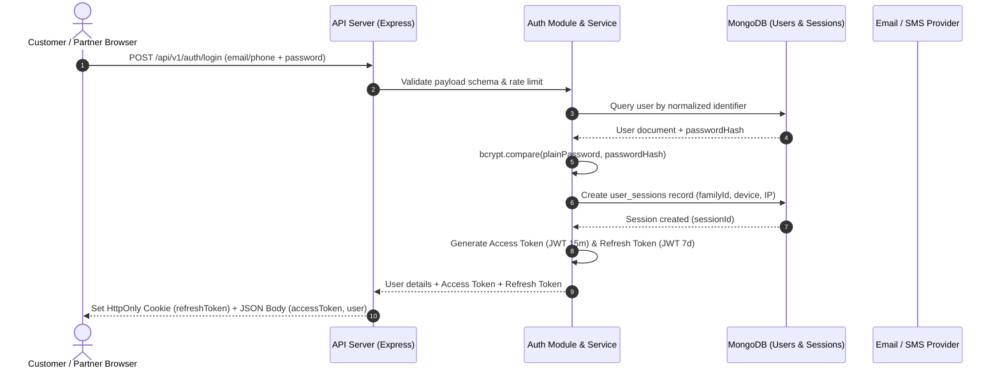

# 01. Authentication Architecture

## 1. Executive Overview

The **BookMyShow Clone** enterprise platform utilizes a hybrid **Stateless JWT + Stateful Session Invalidation** authentication and security architecture. Designed within a modular monolith structure, the authentication boundary isolates identity governance, cryptographic security, role-based access control (RBAC), and multi-tenant data boundaries across retail customers, theatre partners, and platform administrators.

```
+---------------------------------------------------------------------------------------------------------+
|                                           CLIENT APPLICATIONS                                           |
|       Customer Web / Mobile App       |       Theatre Partner Portal       |       Super Admin CMS      |
+---------------------------------------------------------------------------------------------------------+
                                                     |
                                   HTTPS / TLS 1.3 + WAF + Strict CSP
                                                     v
+---------------------------------------------------------------------------------------------------------+
|                                      API GATEWAY / REVERSE PROXY                                        |
|                          Rate Limiting | Request Correlation ID | DDoS Defense                          |
+---------------------------------------------------------------------------------------------------------+
                                                     |
                                                     v
+---------------------------------------------------------------------------------------------------------+
|                                    BACKEND CORE (MODULAR MONOLITH)                                      |
|                                                                                                         |
|   +-------------------------------------------------------------------------------------------------+   |
|   |                                  MIDDLEWARE PIPELINE                                            |   |
|   |   Request-ID -> Security Headers (Helmet) -> Rate Limiter -> Authenticate -> RBAC -> TenantScope|   |
|   +-------------------------------------------------------------------------------------------------+   |
|                                                    |                                                    |
|                                                    v                                                    |
|   +------------------------------------+       +----------------------------------------------------+   |
|   |         AUTH MODULE                |       |                  USERS MODULE                      |   |
|   |  - Dual-Token JWT Engine           |       |  - Profile Governance                              |   |
|   |  - Token Family Rotation           |       |  - Whitelisted Updates                             |   |
|   |  - Cryptographic Session Store     |       |  - Session Enumeration                             |   |
|   |  - Anti-Enumeration Logics         |       |  - Immediate Revocation                            |   |
|   |  - OTP & Password Lifecycle        |       |  - Soft-Delete / Account Deactivation              |   |
|   +------------------------------------+       +----------------------------------------------------+   |
|                      |                                                   |                              |
|                      +------------------------+--------------------------+                              |
|                                               |                                                         |
|                                               v                                                         |
|   +-------------------------------------------------------------------------------------------------+   |
|   |                                   DATA STORAGE INFRASTRUCTURE                                   |   |
|   |   MongoDB: users, user_sessions, otp_verifications, theatre_partners, audit_logs                |   |
|   |   Redis (Cluster): Active Refresh Token Whitelist, Distributed Rate Limiter, Temporary Locks    |   |
|   +-------------------------------------------------------------------------------------------------+   |
+---------------------------------------------------------------------------------------------------------+
```

---

## 2. Architectural Principles & Requirements

| Dimension | Architectural Implementation |
| :--- | :--- |
| **Token Architecture** | Dual-token mechanism: Short-lived Access Token (15 min) in memory + Long-lived Refresh Token (7 days) in `HttpOnly, Secure, SameSite=Strict` cookie. |
| **Token Rotation** | One-time use Refresh Token rotation with automatic Token Family Reuse Detection. Replaying an old token invalidates all sessions in that family. |
| **Session Control** | Stateful session tracking in `user_sessions` collection. Allows immediate revocation of compromised devices, view active sessions, and logout-all. |
| **Identity Scoping** | Clean separation of roles: `CUSTOMER`, `THEATRE_OWNER`, `THEATRE_MANAGER`, `THEATRE_STAFF`, and `SUPER_ADMIN`. |
| **Multi-Tenancy** | Partner-isolated data access. Theatre partners are strictly bound to their provisioned `partnerId` and `assignedTheatres`. |
| **Password Hashing** | Bcrypt with work factor (salt rounds) of 12, resistant to rainbow table and ASIC attacks. |
| **OTP Security** | SHA-256 hashed OTPs with strict 10-minute expiry, max 5 failed attempts per OTP, and rate limiting (max 3 per window). |
| **Audit & Governance** | Immutable `audit_logs` tracking sensitive authentication and administrative actions. |

---

## 3. High-Level System Workflow



---

## 4. Separation of Concerns & Module Boundaries

The authentication system strictly adheres to the layered architectural pattern:
1. **Routes (`auth.routes.js`, `users.routes.js`)**: Map HTTP routes, apply rate limiting, validation middlewares, and authentication guards.
2. **Controllers (`auth.controller.js`, `users.controller.js`)**: Unpack HTTP requests, delegate orchestration to services, set HTTP cookies, and format responses via standardized `ApiResponse`.
3. **Services (`auth.service.js`, `users.service.js`)**: Encapsulate pure business logic, security policies, token issuance, notification dispatches, and audit logs.
4. **Repositories (`auth.repository.js`, `users.repository.js`)**: Encapsulate Mongoose queries, projections, mutations, and database session transactions.
5. **Models (`user.model.js`, `session.model.js`, etc.)**: Define strict database schemas, compound indexes, and TTL expiration rules.

