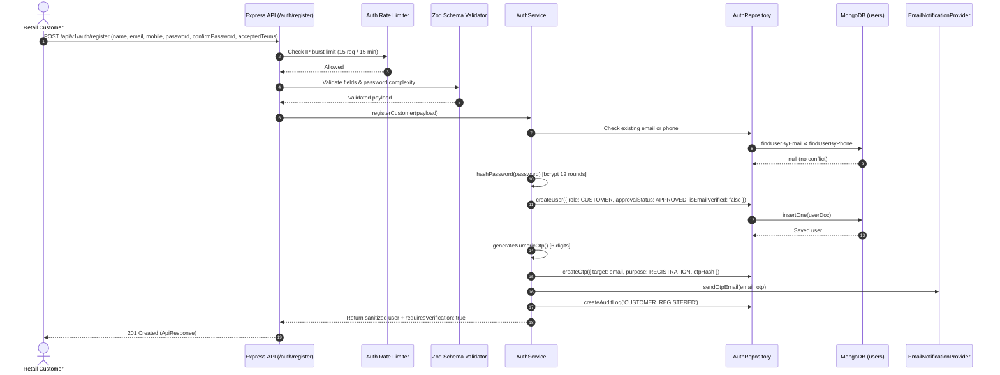
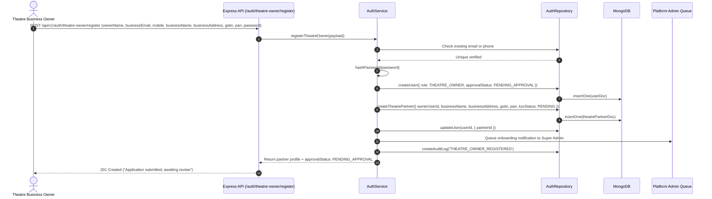

# 02. Registration Workflow

## 1. Overview

The platform supports two distinct onboarding tracks:
1. **Retail Customer Registration**: Instant self-service registration enabling movie discovery, seat reservation, and booking.
2. **Theatre Partner Onboarding**: Enterprise business registration with mandatory compliance verification and Super Admin KYC approval prior to operational activation.

---

## 2. Retail Customer Registration Workflow

### Step-by-Step Execution Sequence

### Validation Rules
- **Name**: String, trimmed, 2-100 characters.
- **Email**: Normalized lower-case, valid RFC 5322 regex. Unique across database.
- **Mobile**: Normalized to standard Indian E.164 (`+91[6-9]\d{9}`). Unique across database.
- **Password**: 8-64 characters, requiring at least 1 uppercase letter, 1 lowercase letter, 1 digit, and 1 special character (`[!@#$%^&*()_+\-=[\]{};':"\\|,.<>/?]`).
- **Confirm Password**: Exact string match with password.
- **Terms & Conditions**: Explicit boolean `true`.

---

## 3. Theatre Partner Onboarding Workflow

### Step-by-Step Execution Sequence

### Security & Compliance Controls
1. **Approval Status Invariant**: Theatre partner accounts default to `approvalStatus: PENDING_APPROVAL`. Any login attempts while pending return `401 Unauthorized` with an explicit message indicating the application is under review.
2. **KYC Verification**: Business legal metadata (`gstin`, `pan`, business registration address) is recorded in the `theatre_partners` entity for offline or automated compliance verification.
3. **Admin Approval Gate**: Only a `SUPER_ADMIN` can transition the status to `APPROVED` or `REJECTED`.

