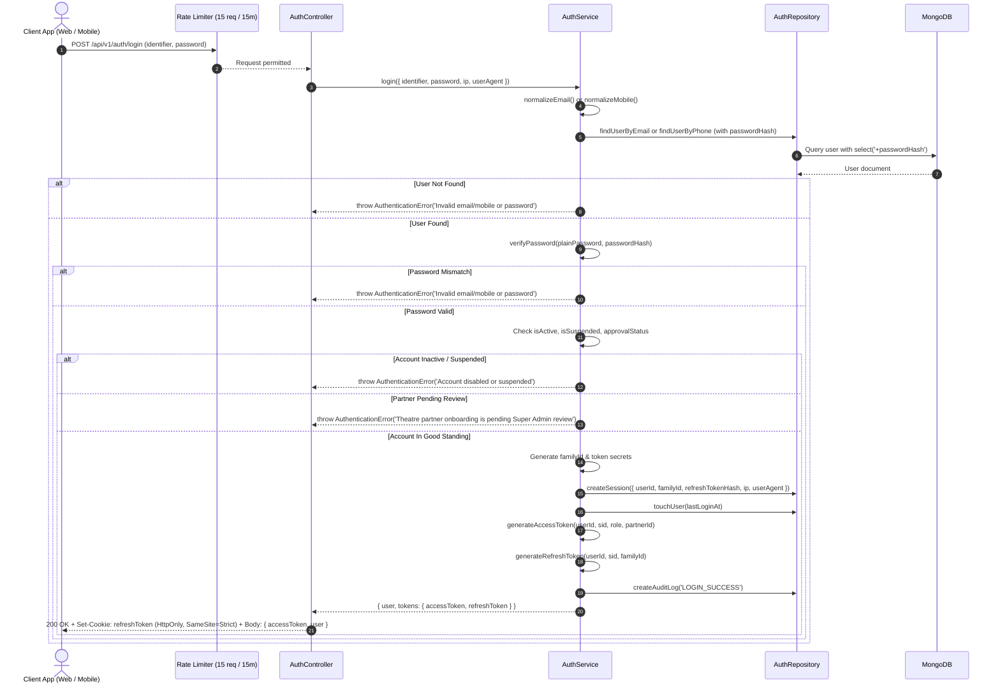

# 03. Login Workflow

## 1. Executive Summary

The login subsystem handles authentication requests across all application personas (Customers, Theatre Owners, Managers, Staff, and Super Admins) through a unified, high-security endpoint: `POST /api/v1/auth/login`.

It guarantees:
- Dual-identifier resolution (Email address or Indian mobile number).
- Zero plain-text password exposure.
- Protection against account enumeration through constant-time verification patterns and generic error messaging.
- Enforcement of lifecycle account restrictions (unapproved partner screening, account deactivation, and suspensions).
- Cryptographic session generation and `HttpOnly` cookie delivery.

---

## 2. Authentication Flow Diagram

---

## 3. Account Status Validation Rules

Before session establishment and token issuance, five state assertions are evaluated:

| Condition | Verification Check | Failure Code & HTTP Status |
| :--- | :--- | :--- |
| **Account Soft Deletion** | `user.deletedAt !== null` | `401 Unauthorized` (`UNAUTHORIZED`) |
| **Account Active Status** | `user.isActive === false` | `401 Unauthorized` (`UNAUTHORIZED`) |
| **Administrative Suspension** | `user.isSuspended === true` | `403 Forbidden` (`FORBIDDEN`) |
| **Partner Pending Approval** | `user.role === 'THEATRE_OWNER' && user.approvalStatus === 'PENDING_APPROVAL'` | `403 Forbidden` (`FORBIDDEN`) |
| **Partner Application Rejected** | `user.role === 'THEATRE_OWNER' && user.approvalStatus === 'REJECTED'` | `403 Forbidden` (`FORBIDDEN`) |

---

## 4. Anti-Enumeration & Brute Force Defense

1. **Generic Credential Rejection**: Whether an email or phone number does not exist in the database or the supplied password hash does not match, the exact same error message is emitted:
   `"Invalid email/mobile or password"` with code `INVALID_CREDENTIALS` and status `401 Unauthorized`.
2. **Aggressive Endpoint Rate Limiting**: The `authRateLimiter` restricts IP addresses to **15 login attempts per 15-minute sliding window**. Upon exceeding this limit, requests are rejected with `429 Too Many Requests`.
3. **Audit Tracing**: Failed and successful logins record client IP addresses and user agents to enable downstream behavioral anomaly detection and threat scoring.

