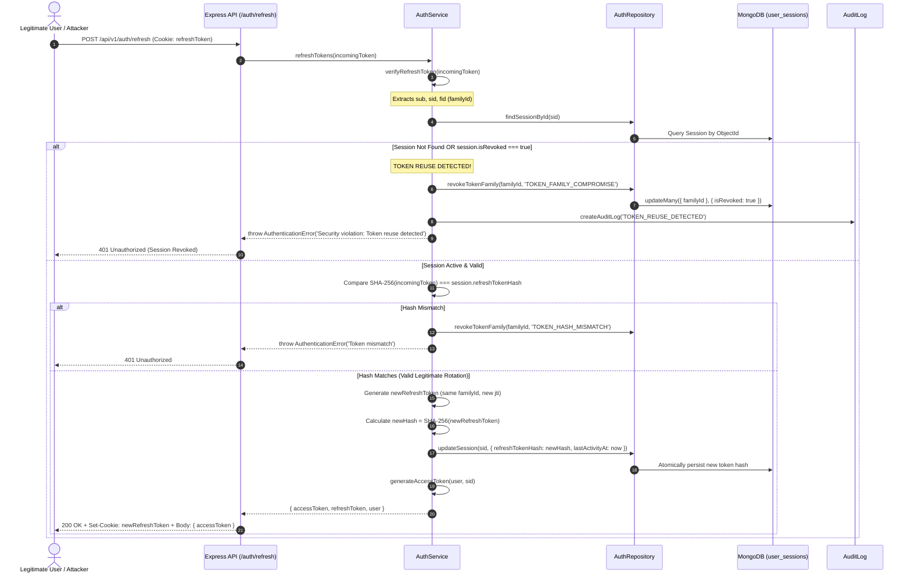

# 05. Refresh Token Rotation & Token Family Reuse Detection

## 1. Executive Summary

To prevent token theft and replay attacks without degrading customer experience, the platform enforces **One-Time Refresh Token Rotation (RTR)** bound to a **Token Family Identifier (`familyId`)**.

Every refresh operation invalidates the presented refresh token and issues a new refresh token and access token. If an attacker attempts to replay a previously rotated refresh token, the server detects a **Token Family Reuse Compromise**, immediately invalidates all active sessions associated with that family, and records an actionable security incident.

---

## 2. Threat Model: Refresh Token Theft & Replay

```
SCENARIO A: Normal Legitimate Client Rotation
Client (Token A) --------> Server rotates Token A to Token B --------> Client (Token B)

SCENARIO B: Intercepted Token Replay Attack
Attacker intercepts Token A before or after client rotates:
Legitimate Client:  Token A  --->  Server rotates to Token B  --->  Client holds Token B
Attacker:           Token A  --->  Server receives Token A!
                                   SERVER DETECTS REUSE of expired/rotated Token A!
                                   Action: Revoke Token Family (Token A & Token B both destroyed).
                                   Both Attacker and Legitimate User are instantly logged out.
```

---

## 3. Sequence Flow Diagram



---

## 4. Cryptographic Implementation Details

### Database Session Record
```javascript
{
  "_id": ObjectId("65f1a2b3c4d5e6f7a8b9c0d2"),
  "userId": ObjectId("65f1a2b3c4d5e6f7a8b9c0d1"),
  "familyId": "65f1a2b3c4d5e6f7a8b9c0d4",
  "refreshTokenHash": "e3b0c44298fc1c149afbf4c8996fb92427ae41e4649b934ca495991b7852b855",
  "isRevoked": false,
  "revocationReason": null,
  "userAgent": "Mozilla/5.0 (Windows NT 10.0; Win64; x64)...",
  "ipAddress": "203.0.113.195",
  "lastActivityAt": ISODate("2026-10-30T11:00:00Z"),
  "expiresAt": ISODate("2026-11-06T11:00:00Z"),
  "createdAt": ISODate("2026-10-30T10:00:00Z")
}
```

### Safety Guarantees
1. **Never Stored in Plain-text**: The raw Refresh Token exists exclusively in the client's cookie and transient server memory during verification. The database records only the SHA-256 digest (`refreshTokenHash`).
2. **Immutable Token Family Tree**: The `familyId` is created once upon initial password login and remains constant through all downstream token rotations of that continuous device session.
3. **Automated Incident Response**: Revocation affects all sessions sharing that `familyId`, neutralizing the attacker's stolen token while forcing the victim to re-authenticate with their credentials.

