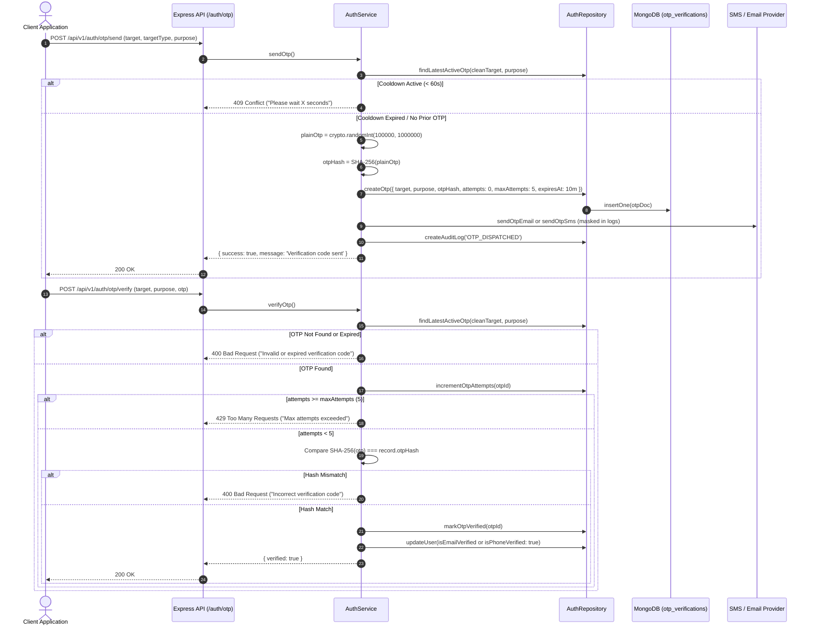

# 07. OTP Verification Architecture

## 1. Executive Summary

One-Time Passwords (OTPs) provide multi-factor verification for identity proofs, password recoveries, and contact verification (Email and SMS). The system enforces strict cryptographic protection, rate limiting, and brute-force throttling.

---

## 2. Cryptographic Security Standards

1. **Entropy & Generation**: Generated using Node.js native cryptographic PRNG (`crypto.randomInt(100000, 1000000)`), guaranteeing uniform distribution across all 900,000 possible 6-digit combinations.
2. **Zero Plain-Text Storage**: OTPs are hashed using **SHA-256** prior to database insertion. Even with full database read access, an attacker cannot retrieve plain-text OTPs without cracking the hash.
3. **Strict Lifespan**: All OTPs expire strictly **10 minutes** from creation.
4. **Brute-Force Counter**: Every failed attempt increments the `attempts` counter. Upon reaching **5 attempts**, the OTP is permanently invalidated.
5. **Cooldown Rate Limiting**: Users must wait **60 seconds** before requesting a new OTP for the same target and purpose.

---

## 3. Supported Purposes & Targets

```
           +-----------------------------------------------+
           |                OTP TARGETS                    |
           |    EMAIL (RFC 5322)   |   PHONE (+91 E.164)   |
           +-----------------------------------------------+
                                   |
                  +----------------+----------------+
                  |                                 |
                  v                                 v
     +-------------------------+       +-------------------------+
     |     EmailProvider       |       |       SmsProvider       |
     | - SendGrid / SES mock   |       | - Twilio / Kaleyra mock |
     +-------------------------+       +-------------------------+
```

### Supported OTP Purposes (`OtpPurpose`)
- `REGISTRATION`: Verification during new user onboarding.
- `LOGIN`: Passwordless or multi-factor login challenge.
- `PASSWORD_RESET`: Account recovery authorization code.
- `EMAIL_VERIFICATION`: Binding verified email to account profile.
- `PHONE_VERIFICATION`: Binding verified mobile phone to account profile.

---

## 4. OTP Verification Sequence Flow



