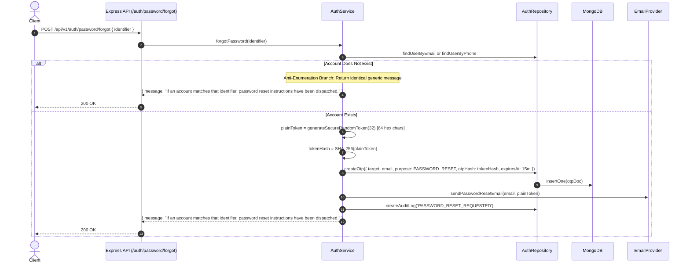

# 08. Password Management Lifecycle

## 1. Overview & Hashing Strategy

User passwords are protected in storage and transit adhering to OWASP Application Security Verification Standards (ASVS):
- **Work Factor / Algorithm**: **Bcrypt** with a work factor of **12 salt rounds**. Each hash is salt-unique and computationally expensive to defend against rainbow-table and GPU/ASIC parallel cracking.
- **In-Memory Hygiene**: Raw passwords are never logged or stored in variables longer than execution scope.
- **Model Security**: `passwordHash` has `select: false` on Mongoose `userSchema`, ensuring queries never expose hashes unless explicitly requested with `.select('+passwordHash')`.

---

## 2. Password Strength Validation Rules

Both registration, password reset, and password change enforce strict complexity through Zod validation:
- **Minimum Length**: 8 characters
- **Maximum Length**: 64 characters (mitigating Bcrypt 72-byte truncation boundaries)
- **Complexity Regex**: `/^(?=.*[a-z])(?=.*[A-Z])(?=.*\d)(?=.*[!@#$%^&*()_+\-=[\]{};':"\\|,.<>/?]).{8,64}$/`
  - At least 1 lowercase Latin character (`[a-z]`)
  - At least 1 uppercase Latin character (`[A-Z]`)
  - At least 1 numeric digit (`\d`)
  - At least 1 special/punctuation symbol (`[!@#$%^&*...]`)

---

## 3. Forgot Password & Anti-Enumeration Protection

### Step-by-Step Recovery Flow

---

## 4. Reset Password Workflow

Endpoint: `POST /api/v1/auth/password/reset`

When the user submits the reset token and their new password:
1. Calculates `SHA-256(token)`.
2. Locates the active recovery record in `otp_verifications` where `purpose: 'PASSWORD_RESET'`, `isVerified: false`, and `expiresAt > new Date()`.
3. Validates new password complexity and confirmation match.
4. Computes `newPasswordHash = bcrypt.hash(newPassword, 12)`.
5. Updates user record:
   - Sets `passwordHash = newPasswordHash`.
   - Sets `passwordChangedAt = new Date()`.
6. Marks recovery token as verified.
7. **Security Revocation**: Calls `AuthRepository.revokeAllUserSessions(userId, 'PASSWORD_RESET')`. All active devices are logged out immediately, neutralizing sessions on stolen or unauthorized devices.

---

## 5. Change Password Workflow

Endpoint: `POST /api/v1/auth/password/change` (Requires active Bearer access token).

1. Retrieves user record with `select('+passwordHash')`.
2. Validates `currentPassword` using `bcrypt.compare(currentPassword, user.passwordHash)`.
3. Enforces new password differs from old password.
4. Computes new Bcrypt hash and updates user record.
5. Calls `UsersRepository.revokeAllSessionsExceptCurrent(userId, currentSessionId)`.
6. Preserves the user's current session so they are not disrupted, while immediately invalidating all other active sessions across their other devices.

