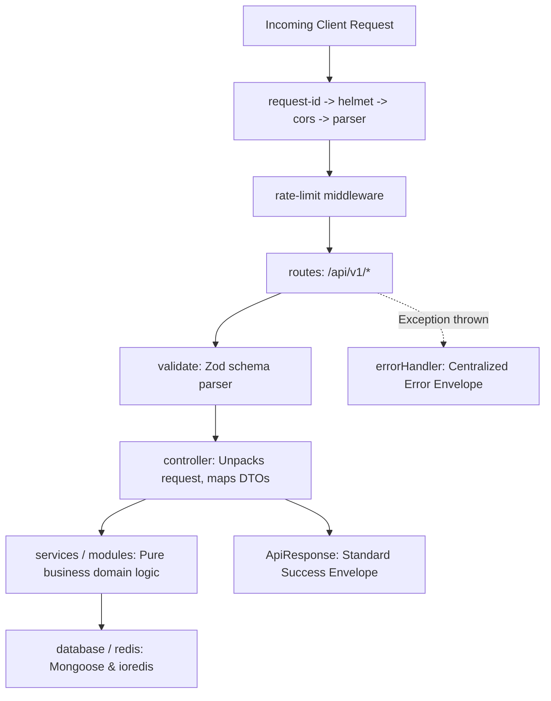

# 02. Backend Modular Folder Structure & Layer Responsibilities

## 1. Directory Tree Layout

The backend directory layout inside `apps/backend/` strictly isolates infrastructure, domain modules, common utilities, and test suites:

```
apps/backend/
├── .env                          # Local development environment secrets (gitignored)
├── .env.example                  # Sanitized environment template
├── .gitignore                    # Git ignore definitions
├── .prettierrc                   # Prettier formatting rules
├── .prettierignore               # Prettier exclusions
├── eslint.config.js              # ESLint 9 modern flat configuration
├── jest.config.js                # Jest test configuration for native ES modules
├── package.json                  # Node.js project manifest & npm scripts
├── Dockerfile                    # Multi-stage production container build
├── docker-compose.yml            # Local development orchestration (App + Mongo + Redis)
├── README.md                     # Backend developer quick-start documentation
│
├── src/
│   ├── config/                   # Centralized runtime configurations
│   │   ├── env.js                # Zod environment variable parsing & fail-fast validation
│   │   ├── database.js           # Mongoose connection pooling & health checks
│   │   ├── redis.js              # ioredis client instance & reconnection backoff
│   │   ├── cors.js               # CORS origins whitelist & preflight options
│   │   └── logger.js             # Pino structured logger & sensitive field redactions
│   │
│   ├── common/                   # Shared cross-cutting primitives
│   │   ├── constants/            # Immutable system constants
│   │   │   ├── http-status.js    # Semantic HTTP status codes
│   │   │   ├── error-codes.js    # Standardized application error codes
│   │   │   └── roles.js          # System user RBAC role enums
│   │   ├── errors/               # Typed custom error taxonomy
│   │   │   ├── app.error.js      # Base operational error class
│   │   │   ├── validation.error.js
│   │   │   ├── authentication.error.js
│   │   │   ├── authorization.error.js
│   │   │   ├── not-found.error.js
│   │   │   ├── conflict.error.js
│   │   │   ├── rate-limit.error.js
│   │   │   └── database.error.js
│   │   └── responses/            # Universal API response envelopes
│   │       ├── api-response.js   # Standard success & error response builder
│   │       └── pagination-meta.js# Pagination metadata calculator
│   │
│   ├── middlewares/              # Express middleware pipeline
│   │   ├── request-id.middleware.js # Unique correlation ID generator & duration tracker
│   │   ├── rate-limit.middleware.js # Tiered IP-based sliding window rate limiter
│   │   ├── validate.middleware.js   # Reusable Zod schema request interceptor
│   │   ├── auth.middleware.js       # JWT authentication & RBAC authorization hook
│   │   ├── not-found.middleware.js  # 404 route not found handler
│   │   └── error.middleware.js      # Centralized global error handler
│   │
│   ├── controllers/              # Transport layer controllers
│   │   └── health.controller.js  # Liveness, readiness, and system health endpoints
│   │
│   ├── routes/                   # RESTful routing declarations
│   │   ├── index.js              # Versioned API root (/api/v1)
│   │   └── health.routes.js      # Health check endpoint mappings
│   │
│   ├── sockets/                  # Real-time WebSocket infrastructure
│   │   ├── index.js              # Socket.IO server initialization & connection hooks
│   │   └── events.js             # Standardized socket event name constants
│   │
│   ├── docs/                     # Interactive API documentation
│   │   └── swagger.js            # Swagger JSDoc & OpenAPI 3.0 specification
│   │
│   ├── modules/                  # Encapsulated domain business modules (Part 4+)
│   ├── services/                 # Cross-cutting infrastructure services
│   ├── jobs/                     # Background scheduled cron workers
│   ├── queues/                   # BullMQ message queues
│   ├── utils/                    # Generic helper functions
│   │
│   ├── app.js                    # Express application factory & middleware pipeline
│   └── server.js                 # HTTP bootstrap & graceful shutdown coordinator
│
└── tests/                        # Automated test suites
    ├── helpers/                  # Test harness & mock server builders
    │   └── test-server.js
    ├── unit/                     # Isolated unit tests
    │   ├── env.test.js
    │   ├── errors.test.js
    │   ├── responses.test.js
    │   ├── middlewares.test.js
    │   ├── auth.middleware.test.js
    │   ├── error.middleware.test.js
    │   └── infrastructure.test.js
    └── integration/              # Supertest HTTP integration tests
        ├── health.test.js
        └── app.test.js
```

---

## 2. Layer Responsibilities & Architectural Separation



### Key Architectural Disciplines
1. **Separation of `app.js` and `server.js`**:
   - `app.js` exports a pure Express application factory (`createApp()`) without starting network listeners. This allows integration test suites (via Supertest) to execute without binding to physical network ports.
   - `server.js` is the executable entry point that bootstraps database connections, binds Socket.IO, listens on the designated TCP port, and registers graceful termination listeners.
2. **Standardized Domain Modules**:
   - Starting in Part 4, business features reside in `src/modules/<module-name>/` following the 7-layer design specified in Part 1 (`model`, `controller`, `service`, `repository`, `routes`, `validation`, `tests`).

