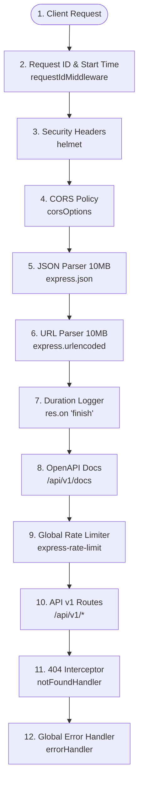

# 04. Express Application Architecture & Middleware Execution Pipeline

## 1. Middleware Execution Pipeline Ordering

In Express.js, middleware execution order is foundational to security, request tracking, parsing, and error propagation. The platform establishes an immutable, deterministic 11-step execution pipeline inside `src/app.js`:

---

## 2. Pipeline Step Rationale & Security Controls

### 1. Request ID & Timing (`requestIdMiddleware`)
- Must run **first** so that all subsequent logs, security checks, and controllers have access to `req.id` and `req.startTime`.
- Sets standard `X-Request-ID` response header for end-to-end client-server tracing.

### 2. HTTP Security Hardening (`helmet`)
- Enforces DNS prefetch controls, disables MIME-type sniffing (`X-Content-Type-Options: nosniff`), sets `X-Frame-Options: SAMEORIGIN` to mitigate clickjacking, and enforces Strict-Transport-Security (HSTS).

### 3. Cross-Origin Resource Sharing (`cors`)
- Whitelists configured frontend applications (`config.CLIENT_URL`). Rejects unauthorized origins with a standard `403 Forbidden` response before request bodies are parsed.

### 4. Bounded Body Parsers (`express.json`, `express.urlencoded`)
- Hard upper limit of `10MB` prevents denial-of-service memory exhaustion attacks from massive payloads.

### 5. Request Telemetry & Duration Logging
- Captures start time on request entry and listens to the native `res.on('finish')` event to log HTTP method, URL, status code, and duration in milliseconds.

### 6. Swagger API Documentation (`/api/v1/docs`)
- Interactive OpenAPI 3.0 documentation served before rate limiting to facilitate testing.

### 7. Global Sliding-Window Rate Limiting
- Evaluates client IP against sliding-window limits (300 requests per 15 minutes) before reaching business controllers.

### 8. API Routing Layer (`/api/v1`)
- Routes requests to specific domain routers, applying route-level Zod validation and authentication guards.

### 9. 404 Route Not Found Interceptor
- Catches unhandled paths and converts them into a standard `NotFoundError` exception passed to `next()`.

### 10. Centralized Global Error Handler
- 4-argument Express error middleware (`err, req, res, next`) that captures all operational and runtime errors, formats them into standard JSON envelopes, and hides internal stack traces in production.

