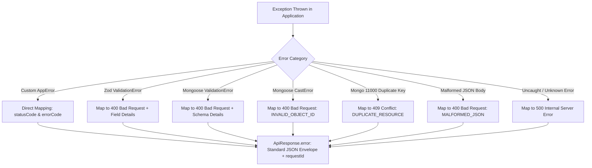

# 05. Centralized Error Handling & Exception Taxonomy

## 1. Error Architecture Philosophy

The error handling subsystem provides a unified, structured error format across all endpoints while guaranteeing that **zero sensitive database internals, system paths, or credential details are leaked in production environments**.



---

## 2. Standardized Error Response Envelope

All error responses across the platform conform to the standard RFC-aligned JSON structure:

```json
{
  "success": false,
  "message": "Validation failed: One or more parameters are invalid",
  "error": {
    "code": "VALIDATION_ERROR",
    "details": [
      {
        "field": "body.email",
        "message": "Invalid email format",
        "rule": "invalid_string"
      }
    ]
  },
  "requestId": "8419ba0b-1381-49e4-b38c-c8a833f3d23f"
}
```

---

## 3. Custom Error Class Hierarchy (`src/common/errors/`)

| Error Class | HTTP Status | Error Code | Description / Usage |
| :--- | :---: | :--- | :--- |
| `AppError` | Variable (500) | `INTERNAL_SERVER_ERROR` | Base operational error class extending native `Error`. |
| `ValidationError` | `400` | `VALIDATION_ERROR` | Request payload fails Zod or schema constraints. |
| `AuthenticationError`| `401` | `AUTHENTICATION_ERROR` | Missing, expired, revoked, or malformed credentials/tokens. |
| `AuthorizationError` | `403` | `FORBIDDEN` | Authenticated user lacks permission or crosses tenant boundaries. |
| `NotFoundError` | `404` | `NOT_FOUND` | Resource or route does not exist. |
| `ConflictError` | `409` | `CONFLICT` | Concurrent state clash (e.g. seat already locked, duplicate key). |
| `RateLimitError` | `429` | `RATE_LIMIT_EXCEEDED`| Request quota exceeded. |
| `DatabaseError` | `500` | `DATABASE_ERROR` | Operational failure in persistent MongoDB storage. |

---

## 4. Automatic Database & Runtime Error Mapping

The centralized error handler (`src/middlewares/error.middleware.js`) intercepts non-operational third-party errors and maps them to clean user-facing representations:

1. **Malformed JSON Body**:
   - Catches body-parser `SyntaxError` when a client sends invalid JSON (e.g. unquoted strings, missing braces).
   - Maps to `400 Bad Request` with code `MALFORMED_JSON`.
2. **Mongoose `CastError`**:
   - Occurs when an invalid 24-character hex string is passed to an `ObjectId` route param (`/shows/abc/seats`).
   - Maps to `400 Bad Request` with code `INVALID_OBJECT_ID`.
3. **MongoDB Duplicate Key (`MongoServerError 11000`)**:
   - Catches unique constraint violations (e.g. duplicate email, duplicate seat identity).
   - Maps to `409 Conflict` with code `DUPLICATE_RESOURCE` and identifies the colliding field.
4. **Environment-Sensitive Stack Traces**:
   - Stack traces are attached to the response payload **only** when `NODE_ENV === 'development'`. In production, stack traces are completely stripped and logged exclusively to structured server logs.

