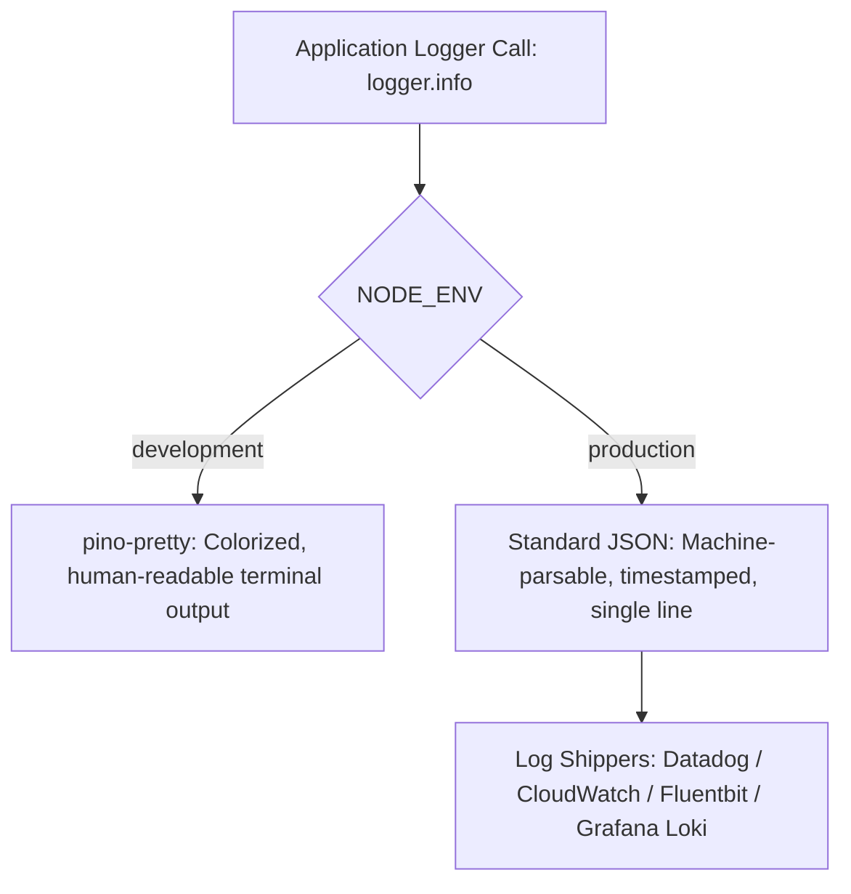

# 09. Structured Logging System & Telemetry Architecture

## 1. Overview & Performance Rationale

Logging is implemented using **Pino v9** inside `src/config/logger.js`. Pino is engineered for ultra-low overhead, processing log events up to 5x faster than alternatives (such as Winston) by deferring serialization and minimizing garbage collection churn.

---

## 2. Environment-Specific Output Formats



### 2.1 Production Log Example (Structured JSON)
```json
{
  "level": 30,
  "time": "2026-10-30T10:30:15.123Z",
  "pid": 1001,
  "hostname": "api-worker-prod-01",
  "msg": "Request Finished",
  "requestId": "8419ba0b-1381-49e4-b38c-c8a833f3d23f",
  "method": "POST",
  "url": "/api/v1/shows/67220b/lock-seats",
  "statusCode": 200,
  "durationMs": 14
}
```

---

## 3. Mandatory PII & Credential Redaction

To prevent sensitive user credentials or financial tokens from accidentally leaking into log storage, Pino is configured with hard redaction paths:

```javascript
redact: {
  paths: [
    'req.headers.authorization',
    'req.headers.cookie',
    'req.body.password',
    'req.body.confirmPassword',
    'req.body.token',
    'req.body.refreshToken',
    'req.body.otp',
    'password',
    'token',
    'refreshToken',
    'otp',
    'secret'
  ],
  censor: '[REDACTED]'
}
```

Any log invocation attempting to print `req.body.password` or `Authorization` headers automatically censors the value to `[REDACTED]`.

---

## 4. Correlation via Request ID

Every HTTP log entry includes the distributed tracing ID:
- `requestId: req.id`
If a customer encounters an error, support staff can search the centralized log index using the `requestId` printed on the customer's error screen to pull the exact execution trace and database timing logs.

