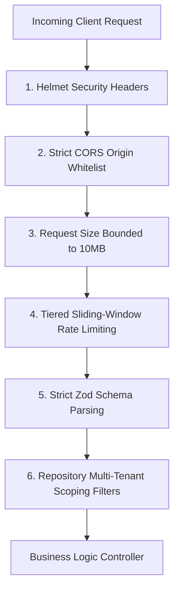

# 10. Security Middleware Foundation & Threat Hardening

## 1. Multi-Tier Security Framework

The backend implements defense-in-depth security across HTTP headers, cross-origin traffic, request bounds, and input sanitization:

---

## 2. Security Middleware Breakdown

### 2.1 Helmet HTTP Headers
- **`X-Content-Type-Options: nosniff`**: Prevents browsers from MIME-sniffing a response away from the declared content-type.
- **`X-Frame-Options: SAMEORIGIN`**: Mitigates Clickjacking attacks by disallowing malicious sites from embedding the booking platform inside iframes.
- **`Strict-Transport-Security (HSTS)`**: Enforces HTTPS connections for 365 days.
- **`X-DNS-Prefetch-Control: off`**: Prevents browser pre-resolving of external hyperlinks.

### 2.2 Cross-Origin Resource Sharing (`cors`)
- Wildcard CORS (`*`) is strictly rejected.
- Permitted origins are loaded from `config.CLIENT_URL` and development localhost aliases.
- Preflight requests are verified and cached for 24 hours (`maxAge: 86400`).
- Credentials (cookies, auth headers) are accepted only from explicit whitelisted domains.

### 2.3 Tiered Rate Limiting (`express-rate-limit`)
- **Global Ingress Limiter**: 300 requests per 15-minute window per IP. Protects against basic volumetric scraping and DDoS.
- **Authentication Limiter**: 15 requests per 15-minute window per IP. Defends against credential stuffing and OTP brute-forcing.

### 2.4 Payload Size Protection
- `express.json({ limit: '10mb' })` and `express.urlencoded({ limit: '10mb' })` reject oversized HTTP bodies with `413 Payload Too Large`, preventing memory starvation.

---

## 3. Threat Mitigation Matrix

| Threat Vector | Mitigation Strategy | Implemented Component |
| :--- | :--- | :--- |
| **NoSQL Query Injection** | Rejecting non-primitive types where strings are expected; Zod schema parsing. | `validate.middleware.js` |
| **Cross-Site Scripting (XSS)** | React JSX escaping on frontend; Content Security Policy headers on backend. | `helmet()` |
| **Clickjacking** | Denying external iframe embedding. | `helmet({ frameguard: 'SAMEORIGIN' })` |
| **Denial of Service (DoS)** | Request payload limits (10MB) + sliding-window rate limiters. | `express.json` + `rate-limit.middleware.js` |
| **Token Hijacking (XSS)** | Refresh tokens stored in `HttpOnly, Secure, SameSite=Strict` cookies. | Auth subsystem (Part 4) |
| **BOLA / IDOR Cross-Tenant Leak** | Auto-injected `partnerId` scoping in repositories. | Part 2 Database Design |

