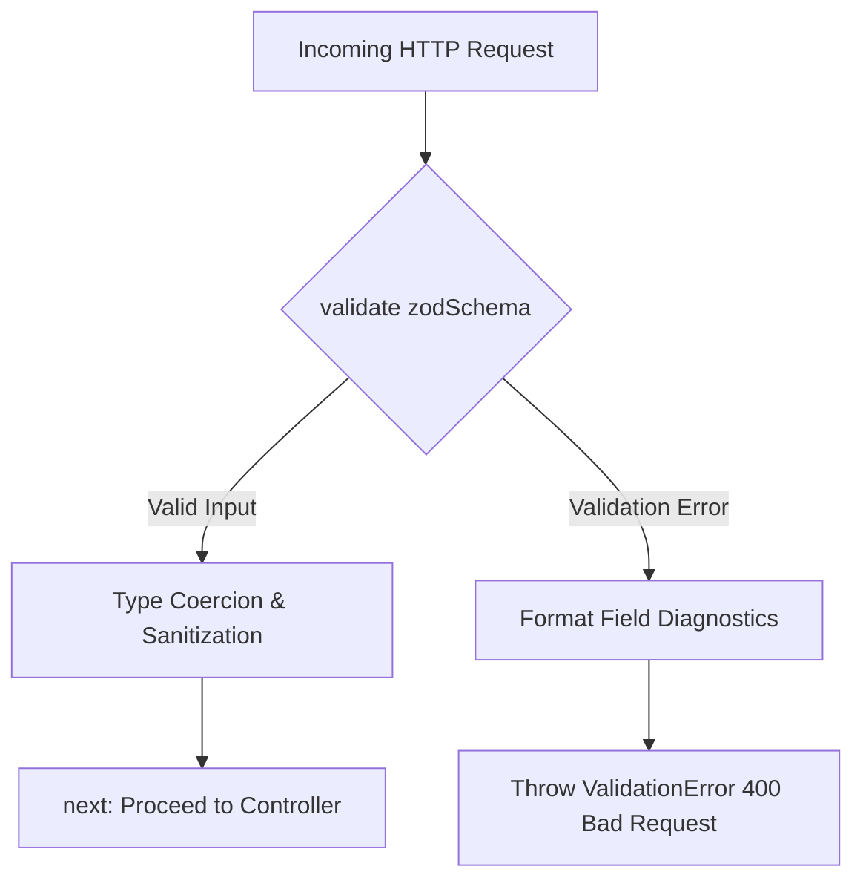

# 11. Request Validation Infrastructure with Zod

## 1. Overview & Architectural Role

All client input arriving at the backend (`req.body`, `req.query`, and `req.params`) must pass through the **Zod Validation Middleware** (`src/middlewares/validate.middleware.js`) before reaching controller logic.



---

## 2. Reusable Validation Middleware (`src/middlewares/validate.middleware.js`)

```javascript
import { ValidationError } from '../common/errors/validation.error.js';

export const validate = (schema) => {
  return async (req, res, next) => {
    try {
      if (schema.params) {
        req.params = await schema.params.parseAsync(req.params);
      }
      if (schema.query) {
        req.query = await schema.query.parseAsync(req.query);
      }
      if (schema.body) {
        req.body = await schema.body.parseAsync(req.body);
      }
      return next();
    } catch (error) {
      if (error.errors && Array.isArray(error.errors)) {
        const formattedDetails = error.errors.map((err) => ({
          field: err.path.join('.'),
          message: err.message,
          rule: err.code
        }));

        return next(
          new ValidationError(
            'Validation failed: One or more parameters are invalid',
            formattedDetails
          )
        );
      }
      return next(error);
    }
  };
};
```

---

## 3. Usage Pattern Example for Future Modules

```javascript
// Example: Bounding seat lock request
import { z } from 'zod';
import validate from '../middlewares/validate.middleware.js';

export const lockSeatsValidation = validate({
  params: z.object({
    showId: z.string().regex(/^[0-9a-fA-F]{24}$/, 'Must be a valid 24-character hexadecimal ObjectId')
  }),
  body: z.object({
    seatIds: z
      .array(z.string().min(1))
      .min(1, 'At least one seat must be selected')
      .max(10, 'Maximum 10 seats allowed per booking transaction')
  })
});

// Applied on router:
router.post('/shows/:showId/lock-seats', lockSeatsValidation, showController.lockSeats);
```

### Diagnostic Output Example
If the caller submits 15 seats or an invalid show ID:
```json
{
  "success": false,
  "message": "Validation failed: One or more parameters are invalid",
  "error": {
    "code": "VALIDATION_ERROR",
    "details": [
      {
        "field": "params.showId",
        "message": "Must be a valid 24-character hexadecimal ObjectId",
        "rule": "invalid_string"
      },
      {
        "field": "body.seatIds",
        "message": "Maximum 10 seats allowed per booking transaction",
        "rule": "too_big"
      }
    ]
  },
  "requestId": "dc3fc553-042c-4fa4-b453-4079f06114bd"
}
```

