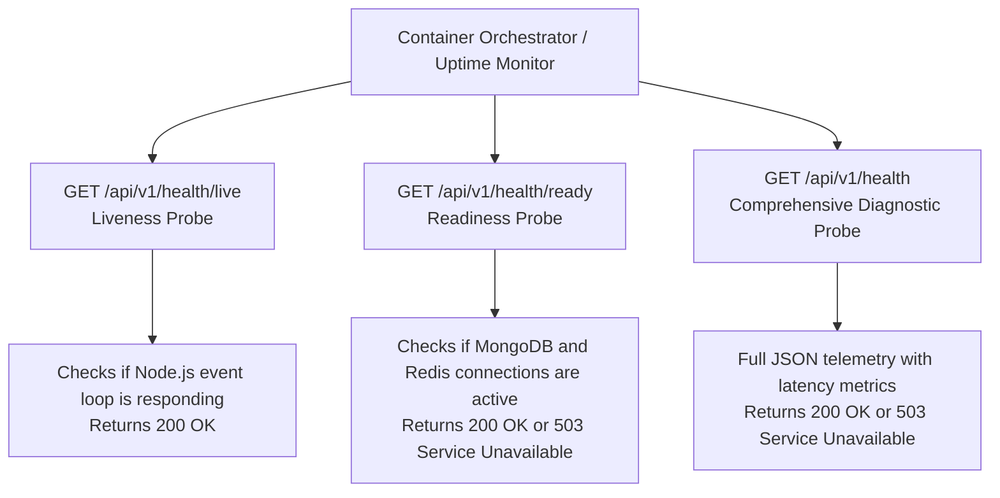

# 12. System Health, Readiness & Liveness Architecture

## 1. Health Probe Ecosystem

Production deployment orchestrators (such as Kubernetes, AWS ECS, Docker Swarm, and uptime monitors like Datadog) require distinct endpoints to evaluate container lifecycles:



---

## 2. Endpoint Specifications

### 2.1 Liveness Probe (`GET /api/v1/health/live`)
- **Purpose**: Confirms the Node.js process is active and has not deadlocked. If this fails, the container orchestrator restarts the pod.
- **Success Code**: `200 OK`
- **Payload Example**:
  ```json
  {
    "success": true,
    "message": "Service is alive",
    "data": {
      "status": "UP",
      "uptimeSeconds": 342,
      "timestamp": "2026-10-30T10:30:00.000Z"
    },
    "meta": null
  }
  ```

---

### 2.2 Readiness Probe (`GET /api/v1/health/ready`)
- **Purpose**: Confirms mandatory dependencies (MongoDB and Redis) are reachable. If this fails, the ingress load balancer stops routing external traffic to this container without terminating it.
- **Success Code**: `200 OK`
- **Failure Code**: `503 Service Unavailable`
- **Payload Example**:
  ```json
  {
    "success": true,
    "message": "Service is ready to accept traffic",
    "data": {
      "status": "READY",
      "timestamp": "2026-10-30T10:30:00.000Z",
      "checks": {
        "database": true,
        "redis": true
      }
    },
    "meta": null
  }
  ```

---

### 2.3 Comprehensive Health Check (`GET /api/v1/health`)
- **Purpose**: Full diagnostic endpoint for DevOps engineers and status page dashboards.
- **Payload Example**:
  ```json
  {
    "success": true,
    "message": "System is fully operational",
    "data": {
      "status": "HEALTHY",
      "environment": "development",
      "uptimeSeconds": 342,
      "timestamp": "2026-10-30T10:30:00.000Z",
      "dependencies": {
        "database": {
          "status": "connected",
          "isHealthy": true,
          "latencyMs": 4
        },
        "redis": {
          "status": "ready",
          "isHealthy": true,
          "latencyMs": 1
        }
      }
    },
    "meta": null
  }
  ```

> [!NOTE]
> Database connection strings, credentials, and internal private VPC hostnames are never exposed in health check outputs.

