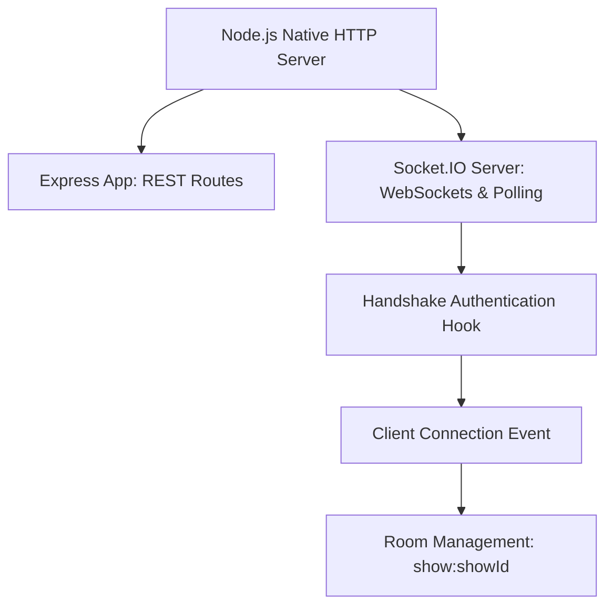

# 14. Real-time Socket.IO Foundation & Event Architecture

## 1. Overview & Real-time Scope

In movie ticket booking, temporary seat locks and seat releases must be synchronized across all active users looking at the same auditorium seat grid in real time. **Socket.IO v4** is configured inside `src/sockets/` to provide bi-directional event distribution.

---

## 2. Decoupled Server Architecture

Socket.IO is decoupled from Express route controllers:


### Server Initialization (`src/sockets/index.js`)
```javascript
export const initSocketServer = (httpServer) => {
  io = new Server(httpServer, {
    cors: {
      origin: allowedOrigins,
      methods: ['GET', 'POST'],
      credentials: true
    },
    pingTimeout: 60000,
    pingInterval: 25000
  });

  // Authentication hook
  io.use((socket, next) => {
    const token = socket.handshake.auth?.token;
    socket.data.user = token ? { role: 'AUTHENTICATED' } : { role: 'GUEST' };
    next();
  });

  io.on('connection', (socket) => {
    logger.info({ msg: 'Socket client connected', socketId: socket.id });
    socket.on('disconnect', (reason) => {
      logger.info({ msg: 'Socket client disconnected', socketId: socket.id, reason });
    });
  });
};
```

---

## 3. Standardized Event Names (`src/sockets/events.js`)

All event identifiers are maintained as immutable constants to eliminate typing bugs:

```javascript
export const SocketEvents = Object.freeze({
  CONNECTION: 'connection',
  DISCONNECT: 'disconnect',
  ERROR: 'error',

  // Show seat room events (reserved for future real-time locking)
  JOIN_SHOW_ROOM: 'show:join',
  LEAVE_SHOW_ROOM: 'show:leave',
  SEATS_LOCKED: 'show:seats_locked',
  SEATS_RELEASED: 'show:seats_released',
  SEATS_BOOKED: 'show:seats_booked'
});
```

When a user opens a seat map for Show 101, the client emits `show:join` with `{ showId: "101" }`. When Customer A locks Seat `A12`, the backend broadcasts `show:seats_locked` exclusively to room `show:101`.

