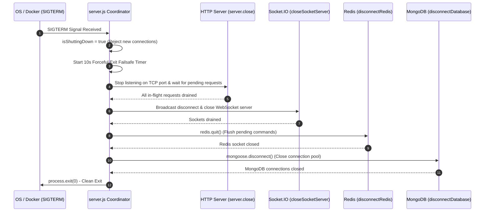

# 15. Graceful Server Shutdown & Process Lifecycle

## 1. Overview & Termination Risks

Abruptly terminating a production backend process (`kill -9`) during a deployment or pod restart causes severe distributed failure states:
- Active MongoDB multi-document transactions are abruptly severed.
- In-flight HTTP requests from clients are dropped with `502 Bad Gateway`.
- Redis lock connections are left open until timeout.
- WebSocket connections are terminated without clean closure codes.

---

## 2. Coordinated Shutdown Sequence (`src/server.js`)

The shutdown coordinator listens for `SIGINT` (Ctrl+C in terminal), `SIGTERM` (emitted by Kubernetes/Docker), and fatal uncaught exceptions:



---

## 3. Implementation Code Reference (`src/server.js`)

```javascript
const gracefulShutdown = async (signal) => {
  if (isShuttingDown) {
    return;
  }
  isShuttingDown = true;

  logger.warn({ msg: `Received ${signal}. Initiating graceful shutdown sequence...` });

  // Safety failsafe: Force exit if shutdown hangs beyond 10 seconds
  const forceExitTimeout = setTimeout(() => {
    logger.error('Graceful shutdown timed out after 10s. Forcing process exit.');
    process.exit(1);
  }, 10000);
  forceExitTimeout.unref();

  try {
    // 1. Stop receiving new HTTP requests
    if (server) {
      await new Promise((resolve) => server.close(resolve));
    }
    // 2. Close active WebSocket connections
    await closeSocketServer();
    // 3. Close Redis connection
    await disconnectRedis();
    // 4. Close MongoDB connection
    await disconnectDatabase();

    logger.info('Graceful shutdown completed successfully. Process exiting.');
    process.exit(0);
  } catch (shutdownError) {
    logger.error({ msg: 'Error occurred during graceful shutdown', error: shutdownError.message });
    process.exit(1);
  }
};
```

