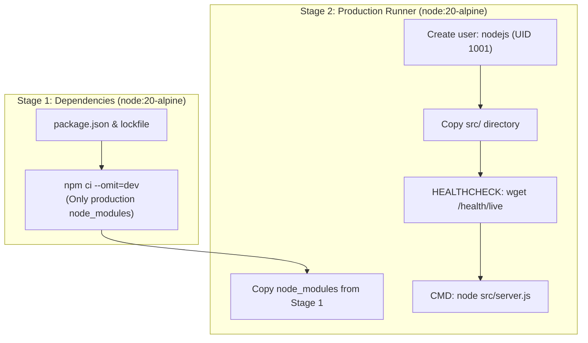

# 16. Docker Containerization & Local Compose Orchestration

## 1. Overview & Multi-Stage Architecture

The backend utilizes an optimized **Multi-Stage Dockerfile** based on `node:20-alpine`, producing a minimal, secure, and production-ready runtime container.



---

## 2. Security Hardening in Dockerfile

1. **Non-Root Execution**:
   ```dockerfile
   RUN addgroup --system --gid 1001 nodejs && \
       adduser --system --uid 1001 nodejs
   USER nodejs
   ```
   Ensures that an application breach cannot gain root shell privileges on the host kernel.
2. **Built-In Container Health Check**:
   ```dockerfile
   HEALTHCHECK --interval=30s --timeout=5s --start-period=10s --retries=3 \
     CMD wget --no-verbose --tries=1 --spider http://localhost:5000/api/v1/health/live || exit 1
   ```

---

## 3. Docker Compose Orchestration (`docker-compose.yml`)

The multi-container development environment spins up the Backend API, MongoDB 7.0, and Redis 7.2 on an isolated internal bridge network:

```yaml
version: '3.8'

services:
  backend:
    build:
      context: .
      dockerfile: Dockerfile
    container_name: bookmyshow_backend_api
    ports:
      - '5000:5000'
    depends_on:
      mongodb:
        condition: service_healthy
      redis:
        condition: service_healthy
    networks:
      - bookmyshow_internal_network

  mongodb:
    image: mongo:7.0
    container_name: bookmyshow_mongodb
    ports:
      - '27017:27017'
    volumes:
      - mongodb_data:/data/db
    networks:
      - bookmyshow_internal_network

  redis:
    image: redis:7.2-alpine
    container_name: bookmyshow_redis
    ports:
      - '6379:6379'
    volumes:
      - redis_data:/data
    networks:
      - bookmyshow_internal_network

networks:
  bookmyshow_internal_network:
    driver: bridge

volumes:
  mongodb_data:
  redis_data:
```

---

## 4. Operational Commands

```bash
# Build and start all three containers in background
docker-compose up --build -d

# Verify container health status
docker-compose ps

# Tail backend application logs
docker-compose logs -f backend

# Stop all containers safely
docker-compose down
```

