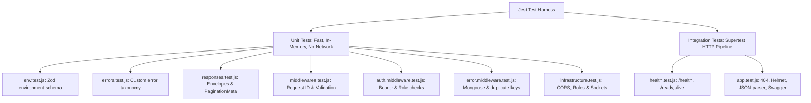

# 17. Automated Testing Strategy & Jest Test Harness

## 1. Overview & Test Philosophy

Testing in enterprise systems must be fast, deterministic, and isolated. The platform implements automated testing with **Jest v29** and **Supertest v7** leveraging native Node.js **ECMAScript Modules (`--experimental-vm-modules`)**.



---

## 2. Test Execution Commands

```bash
# Run all tests sequentially with leak detection
npm test

# Run tests in interactive watch mode during development
npm run test:watch

# Generate code coverage matrix
npm run test:coverage
```

---

## 3. Test Isolation via `createTestApp()`

Integration tests never start live network listeners on physical ports (e.g. port 5000), preventing port conflict collisions in CI/CD runners. 

Tests import the Express application factory directly through `tests/helpers/test-server.js`:

```javascript
import request from 'supertest';
import { createTestApp } from '../helpers/test-server.js';

describe('Health Endpoints Integration Tests', () => {
  let app;

  beforeAll(() => {
    app = createTestApp();
  });

  it('GET /api/v1/health/live should return 200 OK', async () => {
    const response = await request(app)
      .get('/api/v1/health/live')
      .expect(200);

    expect(response.body.success).toBe(true);
    expect(response.body.data.status).toBe('UP');
    expect(response.headers['x-request-id']).toBeDefined();
  });
});
```

---

## 4. Current Test Suite Results (Part 3)

- **Total Test Suites**: 9 passed (100%)
- **Total Tests**: 44 passed (100%)
- **Code Coverage**:
  - Statements: **88.09%**
  - Lines: **88.34%**
  - Functions: **85.36%**
  - Branches: **60.77%**
- **Execution Time**: ~3.7 seconds.

