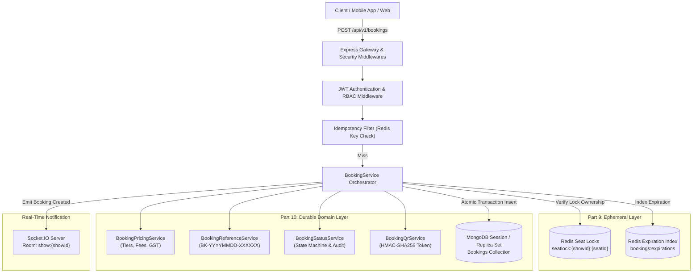

# Part 10 — Booking Engine Module: Architecture & Overview

## 1. Executive Summary

The **Booking Engine Module** serves as the core transactional engine for the enterprise movie ticket booking platform (BookMyShow Clone). Positioned immediately downstream of the temporary seat locking subsystem (Part 9) and immediately upstream of the payment gateway processing pipeline (Part 11), the booking engine orchestrates checkout initiation, server-side pricing breakdown calculations, immutable snapshot persistence, booking lifecycle transitions, automated expiration management, and ticket admittance security.

Designed as a high-concurrency, multi-tenant, and fault-tolerant service, the module eliminates dual-booking risks through dual-layer synchronization: ephemeral Redis lock ownership validation followed by atomic MongoDB transaction sessions backed by unique partial indexes.

---

## 2. Core Architectural Objectives

| Objective | Specification | Implementation Strategy |
| :--- | :--- | :--- |
| **Zero Double-Booking Invariant** | Guaranteed exclusivity across high concurrency | Redis hold verification + MongoDB compound unique partial index on `{ showId: 1, 'seats.seatId': 1 }` for active bookings (`PENDING_PAYMENT`, `CONFIRMED`). |
| **Strict Payment Separation** | Bookings can never reach `CONFIRMED` without verified payment | Centralized `BookingStatusService` state machine enforcing cryptographically verified gateway confirmations (deferred to Part 11). |
| **Server-Side Pricing Engine** | Tamper-proof fee, tax, and discount calculation | Dynamic tier evaluation, configurable convenience fees, statutory GST (18%), and half-up floating-point rounding precision. |
| **Network Idempotency** | Protection against network duplicate requests | Client-supplied `Idempotency-Key` / `x-idempotency-key` cached in Redis with request fingerprinting (600s TTL). |
| **Automated Expiration Cleanup** | Timely release of unpaid inventory | Redis Sorted Set (`bookings:expirations`) with distributed redlock sweeping, MongoDB fallback, and Socket.IO seat release broadcasts. |
| **Immutable Historical Snapshots** | Auditability and ticket resilience | Deep point-in-time capture of movie details, auditorium metadata, show schedules, and seat layouts within the booking document. |
| **Cryptographic Admittance QR** | Anti-counterfeit gate entry validation | HMAC-SHA256 signed JWT-style verification tokens encoding ticket reference, show, seat count, and status without exposing PII. |
| **Multi-Tenant Data Isolation** | Strict BOLA / IDOR protection | Automated partner/theatre isolation ensuring venue operators only access reservations belonging to their cinemas. |

---

## 3. High-Level Booking Engine Topology

---

## 4. Architectural Boundaries and Non-Goals

1. **Payment Gateways Deferred to Part 11**:
   - Razorpay order generation, client SDK checkout signatures, webhook ingestion, and capture reconciliation belong strictly to Part 11.
   - In Part 10, newly created bookings enter the `PENDING_PAYMENT` state with an absolute payment countdown window (default 300 seconds).
2. **Read vs Write Isolation**:
   - High-throughput public reads (show schedule discovery, layout seat maps) execute through lean queries and Redis caching.
   - Writes (booking reservation, cancellation, expiration) utilize database transactions with strict ACID guarantees.
3. **Tenancy Boundaries**:
   - Customers can only read and cancel their own bookings (`customerId === req.user.id`).
   - Theatre partners and cinema managers can only read bookings originating from their assigned theatres (`partnerId === req.user.partnerId`).
   - Platform Super Admins possess global visibility and manual box-office override authority.

