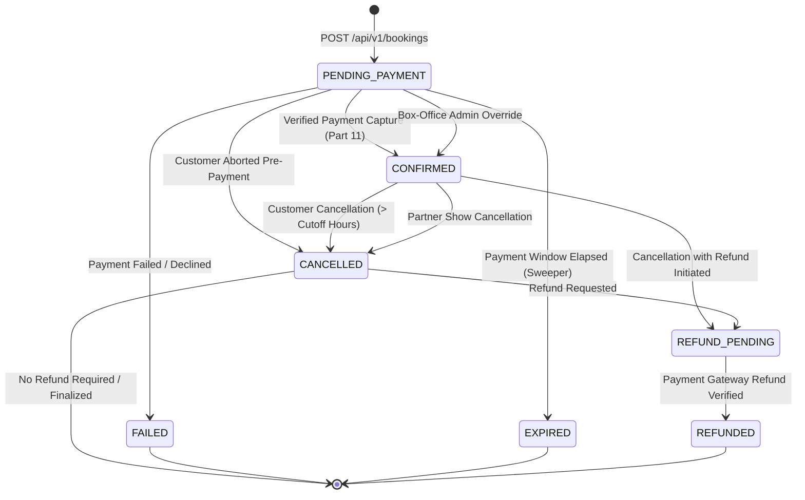

# Part 10 — Booking Lifecycle & State Machine Architecture

## 1. Executive Summary

A robust ticket booking platform requires a formally defined, tamper-proof state machine to govern the transitions of a booking across its lifetime. The **Booking Engine State Machine** guarantees that tickets cannot enter unauthorized states, ensures complete auditability of every state change, and strictly enforces the business invariant that no booking can become `CONFIRMED` without verified payment confirmation or explicit super-admin box-office override.

---

## 2. Booking Status States

The booking lifecycle is composed of 7 discrete statuses:

| Status Code | Type | Description |
| :--- | :--- | :--- |
| `PENDING_PAYMENT` | Initial / Active | Booking record created; immutable snapshots persisted; seats temporarily reserved awaiting payment gateway confirmation within the payment window. |
| `CONFIRMED` | Active / Durable | Payment successfully verified; seats durably locked to customer; QR entry ticket issued; admittance permissible. |
| `FAILED` | Terminal | Payment gateway reported payment failure or client explicitly abandoned checkout; seats immediately restored to available pool. |
| `EXPIRED` | Terminal | Payment countdown timer elapsed without payment confirmation; booking marked expired by sweeper service; seats released. |
| `CANCELLED` | Terminal | Booking voluntarily cancelled by customer or theatre partner prior to show cutoff time; seats released back to inventory. |
| `REFUND_PENDING` | Transitional | Booking cancelled or failed post-charge; refund request submitted to payment provider and queued for settlement. |
| `REFUNDED` | Terminal | Refund verified as credited back to the customer's payment source by gateway webhook or reconciliation worker. |

---

## 3. Formal State Transition Diagram



---

## 4. Transition Rules & Matrix

| From Status | Permissible Target Statuses | Validation Rules & Preconditions |
| :--- | :--- | :--- |
| `PENDING_PAYMENT` | `CONFIRMED`, `FAILED`, `EXPIRED`, `CANCELLED` | Transition to `CONFIRMED` requires `isVerifiedPayment === true` or actor `role === SUPER_ADMIN`. Transition to `EXPIRED` requires current time $\ge$ `expiresAt`. |
| `CONFIRMED` | `CANCELLED`, `REFUND_PENDING` | Transition to `CANCELLED` requires show start time $> \text{now} + 2 \text{ hours}$ (cancellation cutoff window). |
| `CANCELLED` | `REFUND_PENDING` | If refundable amount $> 0$ and payment was captured. |
| `REFUND_PENDING` | `REFUNDED` | Gateway webhook or manual admin reconciliation confirms refund settlement. |
| `FAILED` | *(None)* | Terminal state; immutable. |
| `EXPIRED` | *(None)* | Terminal state; immutable. |
| `REFUNDED` | *(None)* | Terminal state; immutable. |

---

## 5. Audit Logging & State History

Every state transition generates an immutable entry within the booking document's `statusHistory` array:

```json
{
  "status": "CONFIRMED",
  "changedAt": "2026-10-30T10:05:30.123Z",
  "changedBy": "65f1a2b3c4d5e6f7a8b9c001",
  "note": "Payment verified via webhook; booking confirmed"
}
```

This structure provides a complete chronological audit trail, guaranteeing compliance and dispute resolution capabilities.

