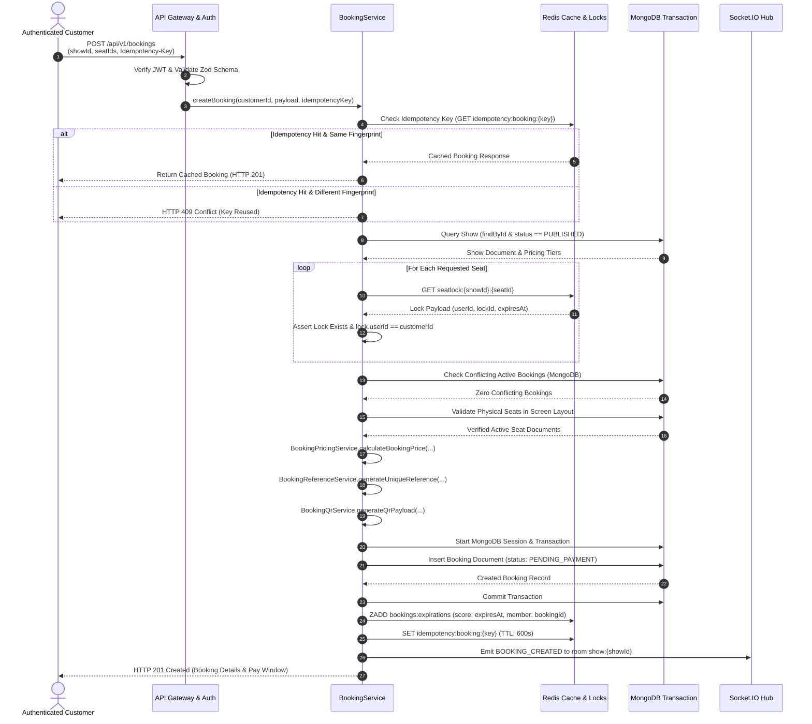

# Part 10 — Booking Creation Workflow & Checkout Processing

## 1. Executive Summary

The booking creation workflow represents the definitive conversion step in the ticket acquisition funnel. Triggered by `POST /api/v1/bookings`, the workflow coordinates verification of show viability, validation of active seat lock ownership, database conflict detection, physical auditorium validation, server-side dynamic pricing calculation, cryptographic QR token generation, and atomic persistence within a MongoDB transaction.

---

## 2. Step-by-Step Creation Sequence



---

## 3. Workflow Steps In Detail

### Step 1: Idempotency Verification
Before acquiring database resources, the system checks whether an `Idempotency-Key` or `x-idempotency-key` HTTP header was provided. If present, the service hashes the request payload (SHA-256 of `showId` and sorted `seatIds`) and queries Redis. If a matching cached response exists, it is returned immediately without duplicate database operations.

### Step 2: Show Viability & Timing
The show must exist, be in `PUBLISHED` status, and have a `startTime` strictly greater than `Date.now()`. Past or cancelled shows immediately abort with `HTTP 409 Conflict` (`SHOW_ALREADY_STARTED` or `SHOW_NOT_BOOKABLE`).

### Step 3: Temporary Seat Lock Ownership Validation
The service inspects Redis key `seatlock:{showId}:{seatId}` for every requested seat:
- If the key is missing or expired: Rejects with `HTTP 409 Conflict` (`LOCK_EXPIRED`).
- If the key exists but `userId !== customerId`: Rejects with `HTTP 403 Forbidden` (`LOCK_OWNERSHIP_MISMATCH`).

### Step 4: Durable Conflict Verification
Even with Redis locks in place, the system issues a database query against MongoDB to verify that no confirmed or pending-payment booking currently covers any of the requested seats:
```javascript
{
  showId,
  'seats.seatId': { $in: seatIds },
  status: { $in: ['PENDING_PAYMENT', 'CONFIRMED'] }
}
```

### Step 5: Physical Layout & Maintenance Verification
The system queries physical seats from the screen layout to verify:
1. Every requested seat exists and belongs to the show's specific `screenId` and `layoutVersion`.
2. No seat is flagged as `MAINTENANCE`, `BLOCKED`, or `INACTIVE`.

### Step 6: Server-Side Pricing Breakdown
Pricing is never accepted from the frontend. The server evaluates base prices from the show's published pricing tiers, applies the standard convenience fee (default ₹30/seat), calculates 18% GST on the convenience fee, and calculates the net payable amount using precision rounding.

### Step 7: Atomic Database Persistence
A new `Booking` document is persisted within an ACID MongoDB transaction session. The compound unique partial index `{ showId: 1, 'seats.seatId': 1 }` guarantees zero dual-booking at the database driver level.

### Step 8: Expiration Indexing & Real-Time Sync
The newly created booking ID is registered into the Redis Sorted Set `bookings:expirations` with its expiration Unix millisecond timestamp as the score, and a `booking:created` notification is broadcast to the Socket.IO show room.

