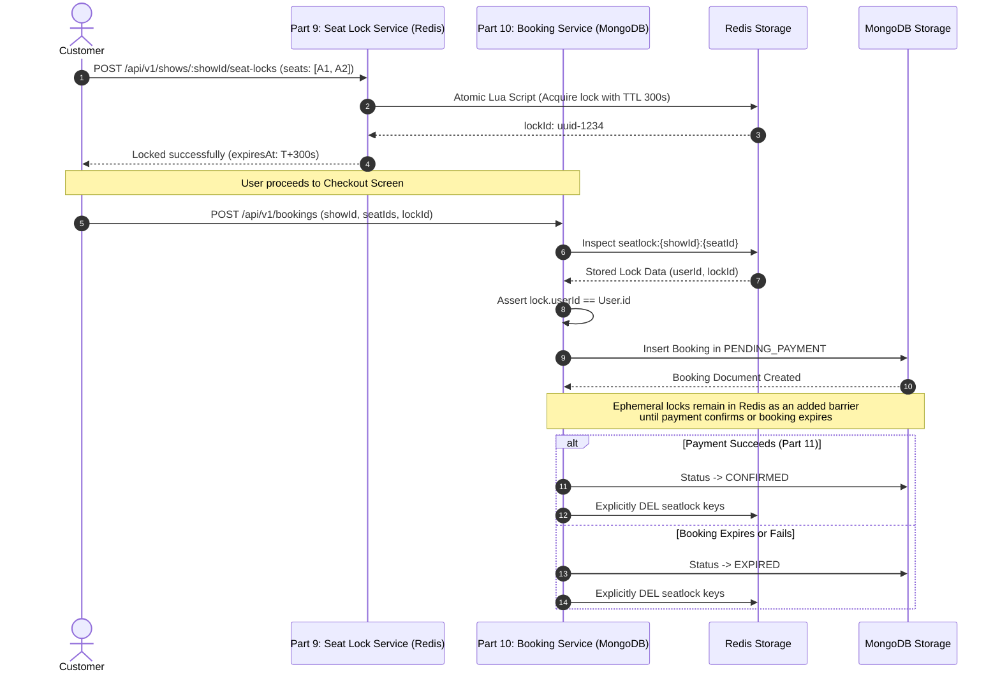

# Part 10 — Seat Lock Integration & Coordination

## 1. Executive Summary

A core architectural pillar of the ticketing engine is the smooth, fault-tolerant coordination between the **Temporary Seat Locking Subsystem (Part 9)** and the **Booking Engine Module (Part 10)**.

The system utilizes an optimistic two-phase reservation model:
- **Phase 1 (Ephemeral Hold - Redis)**: Handled in Part 9 via distributed Redis keys with TTLs to prevent screen hogging and race conditions while users browse.
- **Phase 2 (Durable Reservation - MongoDB)**: Transitioned in Part 10 when the user commits to checkout, migrating the ephemeral hold into a durable pending booking.

---

## 2. Lock-to-Booking Boundary Contract

---

## 3. Boundary Integration Invariants

1. **Lock Verification Before Write**:
   `BookingService` strictly forbids creating a booking for any seat that lacks an active, unexpired Redis lock owned by the requesting customer ID. Attempts to book unheld seats result in `HTTP 409 Conflict` (`LOCK_EXPIRED`).
2. **Lock Ownership Isolation**:
   If Customer A holds seat A1, and Customer B sends a booking payload attempting to include seat A1, `BookingService` detects the ownership mismatch and halts execution with `HTTP 403 Forbidden` (`LOCK_OWNERSHIP_MISMATCH`).
3. **Shared Booking Boundary Model**:
   To prevent schema drift or duplicate model registrations between Part 9 and Part 10, `apps/backend/src/modules/seat-locks/booking-boundary.model.js` re-exports the canonical `BookingModel` directly from `apps/backend/src/modules/bookings/model/booking.model.js`.
4. **Lock Cleanup on Transition**:
   When a booking transitions to a terminal state (`EXPIRED`, `CANCELLED`, `FAILED`) or advances to `CONFIRMED`, `BookingService` and `BookingExpirationService` execute atomic lock deletions via `redisLockService.releaseSeatLocks(...)`, ensuring seats are immediately returned to the bookable inventory pool.

