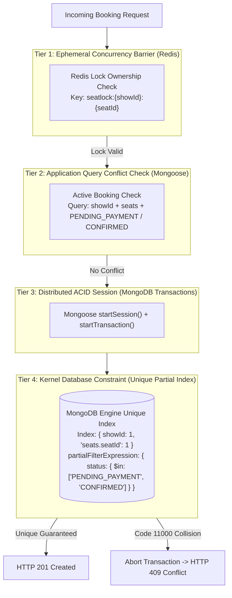

# Part 10 — Booking Consistency Strategy & Double-Booking Prevention

## 1. Executive Summary

In high-concurrency ticket booking engines, ensuring zero double-booking is the single most critical correctness requirement. Under peak load—such as opening sales for a major festival or blockbuster—hundreds of concurrent requests can hit the application server within milliseconds targeting identical seats.

This document details the multi-tiered consistency strategy implemented in Part 10 that provides mathematical guarantees against double booking across distributed application instances.

---

## 2. Multi-Tier Defense-in-Depth Architecture



---

## 3. Layer Breakdown

### Layer 1: Redis Distributed Lock Barrier
- **Mechanism**: Every seat must be temporarily locked by the user in Part 9 via atomic Redis Lua scripts.
- **Enforcement**: `BookingService` verifies that the key exists, has not expired, and `lockData.userId === customerId`.
- **Latency**: Sub-millisecond in-memory lookup.

### Layer 2: Read-Phase Application Conflict Detection
- **Mechanism**: Prior to entering the write phase, the repository queries MongoDB for existing active bookings overlapping the requested seats.
- **Filter**:
  ```javascript
  {
    showId: showObjectId,
    'seats.seatId': { $in: uniqueSeatObjectIds },
    status: { $in: ['PENDING_PAYMENT', 'CONFIRMED'] }
  }
  ```
- **Outcome**: Fast-fails without starting unnecessary database transactions if a seat has already been booked.

### Layer 3: MongoDB ACID Transaction Session
- **Mechanism**: Multi-document write isolation using `mongoose.startSession()` and `session.startTransaction()`.
- **Enforcement**: If any sub-operation fails, or if a database collision occurs, `session.abortTransaction()` is invoked, ensuring zero orphaned records or partial state updates.

### Layer 4: Compound Unique Partial Multikey Index
- **Index Definition**:
  ```javascript
  bookingSchema.index(
    { showId: 1, 'seats.seatId': 1 },
    {
      unique: true,
      partialFilterExpression: {
        status: { $in: ['PENDING_PAYMENT', 'CONFIRMED'] }
      },
      name: 'uniq_active_show_seat_reservation'
    }
  );
  ```
- **Why Partial Filter Expression?**
  - When a booking expires, fails, or is cancelled, its status changes to `EXPIRED`, `FAILED`, or `CANCELLED`.
  - Because of the `partialFilterExpression`, non-active statuses fall outside the index filter.
  - This instantly and automatically frees the seat for future bookings without manual index manipulation or document deletion.
- **Guarantee**: Even if two rogue threads bypass Redis and application read checks concurrently, MongoDB's storage engine enforces uniqueness at the write lock level, immediately throwing `MongoServerError: E11000 duplicate key error`.
- **Graceful Error Translation**: `BookingService` intercepts code `11000` and converts it into a clean `AppError` with `HTTP 409 Conflict` and code `SEAT_ALREADY_BOOKED`.

