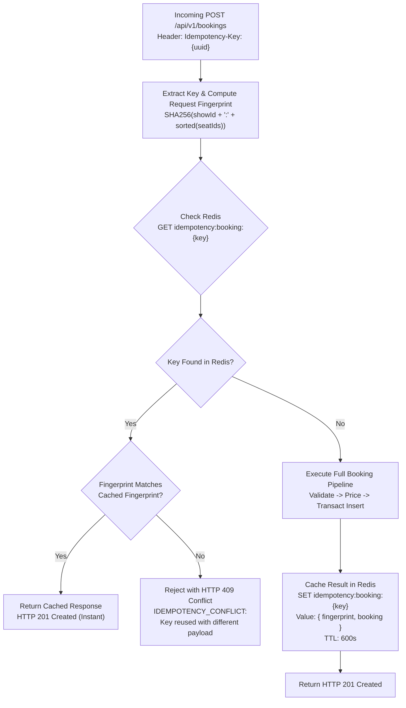

# Part 10 — Idempotency Architecture & Duplicate Request Protection

## 1. Executive Summary

In distributed mobile and web applications, transient network glitches, client retry loops, and impatient users double-tapping buttons can send duplicate booking creation requests. Without idempotency guarantees, duplicate requests could cause double charges, duplicate reservations, or erroneous conflict rejections.

Part 10 implements enterprise-grade idempotency using client-generated idempotency keys, SHA-256 payload fingerprinting, and distributed Redis response caching.

---

## 2. Idempotency Flow & Collision Detection



---

## 3. Implementation Details

### 1. Key Extraction & Precedence
The API gateway extracts the idempotency token from either the standard `Idempotency-Key` or custom `x-idempotency-key` HTTP headers:
```javascript
const idempotencyKey = req.headers['idempotency-key'] || req.headers['x-idempotency-key'];
```

### 2. Payload Fingerprinting
To prevent a malicious or buggy client from reusing the same idempotency key for completely different bookings (e.g. reserving Screen 1, then attempting to reserve Screen 2 using the same key), `BookingService` generates a SHA-256 hash of the normalized request parameters:
```javascript
static hashPayload(showId, seatIds) {
  const sorted = [...seatIds].map(s => s.toString()).sort();
  return crypto.createHash('sha256').update(`${showId}:${sorted.join(',')}`).digest('hex');
}
```

### 3. Collision Handling
When a cached key is found:
- **Identical Fingerprint**: The original booking response is returned verbatim with `HTTP 201 Created`. The customer receives their booking details without duplicate database records or double-charging risk.
- **Different Fingerprint**: Throws `AppError` with `HTTP 409 Conflict` and code `IDEMPOTENCY_CONFLICT`:
  *"Idempotency key has already been used with a different request payload"*.

### 4. Cache TTL & Storage
Responses are cached in Redis with a 600-second (10-minute) TTL:
```javascript
const redisKey = `idempotency:booking:${idempotencyKey}`;
await redisClient.set(
  redisKey,
  JSON.stringify({ fingerprint, booking: createdBooking }),
  'EX',
  600
);
```

