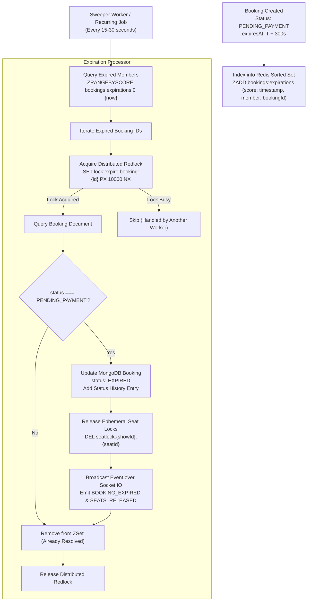

# Part 10 — Automated Booking Expiration & Inventory Reclamation

## 1. Executive Summary

When a customer initiates checkout, seats are reserved in the `PENDING_PAYMENT` state with a countdown window (default 300 seconds / 5 minutes). If payment is not completed before this window closes, the booking must expire and the reserved seats must be promptly returned to the bookable inventory pool.

The **BookingExpirationService** implements a distributed, low-overhead expiration engine utilizing a Redis Sorted Set index, distributed Redlock concurrency control, MongoDB atomic updates, and real-time Socket.IO broadcasts.

---

## 2. Expiration Architecture & Sweeper Engine



---

## 3. High-Concurrency Race Condition Protection

### The Payment vs Expiration Race
A notorious challenge in ticket booking engines is the race condition where:
1. Customer's payment is authorized at second 299.
2. The expiration worker triggers at second 300.
3. If not protected, the worker could mark the booking `EXPIRED` while the payment webhook is confirming it, leading to a paid user without a ticket.

### The Resolution Strategy
1. **Durable Database Guard**:
   Before updating status to `EXPIRED`, the service executes an atomic check:
   ```javascript
   if (booking.status !== BookingStatus.PENDING_PAYMENT) {
     logger.info('Booking is no longer PENDING_PAYMENT; skipping expiration');
     return false;
   }
   ```
2. **Distributed Mutex**:
   The worker acquires `lock:expire:booking:{id}` via Redis before processing.
3. **Optimistic Locking via Status Machine**:
   If the payment webhook confirms the booking first (status becomes `CONFIRMED`), the expiration worker detects the transition and safely aborts.
4. **Idempotent Removal from ZSet**:
   Once resolved, the booking is permanently removed from `bookings:expirations` via `ZREM`.

---

## 4. Performance & Scalability

| Metric | Target | Implementation |
| :--- | :--- | :--- |
| **ZSet Range Query** | $O(\log(N) + M)$ | `ZRANGEBYSCORE` fetches only expired IDs ($M$ items). |
| **Lock Cleanup Overhead** | $< 5\text{ms}$ | Pipelined `redisClient.del()` across all seats in the booking. |
| **Real-Time Push Latency** | $< 25\text{ms}$ | Socket.IO room broadcast to all viewers on the seating layout page. |
| **Crash Resilience** | 100% | If Redis restarts, a background MongoDB query finds orphaned `PENDING_PAYMENT` bookings where `expiresAt <= now`. |

