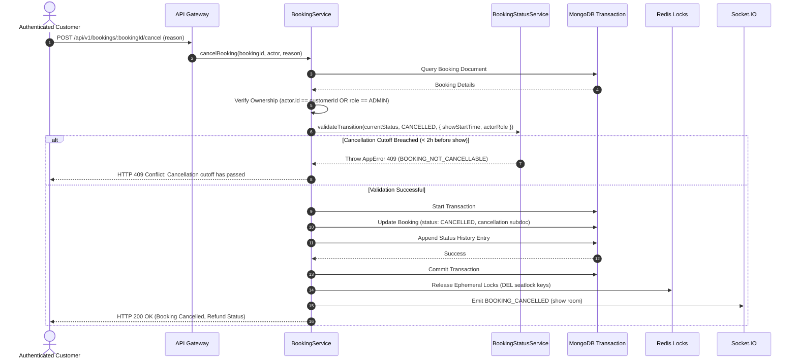

# Part 10 — Booking Cancellation & Refund Policy Engine

## 1. Executive Summary

Ticket cancellation in a corporate entertainment platform requires balancing customer flexibility with theatre operator revenue security. Part 10 establishes a configurable cancellation engine that evaluates show start times, cut-off windows, role authorizations, and inventory release protocols.

---

## 2. Cancellation Business Rules

| Rule | Specification | Enforcement Point |
| :--- | :--- | :--- |
| **Cancellation Cutoff Window** | Minimum 2 hours prior to show start time (`startTime - now >= 2h`) | `BookingStatusService.validateTransition` |
| **Past Show Protection** | Show has already commenced or concluded | Rejected with `HTTP 409 Conflict` (`SHOW_ALREADY_STARTED`) |
| **Status Preconditions** | Booking must currently be in `CONFIRMED` or `PENDING_PAYMENT` | Rejected with `HTTP 409 Conflict` (`BOOKING_NOT_CANCELLABLE`) |
| **Customer Ownership Isolation** | Customers can only cancel their own bookings (`customerId === req.user.id`) | `bookingRepository.findByIdAndCustomer` |
| **Theatre Owner Authority** | Venue operators can cancel shows/bookings for their screens; bypasses cutoff for emergency screenings | Checked against `req.user.partnerId` |
| **Admin Authority** | Super Admins can cancel any booking at any time | Role check `SUPER_ADMIN` |

---

## 3. Cancellation Workflow



---

## 4. Cancellation Subdocument Schema

When a booking is cancelled, the details of the cancellation are recorded immutably:

```json
{
  "cancelledAt": "2026-10-30T11:00:00.000Z",
  "cancelledBy": "65f1a2b3c4d5e6f7a8b9c001",
  "reason": "Change of travel plans",
  "cancellationFee": 0.0,
  "refundableAmount": 870.8,
  "refundStatus": "PENDING"
}
```

---

## 5. Inventory Restoration

Because of the MongoDB compound unique partial index on `{ showId: 1, 'seats.seatId': 1 }` with `partialFilterExpression: { status: { $in: ['PENDING_PAYMENT', 'CONFIRMED'] } }`:
- Transitioning the status to `CANCELLED` causes the document to automatically drop out of the partial index filter.
- The seats are instantly released at the database level and become available for other customers immediately.
- Real-time Socket.IO broadcasts alert active users on the seating chart that the seats have returned to `AVAILABLE`.

