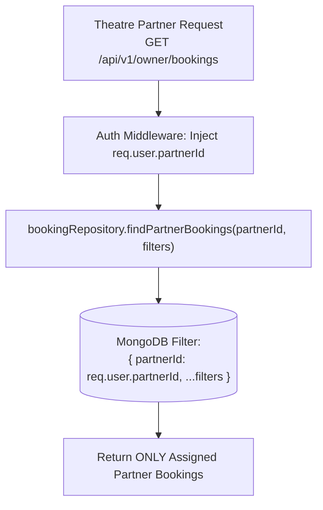

# Part 10 — Booking Security, BOLA Protection & Cryptographic QR Verification

## 1. Executive Summary

Ticketing systems are frequent targets of fraud, digital scalping, ticket forging, and Broken Object Level Authorization (BOLA/IDOR) exploits.

Part 10 incorporates multi-layered security controls to protect user privacy, guarantee tenant data isolation, safeguard payment pipelines, and provide anti-counterfeit entrance admittance validation.

---

## 2. Broken Object Level Authorization (BOLA / IDOR) Defense

### Threat Vector
In naive ticketing systems, a user with ID `user-1` can change the URL ID to `bookingId-99` belonging to `user-2` and read their full name, phone number, address, and ticket barcodes.

### Mitigation Architecture
1. **Scoped Repository Queries**:
   The data access layer strictly queries bookings using composite keys:
   ```javascript
   async findByIdAndCustomer(bookingId, customerId) {
     return BookingModel.findOne({
       _id: bookingId,
       customerId
     }).exec();
   }
   ```
2. **Access Control Evaluation**:
   If a customer attempts to query a booking owned by another account, the query returns `null`, and the service translates this into an unambiguous `HTTP 404 Not Found` (`BOOKING_NOT_FOUND`), preventing account enumeration or information leakage.
3. **Role-Based Exceptions**:
   - `SUPER_ADMIN` can access any booking across the system for customer support.
   - `THEATRE_OWNER` and `CINEMA_MANAGER` can access bookings only if `booking.partnerId === req.user.partnerId`.

---

## 3. Anti-Counterfeit Cryptographic QR Verification

### Design Principles
1. **No Sensitive PII**: QR payloads never contain raw passwords, session cookies, payment card numbers, or customer home addresses.
2. **Tamper-Evident HMAC-SHA256 Signatures**: Any modification to the ticket claims (e.g. changing seat count or booking reference) invalidates the signature immediately.
3. **Turnstile / Gate Verifiability**: Ushers and scanners can decode and verify authenticity in offline or connected modes.

### QR Token Structure
The QR token is constructed as a compact, base64url-encoded two-part token:
`base64url(payload) . base64url(hmacSignature)`

```json
// Payload Claims:
{
  "jti": "BK-20261030-W9K2Q1",
  "showId": "65f1a2b3c4d5e6f7a8b9c010",
  "totalSeats": 2,
  "seatSummary": "A1, A2",
  "status": "CONFIRMED",
  "iat": 1738428000
}
```

```javascript
// Signature Calculation:
const signature = crypto
  .createHmac('sha256', config.JWT_ACCESS_SECRET)
  .update(encodedPayload)
  .digest('base64url');
```

---

## 4. Multi-Tenant Partner Isolation



Even if a theatre partner attempts to query an ID belonging to another cinema chain, the tenant boundary filter blocks cross-tenant leakage.

