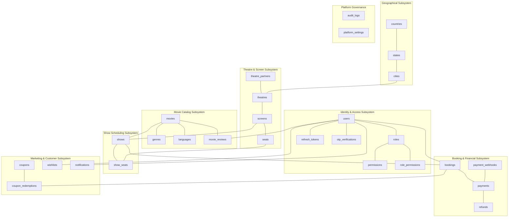

# 01. Database Collection Inventory & Architectural Rationale

## 1. Executive Summary & Modeling Philosophy

This document defines the complete collection inventory for the enterprise **Movie Ticket Booking Platform (BookMyShow Clone)**. The database design adopts a pragmatic hybrid data modeling approach on **MongoDB 7.0+** using **Mongoose**, balancing relational referential integrity where financial audits and inventory locks dictate, and selective denormalization where read throughput on high-frequency customer query patterns (movie browsing, showtime lookups, seat maps) requires sub-50ms latency.

### Core Architectural Decisions & Collection Rationalization
To prevent over-engineering and database bloat while maintaining strict normalization where needed, we have analyzed every proposed collection:

1. **Tenant Model (`theatre_partners` vs. `theatres`)**:
   - A dedicated `theatre_partners` collection represents the legal/commercial tenant entity (corporate registration, GSTIN, PAN, bank settlement accounts).
   - Physical cinemas (`theatres`) are child branches/properties owned by the tenant. This cleanly models multi-property chains (e.g., PVR owning 50 multiplexes across 15 cities) while maintaining absolute data isolation.
2. **Normalized vs. Embedded Seating Architecture**:
   - `screens` maintain physical auditorium specifications.
   - Master physical seats are defined in `seats` (row, col, category, physical type). Layout versions or templates are referenced to allow screens to alter their physical configuration without corrupting past bookings.
   - Show-specific dynamic seat states are persisted in `show_seats` with a compound unique index `{ show_id: 1, seat_id: 1 }` to enforce hard database-level double-booking prevention.
3. **Embedding vs. Referencing in Bookings**:
   - Customer tickets require immutable point-in-time snapshots. A customer's ticket must never mutate if a theatre renames a screen or a movie changes poster art.
   - Line items (`booking_seats`) are stored both as an embedded array within `bookings` for atomic, single-document read efficiency and snapshotting, while atomic inventory validation is backed by the `show_seats` collection.
4. **Pruning Redundant Candidate Collections**:
   - `theatre_branches`: Merged into `theatres` (since a theatre is already a physical branch of a `theatre_partner`).
   - `movie_media`: Embedded directly into `movies` (`posters`, `backdrops`, `trailers`) because media items have 1-to-1 lifecycle coupling with movies and never exceed the 16MB document limit.
   - `movie_cast`: Embedded within `movies` as structured sub-documents (`cast` and `crew`) with indexed names for search, eliminating unnecessary `$lookup` joins.
   - `locations`: Integrated into `cities` with neighborhood/sub-locality tags and `2dsphere` geospatial coordinates on `theatres`.
   - `seat_categories`: Standardized as an enum in application logic and modeled as an administrative master table for cinema-wide tier customization.
   - `show_seat_pricing`: Embedded inside `shows.pricing_tiers` since pricing is inherently scoped to an individual show instance.
   - `user_sessions`: Replaced by the cryptographically secure `refresh_tokens` store with TTL indexing.

---

## 2. Master Collection Inventory Table

The system comprises **24 purposeful collections**, categorized across 8 domain subsystems:

| Subsystem | Collection Name | Purpose / Primary Entity | Data Ownership | Lifecycle / Retention | Soft Delete |
| :--- | :--- | :--- | :--- | :--- | :---: |
| **Identity & Access** | `users` | User accounts, profiles, credentials, role links | System / User | Permanent | Yes |
| | `roles` | RBAC role definitions | Super Admin | Immutable | No |
| | `permissions` | Atomic functional capabilities | Super Admin | Immutable | No |
| | `role_permissions`| Many-to-many role-permission mapping | Super Admin | System | No |
| | `refresh_tokens` | Active JWT refresh token family store | Auth System | TTL (7 Days) | No |
| | `otp_verifications`| Phone/Email verification codes & rates | Auth System | TTL (10 Mins) | No |
| **Location & Geo** | `countries` | Supported sovereign nations | Super Admin | Static | Yes |
| | `states` | Administrative states / provinces | Super Admin | Static | Yes |
| | `cities` | Operational booking cities with geo-points | Super Admin | Operational | Yes |
| **Movie Catalog** | `movies` | Entertainment titles, cast, synopsis, runtime | Super Admin | Long-term | Yes |
| | `genres` | Standardized genre taxonomy | Super Admin | Static | Yes |
| | `languages` | Spoken & dubbed language taxonomy | Super Admin | Static | Yes |
| | `movie_reviews` | Verified viewer ratings, critiques, likes | Customer | Long-term | Yes |
| **Theatre & Screen**| `theatre_partners`| Commercial tenant entity (KYC, GST, Bank) | Partner Owner | Corporate | Yes |
| | `theatres` | Physical cinema properties in cities | Tenant Partner | Corporate | Yes |
| | `screens` | Auditoriums / halls within a cinema | Tenant Partner | Operational | Yes |
| | `seats` | Master physical seating grid template | Tenant Partner | Operational | No |
| **Show Scheduling** | `shows` | Scheduled movie screenings on a screen | Tenant Manager | Operational | Yes |
| | `show_seats` | Dynamic inventory state (Available, Locked, Booked)| Booking Engine | Ephemeral -> Show | No |
| **Booking & Sales** | `bookings` | Master financial ticket order & snapshot | Customer / Tenant | Ledger / Audit | No |
| **Payment Ledger** | `payments` | Gateway transaction records & raw audits | Financial System | Ledger / Tax | No |
| | `refunds` | Cancellation refunds & gateway payouts | Financial System | Ledger / Tax | No |
| | `payment_webhooks`| Raw idempotent gateway webhook intake | Gateway System | Retention (90 Days)| No |
| **Marketing & Ops** | `coupons` | Promotional voucher codes & rules | Admin / Marketing | Campaign | Yes |
| | `coupon_redemptions`| Tracking single/multi-use coupon claims | Customer | Ledger | No |
| | `wishlists` | Customer movie bookmarks & alerts | Customer | Dynamic | No |
| | `notifications` | In-app notification alerts | System / User | Retention (60 Days)| No |
| | `audit_logs` | Immutable administrative & security audit trail| Security System | Append-Only (7 Yrs)| No |
| | `platform_settings`| Global operational fees, GST, timeouts | Super Admin | Configuration | No |

---

## 3. High-Level Entity Domain Grouping

---

## 4. Key Modeling Guidelines & Standards Applied
- **Casing Convention**: Snake_case for collection names (`theatre_partners`, `show_seats`); camelCase for document fields (`partnerId`, `startTime`, `bookingReference`).
- **Primary Keys**: Native MongoDB `ObjectId` (`_id`) across all collections for natural BSON compact indexing and chronological sorting.
- **Audit Columns**: Every collection mandates `createdAt` and `updatedAt` managed automatically by Mongoose timestamps `{ timestamps: true }`.
- **Soft Deletion**: Applied to operational and master catalogs via `deletedAt: Date | null` and indexed with compound equality `{ isDeleted: false }` or `{ deletedAt: null }`. Hard deletion is strictly forbidden on financial, booking, and audit ledger collections.

