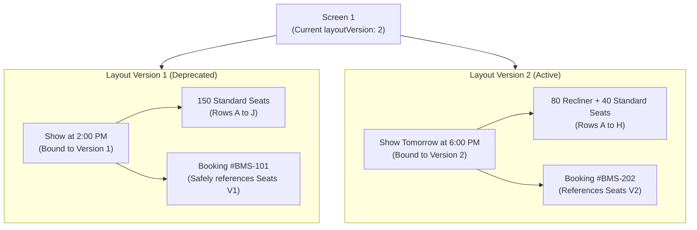

# 06. Seating Layout, Seat Categories & Auditorium Grid Schema

## 1. Architectural Strategy: Mutable Auditoriums vs. Immutable Bookings

In commercial cinema operations, auditorium configurations undergo physical changes:
- Upgrading standard chairs to luxury recliners (reducing capacity from 200 to 120 seats).
- Re-tiering categories (converting Row D from "Executive" to "Premium").
- Adding wheelchair bays or blocking broken chairs.

### The Layout Mutation Problem
If seat configurations are directly mutated in-place while future shows are actively being booked or past bookings are resting in historical ledgers:
1. Past customer tickets reference seat IDs that might no longer exist or now point to a different category.
2. Active shows with sold tickets might have their reserved chairs wiped or re-labeled.

### The Layout Versioning Solution
The platform implements **Immutable Layout Versioning**:


- When a screen's physical layout is edited, the screen's `layoutVersion` increments (e.g., from `1` to `2`).
- Newly created seats are stamped with `layoutVersion: 2`.
- Existing shows previously created with `layoutVersion: 1` continue operating on the Version 1 seat template without any disruption.
- Historical bookings retain their denormalized seat labels (`"Seat F12 (Recliner)"`) regardless of future auditorium renovations.

---

## 2. Collection Schemas

### 2.1 Collection: `seat_categories`

#### A. Purpose
Standard pricing and luxury tiers configured per cinema chain or platform-wide (e.g., Recliner, VIP, Platinum, Gold, Silver).

#### B. Field Specifications
| Field Name | Data Type | Required | Default | Validation & Constraints | Description |
| :--- | :--- | :---: | :---: | :--- | :--- |
| `_id` | `ObjectId` | Yes | Auto | BSON ObjectId | Primary Key |
| `partnerId` | `ObjectId` | No | `null` | Ref: `theatre_partners` | Null = platform default tier; Set = partner custom tier |
| `name` | `String` | Yes | - | Trim (e.g., "IMAX Recliner", "Royal Box") | Display tier name |
| `code` | `String` | Yes | - | UpperCase, alphanumeric | Unique category code (e.g., `RECLINER`, `GOLD`) |
| `colorHex` | `String` | Yes | `#3B82F6` | Valid Hex Color regex | UI color code for SVG canvas rendering |
| `basePrice` | `Number` | No | `250.0` | Positive currency amount | Default suggested price |
| `sortOrder` | `Number` | Yes | `1` | Integer | Display sequence on seat map (1 = Top/Best) |
| `isActive` | `Boolean` | Yes | `true` | Boolean | Operational status |

#### C. Unique Constraints & Indexes
- **Compound Unique**: `{ partnerId: 1, code: 1 }`.

---

### 2.2 Collection: `seats`

#### A. Purpose
Master repository of physical chairs belonging to an auditorium layout version.

#### B. Field Specifications
| Field Name | Data Type | Required | Default | Validation & Constraints | Description |
| :--- | :--- | :---: | :---: | :--- | :--- |
| `_id` | `ObjectId` | Yes | Auto | BSON ObjectId | Primary Key |
| `screenId` | `ObjectId` | Yes | - | Ref: `screens` | Parent auditorium |
| `theatreId` | `ObjectId` | Yes | - | Ref: `theatres` | Cinema complex (denormalized) |
| `partnerId` | `ObjectId` | Yes | - | Ref: `theatre_partners` | Tenant identity (denormalized) |
| `layoutVersion` | `Number` | Yes | `1` | Positive integer | Layout generation version |
| `rowLabel` | `String` | Yes | - | 1-2 Uppercase chars (e.g. "A", "B", "AA") | Row identifier |
| `columnNumber` | `Number` | Yes | - | Positive integer (e.g. 1, 2, 14) | Column position in row |
| `seatLabel` | `String` | Yes | - | E.g. "A12", "K4" | Display label printed on tickets |
| `categoryCode` | `String` | Yes | `STANDARD` | Enum / Ref: `RECLINER`, `VIP`, `PREMIUM`, `EXECUTIVE`, `STANDARD` | Seat tier |
| `type` | `String` | Yes | `REGULAR` | Enum: `REGULAR`, `PREMIUM`, `RECLINER`, `COUPLE_LEFT`, `COUPLE_RIGHT`, `WHEELCHAIR`, `AISLE_GAP` | Physical chair attributes |
| `gridRow` | `Number` | Yes | - | 0-indexed integer | Y-coordinate in SVG seat map matrix |
| `gridCol` | `Number` | Yes | - | 0-indexed integer | X-coordinate in SVG seat map matrix |
| `isAvailable` | `Boolean` | Yes | `true` | Boolean | False if chair is physically damaged |
| `accessibility`| `SubDoc` | No | - | Sub-document | Disability/wheelchair metadata |
| `createdAt` | `Date` | Yes | Auto | ISO Date | Timestamp |
| `updatedAt` | `Date` | Yes | Auto | ISO Date | Timestamp |

#### Sub-Document: `accessibility`
```typescript
{
  isWheelchairAccessible: Boolean, // True for ramp-accessible spaces
  hasCompanionSeat: Boolean,       // True if adjacent companion seat exists
  hasHearingLoop: Boolean          // Proximity to audio induction loops
}
```

#### C. Unique Constraints & Indexes
- **Compound Unique Layout Index**: `{ screenId: 1, layoutVersion: 1, seatLabel: 1 }` (Prevents duplicate seat labels in the same layout version).
- **Compound Grid Collision Index**: `{ screenId: 1, layoutVersion: 1, gridRow: 1, gridCol: 1 }` (Ensures two seats never occupy the exact same physical coordinates).
- **Fast Screen Template Query Index**: `{ screenId: 1, layoutVersion: 1, isAvailable: 1 }`.

#### D. Example JSON Document
```json
{
  "_id": { "$oid": "67220b3f81e7d23a104f9a50" },
  "screenId": { "$oid": "67220b3f81e7d23a104f9951" },
  "theatreId": { "$oid": "67220b3f81e7d23a104f9911" },
  "partnerId": { "$oid": "67220b3f81e7d23a104f9901" },
  "layoutVersion": 1,
  "rowLabel": "A",
  "columnNumber": 1,
  "seatLabel": "A1",
  "categoryCode": "RECLINER",
  "type": "RECLINER",
  "gridRow": 0,
  "gridCol": 2,
  "isAvailable": true,
  "accessibility": {
    "isWheelchairAccessible": false,
    "hasCompanionSeat": false,
    "hasHearingLoop": true
  },
  "createdAt": { "$date": "2026-03-01T10:00:00.000Z" },
  "updatedAt": { "$date": "2026-03-01T10:00:00.000Z" }
}
```

