# 07. Show Scheduling, Dynamic Pricing & Overlap Prevention

## 1. Schedule Conflict & Overlap Prevention Architecture

Scheduling errors (such as booking Screen 2 for two different movies at 4:00 PM) disrupt cinema operations and corrupt customer reservations. The platform enforces a **Two-Tier Overlap Defense System** combining database query validation with atomic transactional commitment.

### 1.1 Temporal Interval Collision Formula
Two shows $A$ and $B$ on the same screen collide if and only if their active intervals overlap:
$$\text{Collision} \iff (\text{Start}_A < \text{End}_B) \land (\text{End}_A > \text{Start}_B) \land (\text{Status} \ne \text{"CANCELLED"})$$

```mermaid
gantt
    title Screen Schedule Conflict Detection
    dateFormat HH:mm
    axisFormat %H:%M

    section Existing Show
    Inception (Screen 1) :done, 14:00, 16:45

    section Buffer (20m)
    Cleaning & Ads       :crit, 16:45, 17:05

    section Valid New Show
    Dune (Screen 1)     :active, 17:10, 19:50

    section Conflicting Show
    Interstellar Attempt :crit, 16:30, 19:15
```



### 1.2 Multi-Step Schedule Validation Pipeline
1. **Cleaning & Intermission Buffer**:
   $$\text{EndTime} = \text{StartTime} + \text{MovieDuration} + \text{TurnaroundBuffer (20 minutes)}$$
2. **Atomic Collision Check Query**:
   Prior to creating or publishing a show, the repository evaluates:
   ```typescript
   const conflictingShow = await ShowModel.findOne({
     screenId: newShow.screenId,
     status: { $ne: 'CANCELLED' },
     $or: [
       {
         startTime: { $lt: newShow.endTime },
         endTime: { $gt: newShow.startTime }
       }
     ]
   }).session(mongoSession);

   if (conflictingShow) {
     throw new ScheduleConflictException(
       `Screen is occupied by show "${conflictingShow._id}" from ${conflictingShow.startTime} to ${conflictingShow.endTime}`
     );
   }
   ```
3. **Optimistic Locking via Screen Versioning**:
   The `screens` document contains a `scheduleVersion` integer that increments atomically inside the same transaction when a new show is scheduled. If two managers attempt to schedule Screen 1 simultaneously, one transaction fails due to version mismatch and rolls back safely.

---

## 2. Collection Schemas

### 2.1 Collection: `shows`

#### A. Purpose
Represents a scheduled theatrical screening of a movie on a specific screen, binding pricing tiers, format, audio, and language.

#### B. Field Specifications
| Field Name | Data Type | Required | Default | Validation & Constraints | Description |
| :--- | :--- | :---: | :---: | :--- | :--- |
| `_id` | `ObjectId` | Yes | Auto | BSON ObjectId | Primary Key |
| `partnerId` | `ObjectId` | Yes | - | Ref: `theatre_partners` | Tenant identity |
| `theatreId` | `ObjectId` | Yes | - | Ref: `theatres` | Cinema property |
| `screenId` | `ObjectId` | Yes | - | Ref: `screens` | Auditorium hall |
| `movieId` | `ObjectId` | Yes | - | Ref: `movies` | Screened title |
| `cityId` | `ObjectId` | Yes | - | Ref: `cities` | Denormalized for zero-join city search |
| `showDate` | `Date` | Yes | - | ISO Date (Normalized to 00:00:00 UTC) | Calendar date of show |
| `startTime` | `Date` | Yes | - | ISO Date (Full UTC timestamp) | Screening start time |
| `endTime` | `Date` | Yes | - | ISO Date (Start + Runtime + Buffer) | Screening conclusion time |
| `format` | `String` | Yes | `2D` | Enum: `2D`, `3D`, `IMAX_2D`, `IMAX_3D`, `4DX` | Projection format |
| `language` | `String` | Yes | - | Ref / E.g. "Hindi", "English" | Spoken audio track |
| `subtitleLanguage`| `String`| No | `""` | E.g. "English", "None" | Subtitle availability |
| `layoutVersion` | `Number` | Yes | `1` | Positive integer | Screen layout version locked at creation |
| `pricingTiers` | `[SubDoc]`| Yes | - | Array of pricing tier objects | Price per seat category |
| `totalSeats` | `Number` | Yes | - | Positive integer | Total auditorium capacity |
| `availableSeats`| `Number` | Yes | - | Non-negative integer | Live available seats counter |
| `status` | `String` | Yes | `SCHEDULED` | Enum: `SCHEDULED`, `BOOKING_OPEN`, `HOUSEFULL`, `CANCELLED`, `COMPLETED` | Operational lifecycle |
| `cancellationReason`| `String`| No | `""` | Text | Reason if show is cancelled by theatre |
| `deletedAt` | `Date` | No | `null` | ISO Date | Soft delete marker |
| `createdAt` | `Date` | Yes | Auto | ISO Date | Timestamp |
| `updatedAt` | `Date` | Yes | Auto | ISO Date | Timestamp |

#### Sub-Document: `pricingTiers`
```typescript
{
  categoryCode: String, // E.g., "RECLINER", "VIP", "PREMIUM", "STANDARD"
  categoryName: String, // E.g., "Royal Recliner"
  basePrice: Number,    // E.g., 450.00
  taxPercent: Number    // E.g., 18.0 (GST)
}
```

#### C. Unique Constraints & Indexes
- **Collision Prevention Query Index**: `{ screenId: 1, startTime: 1, endTime: 1, status: 1 }`.
- **Customer City Showtime Index**: `{ cityId: 1, movieId: 1, showDate: 1, status: 1 }` (Primary customer listing endpoint).
- **Cinema Daily Schedule Index**: `{ theatreId: 1, showDate: 1, startTime: 1 }`.
- **Tenant Scope Index**: `{ partnerId: 1, showDate: -1 }`.

#### D. Example JSON Document
```json
{
  "_id": { "$oid": "67220b3f81e7d23a104f9b01" },
  "partnerId": { "$oid": "67220b3f81e7d23a104f9901" },
  "theatreId": { "$oid": "67220b3f81e7d23a104f9911" },
  "screenId": { "$oid": "67220b3f81e7d23a104f9951" },
  "movieId": { "$oid": "67220b3f81e7d23a104f981a" },
  "cityId": { "$oid": "67220b3f81e7d23a104f9701" },
  "showDate": { "$date": "2026-11-06T00:00:00.000Z" },
  "startTime": { "$date": "2026-11-06T19:30:00.000Z" },
  "endTime": { "$date": "2026-11-06T22:39:00.000Z" },
  "format": "IMAX_3D",
  "language": "English",
  "subtitleLanguage": "English",
  "layoutVersion": 1,
  "pricingTiers": [
    { "categoryCode": "RECLINER", "categoryName": "Royal Recliner", "basePrice": 650.0, "taxPercent": 18.0 },
    { "categoryCode": "PREMIUM", "categoryName": "Prime Plus", "basePrice": 400.0, "taxPercent": 18.0 },
    { "categoryCode": "STANDARD", "categoryName": "Classic", "basePrice": 250.0, "taxPercent": 18.0 }
  ],
  "totalSeats": 220,
  "availableSeats": 184,
  "status": "BOOKING_OPEN",
  "cancellationReason": "",
  "deletedAt": null,
  "createdAt": { "$date": "2026-10-25T14:00:00.000Z" },
  "updatedAt": { "$date": "2026-10-30T10:00:00.000Z" }
}
```

---

### 2.2 Collection: `show_seats`

#### A. Purpose
Represents the dynamic operational seat state for a specific show. Enables high-throughput atomic seat reservation validation without mutating the physical screen template.

#### B. Field Specifications
| Field Name | Data Type | Required | Default | Validation & Constraints | Description |
| :--- | :--- | :---: | :---: | :--- | :--- |
| `_id` | `ObjectId` | Yes | Auto | BSON ObjectId | Primary Key |
| `showId` | `ObjectId` | Yes | - | Ref: `shows` | Associated show instance |
| `seatId` | `ObjectId` | Yes | - | Ref: `seats` | Physical chair reference |
| `seatLabel` | `String` | Yes | - | Denormalized (e.g. "F12") | Fast visual rendering |
| `categoryCode` | `String` | Yes | - | Denormalized (e.g. "RECLINER") | Category tier |
| `price` | `Number` | Yes | - | Positive currency amount | Calculated final price |
| `status` | `String` | Yes | `AVAILABLE` | Enum: `AVAILABLE`, `LOCKED`, `BOOKED`, `BLOCKED` | Real-time seat inventory state |
| `lockedByUserId`| `ObjectId`| No | `null` | Ref: `users` | User holding temporary lock |
| `lockedUntil` | `Date` | No | `null` | ISO Date | TTL threshold for temporary hold |
| `bookingId` | `ObjectId` | No | `null` | Ref: `bookings` | Permanent booking reference |
| `version` | `Number` | Yes | `0` | Non-negative integer | Optimistic locking version key |
| `updatedAt` | `Date` | Yes | Auto | ISO Date | Timestamp |

#### C. Unique Constraints & Indexes
- **Compound Unique Inventory Index**: `{ showId: 1, seatId: 1 }` (Hard database-level barrier: ensures each physical seat has exactly ONE state entry per show).
- **Fast Show Seat Map Query Index**: `{ showId: 1, status: 1 }` (Returns all seats for customer SVG rendering).
- **Active Lock Cleanup Index**: `{ status: 1, lockedUntil: 1 }` (Background worker scans for expired holds).

