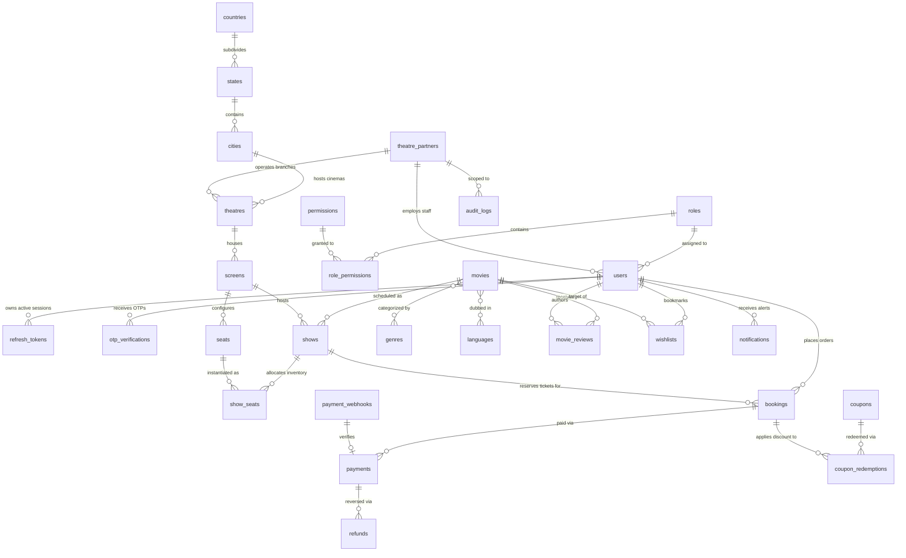
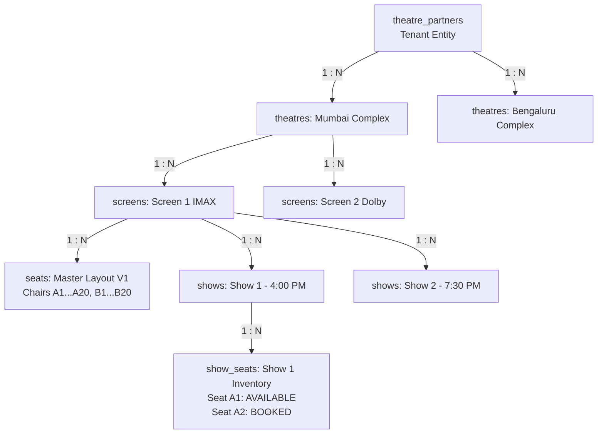
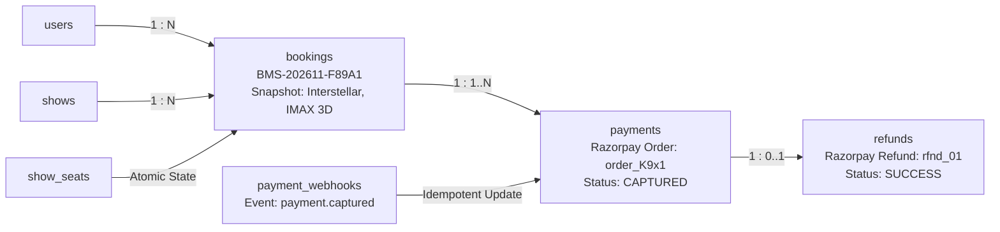

# 12. Entity Relationship Diagrams & Data Association Models

## 1. Subsystem Domain Entity Relationship Model

This document maps all database entity associations, foreign-key relationships, cardinality, and referential integrity constraints across the 24 operational collections.

---

## 2. Granular Subsystem Association Mappings

### 2.1 Multi-Tenant Cinema Hierarchy (1-to-Many Cascades)

### 2.2 Core Booking & Financial Settlement Chain

---

## 3. Referential Integrity & Cascade Policies

Because MongoDB does not enforce declarative database-level foreign keys (like SQL `ON DELETE CASCADE`), referential integrity is strictly enforced at the **Mongoose Application Middleware & Repository Layer**:

| Parent Collection | Child Collection | Foreign Key Field | Cascade Policy on Deletion / Soft Delete | Enforced Rule |
| :--- | :--- | :--- | :--- | :--- |
| `theatre_partners` | `theatres` | `partnerId` | **RESTRICT / SOFT CASCADE** | Cannot delete partner if active theatres exist. Soft deleting partner automatically soft-deletes child theatres and disables active shows. |
| `theatres` | `screens` | `theatreId` | **RESTRICT** | Cannot delete cinema if screens are defined. |
| `screens` | `shows` | `screenId` | **RESTRICT** | Cannot delete screen if future scheduled shows exist (`startTime > NOW()`). |
| `shows` | `show_seats` | `showId` | **CASCADE (System)** | When a show is archived, associated show_seats can be archived or dropped. |
| `shows` | `bookings` | `showId` | **RESTRICT** | Cannot delete or alter show if confirmed bookings exist (`bookings.status == 'CONFIRMED'`). Requires formal show cancellation workflow with refunds. |
| `bookings` | `payments` | `bookingId` | **IMMUTABLE RESTRICT** | Bookings and payments can never be hard-deleted (statutory financial ledger requirement). |
| `movies` | `shows` | `movieId` | **RESTRICT** | Cannot delete movie if active or upcoming shows exist. |
| `users` | `bookings` | `customerId` | **ANONYMIZE ON DELETE** | If customer invokes GDPR/DPDP "Right to be Forgotten", customer profile is soft-deleted, but financial booking documents retain transaction references with personal PII redacted. |

