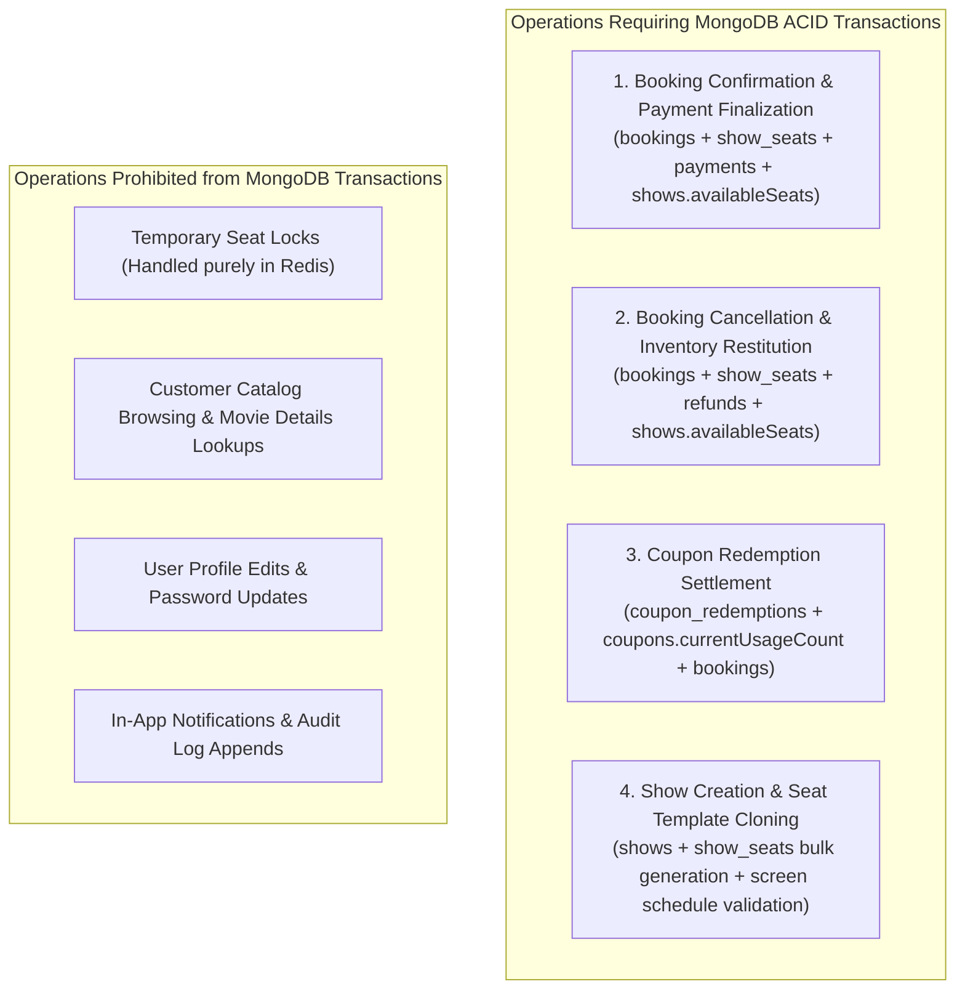
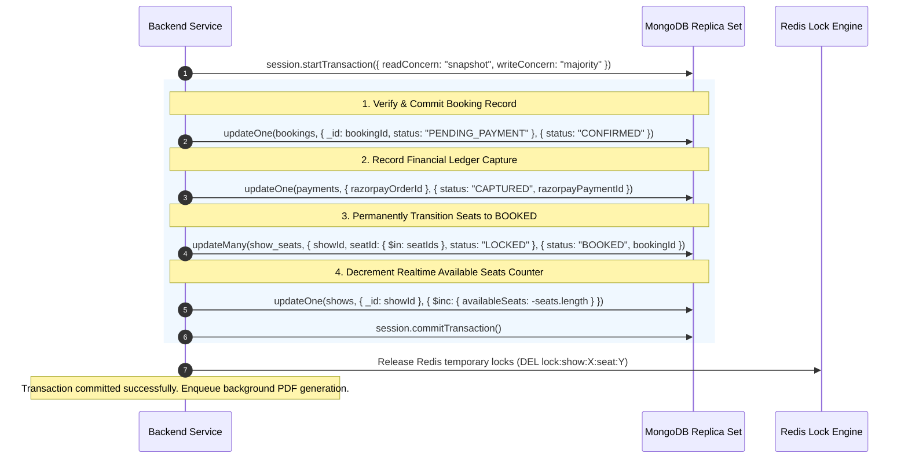
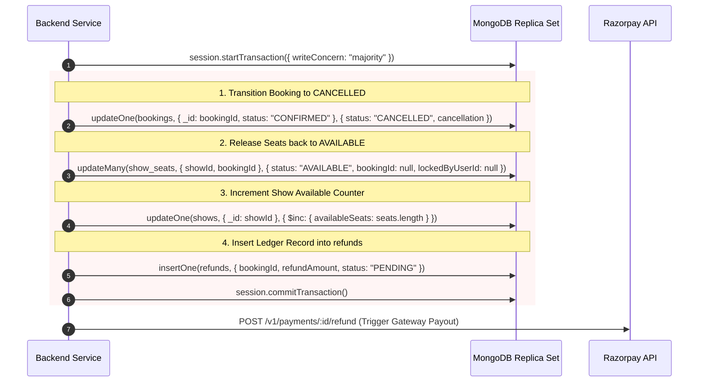

# 14. MongoDB Multi-Document ACID Transaction Strategy

## 1. When to Use (and When NOT to Use) Transactions

MongoDB 4.0+ provides multi-document ACID transactions across replica sets. However, transactions incur computational overhead (maintaining WiredTiger snapshot history, lock acquisition, and coordination latency). 

### Golden Rule of Transactions
> **ACID Transactions are strictly reserved for multi-collection financial and inventory state transitions where intermediate states must never be observable, and partial failure would violate business invariants.**
> Normal read operations, catalog browsing, user profile updates, and temporary Redis lock acquisitions must **never** run inside MongoDB transactions.



---

## 2. Deep Dive: The Critical Booking Confirmation Transaction

When a client payment is verified (or a webhook arrives), the platform executes a 4-step atomic transaction:



### Invariant Checks Inside the Transaction
If `show_seats.updateMany` modifies fewer documents than `seatIds.length` (indicating that one of the seats was tampered with or released), the service executes `session.abortTransaction()`. The booking transitions to `FAILED` and an automated full refund is queued.

---

## 3. Deep Dive: Booking Cancellation & Refund Transaction



---

## 4. Transient Transaction Error Handling & Retry Policies

In high-concurrency environments, MongoDB transactions can encounter **TransientTransactionError** (e.g. WriteConflict errors when two transactions touch the same document, or network glitches during replica step-down).

### Exponential Backoff Retry Pattern
```typescript
// Production Transaction Execution Wrapper
export const runInTransaction = async <T>(
  operation: (session: ClientSession) => Promise<T>,
  maxRetries = 3
): Promise<T> => {
  const session = await mongoose.startSession();
  let attempt = 0;

  while (attempt < maxRetries) {
    try {
      session.startTransaction({
        readPreference: 'primary',
        readConcern: { level: 'snapshot' },
        writeConcern: { w: 'majority', j: true }
      });

      const result = await operation(session);
      await session.commitTransaction();
      return result;
    } catch (error: any) {
      await session.abortTransaction();

      // Check if MongoDB labels this error as transient
      const isTransient = error.hasErrorLabel?.('TransientTransactionError');
      attempt++;

      if (isTransient && attempt < maxRetries) {
        // Exponential jittered backoff: 50ms, 150ms, 450ms
        const delay = Math.pow(3, attempt) * 50 + Math.random() * 50;
        await new Promise((resolve) => setTimeout(resolve, delay));
        continue;
      }
      throw error;
    } finally {
      if (attempt >= maxRetries || !session.inTransaction()) {
        await session.endSession();
      }
    }
  }
  throw new Error('Transaction failed after maximum retries');
};
```

---

## 5. Idempotency Guarantees Across Transactions

Every transactional operation accepts a client-provided or gateway-derived **Idempotency Key**:
- For Webhooks: `eventId` (from Razorpay).
- For Payments: `razorpay_order_id`.
- For Cancellations: `bookingReference + "-cancel"`.

Before executing the transaction, the service queries whether a completed record with that idempotency key already exists. If found, the prior result is returned immediately without re-executing mutations.

