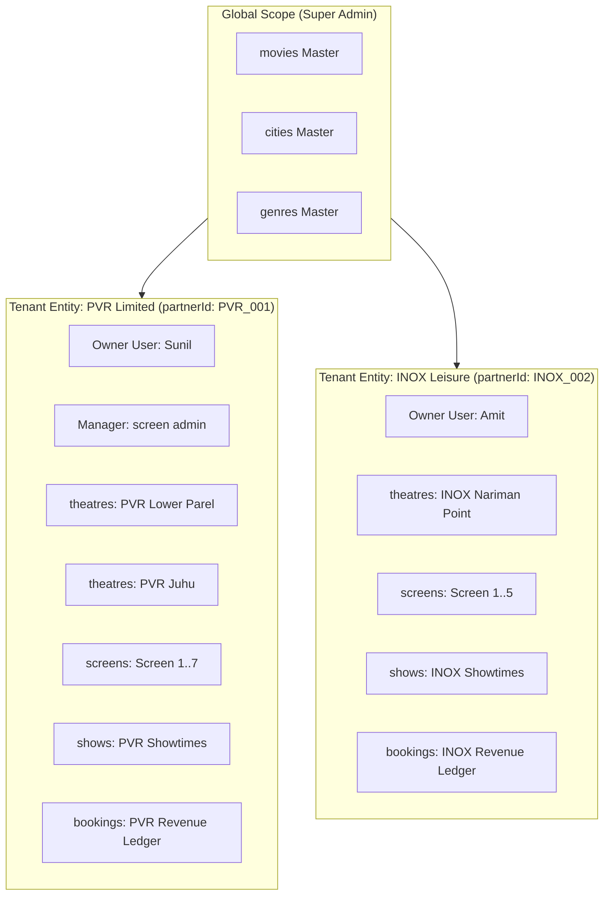

# 15. Multi-Tenant Database Architecture & Isolation Controls

## 1. Multi-Tenant Architectural Pattern: Shared Database, Tenant-Scoped Collections

In enterprise SaaS platforms handling millions of consumers and thousands of cinema partners, selecting the appropriate multi-tenancy model is fundamental.

### Evaluation of Multi-Tenancy Architecture Options

| Architecture Pattern | Description | Pros | Cons | Decision |
| :--- | :--- | :--- | :--- | :---: |
| **Database-Per-Tenant** | Each partner gets an isolated MongoDB database. | Absolute physical data separation. | Unsustainable connection pool sprawl; cannot run cross-tenant global movie search queries without querying 1,000 DBs. | **Rejected** |
| **Schema/Collection-Per-Tenant** | Each partner gets a separate prefixed collection (`theatre_pvr_shows`). | Moderate physical separation. | MongoDB limits total namespace collections; severe administrative overhead. | **Rejected** |
| **Shared Database, Shared Collections with Discriminator (`partnerId`)** | All tenants share collections (`theatres`, `shows`, `bookings`), with mandatory `partnerId` scoping. | Maximum efficiency; high query speed; trivial cross-theatre customer movie searches; clean connection pooling. | Requires strict, foolproof application and repository-level scoping guards. | **SELECTED** |

---

## 2. Tenant Identity & Boundary Definition



### Key Ownership Distinctions
- **`tenantId` (`partnerId`)**: The root commercial owner entity (`theatre_partners`). Represents the legal entity holding GSTIN, settlement bank accounts, and partner agreements.
- **`theatreId`**: A physical cinema building owned by the partner.
- **`ownerUserId`**: The primary administrative user account of the partner.
- **Resource Ownership Hierarchy**:
  $$\text{theatre\_partners} \longrightarrow \text{theatres} \longrightarrow \text{screens} \longrightarrow \text{shows} \longrightarrow \text{bookings}$$
  Every subordinate resource carries `partnerId` as a denormalized index key.

---

## 3. Defense Against Cross-Tenant Access (BOLA / IDOR)

A common vulnerability in multi-tenant systems is Broken Object Level Authorization (BOLA), where an attacker replaces `theatreId` in an API call to alter or view another cinema's data.

### 3.1 Repository-Level Automatic Tenancy Scoping
Tenancy scoping is enforced at the **Base Repository Layer**. Developers cannot accidentally execute an unscoped query:

```typescript
// Enforced Multi-Tenant Base Repository Pattern
export abstract class TenantScopedRepository<T extends Document> {
  protected constructor(protected readonly model: Model<T>) {}

  protected applyTenantScope(query: any, user: AuthenticatedUserContext): any {
    // 1. Super Admins bypass tenant filtering
    if (user.roleCode === 'SUPER_ADMIN') {
      return query;
    }

    // 2. Partners and Managers MUST carry a valid partnerId in token
    if (!user.partnerId) {
      throw new ForbiddenException('Tenant context missing from caller session');
    }

    // 3. Inject partnerId into the root filter
    return {
      ...query,
      partnerId: new Types.ObjectId(user.partnerId)
    };
  }

  async findOneScoped(filter: FilterQuery<T>, user: AuthenticatedUserContext): Promise<T | null> {
    const scopedFilter = this.applyTenantScope(filter, user);
    return this.model.findOne(scopedFilter);
  }

  async findScoped(filter: FilterQuery<T>, user: AuthenticatedUserContext): Promise<T[]> {
    const scopedFilter = this.applyTenantScope(filter, user);
    return this.model.find(scopedFilter);
  }
}
```

### 3.2 Tenant-Scoped Compound Indexes
To ensure high query performance and guarantee that tenant queries are index-covered, all partner-accessible collections maintain compound indexes prefixed by `partnerId`:
- `theatres`: `{ partnerId: 1, isActive: 1 }`
- `screens`: `{ partnerId: 1, theatreId: 1, isActive: 1 }`
- `shows`: `{ partnerId: 1, showDate: -1 }`
- `bookings`: `{ partnerId: 1, createdAt: -1 }`

---

## 4. Tenant Suspension & Data Deletion Behavior

### 4.1 Tenant Suspension Policy
If a cinema partner fails compliance audits or breaches platform terms:
1. Super Admin toggles `theatre_partners.kycStatus = "SUSPENDED"` and `isActive = false`.
2. An automated cascade hook updates all child cinemas:
   - Updates `theatres.updateMany({ partnerId }, { isActive: false })`.
   - Transitions future shows: `shows.updateMany({ partnerId, startTime: { $gt: NOW() } }, { status: "CANCELLED" })`.
   - Triggers automated full refunds for all affected customer bookings.
3. Partner staff JWT tokens are invalidated via Redis blocklist.

### 4.2 Data Deletion & Retention Policy
- Commercial partner deletion is implemented strictly as a **Soft Delete** (`deletedAt: Date`).
- **Zero Financial Data Deletion**: Bookings, payments, and settlements are permanently retained for 7 years to comply with statutory accounting and tax regulations.

