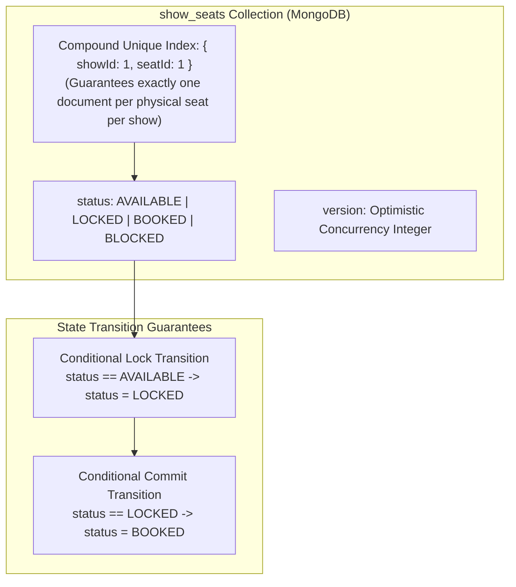
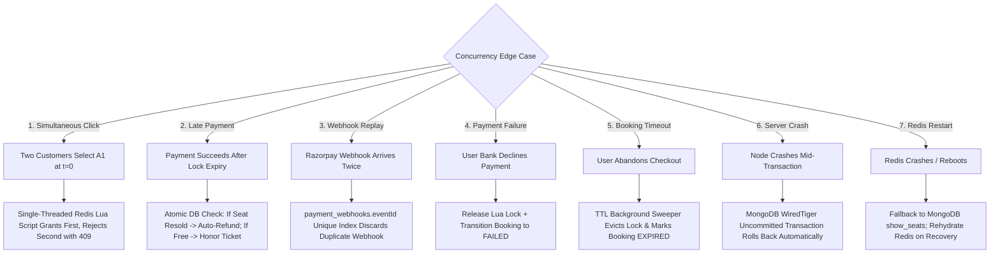

# 16. Seat Double-Booking Prevention & Durable Consistency Design

## 1. The Core Distributed Invariant: MongoDB as Durable Ground Truth

While Redis handles high-speed temporary seat holds (10-minute in-memory locks), **Redis is not the system of record**. In an enterprise booking platform:
1. **Redis is Volatile**: A Redis restart, memory eviction, or network partition must never compromise inventory state.
2. **MongoDB is the Durable System of Record**: The ultimate guarantee against double-booking is enforced at the database level using a **Compound Unique Index** on `show_seats` and **Atomic Conditional Transitions**.

$$\forall s \in \text{Seats}, \forall \text{show} \in \text{Shows}, \quad \text{Count}(\text{Bookings}(s, \text{show})) \le 1$$

---

## 2. Database Enforcement Architecture: The `show_seats` Model



### 2.1 The Atomic Conditional Lock Transition
When persisting a temporary lock to MongoDB, the update operation specifies strict preconditions:
```typescript
const result = await ShowSeatModel.updateOne(
  {
    showId: showId,
    seatId: seatId,
    status: 'AVAILABLE' // Strict precondition!
  },
  {
    $set: {
      status: 'LOCKED',
      lockedByUserId: customerId,
      lockedUntil: new Date(Date.now() + 600000) // 10 minutes TTL
    },
    $inc: { version: 1 }
  }
);

if (result.matchedCount === 0) {
  // Seat was either already LOCKED or BOOKED!
  throw new ConflictException(`Seat ${seatId} is unavailable`);
}
```

### 2.2 The Atomic Confirmation Commit Transition
Upon payment authorization, the seat transition from `LOCKED` to `BOOKED` runs inside a multi-document transaction:
```typescript
const result = await ShowSeatModel.updateOne(
  {
    showId: showId,
    seatId: seatId,
    status: 'LOCKED',
    lockedByUserId: customerId // Enforces caller ownership of the lock!
  },
  {
    $set: {
      status: 'BOOKED',
      bookingId: confirmedBookingId,
      lockedUntil: null
    },
    $inc: { version: 1 }
  },
  { session: mongoSession }
);
```
If another process tampered with or released the lock, `matchedCount === 0`, triggering an immediate transaction rollback and customer refund.

---

## 3. Deep Analysis of Critical Concurrency Edge Cases



### Edge Case 1: Two customers book the exact same seat at the exact same millisecond
- **Scenario**: Customer 1 and Customer 2 both click "Proceed" for Seat `B4` simultaneously.
- **Resolution**:
  1. Both requests invoke the Redis atomic Lua lock script.
  2. Because Redis processes commands sequentially on its single-threaded core, Customer 1's lock key is evaluated and written first. Customer 2's evaluation encounters the existing key and immediately aborts.
  3. Even if Redis was completely bypassed and both requests reached MongoDB directly, MongoDB's document-level lock evaluates Customer 1's update first: `status: 'AVAILABLE'` matches and transitions to `LOCKED`. Customer 2's query matches 0 documents because status is no longer `AVAILABLE`.
  4. Only Customer 1 gets the reservation; Customer 2 receives a `409 Conflict`.

### Edge Case 2: Payment succeeds on gateway AFTER the 10-minute lock expired
- **Scenario**: Customer locks Seat `E10` at 10:00 AM (expires 10:10 AM). Due to bank network delay, Razorpay captures payment at 10:11 AM. In the intervening minute, Seat `E10` was unlocked.
- **Resolution**:
  1. The webhook arrives at 10:11 AM and initiates the confirmation transaction.
  2. The transaction inspects `show_seats` for Seat `E10`:
     - **Branch A (Seat Still Free)**: If Seat `E10` has not yet been selected by anyone else (`status === 'AVAILABLE'`), the system honors the booking! It updates Seat `E10` directly to `BOOKED` and delivers the ticket. (Delightful user experience).
     - **Branch B (Seat Resold to Customer 2)**: If Seat `E10` was locked or booked by Customer 2, the conditional update matches 0 documents.
     - The transaction detects the conflict, marks Booking 1 as `EXPIRED_PAYMENT_CAPTURED`, and **automatically dispatches a 100% full refund via the Razorpay Refund API**. The customer is notified via SMS/Email: *"Your transaction timed out and the seat was taken. A full refund of ₹X has been refunded to your source account."*

### Edge Case 3: Duplicate payment webhook arrives from gateway
- **Scenario**: Network jitter causes Razorpay to transmit `payment.captured` twice within 300ms.
- **Resolution**:
  1. The raw payload is inserted into `payment_webhooks`.
  2. The second webhook insertion fails on the unique index `{ eventId: 1 }` or is flagged as `processed: true`.
  3. The service's booking update query specifies `{ _id: bookingId, status: 'PENDING_PAYMENT' }`. Because the first webhook already shifted status to `CONFIRMED`, the second query matches 0 documents and returns `200 OK` to Razorpay without re-executing ticket generation or customer emails.

### Edge Case 4: Payment fails or is declined
- **Scenario**: Customer's credit card fails 3D-Secure authentication.
- **Resolution**:
  1. Razorpay emits `payment.failed`.
  2. Temporary Redis lock is released via Lua script.
  3. Booking transitions to `FAILED`.
  4. Real-time Socket.IO event `SEATS_AVAILABLE` broadcasts to the show room.

### Edge Case 5: Booking timeout / user abandons cart
- **Scenario**: Customer locks seats and closes their laptop.
- **Resolution**:
  1. Redis key TTL (600s) elapses and Redis evicts the key.
  2. Background BullMQ cron scans for `bookings` where `status == 'PENDING_PAYMENT'` and `createdAt < NOW() - 12 minutes`.
  3. It updates `show_seats` back to `AVAILABLE` and marks the booking `EXPIRED`.

### Edge Case 6: Node.js worker crashes mid-transaction
- **Scenario**: Node process suffers an Out-Of-Memory kill while executing booking confirmation.
- **Resolution**:
  1. The TCP socket connection to MongoDB closes abruptly.
  2. The MongoDB cluster detects the dropped connection and automatically aborts the open transaction.
  3. All partial updates to `show_seats`, `payments`, and `bookings` roll back to their pre-transaction states. Zero corruption.

### Edge Case 7: Redis node crash and restart
- **Scenario**: Redis server reboots while 50 active temporary holds exist.
- **Resolution**:
  1. Redis AOF (Append-Only File) configured with `appendfsync everysec` recovers locks from disk.
  2. Any lost in-flight locks are reconciled from MongoDB: on startup, the backend queries `show_seats` where `status == 'LOCKED' AND lockedUntil > NOW()` and repopulates the Redis lock keys.

