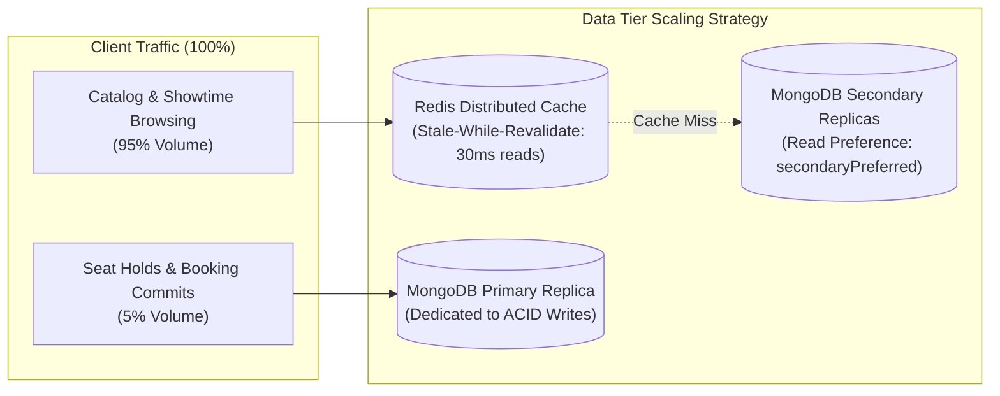
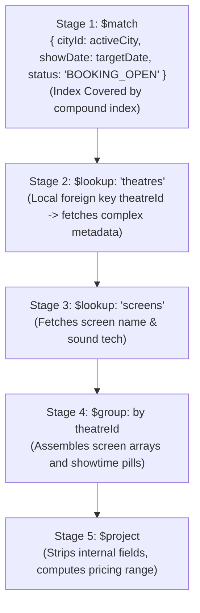
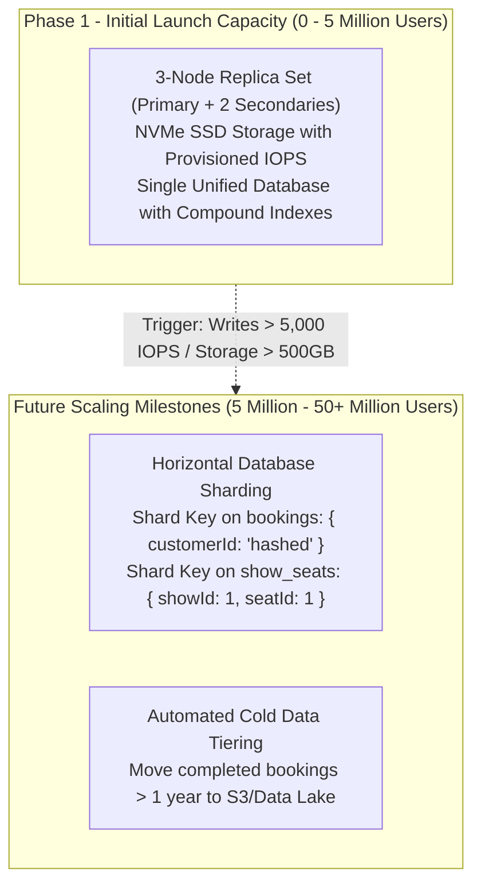

# 17. Database Performance, Scalability & Lifecycle Management

## 1. Workload Characterization: Read vs. Write Ratios

A national ticketing engine exhibits an extreme **asymmetric read-to-write ratio**:
- **Read Heavy Discovery Tier (95% of traffic)**: Catalog browsing, search autocomplete, city showtimes, and theatre layouts.
- **Write Heavy Transaction Tier (5% of traffic)**: Atomic seat locking, payment webhook capture, and booking settlements.



---

## 2. Advanced Pagination Strategy: Cursor vs. Offset

### 2.1 The Offset Pagination Anti-Pattern (`skip(N).limit(M)`)
Using `skip(100000).limit(20)` forces MongoDB WiredTiger to read and discard 100,000 documents from disk before returning 20 records. In high-volume collections (`bookings`, `audit_logs`, `movie_reviews`), this results in $O(N)$ CPU and I/O degradation.

### 2.2 Standardized Cursor-Based Pagination
For continuous feeds and customer transaction histories, the platform uses **Deterministic Keyset (Cursor) Pagination**:
```typescript
// Keyset Cursor Pagination Query Pattern
const fetchCustomerBookings = async (
  customerId: string,
  lastSeenId?: string,
  limit = 20
) => {
  const filter: any = { customerId: new Types.ObjectId(customerId) };

  if (lastSeenId) {
    // Uses the immutable monotonic _id for cursor evaluation
    filter._id = { $lt: new Types.ObjectId(lastSeenId) };
  }

  const records = await BookingModel.find(filter)
    .sort({ _id: -1 }) // Utilizes BSON timestamp prefix in ObjectId
    .limit(limit + 1)
    .lean();

  const hasNextPage = records.length > limit;
  const data = hasNextPage ? records.slice(0, limit) : records;
  const nextCursor = hasNextPage ? data[data.length - 1]._id : null;

  return { data, nextCursor, hasNextPage };
};
```
- **Performance Guarantee**: Constantly executes in $O(1)$ time regardless of whether browsing page 1 or page 5,000 because it jumps directly to the B-tree index node.

---

## 3. High-Volume Aggregation Pipeline Optimization

### The City Showtime Timetable Pipeline
The most computationally intensive query in the system aggregates all shows in a city, grouping them by Theatre $\to$ Screen $\to$ Showtimes for a given date.



#### Optimization Techniques Applied
1. **Match First**: The `$match` stage is always the very first stage, leveraging the compound index `{ cityId: 1, movieId: 1, showDate: 1, status: 1 }` to prune 99.9% of documents before memory processing.
2. **Lean Projection**: `$project` immediately discards unneeded audit timestamps and internal flags to minimize aggregation memory buffer consumption below the 100MB RAM ceiling.

---

## 4. Connection Pooling & Resource Sizing

In multi-instance containerized Node.js architectures, unmanaged connection pools exhaust MongoDB connection limits:
- **Max Pool Size**: Configured at `minPoolSize: 10, maxPoolSize: 50` per Node worker container.
- **Scaling Formula**:
  $$\text{Total Connections} = \text{Containers} \times \text{maxPoolSize}$$
  Running 10 Node API containers results in $10 \times 50 = 500$ concurrent database connections, well within MongoDB Atlas/Enterprise standard capacity (1,500 - 3,000 connections).
- **Socket Timeouts**: `serverSelectionTimeoutMS: 5000`, `socketTimeoutMS: 45000`.

---

## 5. Phased Roadmap: Initial Launch vs. Future Horizontal Sharding



### Initial Implementation (Current Scope)
- 3-Node MongoDB Replica Set (`P-S-S`).
- Secondary read offloading for catalog search.
- Redis response caching for movie listings.
- In-memory seat locking.

### Future Sharding Design (Architectural Blueprint Ready)
- **`bookings` Collection Shard Key**: `{ customerId: "hashed" }` guarantees perfectly uniform write distribution across shards.
- **`show_seats` Collection Shard Key**: `{ showId: 1, seatId: 1 }` co-locates all seats for a specific show onto the same shard, ensuring atomic lock queries never cross shard boundaries.

